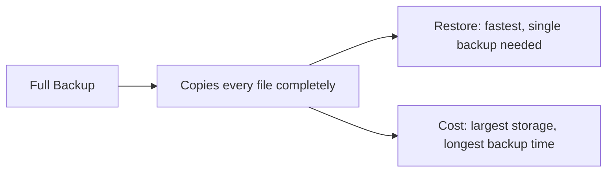
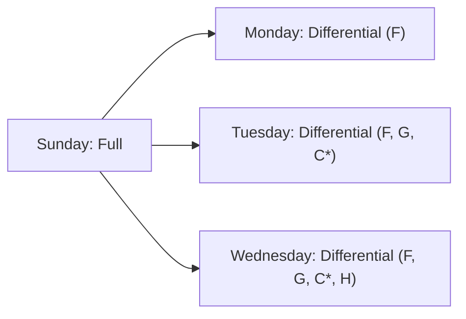
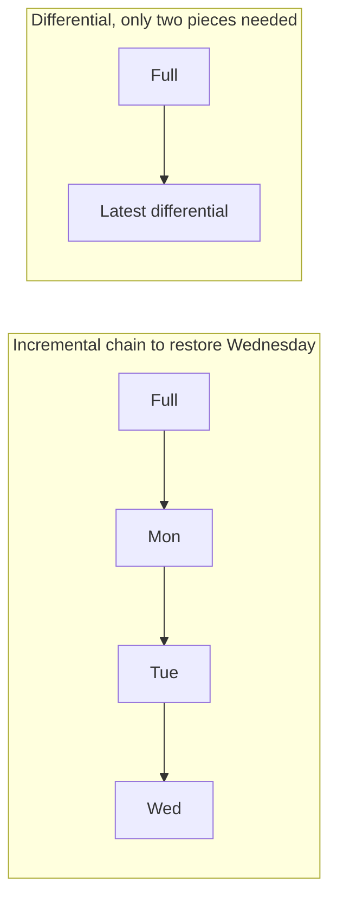
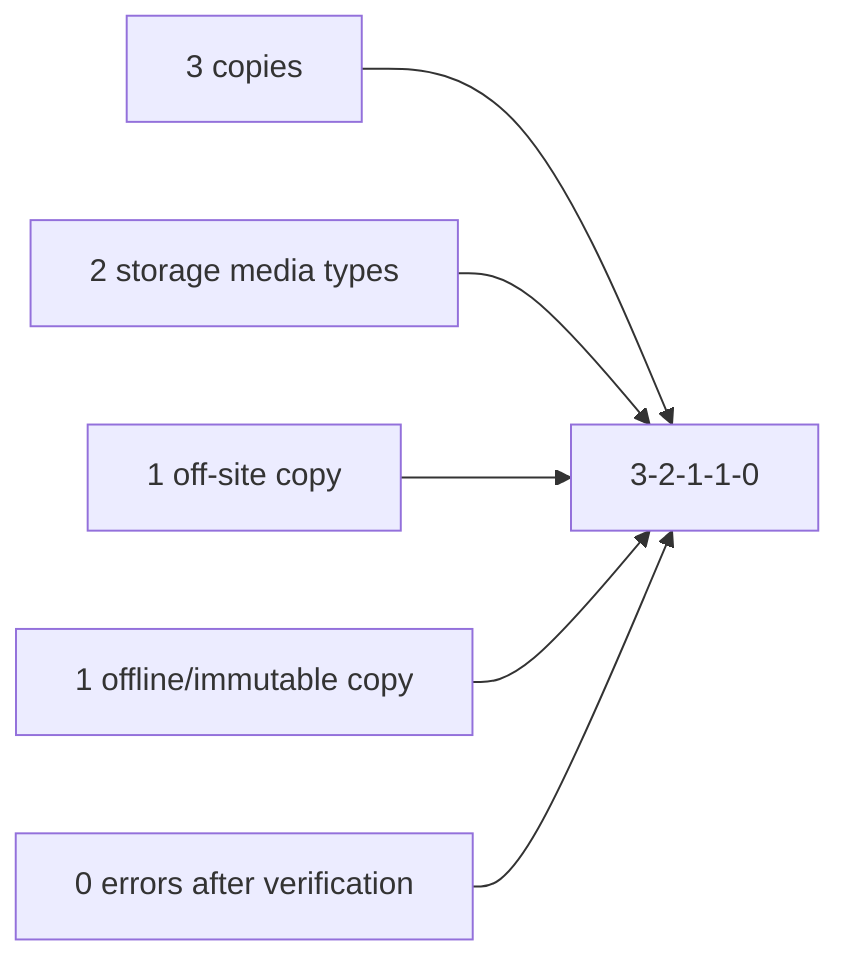
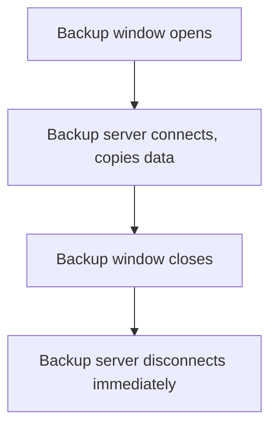
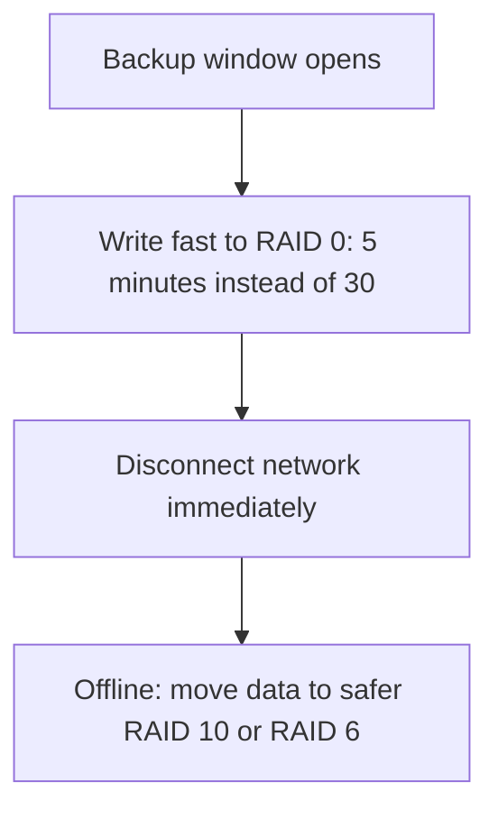
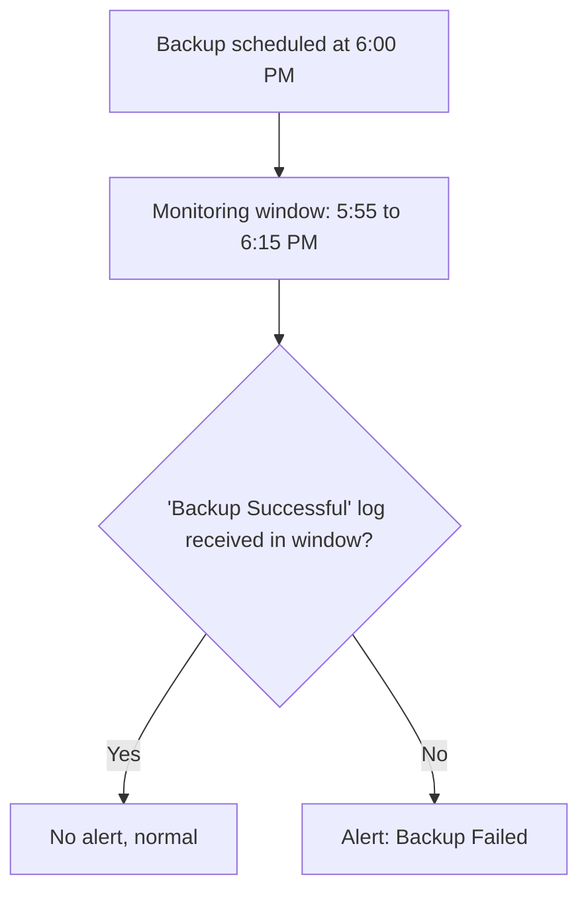
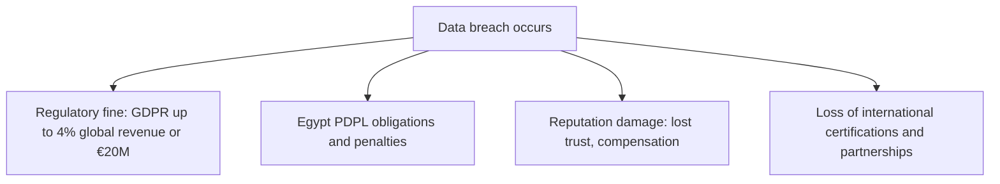

| Topic | Level | Reading Time | Prerequisites |
|---|---|---|---|
| Backup Strategies and Data Recovery | Intermediate | ~25 min | Redundancy, High Availability, and RAID |

> **The goal of this section:**  
> You'll understand the three types of backups and how to compare them, learn the 3-2-1 rule (and its modern version, 3-2-1-1-0) and the concepts of RPO and RTO, understand why backups must be isolated from the network and how to shrink the exposure window, learn how to verify that a backup actually worked, and finally understand the real legal and reputational cost of failing to protect data.


## Learning Objectives

By the end of this section, you will be able to:

- Define a **backup** and explain its purpose across deletion, theft, ransomware, corruption, and disaster scenarios.
- Compare **full**, **incremental**, and **differential** backups by speed, storage, and restore complexity.
- Apply the **3-2-1 rule** and its modern extension **3-2-1-1-0**, and define **RPO** and **RTO**.
- Explain why backups must be **isolated** from the network, and describe the connect-only-during-window solution.
- Describe a technique for **reducing the backup window** using fast RAID storage.
- Design a **SIEM rule** that detects a failed backup through the absence of an expected log.
- Explain the **regulatory and reputational cost** of a breach, including GDPR and Egypt's Personal Data Protection Law.

## Table of Contents

- [Learning Objectives](#learning-objectives)
- [What Is a Backup](#what-is-a-backup)
  - [Core Definition](#core-definition)
  - [Full Backup](#full-backup)
- [Incremental Backup](#incremental-backup)
  - [How It Works](#how-it-works)
  - [Advantages and Disadvantages](#advantages-and-disadvantages)
- [Differential Backup](#differential-backup)
  - [How It Works](#how-it-works-1)
  - [Advantages and Disadvantages](#advantages-and-disadvantages-1)
- [Full Versus Incremental Versus Differential](#full-versus-incremental-versus-differential)
- [Backup Best Practices: The 3-2-1 Rule](#backup-best-practices-the-3-2-1-rule)
  - [The Classic Rule](#the-classic-rule)
  - [The Modern Version: 3-2-1-1-0](#the-modern-version-3-2-1-1-0)
  - [RPO and RTO](#rpo-and-rto)
- [Backups Must Be Isolated](#backups-must-be-isolated)
  - [Why Isolation Matters](#why-isolation-matters)
  - [The Dilemma and Its Solution](#the-dilemma-and-its-solution)
  - [The Risk Window](#the-risk-window)
- [Reducing the Backup Window](#reducing-the-backup-window)
  - [The Two-Stage Technique](#the-two-stage-technique)
- [Verify That Backups Actually Work](#verify-that-backups-actually-work)
  - [The Scenario](#the-scenario)
  - [The Detection Steps](#the-detection-steps)
- [Encryption, Regulation, and Reputation](#encryption-regulation-and-reputation)
  - [Encrypt Data at Rest](#encrypt-data-at-rest)
  - [GDPR](#gdpr)
  - [Egypt's Personal Data Protection Law](#egypts-personal-data-protection-law)
  - [Reputation Damage](#reputation-damage)
- [Career Path Connections](#career-path-connections)
- [Key Terms Glossary](#key-terms-glossary)
- [Summary](#summary)

## What Is a Backup

### Core Definition

A **Backup** is a copy of your data stored somewhere else, so you can **restore it** after deletion, theft, encryption by ransomware, corruption, or a disaster.

### Full Backup

**Full backup (image backup)**: a complete copy of everything, or a snapshot of the entire system, similar to how a virtual machine snapshot captures the machine exactly as it is. If you restore the image, you get **the same computer with all its data**.

```text
Source: [File A][File B][File C][File D][File E]
Backup: [File A][File B][File C][File D][File E]  <- everything copied
```

| Aspect | Detail |
|---|---|
| Advantage | The simplest and fastest to restore |
| Disadvantage | Needs the most space and time, and costs the most |



Organizations usually run full backups **only for their most important systems**, because of the cost, the storage space, and restore-time constraints.

## Incremental Backup

### How It Works

An **Incremental backup** copies **only what has changed since the last backup of any type**.

| Day | Backup Type | What Is Stored |
|---|---|---|
| Sunday | Full | A, B, C, D, E |
| Monday | Incremental | F (new file) |
| Tuesday | Incremental | G (new), C* (C modified) |
| Wednesday | Incremental | H (new) |


### Advantages and Disadvantages

| Aspect | Detail |
|---|---|
| Advantage | The fastest backup, and the smallest storage footprint |
| Disadvantage | The slowest restore. To restore Wednesday, you need Sunday's full backup **plus** Monday, Tuesday, and Wednesday **in order**. If any link in the chain is missing or corrupted, the whole chain breaks |

> [!WARNING]
> If Tuesday's incremental backup is corrupted, the entire chain breaks from that point forward, meaning Wednesday cannot be restored either, even though Wednesday's own backup file is perfectly intact. This single weakness is the main reason many organizations choose differential backups despite the extra storage cost.

## Differential Backup

### How It Works

A **Differential backup** copies **everything that has changed since the last FULL backup**.

| Day | Backup Type | What Is Stored |
|---|---|---|
| Sunday | Full | A, B, C, D, E |
| Monday | Differential | F |
| Tuesday | Differential | F, G, C* |
| Wednesday | Differential | F, G, C*, H (cumulative) |



### Advantages and Disadvantages

| Aspect | Detail |
|---|---|
| Advantage | Faster restore than incremental. You only need the full backup **plus** the latest differential |
| Disadvantage | The backup size **grows every day** as the week goes on, so it takes more space and time |

## Full Versus Incremental Versus Differential

| | Full | Incremental | Differential |
|---|---|---|---|
| **Backup speed** | Slowest | Fastest | Medium |
| **Storage** | Largest | Smallest | Medium |
| **Restore speed** | Fastest | Slowest | Medium |
| **Restore needs** | A single copy | Full + all the incrementals | Full + the latest differential |



## Backup Best Practices: The 3-2-1 Rule

### The Classic Rule

| Component | Meaning |
|---|---|
| **3** | Copies of your data (the original + two backup copies) |
| **2** | Two different types of storage media |
| **1** | One copy stored off-site, or in another region |

### The Modern Version: 3-2-1-1-0

The modern version: **3-2-1-1-0**:

- One copy that is **offline or immutable** (can't be changed or deleted, not even by the administrator).
- **0 errors** after backup verification.



### RPO and RTO

| Term | Full Name | Meaning |
|---|---|---|
| **RPO** | Recovery Point Objective | The maximum amount of data you can afford to lose, measured in time. A daily backup gives an RPO of up to 24 hours |
| **RTO** | Recovery Time Objective | The maximum amount of downtime you can tolerate. It determines how quickly you need to restore |


> [!NOTE]
> RPO and RTO are business decisions, not purely technical ones. A daily backup schedule implies the business has accepted up to 24 hours of potential data loss as tolerable; if that is not acceptable, the backup frequency itself must change.

## Backups Must Be Isolated

### Why Isolation Matters

Backups exist to save you from ransomware, but **they can be destroyed by it too**.

Ransomware spreads across the network and looks for backups so it can **encrypt or wipe them first**. Some Egyptian organizations **were hit hard** because their backup servers were **inside the same compromised network**.

**Backup storage must be on an isolated or separate network.**

### The Dilemma and Its Solution

**The dilemma:** the backup server **has to connect to the network** to copy the data. **The solution:** connect it **only during the scheduled backup window**, and then disconnect it **immediately**.

Some highly sensitive environments (military, nuclear facilities) remain **disconnected from the internet** except when they need to receive updates.



### The Risk Window

**The risk during the connection:** the backup window is **a moment of exposure**. Skilled attackers have **waited inside the network** until the backup connection window opened, and then infected the backup files. **Monitor the network carefully during that window**.

Leaving the backup **permanently connected** (which some organizations do) **cancels out most of its value**.

> [!WARNING]
> A skilled attacker may wait days or weeks inside a network specifically for the backup connection window to open, then infect the backup files during that brief period. Network monitoring during the connection window is just as critical as the disconnect-after rule.

## Reducing the Backup Window

### The Two-Stage Technique

A clever technique: using **fast storage** during the backup window.

- Write the backup first to a **fast RAID** setup (for example, RAID 0, which is speed-only), so the copy finishes in **5 minutes instead of 30**.
- **Disconnect the network immediately** after copying.
- Then, **offline**, move the data to a safer, redundant arrangement (for example, **RAID 10** or **RAID 6**).



**The shorter the backup server stays connected, the lower the chance of it being targeted.**

> [!TIP]
> This is a great point to mention in an interview because it shows you understand both RAID and backup security together, not just one of them in isolation. For the full comparison of RAID levels and the RAID-is-not-a-backup distinction, see the Redundancy, High Availability, and RAID file.

## Verify That Backups Actually Work

**A backup that failed silently is useless, until the moment you need it.**

### The Scenario

The backup runs every day at 6:00 PM. The backup team doesn't work 24/7, but the **SOC does**. The backup system sends a log such as **"Backup Successful"**.

### The Detection Steps

- Send the **SIEM only the logs it needs**. The backup system can produce millions of logs per hour, and sending all of them would flood the SIEM.
- Create a **rule based on the absence of a log**: if no "Backup Successful" log arrives between **5:55 and 6:15 PM**, fire an alert called **"Backup Failed"**.
- Make the window start a little early and end a little late, to absorb any small timing differences.



> [!TIP]
> This "expected event did NOT happen" type of rule is very useful in SOC work generally, not just for backups. It is a distinct detection pattern from the usual "a bad event DID happen" alert logic, and worth naming explicitly in an interview.

## Encryption, Regulation, and Reputation

### Encrypt Data at Rest

Encrypt data at rest. If attackers steal encrypted files, **they won't be able to read them**.

### GDPR

Why spend millions on security and backups? **Because of the cost of failure**.

**GDPR** (the European data protection regulation) allows fines **of up to 4% of the company's annual global revenue** (or **€20 million**, whichever is higher) for serious violations. For a company earning billions, **that's an enormous fine**.

### Egypt's Personal Data Protection Law

**Egypt's Personal Data Protection Law (Law No. 151 of 2020)** also sets **obligations** on how organizations must protect personal data.

### Reputation Damage

**Reputational damage can cost more than the fine itself**. Customers, banks, and partners lose trust, and some companies have to pay compensation. Large organizations also need **international certifications** to work with global partners, and those certifications require **strong security controls**.



**Simply put: the security budget is small compared to the cost of a breach.**

> [!IMPORTANT]
> This connects directly back to the legal dimension of double extortion covered in Ransomware and the LockBit Case Study: a ransomware group publishing stolen customer data is not just a technical incident, it is the trigger that converts a breach into regulatory fines, compensation claims, and lost certifications all at once.

## Career Path Connections

| Career Path | How This Topic Applies |
|---|---|
| SOC Analyst | Builds and monitors "expected event did not happen" alert rules for backup failures as part of daily operations |
| Penetration Tester | Testing whether backup servers are genuinely isolated is a standard objective in internal ransomware-resilience assessments |
| GRC | RPO/RTO definitions, the 3-2-1-1-0 rule, and regulatory compliance (GDPR, Egypt PDPL) are core GRC responsibilities |
| Cloud Security | Cloud-native backup services implement immutable storage and geographic distribution as built-in features |

## Key Terms Glossary

| Term | Definition |
|---|---|
| Backup | A copy of data stored elsewhere, enabling restoration after loss |
| Full Backup | A complete copy of all data, fastest to restore but largest and slowest to create |
| Incremental Backup | A backup of only what changed since the last backup of any type |
| Differential Backup | A backup of everything changed since the last full backup, growing daily |
| 3-2-1 Rule | Three copies of data, on two media types, with one copy off-site |
| 3-2-1-1-0 | The modern extension adding one offline/immutable copy and zero verification errors |
| RPO | Recovery Point Objective, the maximum tolerable data loss, measured in time |
| RTO | Recovery Time Objective, the maximum tolerable downtime |
| Immutable Backup | A backup that cannot be altered or deleted, even by an administrator |
| GDPR | The European Union's General Data Protection Regulation |
| Egypt PDPL | Egypt's Personal Data Protection Law, Law No. 151 of 2020 |

## Summary

- **A backup restores data lost to deletion, theft, ransomware, corruption, or disaster.**
- **Full backups are simplest to restore but costliest to create:** they're usually used only for the most important systems.
- **Incremental backups are fastest to make but slowest and most fragile to restore:** the entire chain has to be intact.
- **Differential backups balance speed and restore simplicity:** but they grow larger every day.
- **The 3-2-1 rule, extended to 3-2-1-1-0, adds immutability and verification:** a protected offline copy and zero errors.
- **RPO and RTO translate backup strategy into business tolerance for loss and downtime.**
- **Backups must be isolated, connected only during the scheduled window:** leaving them permanently connected cancels their value as an independent layer of protection.
- **Fast RAID can shrink the exposure window, then data moves offline to safer storage.**
- **Silent backup failure is as dangerous as no backup:** "expected event did not happen" rules solve this problem.
- **The real cost of a breach is regulatory, reputational, and contractual, not just technical:** GDPR, Egypt PDPL, and the loss of trust and international certifications.

