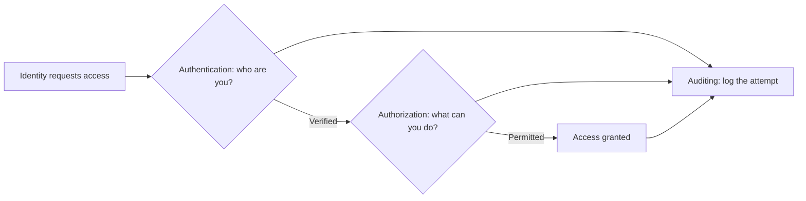
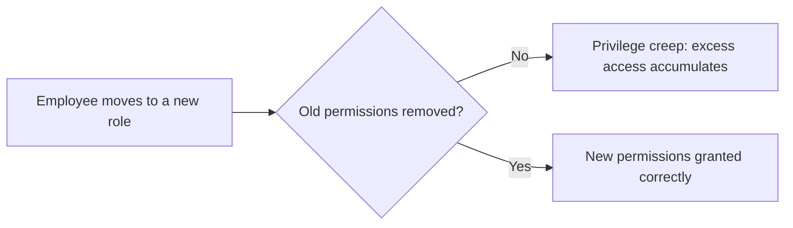
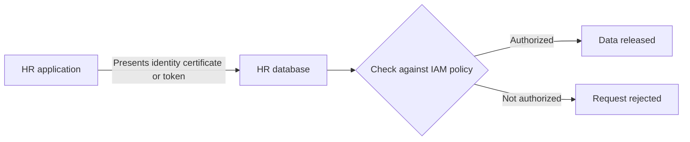
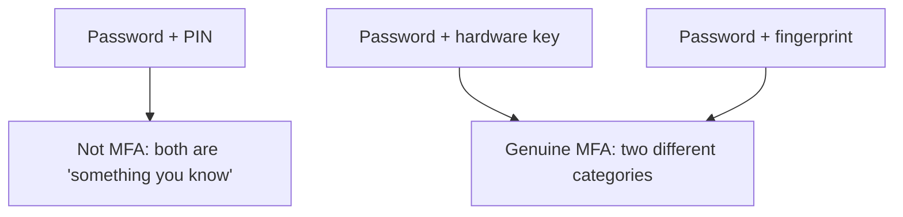
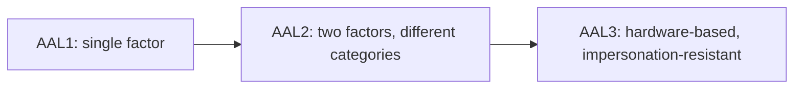
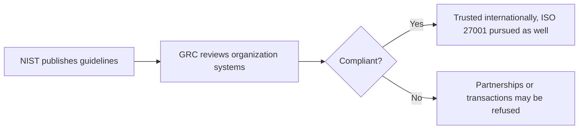
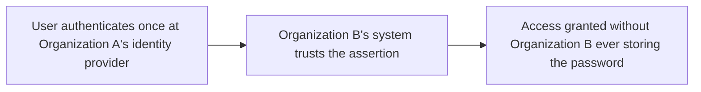
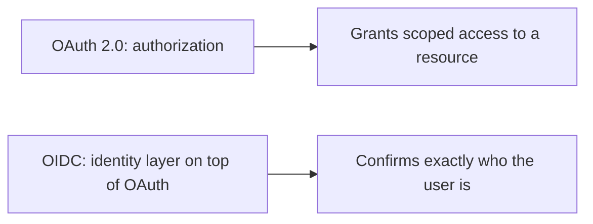

| Topic | Level | Reading Time | Prerequisites |
|---|---|---|---|
| Identity and Access Management (IAM) | Intermediate | ~20 min | Zero Trust Model, basic idea of authentication |

> **Goal of this section:**
>  You'll understand the IAM framework that determines who a person is, what they're allowed to do, and how that is proven and tracked, and how it applies not just to employees but to applications and services as well.

## Learning Objectives

By the end of this section, you will be able to:

- Define **IAM** and explain the three core questions it answers: authentication, authorization, and auditing.
- Describe the **Joiner, Mover, Leaver** lifecycle and explain how skipping a step causes **privilege creep** or delayed deprovisioning.
- Differentiate between how users authenticate and how applications and services authenticate to each other.
- List the three **authentication factors** and explain what makes something genuine **Multi-Factor Authentication (MFA)**.
- Explain the NIST **Authenticator Assurance Levels (AAL1, AAL2, AAL3)** and how sensitivity determines which level applies.
- Explain the role of **NIST** and **GRC** in compliance, and why standards like these matter for international business.
- Differentiate between **SSO**, **Federation**, and the protocols behind them: **SAML**, **OAuth 2.0**, and **OpenID Connect**.

## Table of Contents

- [Learning Objectives](#learning-objectives)
- [IAM: Definition and Purpose](#iam-definition-and-purpose)
  - [The Three Core Questions](#the-three-core-questions)
  - [The Business Reason It Exists](#the-business-reason-it-exists)
- [The IAM Lifecycle: Joiner, Mover, Leaver](#the-iam-lifecycle-joiner-mover-leaver)
  - [Joiner](#joiner)
  - [Mover](#mover)
  - [Leaver](#leaver)
- [Authenticating Users, Applications, and Services](#authenticating-users-applications-and-services)
  - [How Users Authenticate](#how-users-authenticate)
  - [How Applications and Services Authenticate](#how-applications-and-services-authenticate)
- [Authentication Factors](#authentication-factors)
  - [The Three Categories](#the-three-categories)
  - [What Makes MFA Genuine](#what-makes-mfa-genuine)
- [Authenticator Assurance Levels (AAL)](#authenticator-assurance-levels-aal)
- [NIST, GRC, and Compliance in Practice](#nist-grc-and-compliance-in-practice)
  - [What NIST Is](#what-nist-is)
  - [GRC's Job](#grcs-job)
  - [Real-World Consequences](#real-world-consequences)
- [Single Sign-On and Federation](#single-sign-on-and-federation)
  - [Single Sign-On (SSO)](#single-sign-on-sso)
  - [Federation](#federation)
- [The Protocols Behind SSO](#the-protocols-behind-sso)
  - [SAML](#saml)
  - [OAuth 2.0](#oauth-20)
  - [OpenID Connect (OIDC)](#openid-connect-oidc)
  - [The Key Distinction](#the-key-distinction)
- [Career Path Connections](#career-path-connections)
- [Key Terms Glossary](#key-terms-glossary)
- [Summary](#summary)

## IAM: Definition and Purpose

### The Three Core Questions

**Identity and Access Management (IAM)** is the framework that ensures the right entities, whether **people, applications, or services**, have the appropriate access to the right resources at the right time.

IAM answers three core questions:

| Question | Function | What It Establishes |
|---|---|---|
| Who are you? | **Authentication** | Proving identity, usually through a username and password or another credential |
| What are you allowed to do? | **Authorization** | Determining which resources and actions this identity is authorized to access |
| How do we prove and track this? | **Auditing** | Recording every authentication attempt and every access decision so it can be reviewed later |

### The Business Reason It Exists

Organizations need every person to have **exactly the access their job requires**, to be able to prove during an audit who accessed what, and to be able to remove that access **immediately** the moment someone changes roles or leaves the company.

> [!IMPORTANT]
> Authentication answers "who are you", authorization answers "what can you do". These are two different problems solved by two different mechanisms. A system can correctly identify someone and still let them do something they should not, if authorization is misconfigured.

## The IAM Lifecycle: Joiner, Mover, Leaver

### Joiner

When a new employee joins, they get an account with permissions that **exactly match their specific role**, nothing more.

### Mover

When an employee changes roles or departments, the old permissions must be removed and the new ones added. Skipping this step causes **privilege creep**: an employee accumulating permissions over time without actually needing them.

### Leaver

When an employee leaves the organization, their access must be revoked **immediately**. Delays in deprovisioning are a very common cause of security incidents involving former employees.

| Stage | Correct Action | Risk of Getting It Wrong |
|---|---|---|
| Joiner | Grant access matching the role, nothing more | Over-provisioning from day one |
| Mover | Remove old permissions, grant new ones | Privilege creep |
| Leaver | Revoke access immediately | Former employee retains access |

> [!WARNING]
> Delayed deprovisioning is one of the most common, and most preventable, causes of real-world security incidents. A former employee with lingering access is a risk that costs nothing to eliminate and everything to ignore.

## Authenticating Users, Applications, and Services

### How Users Authenticate

The most common method: **username and password**. IAM decides which systems and applications this user is allowed to open; for example, only HR staff can open the HR application.

### How Applications and Services Authenticate

Applications and services **don't type a username or password at all**. Instead, an application proves its identity to another application using a **certificate or token**.

Example: the HR application requests employee records from the HR database. The application presents its identity, and the database checks it against the IAM policy before releasing any data, rejecting any other application that isn't authorized to make this request.

> [!NOTE]
> This machine-to-machine authentication is exactly what makes microsegmentation and Zero Trust work at the application layer, covered in the Zero Trust Model file. Every service call is itself a request that gets evaluated, not just user logins.

## Authentication Factors

### The Three Categories

| Category | Examples |
|---|---|
| Something you know | Password, PIN, security question answer |
| Something you have | Phone with authenticator app, hardware security key, physical access card |
| Something you are | Biometric trait: fingerprint, face, iris scan |

### What Makes MFA Genuine

**Multi-Factor Authentication (MFA)** means combining **at least two different categories** of these factors.

> [!IMPORTANT]
> Two passwords together is not MFA, because both belong to the same category (something you know). Genuine MFA requires crossing category boundaries, for example a password plus a hardware key, or a password plus a fingerprint.

## Authenticator Assurance Levels (AAL)

**NIST** standards define three levels of authentication strength:

| Level | Requirement | Suitable For |
|---|---|---|
| AAL1 | A single factor is enough, usually just a username and password | Low-risk, low-importance systems |
| AAL2 | Two different categories are required: something you know (password) + something you have (OTP, authenticator app, hardware key) | Most typical business systems |
| AAL3 | The strongest level, requiring a hardware-based authenticator with **verifier impersonation resistance**, meaning it can't be fooled by a fake login page pretending to be the real service | Highly sensitive systems such as databases or banking systems |

The choice is determined by **the system's sensitivity**: highly critical systems run at AAL3, while a low-importance internal tool may only need AAL1.

## NIST, GRC, and Compliance in Practice

### What NIST Is

**NIST (National Institute of Standards and Technology)** is a US organization that publishes guidelines, such as exactly how to build a strong password, or how to determine the appropriate AAL for each system.

These guidelines **are not laws**; an organization is free to follow them or not. But banks, governments, and large organizations usually **must follow them** to be trusted globally.

### GRC's Job

**Governance, Risk, and Compliance (GRC)** staff read these standards, review the organization's actual systems, and confirm whether the organization is compliant, by determining the correct AAL for each application and directing teams to fix any gaps.

### Real-World Consequences

International banks usually **only deal** with other banks that comply with these standards; a bank that isn't fully compliant may **be refused** certain international transactions or partnerships.

A related, globally recognized certification: **ISO 27001**, the information security management certification that organizations pursue for the same reason: proving to the rest of the world that their security practices meet a trusted standard.

> [!NOTE]
> NIST guidelines are voluntary, but the practical consequences of non-compliance in regulated industries make them functionally mandatory for banks, governments, and large enterprises operating internationally.

## Single Sign-On and Federation

### Single Sign-On (SSO)

**SSO** lets a user authenticate **once** and then access multiple applications, without re-entering their credentials each time.

**Active Directory** is the best-known implementation of this: a central directory service where an account is created once and used to authenticate across many internal services.

SSO improves **security** (fewer passwords to be stolen or forgotten) and **user experience** at the same time.

### Federation

**Federation** lets a user from one organization log in to a system belonging to a **completely different** organization, using their original credentials, **without** that other organization ever storing the password.

This makes it possible for SSO to work **across organizational boundaries**, not just within one company's applications.

## The Protocols Behind SSO

### SAML

**SAML** is a relatively old protocol, based on **XML**, used mainly for logging in to enterprise applications through the browser.

### OAuth 2.0

**OAuth 2.0** is **not an authentication protocol** on its own; it is an **authorization** protocol: it lets an application access specific resources on behalf of a user without ever seeing the user's password.

### OpenID Connect (OIDC)

**OIDC** is built on top of OAuth 2.0 and adds an identity layer, so the application can also confirm **exactly who the user is**, not just what they're allowed to do.

### The Key Distinction

| Protocol | Answers | Type |
|---|---|---|
| SAML | Who you are, and which applications you're allowed to open | Authentication protocol, XML-based |
| OAuth 2.0 | What this application is allowed to do on my behalf | Authorization protocol |
| OIDC | Exactly who this user is | Identity layer built on top of OAuth 2.0 |

> [!IMPORTANT]
> OAuth answers "what can this application do on my behalf", while OIDC answers "who is this user". This distinction is commonly tested in interviews, and confusing the two is one of the most frequent mistakes in IAM discussions.

## Career Path Connections

| Career Path | How This Topic Applies |
|---|---|
| SOC Analyst | Investigates authentication anomalies and audit logs to detect compromised accounts |
| Penetration Tester | Tests for privilege creep, weak MFA implementations, and misconfigured OAuth scopes |
| GRC | Directly responsible for mapping AAL levels to systems and confirming NIST or ISO 27001 compliance |
| Cloud Security | Configures SSO, federation, and conditional access policies across cloud identity providers |

## Key Terms Glossary

| Term | Definition |
|---|---|
| IAM | Identity and Access Management, the framework ensuring the right entities have appropriate access to the right resources |
| Authentication | Proving identity, typically through a credential such as a password |
| Authorization | Determining which resources and actions a verified identity is permitted to access |
| Auditing | Recording authentication attempts and access decisions for later review |
| Joiner, Mover, Leaver | The IAM lifecycle stages for onboarding, role change, and offboarding |
| Privilege Creep | The gradual accumulation of unnecessary access permissions over time |
| Deprovisioning | Removing a user's access, ideally immediately upon departure or role change |
| MFA | Multi-Factor Authentication, combining at least two different authentication factor categories |
| AAL | Authenticator Assurance Level, a NIST scale (AAL1 to AAL3) rating authentication strength |
| Verifier Impersonation Resistance | A property of AAL3 authenticators that resists being tricked by fake login pages |
| NIST | National Institute of Standards and Technology, publishes security guidelines |
| GRC | Governance, Risk, and Compliance, the function that verifies an organization follows required standards |
| ISO 27001 | An internationally recognized information security management certification |
| SSO | Single Sign-On, authenticate once, access multiple applications |
| Federation | Allowing a user to authenticate across organizational boundaries using their original credentials |
| SAML | An XML-based protocol mainly used for browser-based enterprise application login |
| OAuth 2.0 | An authorization protocol letting an application access resources on a user's behalf |
| OIDC | OpenID Connect, an identity layer built on top of OAuth 2.0 |

## Summary

- **IAM answers three questions:** who you are (authentication), what you're allowed to do (authorization), and how we prove and track it (auditing).
- **The lifecycle has three stages:** Joiner, Mover, Leaver, and skipping any step causes privilege creep or delays in revoking access.
- **Users and services authenticate differently:** users with a username and password, while applications prove their identity with certificates or tokens.
- **Genuine MFA crosses categories:** something you know, have, or are, and combining two factors from the same category isn't genuine MFA.
- **AAL scales with sensitivity:** AAL1 for low-risk systems, AAL3 for critical systems such as banks and sensitive databases.
- **NIST guides, GRC verifies:** NIST publishes optional standards, GRC confirms the organization complies with them, and non-compliance has real international consequences.
- **SSO simplifies access, Federation extends it across organizations:** both are built on protocols such as SAML, OAuth 2.0, and OIDC.
- **OAuth and OIDC solve different problems:** OAuth grants permission; OIDC proves identity.

