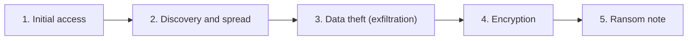
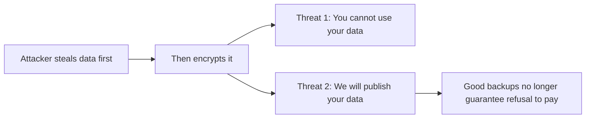
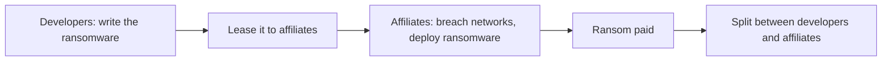
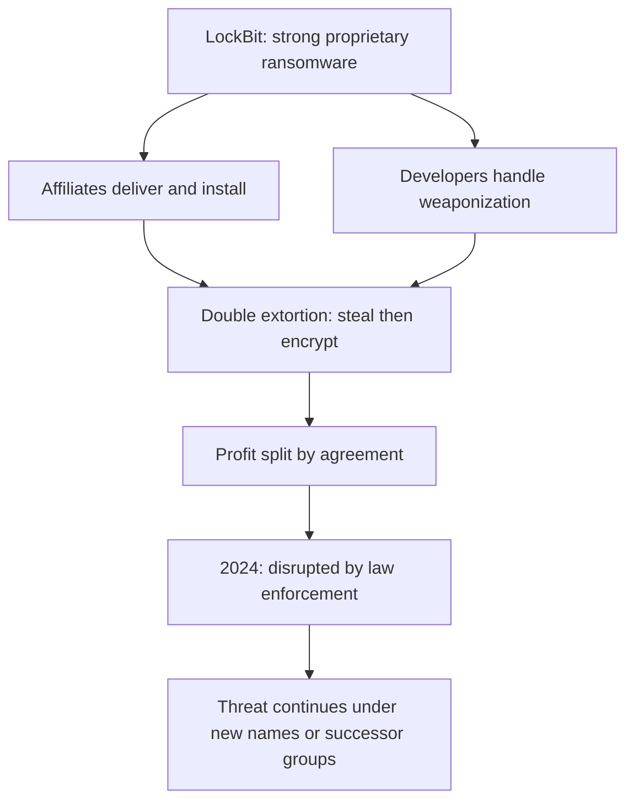
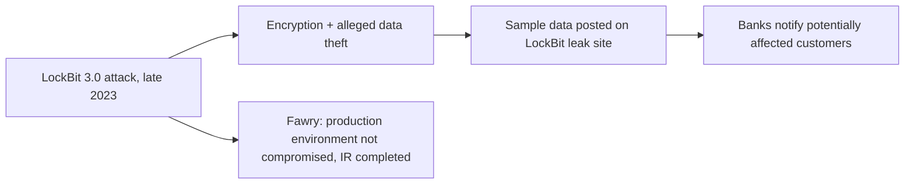
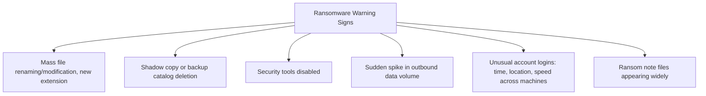

| Topic | Level | Reading Time | Prerequisites |
|---|---|---|---|
| Ransomware and the LockBit Case Study | Intermediate | ~20 min | Data Loss Fundamentals and DLP Operations |

> **Goal of this section:**
> You'll understand how a ransomware attack unfolds stage by stage and the difference between single and double extortion, you'll get to know the Ransomware-as-a-Service business model through a real case study of the LockBit group and its Egyptian victim Fawry, and you'll learn the warning signs a SOC analyst needs to watch for.

## Learning Objectives

By the end of this section, you will be able to:

- Define **ransomware** and list the five typical stages of a ransomware attack, in order.
- Differentiate between **single extortion** and **double extortion**, and explain why the latter defeats good backups.
- Define **Ransomware-as-a-Service (RaaS)** and explain the role split between developers and affiliates.
- Describe **LockBit** as a concrete example: its technical strength, its double extortion model, and why victims trusted it.
- Summarize the **LockBit and Fawry** case study and extract its lessons about incident transparency.
- List five other well-known ransomware groups and what each is known for.
- Identify concrete **warning signs of ransomware** a SOC analyst should watch for in logs and alerts.

## Table of Contents

- [Learning Objectives](#learning-objectives)
- [What Is Ransomware](#what-is-ransomware)
  - [Core Definition](#core-definition)
  - [Typical Stages of an Attack](#typical-stages-of-an-attack)
- [Single Versus Double Extortion](#single-versus-double-extortion)
  - [Single Extortion](#single-extortion)
  - [Double Extortion](#double-extortion)
  - [The Legal Dimension](#the-legal-dimension)
- [Ransomware-as-a-Service (RaaS)](#ransomware-as-a-service-raas)
  - [The Business Model](#the-business-model)
  - [The Cloud Analogy](#the-cloud-analogy)
- [LockBit](#lockbit)
  - [Technical Strength](#technical-strength)
  - [Affiliates and the Cyber Kill Chain](#affiliates-and-the-cyber-kill-chain)
  - [Double Extortion in Practice](#double-extortion-in-practice)
  - [Profit Sharing](#profit-sharing)
  - [Law Enforcement Disruption](#law-enforcement-disruption)
- [Why Victims Trusted LockBit](#why-victims-trusted-lockbit)
  - [Reliable Criminals](#reliable-criminals)
  - [Why This Reputation Mattered](#why-this-reputation-mattered)
- [Case Study: LockBit and Fawry (Egypt)](#case-study-lockbit-and-fawry-egypt)
  - [What Happened](#what-happened)
  - [Lessons](#lessons)
- [Other Well-Known Attacks and Groups](#other-well-known-attacks-and-groups)
- [Warning Signs of Ransomware for SOC Analysts](#warning-signs-of-ransomware-for-soc-analysts)
- [Career Path Connections](#career-path-connections)
- [Key Terms Glossary](#key-terms-glossary)
- [Summary](#summary)

## What Is Ransomware

### Core Definition

**Ransomware** is malware that encrypts the victim's files so they **can't use them**, and then demands payment (usually in cryptocurrency such as **Bitcoin**) in exchange for the decryption key.

### Typical Stages of an Attack

| # | Stage | What Happens |
|---|---|---|
| 1 | **Initial access** | Phishing, stolen passwords, or an unpatched vulnerability |
| 2 | **Discovery and spread** | The attacker explores the network and takes over more accounts |
| 3 | **Data theft (exfiltration)** | Valuable files are copied out |
| 4 | **Encryption** | The files are locked, and the backups are often deleted first |
| 5 | **Ransom note** | The victim is told how to pay, sometimes with a countdown and a threat |

> [!IMPORTANT]
> Notice that exfiltration (stage 3) happens before encryption (stage 4). This ordering is deliberate and is exactly what makes double extortion possible: the attacker secures a copy of the data before the victim even knows anything is wrong.

## Single Versus Double Extortion

### Single Extortion

The attacker **only encrypts**. If the victim has **good backups**, they can restore and refuse to pay.

### Double Extortion

The attacker **steals the data first, and then encrypts it**. Now there are **two separate threats**:

- You won't be able to use your data.
- We'll publish it.

The attackers' message, in effect: **"We've encrypted your data, and we have a copy of it."**

Even a victim with **excellent backups** may pay to prevent a public leak.

### The Legal Dimension

Double extortion also puts the victim in **legal trouble**, because leaking customer data can mean **fines from regulators** (see the Backup Strategies and Data Recovery note for GDPR details).

> [!NOTE]
> This legal consequence is why ransomware defense cannot stop at backup resilience alone. It must also include exfiltration detection, covered in the Data Exfiltration and DNS Tunneling file, since preventing the leak itself is now a separate, independent goal.

## Ransomware-as-a-Service (RaaS)

### The Business Model

**Ransomware-as-a-Service (RaaS)** is a **criminal business model**: developers write the ransomware and rent it out to **affiliates**, who actually carry out the attacks. The ransom is split between them.

- The developers are usually **skilled at writing code**.
- The affiliates are usually **skilled at breaking into networks**.

**Example: LockBit.**

### The Cloud Analogy

The phrase **"as a service"** is common in the cloud world (**SaaS, IaaS**): you receive a ready-made service instead of building it yourself. **RaaS is the same idea applied to crime**.

## LockBit

**LockBit** was one of the **most active and financially successful ransomware groups** in recent years.

### Technical Strength

They developed the ransomware **from scratch**, which is hard. Most amateur ransomware is poorly written and **can't decrypt after payment**. LockBit's tool was **powerful and reliable**.

### Affiliates and the Cyber Kill Chain

They worked with **affiliates** who delivered the ransomware into victims' networks. In the **cyber kill chain**:

| Phase | Who Handles It |
|---|---|
| Delivery and Installation | Affiliates |
| Weaponization (preparing the malicious code) | Developers |

### Double Extortion in Practice

They used **double extortion**: theft first, then encryption. Their message to victims, in effect: **"Don't just trust that we encrypted it; we're also holding your data."**

### Profit Sharing

The profits are split **by agreement**. For example, if a company paid **$10 million**, the developers and the affiliates would divide it **according to agreed percentages**.

### Law Enforcement Disruption

They were arrested and **disrupted by law enforcement in 2024**. Even so, **ransomware groups often come back under new names or are replaced by other groups**, so the threat is **ongoing**.

## Why Victims Trusted LockBit

### Reliable Criminals

LockBit had a **strange reputation as trustworthy criminals**:

- When the victim paid, LockBit **actually provided the decryption key**.
- They let victims **test-decrypt a sample file** to prove it worked.
- They had a **customer support team and chat**, which some victims described as **better than their phone company's support**.

### Why This Reputation Mattered

This credibility **increased the number of victims willing to pay**, which made the group **richer**.

> [!IMPORTANT]
> This "customer service" reputation is counterintuitive but structurally important: it was not a side effect, it was a deliberate business strategy. A ransomware group that reliably delivers decryption after payment increases its own revenue, because victims who believe payment "works" are far more likely to pay.

> [!TIP]
> This knowledge is directly useful in interviews. If asked "What is the most well-known ransomware group you have heard of?", describe LockBit: its RaaS model, and its double extortion technique.

## Case Study: LockBit and Fawry (Egypt)

### What Happened

In **late 2023**, the **LockBit 3.0** group encrypted files and reportedly stole some data from **Fawry**, an Egyptian digital payments platform.

- Samples of stolen personal data were **published on LockBit's leak site**.
- Banks advised some customers that their information might have been **affected**.
- Fawry stated that its **production environment was not involved in the breach**, and it carried out incident response and cleanup with cybersecurity experts.

### Lessons

- **Attackers often publish samples as proof to increase the pressure.**
- **Companies sometimes deny or downplay the incident, but a leak site can contradict them.** Hiding the incident often **increases the reputational damage**.
- **When a well-known Egyptian company is hit, every organization in the region worries about the same group.**

> [!WARNING]
> Companies sometimes minimize incidents publicly, but a ransomware group's leak site is independent evidence that can directly contradict a company's official statement. This gap between the public narrative and the leak site is itself a reputational risk, separate from the technical breach.

## Other Well-Known Attacks and Groups

| Name | What It Is | Why It Matters |
|---|---|---|
| **WannaCry (2017)** | A ransomware worm exploiting an SMB vulnerability | Spread worldwide within hours, hit hospitals |
| **NotPetya (2017)** | A wiper disguised as ransomware | Destroyed data, cost Maersk hundreds of millions |
| **REvil (Sodinokibi)** | A RaaS group | Attacked software supply chains (example: Kaseya) |
| **Conti** | A RaaS group | Hit hospitals and governments |
| **Clop** | An extortion group | Mass data theft through vulnerabilities in file transfer software |

> [!NOTE]
> NotPetya is the same attack covered in the Maersk case study in Data Loss Fundamentals and DLP Operations. Notice it is classified here as a wiper disguised as ransomware: its goal was destruction, not profit, which is why no reliable decryption was ever possible, unlike LockBit.

## Warning Signs of Ransomware for SOC Analysts

Look for these signs in the logs and alerts:

- **Many files renamed or modified in a short time**, often with a new extension.
- **Deletion of shadow copies or backup catalogs.**
- **Security tools being disabled.**
- **A sudden increase in the volume of outbound data (exfiltration).**
- **Logins from unusual accounts, at unusual hours, or to several machines in quick succession.**
- **Ransom note files** (such as `README.txt`) **appearing on many machines.**

> [!IMPORTANT]
> The earlier you catch the first signs, data theft or lateral movement, the more damage you prevent. By the time ransom note files appear across many machines, encryption has already completed; the real opportunity to limit damage is detecting stages 2 and 3 of the attack chain, not stage 4.

## Career Path Connections

| Career Path | How This Topic Applies |
|---|---|
| SOC Analyst | The warning signs list above represents core daily detection responsibilities for ransomware-in-progress |
| Penetration Tester | Understanding RaaS, affiliate roles, and extortion models informs realistic ransomware simulation during authorized engagements |
| GRC | Incident transparency (the Fawry lesson) and legal exposure from double extortion are direct governance and regulatory concerns |
| Cloud Security | Cloud environments face the same extortion dynamics, with cloud storage often becoming both the target and the exfiltration channel |

## Key Terms Glossary

| Term | Definition |
|---|---|
| Ransomware | Malware that encrypts a victim's files and demands payment for the decryption key |
| Single Extortion | A ransomware model where only encryption is used, defeated by good backups |
| Double Extortion | A ransomware model combining data theft with encryption, threatening both unusability and public leak |
| RaaS | Ransomware-as-a-Service, a criminal business model splitting development and deployment between developers and affiliates |
| Affiliate | The party in a RaaS model who breaches networks and deploys the ransomware |
| Cyber Kill Chain | A framework describing the stages of an attack, including weaponization, delivery, and installation |
| Leak Site | A website operated by a ransomware group to publish stolen data as pressure or proof |
| Shadow Copy | A Windows feature that can hold recoverable file versions, often deleted by ransomware to prevent easy recovery |

## Summary

- **Ransomware follows five predictable stages:** initial access, discovery/spread, data theft, encryption, and the ransom note, with exfiltration deliberately happening before encryption.
- **Double extortion defeats "just restore from backup":** two independent threats pressure the victim even with excellent backups.
- **RaaS mirrors the cloud "as a service" model, applied to crime:** developers write, affiliates execute, and the profits are split.
- **LockBit combined strong technical execution with a trustworthy criminal reputation:** reliable decryption and a real support chat increased the payment rate.
- **The Fawry case shows the gap between official statements and leak-site evidence:** hiding the incident often increases the reputational damage.
- **Other major groups illustrate different motives:** WannaCry (rapid spread), NotPetya (disguised destruction), REvil/Conti (RaaS), and Clop (mass theft).
- **Early detection targets stages 2 and 3, not stage 4:** by the time ransom notes appear, the encryption is already complete.

