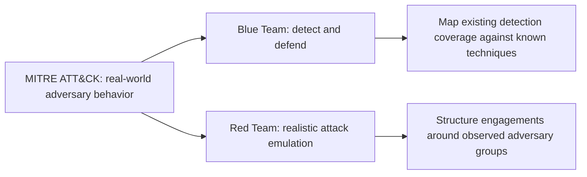
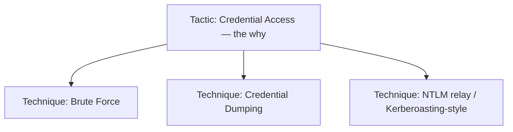
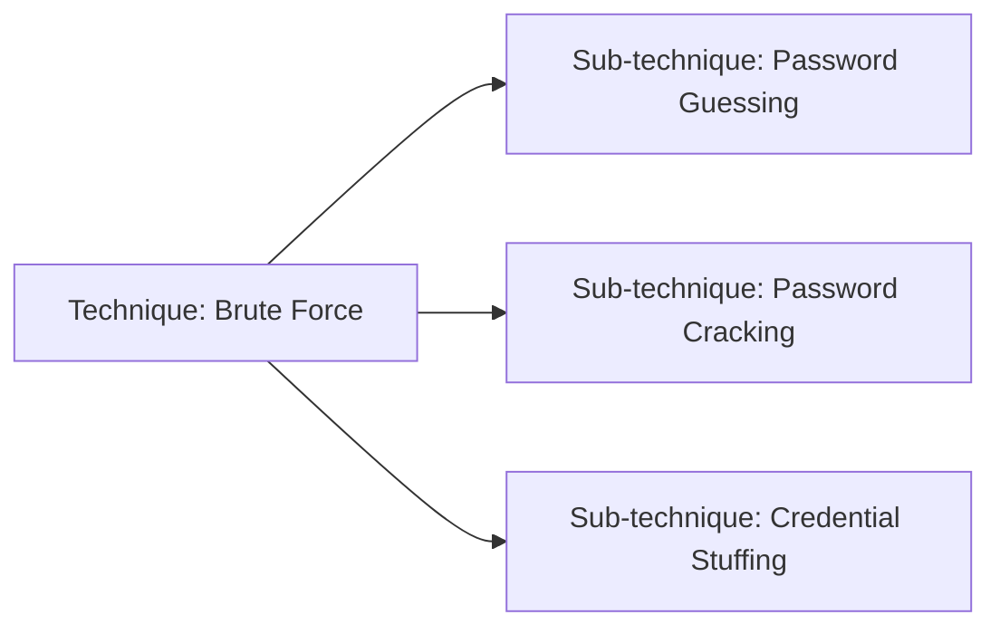
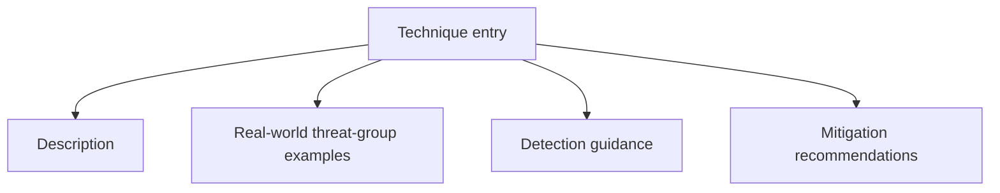
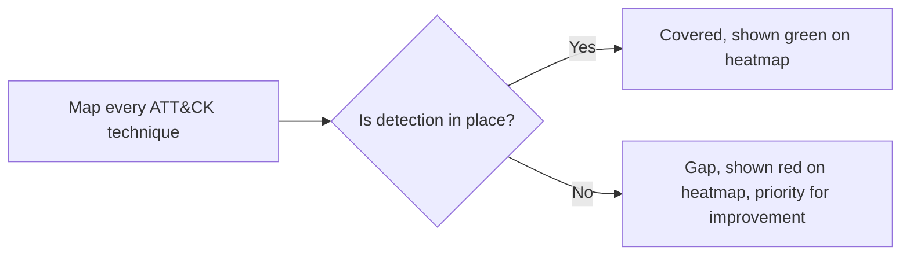
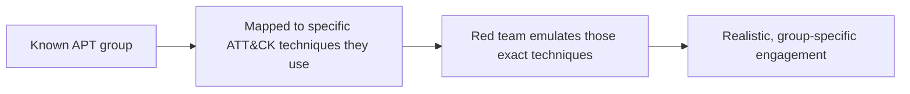

| Topic | Level | Reading Time | Prerequisites |
|---|---|---|---|
| MITRE ATT&CK Framework | Intermediate | ~15 min | None |

> **Goal of this section:**
> You'll understand what the MITRE ATT&CK framework is, how it describes real attacker behavior instead of theoretical scenarios, and how both defensive and offensive teams use it in their daily work.

## Learning Objectives

By the end of this section, you will be able to:

- Define **MITRE ATT&CK** and explain who maintains it and why it is built from real-world observed behavior, not theory.
- Explain how **Blue Teams** and **Red Teams** each use the framework differently.
- Describe the structure of the **ATT&CK Matrix**: Tactics as columns, Techniques as rows, and sub-techniques beneath them.
- Explain what each technique entry documents, and how a technique ID (like T1110) is used in practice.
- Explain three concrete practical uses of ATT&CK: detection coverage heatmaps, standardized threat intelligence reporting, and red team engagement planning.

## Table of Contents

- [Learning Objectives](#learning-objectives)
- [What Is MITRE ATT&CK](#what-is-mitre-attck)
  - [Who Maintains It](#who-maintains-it)
  - [The Full Name and Core Definition](#the-full-name-and-core-definition)
  - [Blue Team Versus Red Team Usage](#blue-team-versus-red-team-usage)
- [Structure: The ATT&CK Matrix](#structure-the-attck-matrix)
  - [Tactics: The Columns](#tactics-the-columns)
  - [Techniques: The Rows](#techniques-the-rows)
  - [Sub-Techniques](#sub-techniques)
  - [What Each Technique Entry Documents](#what-each-technique-entry-documents)
- [Why It Matters in Practice](#why-it-matters-in-practice)
  - [Bridging Abstract Concepts and Real Behavior](#bridging-abstract-concepts-and-real-behavior)
  - [Detection Coverage Heatmaps](#detection-coverage-heatmaps)
  - [Standardizing Threat Intelligence Reporting](#standardizing-threat-intelligence-reporting)
  - [Planning Red Team Engagements](#planning-red-team-engagements)
- [Career Path Connections](#career-path-connections)
- [Key Terms Glossary](#key-terms-glossary)
- [Summary](#summary)

## What Is MITRE ATT&CK

### Who Maintains It

**MITRE ATT&CK** is maintained by **MITRE Corporation**, a **non-profit** organization that operates **federally funded** research centers.

### The Full Name and Core Definition

The full name: **Adversarial Tactics, Techniques, and Common Knowledge**.

It's a **publicly available, continuously updated knowledge base** that documents **real attacker behavior** observed in **actual attacks and breaches**.

> [!IMPORTANT]
> ATT&CK is built from actual incident and threat intelligence reporting, not theoretical scenarios. This is the single most important distinction between ATT&CK and a generic security awareness list: every technique documented has been observed in the real world.

### Blue Team Versus Red Team Usage

Both teams use ATT&CK, but with different goals:

| Team | How They Use ATT&CK |
|---|---|
| **Blue Team (Defenders)** | They use the framework to understand which techniques they need to detect and defend against, and to **compare existing detection coverage** against known attacker behavior |
| **Red Team (Attackers/Pentesters)** | They use the framework as a **reference for realistic attack-technique emulation**, and they build engagements around real attacker behavior that has actually been observed |

> [!NOTE]
> This same Blue Team / Red Team framing connects directly to the SOC Analyst and Penetration Tester career paths referenced throughout this series. ATT&CK is one of the few resources genuinely shared, in daily practice, by both sides.

## Structure: The ATT&CK Matrix

The framework is organized visually as a **matrix**.

### Tactics: The Columns

The columns = **Tactics**, which are **the attacker's goal** at a given stage (the **why**):

| Tactic | Attacker's Goal |
|---|---|
| Initial Access | Getting into the environment for the first time |
| Execution | Running malicious code |
| Persistence | Staying connected after reboots or account changes |
| Privilege Escalation | Gaining higher privileges |
| Defense Evasion | Avoiding detection |
| Credential Access | Stealing usernames and passwords |
| Lateral Movement | Moving across the network |
| Collection | Gathering the targeted data |
| Exfiltration | Getting the data out of the network |
| Impact | Manipulating, disrupting, or destroying systems |

### Techniques: The Rows

The rows under each tactic = **Techniques**, which are **the specific methods** used to achieve that goal (the **how**).

Example: under **Credential Access**:

- **Brute Force**
- **Credential Dumping**
- **NTLM relay / Kerberoasting**-style techniques

> [!NOTE]
> Every technique listed under Credential Access in this example was covered in detail earlier in this series: brute force in Password Cracking Techniques, credential dumping from NTDS.dit in Group Policy and Credential Storage, and NTLM relay in Windows Authentication Hashes. ATT&CK is the framework that organizes exactly this kind of knowledge into one structured reference.

### Sub-Techniques

Many techniques have **sub-techniques**. Example: under **Brute Force**:

- **Password Guessing**
- **Password Cracking**
- **Credential Stuffing**

### What Each Technique Entry Documents

Every technique entry in ATT&CK documents:

- A **description** of the technique.
- **Real-world threat-group examples** that have used it.
- **Detection guidance**.
- **Mitigation recommendations**.

## Why It Matters in Practice

### Bridging Abstract Concepts and Real Behavior

ATT&CK bridges the gap between **abstract security concepts** and **concrete, actually observed attacker behavior**, because it's **built from real incident reports and actual threat intelligence**, not theoretical scenarios.

### Detection Coverage Heatmaps

It's used to build **detection coverage heatmaps**: which techniques are actually detected, and which have **gaps**.

### Standardizing Threat Intelligence Reporting

It's used **to standardize threat intelligence reporting**, by referring to specific technique IDs such as **T1110** for Brute Force.

> [!TIP]
> Instead of saying "the attacker tried a lot of passwords," a professional report refers directly to **T1110**. This makes reports comparable and automatically correlatable across different organizations and sources.

### Planning Red Team Engagements

It's used to plan **red team engagements** that emulate **specific real attacker groups**; **APT (Advanced Persistent Threat)** groups are often mapped to the techniques they're known to use.

> [!IMPORTANT]
> This is what separates ATT&CK-driven red teaming from generic penetration testing: the engagement is designed to emulate a specific, real adversary's known playbook, not a generalized list of common attacks.

## Career Path Connections

| Career Path | How This Topic Applies |
|---|---|
| SOC Analyst | Maps detection rules to specific ATT&CK technique IDs and identifies coverage gaps |
| Penetration Tester | Structures red team engagements around specific techniques and APT group emulation |
| GRC | References ATT&CK coverage as part of risk assessments and security program maturity reporting |
| Cloud Security | Cloud-specific ATT&CK matrices exist for mapping adversary behavior against cloud platforms specifically |

## Key Terms Glossary

| Term | Definition |
|---|---|
| MITRE ATT&CK | A publicly accessible knowledge base of real-world adversary tactics and techniques, maintained by MITRE Corporation |
| Tactic | The adversary's goal at a given stage of an attack (the why) |
| Technique | The specific method used to achieve a tactic's goal (the how) |
| Sub-Technique | A more specific variant of a broader technique |
| Technique ID | A standardized identifier (e.g., T1110) used to reference a specific technique in reports and tools |
| Detection Coverage Heatmap | A visual map showing which ATT&CK techniques an organization can detect, and where gaps exist |
| APT | Advanced Persistent Threat, a sophisticated, often state-sponsored or well-resourced threat actor group |

## Summary

- **MITRE ATT&CK is maintained by a non-profit, federally funded organization:** It's built from real attacker behavior, not theoretical scenarios.
- **Both Blue Team and Red Team use it, for different purposes:** Defenders use it for detection and measuring coverage, and attackers use it for realistic emulation.
- **The matrix structure is Tactics (columns, the why) and Techniques (rows, the how):** With more specific sub-techniques under many of the techniques.
- **Every technique entry is fully documented:** Description, real-world examples, detection guidance, and mitigation recommendations.
- **Three concrete practical uses stand out:** Detection coverage maps, standardizing threat intelligence reporting with IDs such as T1110, and planning red team engagements around real APT groups.

