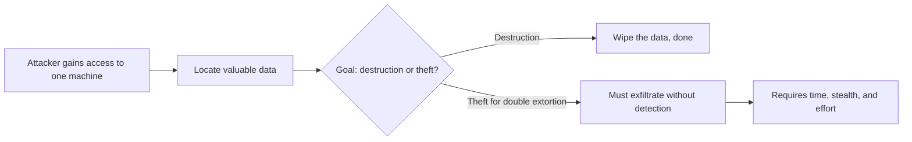
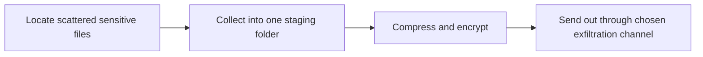
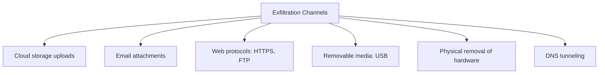
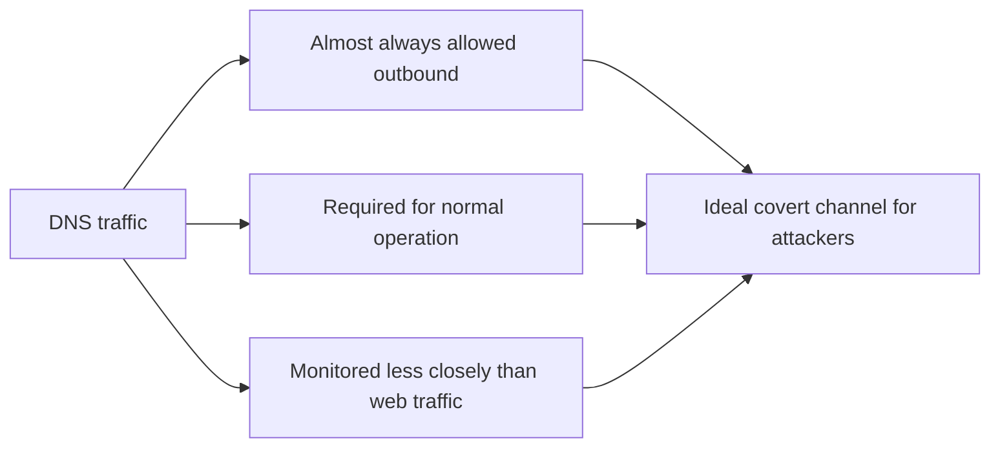
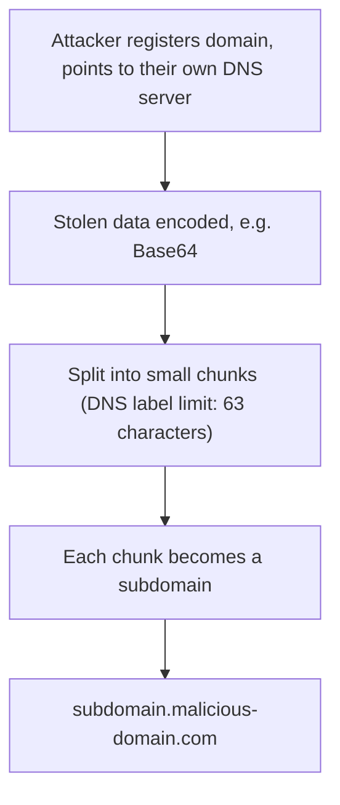
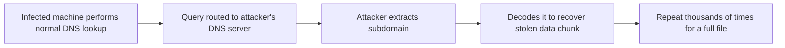
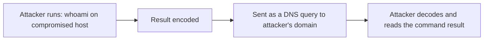
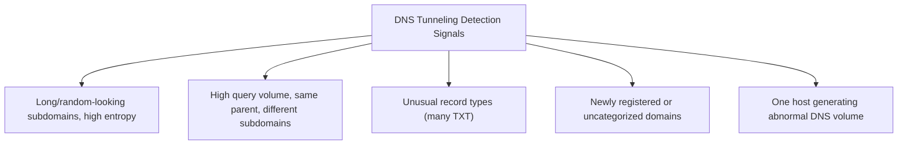
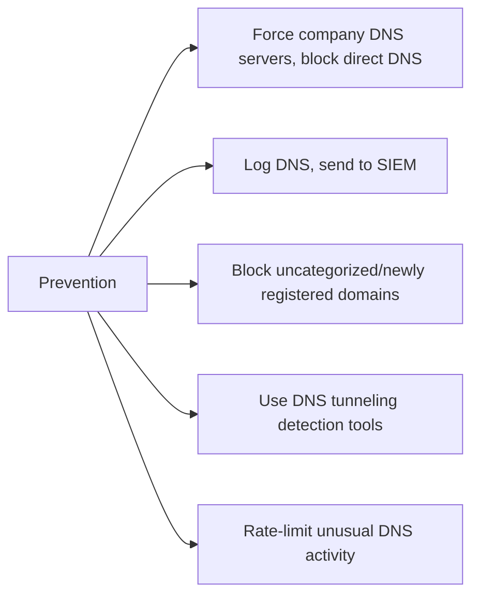

| Topic | Level | Reading Time | Prerequisites |
|---|---|---|---|
| Data Exfiltration and DNS Tunneling | Intermediate | ~20 min | DLP Tools and SIEM Integration |

> **Goal of this section:**
> You'll understand what data exfiltration means and why it's the hardest step in any double-extortion attack. You'll see the different channels attackers use, understand in detail how DNS tunneling smuggles data out without being noticed, and learn how to detect and prevent it.


## Learning Objectives

By the end of this section, you will be able to:

- Define **data exfiltration** and explain why it is harder for an attacker than encryption alone.
- List the common exfiltration channels and a detection idea for each.
- Explain, step by step, how **DNS tunneling** encodes and smuggles data inside DNS queries.
- Explain how an attacker receives the exfiltrated data on their own DNS server.
- List concrete detection signals and preventive measures against DNS tunneling.

## Table of Contents

- [Learning Objectives](#learning-objectives)
- [Data Exfiltration](#data-exfiltration)
  - [Definition](#definition)
  - [Why Exfiltration Is Harder Than Destruction](#why-exfiltration-is-harder-than-destruction)
  - [Staging the Data](#staging-the-data)
- [Common Exfiltration Channels](#common-exfiltration-channels)
- [DNS Tunneling: Why and How (Part 1)](#dns-tunneling-why-and-how-part-1)
  - [Why DNS Specifically](#why-dns-specifically)
  - [Attack Steps: Setting Up the Channel](#attack-steps-setting-up-the-channel)
- [DNS Tunneling: Receiving the Data (Part 2)](#dns-tunneling-receiving-the-data-part-2)
  - [Completing the Round Trip](#completing-the-round-trip)
  - [Command Output Over DNS](#command-output-over-dns)
- [Detecting and Preventing DNS Tunneling](#detecting-and-preventing-dns-tunneling)
  - [What to Look For in DNS Logs](#what-to-look-for-in-dns-logs)
  - [Prevention Measures](#prevention-measures)
- [Career Path Connections](#career-path-connections)
- [Key Terms Glossary](#key-terms-glossary)
- [Summary](#summary)

## Data Exfiltration

### Definition

**Data exfiltration** is the **unauthorized transfer of data out of the organization**.

### Why Exfiltration Is Harder Than Destruction

Gaining access to one machine is **only the first step** in a long attack chain. The attacker must **locate the valuable data**, which is hard even for the company that owns the data.

| Goal | What the Attacker Must Do |
|---|---|
| **Destruction** | The attacker's work is done as soon as they find the data and wipe it |
| **Double extortion** | The attacker **also** has to transfer hundreds of gigabytes or terabytes **without being detected**. This takes time, stealth, and effort |



> [!IMPORTANT]
> This is why exfiltration detection matters so much for a SOC: it is the hardest, slowest, and most detectable step for the attacker in a double-extortion ransomware chain. Catching exfiltration early can stop the leak threat even if encryption still happens.

### Staging the Data

Attackers usually **stage** the data first: they gather it into a single folder, then compress and encrypt it **before** sending it out.



## Common Exfiltration Channels

| Channel | How It Works | Detection Idea |
|---|---|---|
| Cloud storage | Uploads to file-sharing sites | Monitoring the category and the domain |
| Email | Attachments sent externally | Email security and DLP |
| Web protocols (HTTPS, FTP) | Transferring large volumes externally | Unusual volume, unknown destinations |
| Removable media | USB drives | Endpoint DLP |
| Physical removal | An insider physically takes the disk | Physical security and access logs |
| DNS tunneling | Data hidden inside DNS queries | DNS log analysis |

**Physical removal of the disk by an insider** is **the simplest method**, and **DNS tunneling** is one of **the stealthiest methods**.



> [!NOTE]
> This connects directly to the Causes of Data Leakage section in Data Loss Fundamentals and DLP Operations: an insider with no internet access can only exfiltrate by physically removing a drive, which is exactly why the "Physical removal" channel exists on this list.

## DNS Tunneling: Why and How (Part 1)

### Why DNS Specifically

**DNS tunneling** hides arbitrary data inside DNS queries and responses to create a **covert communication channel**.

| Reason | Explanation |
|---|---|
| Almost always allowed outbound | DNS traffic is rarely blocked completely |
| Required for normal operation | If it's blocked, nothing on the network will work |
| Less monitored | Many organizations monitor web traffic **much more closely** than DNS traffic |



### Attack Steps: Setting Up the Channel

- The attacker registers a domain (for example, `malicious-domain[.]com`) and points it to a DNS server they control.
- The stolen data is **encoded** (for example, with **Base64**).
- The data is split into **small chunks**, because a DNS label has a maximum length of **63 characters**.
- Each chunk becomes a **subdomain**, for example:

```text
dGhpcy1pcy1zdG9sZW4tZGF0YQ.malicious-domain[.]com
```

That first part is the encoded data. (This example decodes to harmless text: `"this-is-stolen-data"`)



## DNS Tunneling: Receiving the Data (Part 2)

### Completing the Round Trip

- The infected machine performs a **normal DNS lookup** for that subdomain.
- Since the attacker controls the domain's DNS server, the query **reaches them**, carrying the encoded chunk.
- The attacker extracts the subdomain and **decodes** it to recover the stolen data. Repeating this over thousands of queries transfers an entire file out.



### Command Output Over DNS

The same technique is used to transfer **command output**: the attacker runs a command such as `whoami`, and the result (for example, `corp\administrator`) is encoded and sent as a query, such as:

```text
mnxw24dmmuwwk3tbnr2a.attacker-domain[.]com
```

This is how the attacker sees results from a machine that **can't communicate externally except through DNS**.



> [!WARNING]
> This is not limited to stealing files. An attacker can run an entire command-and-control conversation purely through DNS queries, which is why DNS tunneling is considered dangerous beyond just large file exfiltration.

## Detecting and Preventing DNS Tunneling

### What to Look For in DNS Logs

| Signal | Why It Matters |
|---|---|
| Very long or random-looking subdomains (high **entropy**) | Normal readable text is very different from encoded base64 data |
| A very large number of queries to the same parent domain, each with a different subdomain | A typical pattern for transferring many chunks |
| Unusual record types, such as many **TXT queries** | TXT records carry more data and are often used in tunneling |
| Newly registered or uncategorized domains | A general indicator of untrustworthy activity |
| A single host generating far more DNS traffic than its peers | A clear deviation from the normal baseline |



> [!NOTE]
> This detection list applies the exact same baselining principle covered in Asset Awareness and Traffic Flow from Network Security Foundations: you cannot spot an anomaly without first knowing what normal DNS traffic looks like for a given host.

### Prevention Measures

- Enforce the use of the **organization's DNS servers** on all devices, and block any direct DNS to the internet.
- Log DNS and send it to the SIEM.
- Block uncategorized or newly registered domains where possible.
- Use DNS security tools that detect tunneling patterns.
- Rate-limit unusual DNS activity.



> [!TIP]
> If asked in an interview "why can't you just block all DNS to stop tunneling?", the answer is the same reason tunneling works in the first place: DNS is required for normal operation. The defenses target the behavior pattern (forcing centralized DNS, logging, rate-limiting), not DNS itself.

## Career Path Connections

| Career Path | How This Topic Applies |
|---|---|
| SOC Analyst | Directly applies the DNS log detection signals covered here when investigating suspected exfiltration |
| Penetration Tester | DNS tunneling is a realistic covert channel technique used in authorized red team data-exfiltration simulations |
| GRC | Exfiltration risk assessments inform data classification and network monitoring policy requirements |
| Cloud Security | Cloud-native DNS firewall services apply the same tunneling-detection logic to cloud workloads |

## Key Terms Glossary

| Term | Definition |
|---|---|
| Data Exfiltration | The unauthorized transfer of data out of an organization |
| Staging | Collecting and preparing data (compressing, encrypting) before exfiltrating it |
| DNS Tunneling | Hiding arbitrary data inside DNS queries and responses to create a covert communication channel |
| Base64 | An encoding scheme used to convert binary data into text-safe characters |
| DNS Label | A single segment of a domain name, limited to 63 characters |
| Entropy | A measure of randomness; high entropy in a subdomain suggests encoded rather than human-readable data |
| TXT Record | A DNS record type that can carry arbitrary text, commonly abused in tunneling |

## Summary

- **Exfiltration is the hardest step for an attacker pursuing double extortion:** It requires time, stealth, and effort, unlike destruction, which is done as soon as the data is wiped.
- **Attackers stage data before sending it out:** Gathering, compressing, and encrypting before the transfer.
- **Six common channels exist, each with its own detection idea:** cloud storage, email, web protocols, removable media, physical removal, and DNS tunneling.
- **DNS tunneling exploits DNS's always-allowed, lightly-monitored nature:** Encoding, splitting into chunks, and turning them into subdomains.
- **The attacker's own DNS server receives and decodes the data:** Through normal queries that reach the attacker specifically.
- **The same technique carries command output, not just files:** A full command-and-control channel can run through DNS alone.
- **Detection relies on baselining DNS behavior:** Entropy, query volume, record types, and new or uncategorized domains.
- **Prevention targets the pattern, not DNS itself:** Centralized DNS servers, logging, rate-limiting, and specialized detection tools.


