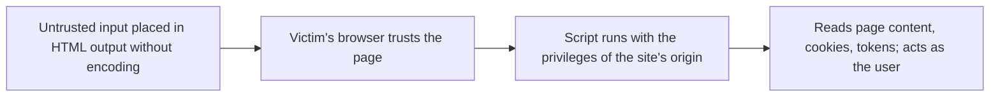
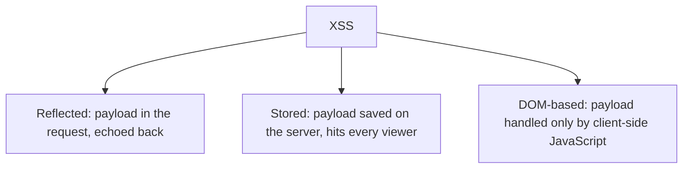
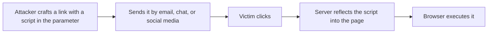
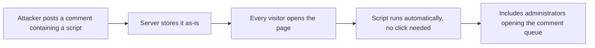
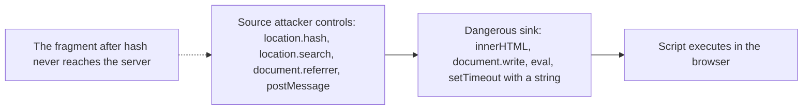
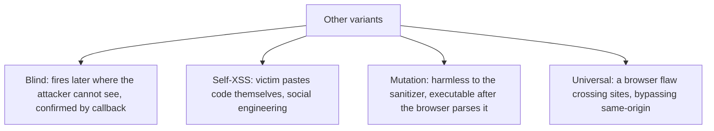
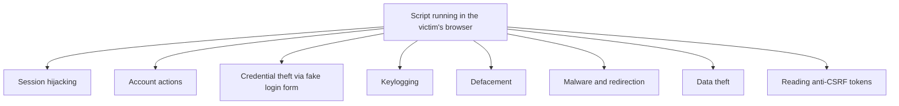
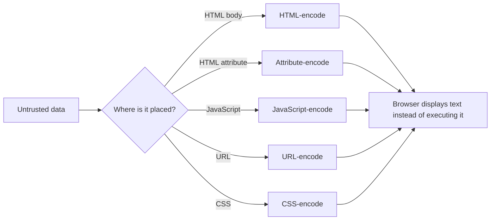
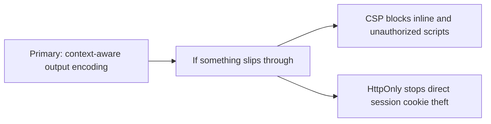

| Topic | Level | Reading Time | Prerequisites |
|---|---|---|---|
| Cross-Site Scripting (XSS) | Intermediate | ~25 min | Input Attacks Fundamentals |

> **The goal of this section:**  
> You'll understand how XSS attacks the application's users rather than the server, the difference between the three main types (reflected, stored, and DOM-based) and the special variants, what an attacker can do with a script running in the victim's browser, how output encoding is the primary defence, and how CSP and HttpOnly limit the damage if something slips through.


## Learning Objectives

By the end of this section, you will be able to:

- Define **XSS**, state its root cause, and contrast it with SQL injection.
- Compare **reflected**, **stored**, and **DOM-based** XSS by payload location, who is affected, and persistence.
- Explain why **stored XSS** is usually the most dangerous and why DOM-based XSS can bypass server-side filters.
- Describe the special variants: **blind XSS**, **self-XSS**, **mutation XSS**, and **universal XSS**.
- List what an attacker can do with XSS.
- Apply the defences: **context-aware output encoding**, auto-escaping frameworks, sanitization, **HttpOnly cookies**, safe DOM APIs, and **Content Security Policy**.
- Recognize SOC clues for reflected XSS in request URLs.

## Table of Contents

- [Learning Objectives](#learning-objectives)
- [What Is XSS](#what-is-xss)
  - [Definition and Root Cause](#definition-and-root-cause)
  - [SQLi Versus XSS](#sqli-versus-xss)
  - [Proof of Concept](#proof-of-concept)
- [Types of XSS: Overview](#types-of-xss-overview)
- [Reflected XSS](#reflected-xss)
- [Stored (Persistent) XSS](#stored-persistent-xss)
- [DOM-Based XSS](#dom-based-xss)
- [Other XSS Variants](#other-xss-variants)
- [What Can an Attacker Do with XSS](#what-can-an-attacker-do-with-xss)
- [Preventing XSS](#preventing-xss)
  - [Encode the Output](#encode-the-output)
  - [Validate, Sanitize, and Limit Access](#validate-sanitize-and-limit-access)
  - [Content Security Policy](#content-security-policy)
- [Career Path Connections](#career-path-connections)
- [Key Terms Glossary](#key-terms-glossary)
- [Summary](#summary)

## What Is XSS

### Definition and Root Cause

**Cross-Site Scripting (XSS)** is a vulnerability where the attacker **injects a malicious client-side script** (usually JavaScript) into a web page **that other users view.**

**The victim's browser trusts the page**, so it runs the script **with the privileges of that site's origin.** The script can **read the page content, cookies, and tokens**, and act **on behalf of the user.**

**The root cause:** the application **puts untrusted input into HTML output without encoding it** for its context.

### SQLi Versus XSS

| Attack | Target |
|---|---|
| **SQLi** | **The server's database** |
| **XSS** | **The application's users** |

### Proof of Concept

```html
<script>alert(1)</script>
```

**If the popup appears, the attacker's code is running.**



> [!NOTE]
> This is the same data-versus-instructions root cause as every other attack in this category, but with a different victim. In SQL injection the input becomes part of a query run by the database; in XSS it becomes part of a page run by the browser. The output-encoding defence below is the XSS version of the parameterized query.

## Types of XSS: Overview

| Type | Where the Payload Lives | Who Is Affected | Persistence |
|---|---|---|---|
| **Reflected** | In the request (URL or form), and the server echoes it in the response | The victim who clicks the crafted link | Non-persistent |
| **Stored** | **Saved on the server**, such as in the database | **Every user who views the page** | Persistent |
| **DOM-based** | Processed by **client-side JavaScript only** | The victim who opens the crafted link | Non-persistent; **the URL fragment never reaches the server** |

The special variants (Blind, Self, Mutation, and Universal) are explained after the three main types.



## Reflected XSS

### How It Works

The application **takes input from the request and puts it in the response immediately without encoding.** A search page such as `shop.example/search?q=shoes` shows "Results for: shoes".

The attacker **crafts a link whose parameter contains a script** and sends it by email, chat, or social media. When the victim clicks it, **the server reflects the script into the page and the browser runs it.**

```text
https://shop.example/search?q=<script>/* attacker code */</script>
```

### Needs Social Engineering

**The victim has to click the link.** Attackers **hide the payload** with URL shorteners or encoding. Typical places: search boxes, error messages, and login redirects.

### SOC Clue

Look for `<script`, `%3Cscript`, `onerror=`, and `javascript:` **inside request URLs.**



> [!TIP]
> The SOC clue is simple but effective: the encoded form `%3Cscript` is the same attack as `<script`, so a rule that only matches the raw angle bracket misses most real requests. This mirrors the encoded-quote point in the SQL injection files.

## Stored (Persistent) XSS

### How It Works

The malicious script **is saved on the server** (in a database, a log, or a file) **and delivered to every user who views the affected content.**

**Typical places:** comments, forum posts, product reviews, user profiles, display names, support tickets, and chat messages.

**An example:** the attacker posts a comment containing a script. The site saves it as is. **Every visitor who opens the page runs the script automatically, with no click at all.**

### The Most Dangerous Type

**It reaches many victims**, including **the administrators who open the comment list**, and it can turn into a **worm.**

### Defence Emphasis

**Encode the output every time stored data is displayed**: it may have been stored long ago or come from another system.



> [!IMPORTANT]
> Stored XSS is dangerous precisely because of who it reaches. A reflected attack needs one victim to click one link; a stored attack waits on a page and fires for everyone, including the highest-privileged user who reviews content. This is also why the output-encoding rule applies to data read back from your own database, the same lesson as second-order SQL injection.

## DOM-Based XSS

### How It Happens

The flaw is **in the client-side JavaScript, not in the server's response.** **The server may never see the payload.**

Data flows from **a source the attacker controls** (`location.hash`, `location.search`, `document.referrer`, and `postMessage`) to **a dangerous sink** (`innerHTML`, `document.write`, `eval`, and `setTimeout` with a string).

```javascript
el.innerHTML = location.hash.substring(1);
```

### Attack and Fix

```text
https://example.com/page#
```

**The part after `#` is never sent to the server**, so **server-side filters and many WAFs can't see it.**

| Fix | Detail |
|---|---|
| Use `textContent` instead of `innerHTML` | Treats the text as text |
| Avoid `eval` | |
| Sanitize with a library such as **DOMPurify** | When HTML has to be inserted |



> [!WARNING]
> DOM-based XSS is the case where server-side defences are structurally blind. A WAF inspects requests that arrive at the server, but the fragment after `#` is never sent, so the payload never appears in any server or WAF log. The fix has to be in the client-side code itself, which is a limit of the WAF noted in the WAF file.

## Other XSS Variants

| Variant | Description |
|---|---|
| **Blind XSS** | Stored XSS **whose payload runs later, somewhere the attacker can't see**, such as an admin dashboard or a log viewer. **A callback to the attacker's server confirms execution** |
| **Self-XSS** | The victim **is tricked into pasting malicious code into their own browser console** or into a form. **Pure social engineering**, and browsers show warnings about it |
| **Mutation XSS (mXSS)** | A payload that **looks harmless to the sanitizer**, but **the browser's HTML parser mutates it into executable code**, so it bypasses the filter |
| **Universal XSS (UXSS)** | A flaw **in the browser itself** that lets scripts run **across different sites**, bypassing same-origin protection |



## What Can an Attacker Do with XSS

| Goal | What Happens |
|---|---|
| **Session hijacking** | Stealing session cookies (unless `HttpOnly`) and impersonating the user |
| **Account actions** | Acting as the victim, for example changing the email or password or transferring money |
| **Credential theft** | Injecting a fake login form into the real page |
| **Keylogging** | Capturing everything the victim types on the page |
| **Defacement** | Changing the displayed content to spread misinformation |
| **Malware and redirection** | Sending users to malicious sites |
| **Data theft** | Reading the personal information shown on the page |
| **Pivoting** | Reading **anti-CSRF tokens** to bypass CSRF protection |



> [!NOTE]
> Session hijacking is where this connects to identity investigations. A stolen session cookie lets an attacker act as the user without ever knowing the password, which is the kind of token theft that produces an impossible-travel alert, as covered in Impossible Travel and VPN Detection.

## Preventing XSS

### Encode the Output

| # | Defence | Detail |
|---|---|---|
| 1 | **Context-aware output encoding** (the primary defence) | Encode according to where the data goes: HTML body, HTML attribute, JavaScript, URL, or CSS. **Each context needs different encoding** |
| 2 | **Auto-escaping frameworks** | React, Angular, Vue, Django, and Jinja2 **escape by default.** **Avoid the bypasses** such as `dangerouslySetInnerHTML` or the `\|safe` filter |

An example in the HTML body:

```text
<script>   becomes   &lt;script&gt;
```

**The browser then displays the text instead of running it.**



### Validate, Sanitize, and Limit Access

| # | Defence | Detail |
|---|---|---|
| 3 | **Input validation** | With an allowlist. **Useful, but not enough on its own** |
| 4 | **Sanitize rich HTML** | When users must submit HTML, sanitize it with a trusted library such as **DOMPurify** |
| 5 | **HttpOnly cookies** | **JavaScript can't read them**, so XSS **can't steal the session directly** |
| 6 | **Safe DOM APIs** | Use `textContent`, use `setAttribute` with care, and adopt **Trusted Types** |

### Content Security Policy

| # | Defence | Detail |
|---|---|---|
| 7 | **Content Security Policy (CSP)** | **A response header that sets where scripts may be loaded from.** A strong policy **blocks inline scripts**, so an injected script tag **doesn't run** |
| 8 | **Avoid risky placements** | Don't put untrusted data in script blocks, event handlers, or `javascript:` URLs |

```text
Content-Security-Policy: default-src 'self'; script-src 'self'
```

**Defence in depth:** output encoding is **the primary control.** CSP and HttpOnly **limit the damage if something slips through.**



> [!IMPORTANT]
> Notice the shape of this defence: encoding prevents the injection, while CSP and HttpOnly are damage-limiting layers for when prevention fails. Relying on either damage limiter instead of encoding leaves the vulnerability in place. CSP and HttpOnly are covered further in HTTP Requests, Responses, and Headers and Cookies and Session Security.

## Career Path Connections

| Career Path | How This Topic Applies |
|---|---|
| SOC Analyst | Searches request URLs for `<script`, `%3Cscript`, `onerror=`, and `javascript:`, and correlates XSS with later session misuse |
| Penetration Tester | Tests every reflected parameter and stored field, and checks DOM sinks, since server-side tools miss DOM-based cases |
| GRC | Output encoding, CSP, and secure cookie flags are standard web application security requirements |
| Cloud Security | Cloud-hosted web apps and admin consoles are common stored and blind XSS targets, so headers like CSP are part of the baseline |

## Key Terms Glossary

| Term | Definition |
|---|---|
| XSS | Cross-Site Scripting, injecting a client-side script into a page that other users view |
| Origin | The combination of scheme, host, and port that defines a site's security boundary in the browser |
| Reflected XSS | XSS where the payload is in the request and echoed back immediately |
| Stored XSS | XSS where the payload is saved on the server and delivered to every viewer |
| DOM-Based XSS | XSS caused by client-side JavaScript moving attacker data from a source to a dangerous sink |
| Source / Sink | Where attacker-controlled data enters client-side code, and where it is dangerously used |
| Blind XSS | A stored XSS that fires later somewhere the attacker cannot see |
| Output Encoding | Converting special characters so the browser treats them as text, chosen per output context |
| HttpOnly | A cookie flag preventing JavaScript from reading the cookie |
| CSP | Content Security Policy, a response header restricting where scripts can load from |
| DOMPurify | A maintained library for sanitizing HTML |
| Trusted Types | A browser feature restricting dangerous DOM sink usage |

## Summary

- **XSS injects client-side script into a page other users view:** the root cause is not encoding input for the output context.
- **SQLi attacks the database, XSS attacks the users.**
- **Reflected XSS needs a click; stored XSS fires for everyone; DOM-based XSS lives in client-side code.**
- **Stored XSS is usually the most dangerous:** it reaches many victims, including admins, and can turn into a worm.
- **DOM-based XSS can bypass server-side filters:** because the fragment after `#` never reaches the server.
- **Four special variants exist:** blind, self, mutation, and universal.
- **XSS enables session hijacking, credential theft, keylogging, and more.**
- **Output encoding is the primary defence:** according to the context, with frameworks that auto-escape.
- **CSP and HttpOnly limit the damage when something slips through.**


