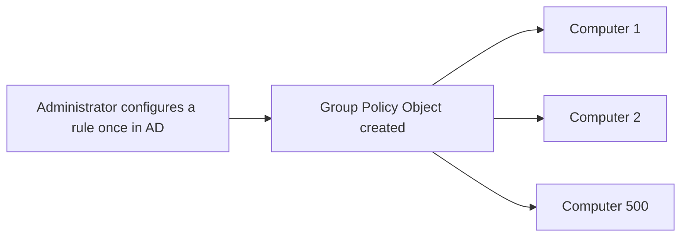
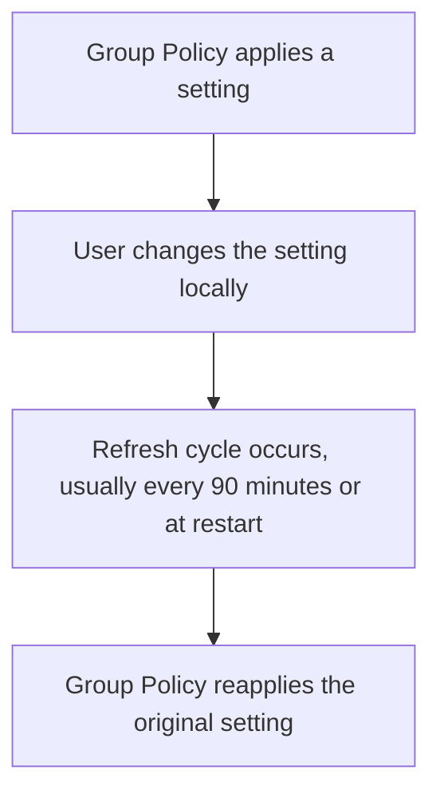
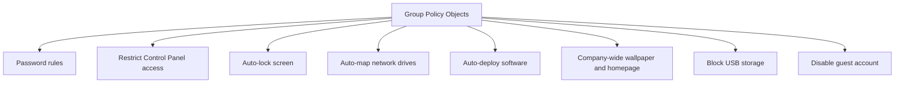
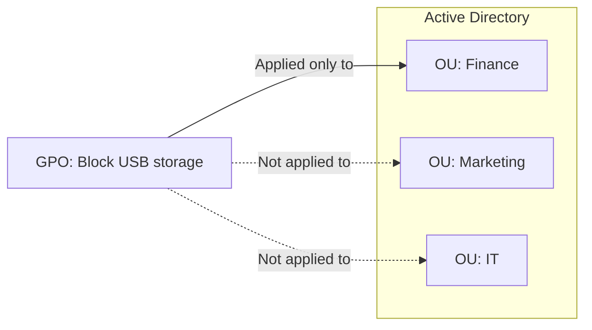
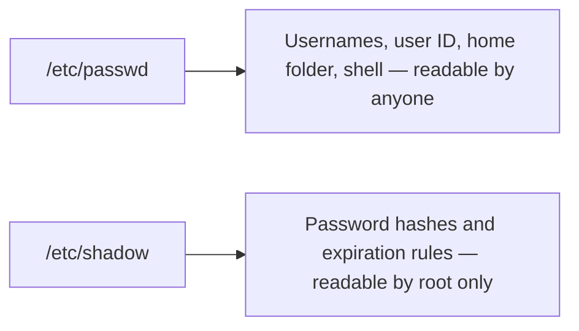
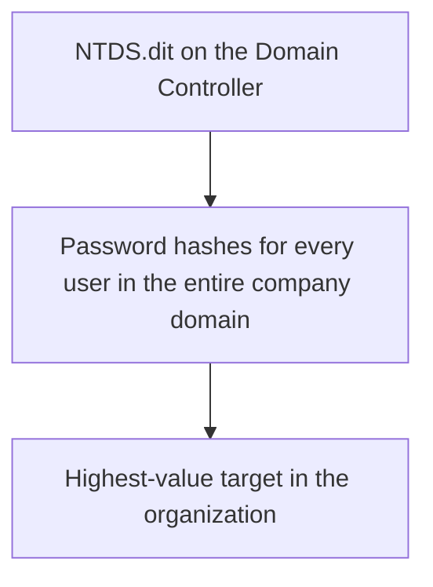
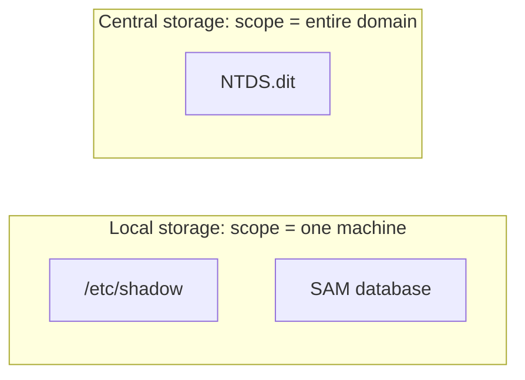

| Topic | Level | Reading Time | Prerequisites |
|---|---|---|---|
| Group Policy and Credential Storage | Intermediate | ~20 min | Active Directory Core Concepts |

> **Goal of this section:**  
>  You'll understand how Active Directory enforces rules on hundreds of machines without anyone touching them one by one, and you'll see exactly where the biggest secret in any system is stored: password hashes, on Linux, Windows, and Active Directory.


## Learning Objectives

By the end of this section, you will be able to:

- Explain what **Group Policy (GPOs)** is, and how it applies settings centrally without visiting each machine.
- Explain how Group Policy **re-applies itself automatically**, even if a user changes a setting locally.
- List concrete, practical examples of what Group Policy can enforce across an organization.
- Explain how **Organizational Units (OUs)** let administrators target policies to specific groups instead of everyone.
- Describe where password hashes are stored on **Linux** (`/etc/shadow`), a **standalone Windows PC** (`SAM`), and **Active Directory** (`NTDS.dit`).
- Explain why `NTDS.dit` makes the Domain Controller the highest-value target in any organization.

## Table of Contents

- [Learning Objectives](#learning-objectives)
- [What Is Group Policy](#what-is-group-policy)
  - [The Rule Book, in Action](#the-rule-book-in-action)
  - [Why It Matters at Scale](#why-it-matters-at-scale)
  - [Self-Reapplying Rules](#self-reapplying-rules)
- [Group Policy in Practice](#group-policy-in-practice)
  - [Eight Concrete Examples](#eight-concrete-examples)
  - [Targeting Policies with Organizational Units](#targeting-policies-with-organizational-units)
- [Where Passwords Are Stored on Linux](#where-passwords-are-stored-on-linux)
  - [The Two-File Split](#the-two-file-split)
  - [Trying It Yourself](#trying-it-yourself)
- [Where Passwords Are Stored on a Standalone Windows PC](#where-passwords-are-stored-on-a-standalone-windows-pc)
  - [The SAM Database](#the-sam-database)
- [Where Passwords Are Stored in Active Directory](#where-passwords-are-stored-in-active-directory)
  - [NTDS.dit](#ntdsdit)
  - [Comparing the Three Storage Locations](#comparing-the-three-storage-locations)
- [Career Path Connections](#career-path-connections)
- [Key Terms Glossary](#key-terms-glossary)
- [Summary](#summary)

## What Is Group Policy

### The Rule Book, in Action

**Group Policy** (technically: **Group Policy Objects**, or **GPOs**) is Active Directory's **rule-book feature**. It lets administrators define settings **once, centrally**, and have them apply automatically to hundreds of machines **at the same time**, without needing to visit each machine individually.

### Why It Matters at Scale

If a company wants to apply a password rule to **500 machines**, someone would have to configure it **500 times** if there were no Group Policy. A GPO solves exactly this problem: you configure the rule **once** in Active Directory, and it applies automatically to every machine assigned to it.



### Self-Reapplying Rules

A GPO **continuously re-enforces itself**, usually **every 90 minutes** or at every **restart**, even if someone tries to change it locally.

> [!IMPORTANT]
> Even if someone changes a setting locally, Group Policy re-applies it on the next refresh cycle. This is what makes GPOs a real enforcement mechanism rather than just a suggestion: a user cannot simply undo a policy and expect it to stay undone.



## Group Policy in Practice

### Eight Concrete Examples

This table shows practical examples of what you can control with Group Policy:

| # | Example |
|---|---|
| 1 | Password rules: minimum length, complexity, and expiration |
| 2 | Restricting access to Control Panel and Settings |
| 3 | Automatically locking the screen after a period of inactivity |
| 4 | Automatically mapping network drives by department |
| 5 | Automatically deploying software (such as antivirus) to a particular group |
| 6 | Setting the wallpaper and browser homepage across the whole company |
| 7 | Blocking USB storage devices |
| 8 | Disabling the guest account, and enforcing screen lock |



### Targeting Policies with Organizational Units

**Not every rule has to apply to everyone**. GPOs can target specific groups, for example blocking USB devices **only on the Finance department**, which is done using **Organizational Units (OUs)**, which are **folders inside Active Directory** that group users and machines together.



> [!TIP]
> Organizational Units are the mechanism that turns "one rule for everyone" into "the right rule for the right group." Without OUs, administrators would face the same all-or-nothing problem Group Policy was designed to eliminate.

## Where Passwords Are Stored on Linux

### The Two-File Split

On **Linux**, user account information is split across **two files**:

| File | Stores | Access |
|---|---|---|
| `/etc/passwd` | A list of usernames and basic info (user ID, home folder, default shell), **but not the actual passwords** | Any user can read it |
| `/etc/shadow` | The actual **password hashes** (a one-way encrypted version of the password, not the plaintext password itself), plus password expiration rules | **Only root** can read it |

> [!NOTE]
> `/etc/passwd` used to store actual passwords decades ago. It no longer does, but the historical name stuck, which is why the file's name can be misleading today.



### Trying It Yourself

```bash
cat /etc/passwd
sudo cat /etc/shadow
```

The first command works for any user. The second will ask for the sudo password, which practically demonstrates that **ordinary users are forbidden** from reading the password hashes; **only root** can.

> [!TIP]
> Run these two commands on your own Linux machine. Notice that the second command prompts for authentication even if you are already logged in, a direct demonstration of the standard-user-versus-root separation from the previous file in this series.

## Where Passwords Are Stored on a Standalone Windows PC

### The SAM Database

The password hashes for local accounts are stored in a file called the **SAM (Security Account Manager) database**.

This file is **locked and inaccessible** while Windows is running normally; **even administrators can't open it directly**. Windows protects it heavily because it holds the password hash of **every local account** on that machine.

```text
C:\Windows\System32\config\SAM
```

This file is the **equivalent** of the `/etc/shadow` file on Linux; both serve the same purpose: **the protected vault** for the password hashes of the machine's local accounts.

| System | Local Password Storage | Locked While Running? |
|---|---|---|
| Linux | `/etc/shadow` | Readable only by root |
| Windows (standalone) | `SAM` database | Completely locked, even for admins |

## Where Passwords Are Stored in Active Directory

### NTDS.dit

On a **Domain Controller**, the accounts belong to **the entire domain, not a single machine**. The password hash of **every user in the domain** lives in **a single database file**: **`NTDS.dit`** (NT Directory Services).

This file holds the password hashes of **every user account in the entire company**, which is exactly why the Domain Controller is **the highest-value target** in any organization. Like the SAM, it's **locked and protected** while the server is running.



### Comparing the Three Storage Locations

| Where | What It's Called | What It Stores |
|---|---|---|
| Linux, single PC | `/etc/shadow` | Password hashes for the users of this Linux machine only |
| Windows, single PC | SAM database | Password hashes for the users of this Windows machine only |
| Active Directory | `NTDS.dit` (on the DC) | Password hashes **for every user in the entire domain** |



> [!IMPORTANT]
> The pattern across all three systems is identical: readable account information stays in an accessible file, while the actual password hashes sit in a separate, tightly locked file. The only thing that changes is scope: one machine locally, versus the entire company centrally. This is exactly why compromising `NTDS.dit` is structurally worse than compromising any single SAM database.

## Career Path Connections

| Career Path | How This Topic Applies |
|---|---|
| SOC Analyst | Treats any attempt to access or extract `NTDS.dit` as a critical, Tier 0 alert |
| Penetration Tester | Extracting `NTDS.dit` (often via a technique called DCSync) is a common objective in internal Active Directory assessments |
| GRC | Group Policy enforcement of password rules is a direct, auditable compliance control |
| Cloud Security | Cloud identity providers replace local GPOs with cloud-native policy engines, but the same "central rule, central enforcement" logic applies |

## Key Terms Glossary

| Term | Definition |
|---|---|
| Group Policy (GPO) | The Active Directory feature that centrally configures and enforces settings across many computers |
| Organizational Unit (OU) | A folder-like structure in Active Directory used to group users and computers for targeted policy application |
| /etc/passwd | The Linux file storing usernames and basic account info, readable by any user |
| /etc/shadow | The Linux file storing password hashes, readable only by root |
| SAM Database | The Windows file storing local account password hashes on a standalone PC |
| NTDS.dit | The Active Directory database file on a Domain Controller storing password hashes for every domain user |
| Password Hash | A one-way, scrambled version of a password, stored instead of the plaintext password itself |

## Summary

- **Group Policy is Active Directory's enforcement mechanism:** settings are configured once centrally and apply automatically to hundreds of machines.
- **Rules reapply themselves:** a local change reverts to the original setting on the next refresh cycle, usually every 90 minutes or at restart.
- **Organizational Units allow targeted policy:** instead of one rule for everyone, rules are directed to specific groups such as the Finance department.
- **Linux splits account info across two files:** `/etc/passwd` is readable by everyone, and `/etc/shadow`, with the password hashes, is readable only by root.
- **Windows mirrors the same split locally:** the SAM database is the equivalent of `/etc/shadow`, completely locked while the system is running.
- **Active Directory centralizes this at domain scale:** `NTDS.dit` holds the password hashes of every user in the entire company, not just a single machine.
- **The pattern is the same everywhere, only the scope changes:** a locked file to protect the hashes, and the only difference between local and central is the scale of the damage if it's compromised.

