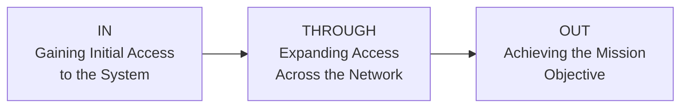
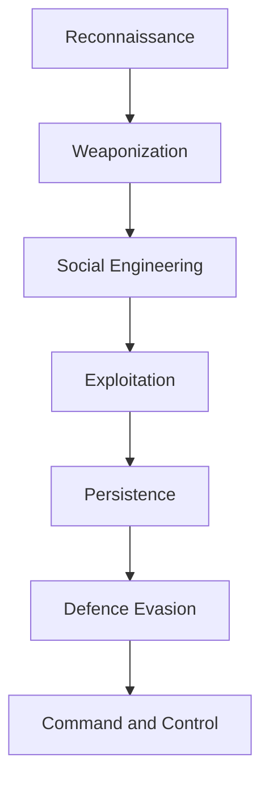
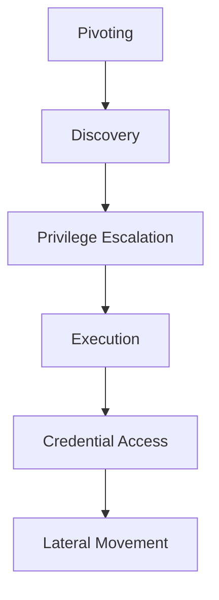
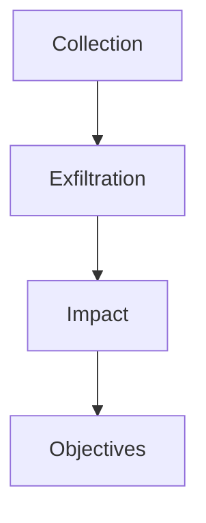
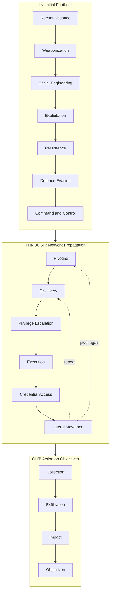

> **Goal of this section:**
> You will understand how attackers plan and carry out their attacks from start to finish using the Unified Kill Chain (UKC) framework, and how, as a SOC Analyst or Defender, you can map each phase to the right detection and response so you can stop the attacker before they reach their final objective.

## Table of Contents

- [Introduction: Why Frameworks Matter](#introduction-why-frameworks-matter)
- [What is a Kill Chain?](#what-is-a-kill-chain)
- [Threat Modelling](#threat-modelling)
- [What is the Unified Kill Chain (UKC)?](#what-is-the-unified-kill-chain-ukc)
- [UKC vs Other Frameworks](#ukc-vs-other-frameworks)
- [The Three Strategic Goals of UKC](#the-three-strategic-goals-of-ukc)
- [Goal 1: In — Initial Foothold](#goal-1-in--initial-foothold)
  - [Reconnaissance](#1-reconnaissance)
  - [Weaponization](#2-weaponization)
  - [Social Engineering](#3-social-engineering)
  - [Exploitation](#4-exploitation)
  - [Persistence](#5-persistence)
  - [Defence Evasion](#6-defence-evasion)
  - [Command & Control](#7-command--control)
- [Goal 2: Through — Network Propagation](#goal-2-through--network-propagation)
  - [Pivoting](#1-pivoting)
  - [Discovery](#2-discovery)
  - [Privilege Escalation](#3-privilege-escalation)
  - [Execution](#4-execution)
  - [Credential Access](#5-credential-access)
  - [Lateral Movement](#6-lateral-movement)
- [Goal 3: Out — Action on Objectives](#goal-3-out--action-on-objectives)
  - [Collection](#1-collection)
  - [Exfiltration](#2-exfiltration)
  - [Impact](#3-impact)
  - [Objectives](#4-objectives)
- [Full UKC Flow Diagram](#full-ukc-flow-diagram)
- [Defensive Mapping: UKC Phase to Detection Focus](#defensive-mapping-ukc-phase-to-detection-focus)
- [Summary](#summary)

---

## Introduction: Why Frameworks Matter

To defend any system, you first have to understand the mindset of whoever is going to attack it. It's not just "a hacker is going to get into the system." There are logical steps that every attacker follows, whether they are a Script Kiddie or a professional APT (Advanced Persistent Threat).

This is where **Frameworks** come in: they are tools that help you understand and organize the attacker's behaviour, objectives, and methodologies systematically. Without a framework, you would be trying to understand the attack while lost, but a framework gives you a **structure** you can build a real defensive strategy on, and that is what's called **Cybersecurity Posture**.

> [!NOTE]
> Cybersecurity Posture is the term that describes the overall strength of an organization's defenses, meaning how capable it is of preventing, detecting, and responding to any attack.

### Learning Objectives for This Section

- Understand why frameworks like the UKC are important for building a strong posture.
- Use the UKC to understand the motivation, methodologies, and tactics of any attacker.
- Understand the different phases of the UKC.
- Know that the UKC complements other frameworks such as MITRE ATT&CK rather than competing with them.

---

## What is a Kill Chain?

The term **"Kill Chain"** has military origins, where it described the different stages of a military attack, from identifying the target to destroying it.

In cybersecurity, the Kill Chain came to describe **the methodology or path** that attackers (Hackers, APTs, etc.) use to approach a target and breach it.

**A simple example:** an attacker scans a network, finds a web vulnerability to exploit, and then performs Privilege Escalation. This whole chain is called a **Kill Chain**.

> [!IMPORTANT]
> The main goal of understanding the Kill Chain is not just to "know how the attack happens," but to be able to put **Defensive Measures** in place that either prevent the attack altogether (Pre-emptive Protection) or stop it at any of its stages (Disrupt the Attempt).

---

## Threat Modelling

**Threat Modelling** is a series of steps taken to improve a system's security by identifying risk. Simply put, it answers the question: "What could happen, why, and how do we prevent it?"

The basic steps of Threat Modelling:

1. **Identify Assets**: Determine which systems and applications need protection and what their role is in the environment (Are they critical to the business? Do they store sensitive data such as Payment Info or Addresses?).
2. **Assess Vulnerabilities**: Evaluate the weaknesses that may exist in these systems and how they could be exploited.
3. **Create an Action Plan**: Build a plan to secure these systems against the vulnerabilities that were discovered.
4. **Implement Policies**: Put policies in place that prevent the problem from happening again (for example, adopting an SDLC, Software Development Life Cycle, or training employees in Phishing Awareness).

> [!TIP]
> Threat Modelling is not a one-time step. It is a continuous process that must be repeated whenever something changes in the environment (a new system, an update, etc.).

The UKC encourages Threat Modelling because it helps you identify potential **Attack Surfaces** and how these systems could be exploited.

> [!NOTE]
> There are other frameworks dedicated to Threat Modelling, such as **STRIDE**, **DREAD**, and **CVSS**. If you want to dig deeper into them, the "Principles of Security" room on TryHackMe covers them in detail.

---

## What is the Unified Kill Chain (UKC)?

The **Unified Kill Chain** was created by **Paul Pols** in 2017, and its purpose is to **complement**, not compete with, other frameworks such as:

- Lockheed Martin's Cyber Kill Chain
- MITRE's ATT&CK Framework

The UKC states that any attack goes through **18 different phases**, from Reconnaissance all the way to Data Exfiltration and understanding the attacker's motivation. To make this easier to understand, these phases are divided into **3 main Strategic Goals**, which we will explain in detail below.

---

## UKC vs Other Frameworks

| Benefits of the UKC | How Other Frameworks Compare |
|---|---|
| **Modern** - created in 2017 and updated in 2022 | Frameworks like MITRE ATT&CK were created in 2013, when the cyber landscape was completely different |
| **Very detailed** - 18 phases | Other frameworks only have a small number of phases |
| Covers the entire attack, from Reconnaissance to Exploitation and Post-Exploitation, and also identifies the attacker's motivation | Other frameworks only cover a limited number of phases |
| Reflects a **more realistic** attack scenario: the attacker goes back and repeats certain stages (for example, after Exploitation they go back to Reconnaissance to Pivot to another system) | Other frameworks don't account for the attacker moving back and forth between stages during the attack |

> [!IMPORTANT]
> The most important advantage of the UKC is that it recognizes that a real attack is **not linear**. The attacker doesn't necessarily move from Phase 1 to Phase 18 in order. They may go back and repeat stages like Reconnaissance and Discovery more than once in the same attack as they move through the network.

---

## The Three Strategic Goals of UKC

The 18 phases are divided into 3 main groups, each representing a **strategic goal** for the attacker:

| Goal | Description |
|---|---|
| **In** | The attacker tries to get into the system for the first time, discover vulnerabilities, and establish a foothold inside the system |
| **Through** | The attacker uses that foothold to move through the network (Pivoting), discover other systems, and escalate their privileges |
| **Out** | The attacker has reached their final objective, whether that is stealing data, sabotage, or financial extortion |

---

## Goal 1: In — Initial Foothold

The main goal of this group is for the attacker to **reach any point of access** in the target system or network. The attacker uses many tactics to probe the system for weaknesses they can exploit to establish a foothold inside it.

### 1. Reconnaissance

> **MITRE Tactic:** TA0043

This is the first stage, and it describes the techniques the attacker uses to **gather information** about the target, either through:

- **Passive Reconnaissance**: Gathering information without any direct interaction with the target (such as searching OSINT, Open Source Intelligence).
- **Active Reconnaissance**: Interacting directly with the target (such as Port Scanning).

The information gathered at this stage is used in all the stages that follow, especially the Initial Foothold stage. It includes:

- Discovering the systems and services running on the target (very useful for Weaponization and Exploitation).
- Finding contact lists or employee lists that can be used for Social Engineering or Phishing.
- Looking for potential credentials that could be used later for Pivoting or Initial Access.
- Understanding the network topology and the connected systems that could be pivoted to.

> [!TIP]
> From a SOC analyst's perspective, Reconnaissance is often hard to detect, especially if it is passive (such as searching LinkedIn or WHOIS records), but Active Recon (such as Port Scans) can be detected through IDS/IPS or NetFlow Analysis.

### 2. Weaponization

> **MITRE Tactic:** TA0001

At this stage, the attacker prepares the **infrastructure** needed to carry out the attack. For example:

- Setting up a **Command and Control (C2) Server**.
- Preparing a system capable of receiving **Reverse Shells**.
- Preparing the payloads that will be sent to the target.

> [!NOTE]
> Weaponization doesn't happen on the victim's machine. It is a "preparation" stage that happens on the attacker's own infrastructure before they start interacting with the target.

### 3. Social Engineering

> **MITRE Tactic:** TA0001

These are the techniques the attacker uses to **manipulate employees** into taking actions that help the attack. Examples:

- Getting the user to open a **Malicious Attachment** in a phishing email.
- **Impersonating** a real web page to steal credentials.
- Calling or visiting in person and pretending to be someone else (such as requesting a Password Reset, or posing as a maintenance technician to gain physical access to certain areas).

> [!WARNING]
> Social Engineering is one of the most dangerous tactics because it targets **the human element**, not the technology. Even if you have the strongest firewall in the world, one employee opening the wrong attachment can break all of those defenses.

### 4. Exploitation

> **MITRE Tactic:** TA0002

This is the stage where the attacker exploits the **weaknesses or vulnerabilities** in the system. The UKC defines Exploitation as abusing vulnerabilities to achieve **Code Execution**. Examples:

- Uploading and running a **Reverse Shell** on a web application.
- Tampering with an **Automated Script** on the system to execute code.
- Exploiting a vulnerability in a web application to execute code on the server it runs on.

### 5. Persistence

> **MITRE Tactic:** TA0003

This stage is simple and straightforward: it describes the techniques the attacker uses to **maintain their access** to the system after gaining a foothold in it. Examples:

- Creating a new **Service** on the target system that lets them get back in.
- Adding the system to a **Command & Control Server** so they can execute commands remotely at any time.
- Leaving **Backdoors** that run when a certain event happens (such as a Reverse Shell that runs when the Admin logs in).

> [!IMPORTANT]
> Persistence is the main reason attackers are able to stay "hidden" inside the network for long periods (sometimes months) without anyone discovering them, and this is called **Dwell Time**.

### 6. Defence Evasion

> **MITRE Tactic:** TA0005

This is one of the most important and valuable stages in the UKC. It describes the techniques the attacker uses to **evade the existing defensive systems**, such as:

- Web Application Firewalls (WAF).
- Network Firewalls.
- Anti-virus Systems.
- Intrusion Detection Systems (IDS).

> [!TIP]
> From a defensive perspective, this stage is very valuable when analyzing any attack (Incident Response) because it gives you information that helps you improve your defensive systems in the future. If you learn how the attacker bypassed the AV, you can tune your detection rules.

### 7. Command & Control

> **MITRE Tactic:** TA0011

This stage brings together all the effort made in the Weaponization stage to **establish a communication channel** between the attacker and the target system. Once the attacker achieves C2 on the system, they can:

- Execute commands.
- Steal data, credentials, and other information.
- Use the controlled server to **Pivot** to other systems on the network.

> [!WARNING]
> C2 Traffic is one of the most important indicators a SOC Analyst looks for, by analyzing unusual DNS Requests, Beaconing Patterns (regular connections at fixed time intervals), or traffic to suspicious IPs/Domains.

---

## Goal 2: Through — Network Propagation

After the attacker gains a **successful foothold** on the network, if the defenses stop them from achieving their goal right away, they will try to expand their privileges and access. The attacker uses the system they compromised as a **Pivot Point** to gather information about the internal network.

### 1. Pivoting

> **MITRE Tactic:** TA0008

**Pivoting** is the technique the attacker uses to reach other systems inside the network that are not directly accessible (for example, not exposed to the internet). Many systems inside any network are not directly accessible, and they often contain valuable data or have weaker security.

**Example:** the attacker gains access to a web server exposed to the internet and uses it to attack other systems on the same internal network (which are not accessible from outside).

Once the attacker has a foothold, they use that system as a:

- **Staging Site**: a launch point.
- **Tunnel**: a channel between their C2 Operations and the victim's network.
- **Distribution Point**: a distribution point for all the malware and backdoors in the later stages.

### 2. Discovery

> **MITRE Tactic:** TA0007

The attacker starts discovering information about the system and the network it's connected to. The knowledge base they build includes:

- Active user accounts.
- Granted permissions.
- Applications and software in use.
- Web browser activity.
- Files, Directories, and Network Shares.
- System Configurations.

### 3. Privilege Escalation

> **MITRE Tactic:** TA0004

After gathering information, the attacker tries to gain higher privileges on the system they pivoted to. They exploit information about accounts, vulnerabilities, and misconfigurations to reach higher levels such as:

| Level | Description |
|---|---|
| **SYSTEM / ROOT** | The highest possible privilege on the system |
| **Local Administrator** | Local administrative privilege |
| **User with Admin-like access** | A regular user, but with privileges close to an admin |
| **User with specific access/functions** | A user with privileges limited to specific tasks |

> [!IMPORTANT]
> Privilege Escalation is always tied to misconfigurations or unpatched vulnerabilities. Regular patching checks and the Least Privilege Principle are among the most important ways to reduce the risk here.

### 4. Execution

> **MITRE Tactic:** TA0002

This is the stage where the attacker deploys malicious code using the pivot system as a host. The following are deployed and created:

- Remote Trojans.
- C2 Scripts.
- Malicious Links.
- Scheduled Tasks.

All of this is done to facilitate a **recurring presence** on the system and maintain persistence.

### 5. Credential Access

> **MITRE Tactic:** TA0006

This works hand in hand with the Privilege Escalation stage. The attacker tries to steal account names and passwords in different ways, such as:

- **Keylogging**.
- **Credential Dumping**.

> [!WARNING]
> Using legitimate credentials makes the attacker harder to detect because they "behave" like a regular user. This is what makes Behavioral Analytics and UEBA (User and Entity Behavior Analytics) so important for detecting unusual activity even when the credentials are valid.

### 6. Lateral Movement

> **MITRE Tactic:** TA0008

With the credentials and privileges gathered, the attacker starts **moving through the network**, jumping to other target systems to achieve their main objective. The stealthier the technique, the harder it is to detect.

---

## Goal 3: Out — Action on Objectives

This is the final stage of the attacker's journey: they have gained full access to the critical assets and are able to achieve the goals of their attack. These goals are usually aimed at compromising one or more elements of the **CIA Triad** (Confidentiality, Integrity, Availability).

### 1. Collection

> **MITRE Tactic:** TA0009

After all the effort to reach the assets, the attacker looks for **all the valuable data** they can collect. This compromises the **Confidentiality** of the data and paves the way for the next stage, Exfiltration. The main sources targeted are:

- Drives.
- Browsers.
- Audio.
- Video.
- Email.

### 2. Exfiltration

> **MITRE Tactic:** TA0010

To escalate the scale of the breach, the attacker steals the data they collected and packages it using **Encryption** and **Compression** to avoid detection. The C2 Channel and the Tunnel created in the earlier stages become very useful here.

> [!TIP]
> From a detection perspective, looking for abnormal **Large Outbound Data Transfers**, or compressed/encrypted data being sent to unusual external parties, is one of the most important ways to spot Exfiltration. DLP (Data Loss Prevention) tools play a big role here.

### 3. Impact

> **MITRE Tactic:** TA0040

If the attacker's goal is to compromise **Integrity** and **Availability**, they start to manipulate, interrupt, or destroy these assets. The goal is to disrupt operations and the business, and it can include:

- Removing Account Access.
- Disk Wipes.
- Encrypting data, as in **Ransomware** attacks.
- **Defacement** of websites.
- **Denial of Service (DoS)** attacks.

### 4. Objectives

This is the final step: the attacker has all the power and access needed to achieve the overall **strategic goal** of the attack. Examples:

- If the attack is **Financially Motivated**: they may encrypt files and systems with Ransomware and demand a ransom.
- If the goal is **Reputation Damage**: they may leak confidential and private information to the public.

---

## Full UKC Flow Diagram

The full diagram shows how all the stages connect to each other, and how the attacker can **go back** to earlier stages (such as Reconnaissance or Discovery) while moving through the network:

> [!NOTE]
> The dashed lines in the diagram represent how the attacker goes back and repeats stages like Discovery or Pivoting while moving through the network. This is exactly the fundamental difference between the UKC and traditional frameworks, which assume the attack is purely linear.

---

## Defensive Mapping: UKC Phase to Detection Focus

As a SOC Analyst, this table gives you a quick overview of what to focus on in each phase:

| UKC Phase | MITRE Tactic | What to Look For as a Defender |
|---|---|---|
| Reconnaissance | TA0043 | Anomalies in DNS lookups, Port Scans, unusual OSINT activity |
| Weaponization | TA0001 | No direct telemetry (it happens outside your environment) - focus on Threat Intel |
| Social Engineering | TA0001 | Phishing reports from users, Email Gateway Logs |
| Exploitation | TA0002 | EDR Alerts, Unusual Process Creation, Web Server Logs |
| Persistence | TA0003 | New Services, Scheduled Tasks, Registry Run Keys |
| Defence Evasion | TA0005 | AV/EDR Tampering Logs, Log Clearing Events |
| Command & Control | TA0011 | Beaconing Patterns, DNS Tunneling, Anomalous Outbound Traffic |
| Pivoting | TA0008 | Internal traffic between unexpected segments |
| Discovery | TA0007 | Repeated use of tools such as `whoami`, `net user`, `ipconfig` |
| Privilege Escalation | TA0004 | Token Manipulation, exploitation of known misconfigurations |
| Execution | TA0002 | Execution of unusual binaries, PowerShell Logging |
| Credential Access | TA0006 | LSASS Access, Mimikatz-like Behavior |
| Lateral Movement | TA0008 | Unusual use of RDP, WMI, PsExec |
| Collection | TA0009 | Bulk access to sensitive files in a short time |
| Exfiltration | TA0010 | DLP Alerts, Large Outbound Transfers |
| Impact | TA0040 | File Encryption Events, Mass Deletion, Service Disruption |

> [!IMPORTANT]
> This table is not a replacement for the MITRE ATT&CK Navigator. It is a starting point that helps you map each UKC phase to the log sources and detections you need to review as an analyst.

---

## Summary

- The **Kill Chain** is a term of military origin that, in cybersecurity, describes the chain of steps an attacker follows from the start of the attack until they achieve their goal.
- **Threat Modelling** is the process of identifying assets, assessing vulnerabilities, and creating a plan to secure them, and the UKC directly encourages it.
- The **Unified Kill Chain (UKC)** was created by Paul Pols in 2017. It is a framework made up of **18 phases** that complements (rather than competes with) frameworks such as Lockheed Martin's Kill Chain and MITRE ATT&CK.
- The biggest advantage of the UKC is that it represents the attack in a **realistic, non-linear** way: the attacker goes back and repeats stages like Reconnaissance and Discovery while moving through the network.
- The 18 phases are divided into **3 Strategic Goals**:
  - **In**: Securing an initial foothold (Reconnaissance → Weaponization → Social Engineering → Exploitation → Persistence → Defence Evasion → Command & Control).
  - **Through**: Expanding inside the network (Pivoting → Discovery → Privilege Escalation → Execution → Credential Access → Lateral Movement).
  - **Out**: Achieving the final objective (Collection → Exfiltration → Impact → Objectives).
- Each phase has an associated **MITRE ATT&CK Tactic**, which is what makes the UKC and MITRE ATT&CK complement each other instead of being alternatives.
- As a SOC Analyst, understanding the UKC lets you identify **which stage the attacker is in** during any incident, which helps you anticipate their next move and take the right defensive action before they reach the Impact or Exfiltration stage.
