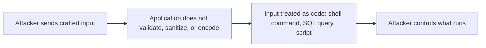
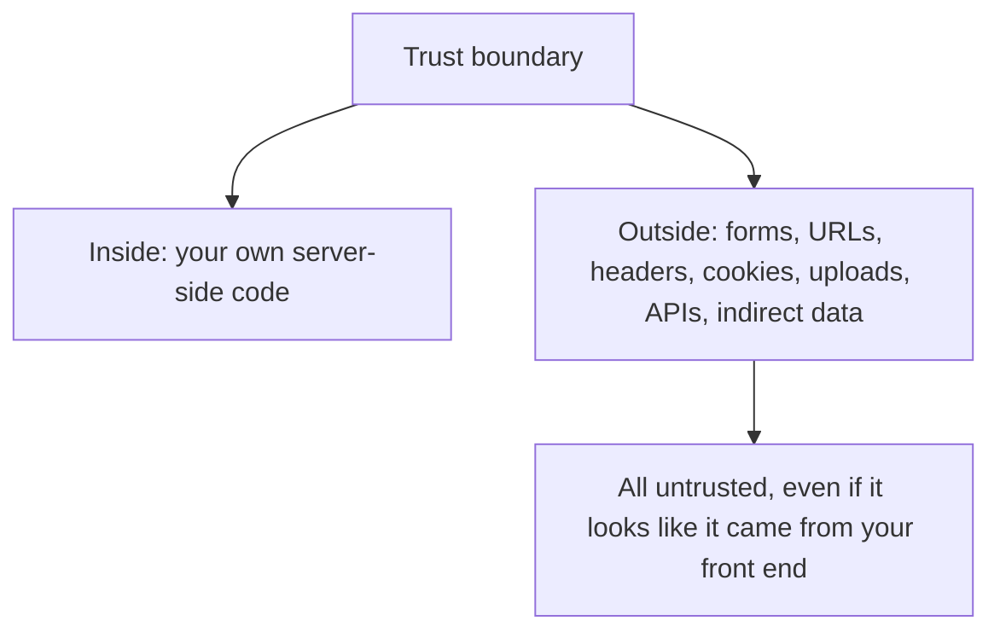
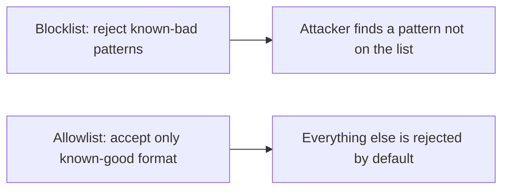
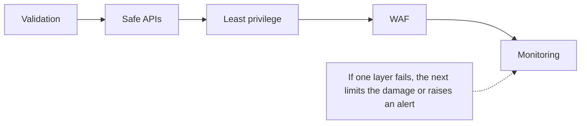

| Topic | Level | Reading Time | Prerequisites |
|---|---|---|---|
| Input Attacks Fundamentals | Beginner | ~15 min | None |

> **The goal of this section:**  
> You'll understand the shared root behind most application attacks: the developer trusts what the user sends. You'll see how data turns into instructions, every source input can come from (including the ones we forget), and the core lines of defence that repeat in every attack type you'll study next.

## Learning Objectives

By the end of this section, you will be able to:

- Define an **input attack** and state its root cause: mixing data with instructions.
- List both the obvious and the easily forgotten **sources of input**.
- Apply the golden rule: anything outside your **trust boundary** is untrusted.
- Differentiate between **validation**, **sanitization**, and **encoding/escaping**, and explain why an allowlist beats a blocklist.
- Explain why **server-side enforcement**, **safe APIs**, and **least privilege** remove whole classes of vulnerability.
- Explain what **fuzzing** is and why a **layered defence** is required.

## Table of Contents

- [Learning Objectives](#learning-objectives)
- [What Are Input Attacks](#what-are-input-attacks)
  - [Definition](#definition)
  - [The Root Cause](#the-root-cause)
  - [One Cause, Many Attacks](#one-cause-many-attacks)
- [Where Inputs Come From](#where-inputs-come-from)
  - [Everyday Inputs](#everyday-inputs)
  - [Easy to Forget](#easy-to-forget)
  - [The Golden Rule](#the-golden-rule)
- [How to Mitigate Input Attacks](#how-to-mitigate-input-attacks)
  - [Check and Clean the Input](#check-and-clean-the-input)
  - [Make the System Safe by Design](#make-the-system-safe-by-design)
- [Fuzzing and Layered Defence](#fuzzing-and-layered-defence)
  - [Fuzzing](#fuzzing)
  - [Layered Defence](#layered-defence)
- [Career Path Connections](#career-path-connections)
- [Key Terms Glossary](#key-terms-glossary)
- [Summary](#summary)

## What Are Input Attacks

### Definition

An **input attack** is any attack where the attacker **manipulates the data the application receives** so that the application **behaves in an unintended or malicious way.**

The attacker sends **specially crafted input** instead of normal user data, and the application **processes it without proper validation.**

### The Root Cause

**The root cause:** developers **trust user input more than they should.** The application doesn't **validate, sanitize, or encode** the input before using it.

**The core problem is mixing data with instructions.** When input **is treated as code** (a shell command, an SQL query, or a script), **the attacker controls what gets executed.**

An analogy: if a secretary types whatever a client dictates, word for word, into an official letter the manager signs, the client can dictate "and add that the manager approved a payment of one million pounds". The mistake is that text meant to be **data** was treated as **instructions.**

### One Cause, Many Attacks

The same root sits behind **injection, XSS, buffer overflow, and path traversal.** And most of the **OWASP Top 10** starts with unsafe input handling.

| Attack | What the Input Becomes |
|---|---|
| OS command injection | A shell command |
| SQL injection | A database query |
| Cross-site scripting (XSS) | A script running in a victim's browser |
| Buffer overflow | Data that spills into adjacent memory |
| Path traversal | A file path escaping the intended folder |

> [!IMPORTANT]
> Each of the next files in this category is one row of this table in detail. They look different on the surface, but the question to ask is always the same: where does this application mix data and instructions, and who controls the data?

> [!NOTE]
> Log4Shell, covered in the Log4Shell Case Study file, is the same root cause in a logging library: text that should have been plain data was processed as an instruction. Input attacks are not an old topic; they produced the maximum-severity vulnerability of the decade.

## Where Inputs Come From

### Everyday Inputs

| Input Source | Detail |
|---|---|
| **Login forms and search bars** | The most obvious inputs |
| **URL parameters** such as `?id=123` | Easy to change from the address bar |
| **HTTP headers** such as User-Agent, Referer, and X-Forwarded-For | **Logged often and rarely validated** |
| **Cookies and hidden fields** | **They live on the client**, so the attacker controls them |

### Easy to Forget

| Input Source | Detail |
|---|---|
| **File uploads** | The file name, type, and content **can all be malicious** |
| **APIs** (JSON/XML bodies) | Machine-to-machine input that is **still under the attacker's control** |
| **Indirect sources** | Data from a database, a third party, or an email **that a user originally wrote** |

### The Golden Rule

**Anything coming from outside the trust boundary is untrusted**, even data that looks like it comes from your own front end. **The attacker can skip the browser and send requests directly.**

> [!WARNING]
> HTTP headers deserve special attention because they are logged constantly and validated rarely. An attacker-controlled header such as User-Agent or X-Forwarded-For flows straight into log files, databases, and sometimes dashboards, where it can be processed as something more than text.

## How to Mitigate Input Attacks

### Check and Clean the Input

| Technique | What It Does |
|---|---|
| **Validation** | Check type, length, format, and range. **Prefer an allowlist** (accept only what is known to be good) **over a blocklist** (easy to bypass) |
| **Sanitization** | Remove or neutralize dangerous characters |
| **Encoding / escaping** | Convert special characters so they are treated as **data, not code**, according to the output context (HTML, URL, SQL, or shell) |

### Make the System Safe by Design

| Technique | What It Does |
|---|---|
| **Server-side enforcement** | Client-side checks **improve the user experience only; they don't provide security** |
| **Safe APIs** | Parameterized queries, argument arrays instead of shell strings, and auto-escaping in frameworks **remove entire classes of vulnerabilities** |
| **Least privilege** | If an injection succeeds, **the damage is limited by the application account's permissions** |

> [!TIP]
> The allowlist-over-blocklist rule is the single most reusable idea in this whole category. A blocklist has to anticipate every attack; an allowlist only has to describe what valid input looks like, which the developer already knows.

> [!NOTE]
> Least privilege here is the same principle from the Access Control Models file, applied to the application's own service account: if an injection succeeds, a low-privilege account limits what the attacker can reach.

## Fuzzing and Layered Defence

### Fuzzing

**Fuzzing:** testers **automatically send large volumes of malformed or unexpected input** to input fields: very long strings, special characters, wrong data types, and empty values. Then they **watch for crashes, errors, and strange behaviour.** Fuzzing **verifies the developer's work** and finds gaps that were missed.

### Layered Defence

**Combine** validation with safe APIs, least privilege, a **WAF**, and monitoring. **No single control is enough**: if one layer fails, the next one **limits the damage or raises an alert.**

> [!IMPORTANT]
> Remember: developers must never trust user input. This is defense in depth at the application layer: the WAF described in the WAF file is one valuable layer, but it is a mitigation, not a substitute for fixing the code that mishandles input.

## Career Path Connections

| Career Path | How This Topic Applies |
|---|---|
| SOC Analyst | Recognizes that attacker-controlled input appears in URLs, headers, and parameters in the logs being reviewed |
| Penetration Tester | Maps every input source of an application first, including headers, APIs, and uploads, then fuzzes and manipulates each one |
| GRC | Secure coding standards and input validation requirements appear in application security policies and audits |
| Cloud Security | APIs and serverless functions are input surfaces too, and every one needs the same validation discipline |

## Key Terms Glossary

| Term | Definition |
|---|---|
| Input Attack | An attack where the attacker manipulates data an application receives so it behaves in an unintended way |
| Trust Boundary | The line separating data you control from data you must treat as untrusted |
| Validation | Checking input type, length, format, and range |
| Allowlist | Accepting only known-good input |
| Blocklist | Rejecting only known-bad input, which is easy to bypass |
| Sanitization | Removing or neutralizing dangerous characters |
| Encoding / Escaping | Converting special characters so they are treated as data in the output context |
| Parameterized Query | A query where user input is passed separately from the SQL command |
| Fuzzing | Automatically sending large volumes of malformed or unexpected input to find crashes and flaws |
| Layered Defence | Combining several independent controls so no single failure is decisive |

## Summary

- **Input attacks manipulate the data an application receives:** and the application processes it without validation.
- **The root cause is mixing data with instructions:** when input is treated as code, the attacker controls what gets executed.
- **One cause sits behind many attacks:** injection, XSS, buffer overflow, and path traversal.
- **Inputs come from everywhere:** forms, URLs, headers, and cookies, but also uploads, APIs, and indirect sources.
- **Anything outside the trust boundary is untrusted:** even when it looks like it comes from the front end.
- **Validate with an allowlist, sanitize, and encode for the output context.**
- **Enforce on the server, use safe APIs, and apply least privilege.**
- **Fuzzing finds what developers missed, and no single control is enough:** layered defence is required.

