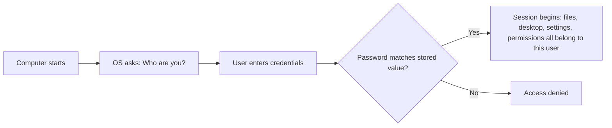
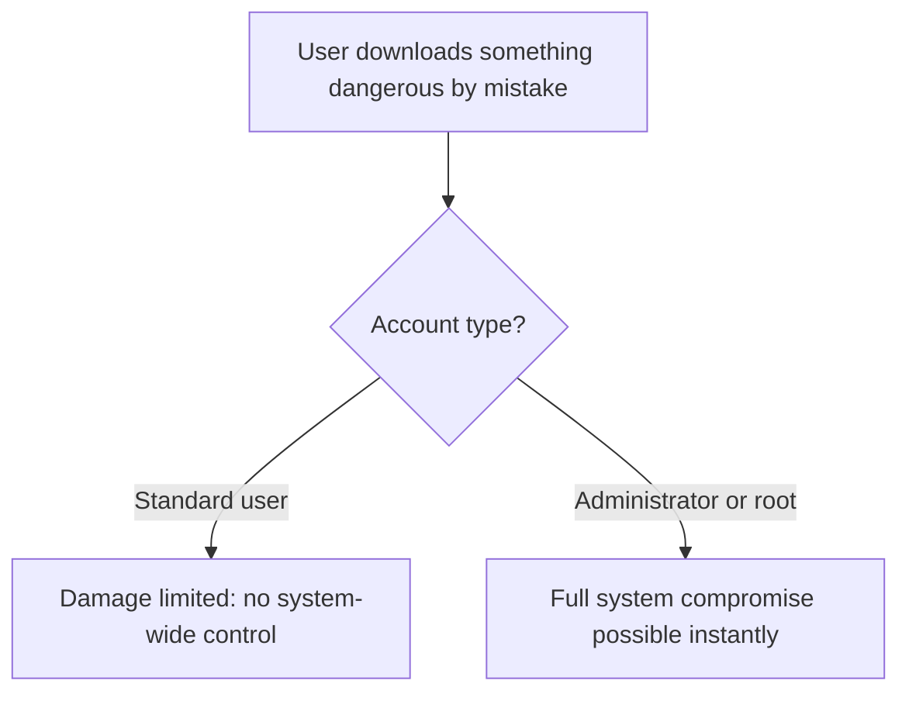
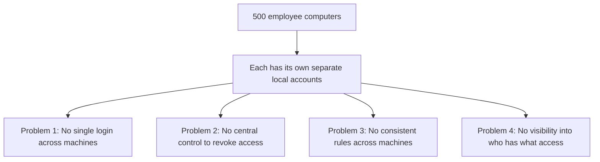
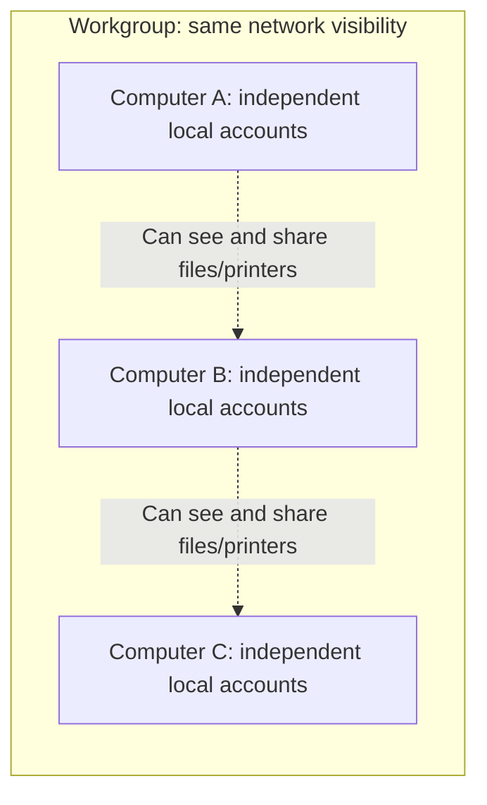

| Topic | Level | Reading Time | Prerequisites |
|---|---|---|---|
| Local Identity and the Scaling Problem | Beginner | ~15 min | None |

> **Goal of this section:**
>  You'll understand exactly what a user account is, why systems distinguish between an admin and a standard user, and why managing identity at the level of a single machine completely breaks down once we reach a company with hundreds of devices.


## Learning Objectives

By the end of this section, you will be able to:

- Explain what a **user account** is and how the operating system uses it to answer "who are you?" at every login.
- Locate and inspect local user accounts on both **Windows** and **Linux**.
- Differentiate between an **administrator/root** account and a **standard user** account, and explain why the separation exists.
- Describe the four core problems that appear when an organization tries to manage identity across hundreds of separate computers.
- Explain what a **Workgroup** is, and why it solves visibility but not identity management.

## Table of Contents

- [Learning Objectives](#learning-objectives)
- [What Is a User Account](#what-is-a-user-account)
  - [The Core Idea](#the-core-idea)
  - [One Machine, Many Accounts](#one-machine-many-accounts)
  - [Practical Demo: Viewing Local Accounts](#practical-demo-viewing-local-accounts)
- [Why Multiple Accounts Exist](#why-multiple-accounts-exist)
  - [Administrator and Root Versus Standard User](#administrator-and-root-versus-standard-user)
  - [Why the Separation Exists](#why-the-separation-exists)
  - [Checking Your Own Account Role](#checking-your-own-account-role)
- [Scaling the Problem: One Computer Versus 500](#scaling-the-problem-one-computer-versus-500)
  - [Problem 1: No Single Login](#problem-1-no-single-login)
  - [Problem 2: No Central Control](#problem-2-no-central-control)
  - [Problem 3: No Consistent Rules](#problem-3-no-consistent-rules)
  - [Problem 4: No Visibility](#problem-4-no-visibility)
- [Before Active Directory: The Workgroup](#before-active-directory-the-workgroup)
  - [What a Workgroup Is](#what-a-workgroup-is)
  - [Why a Workgroup Is Not Enough for a Company](#why-a-workgroup-is-not-enough-for-a-company)
- [Career Path Connections](#career-path-connections)
- [Key Terms Glossary](#key-terms-glossary)
- [Summary](#summary)

## What Is a User Account

### The Core Idea

Every computer needs to know **who is using it**. A **user account** is an identity on the computer: it has a username and password, and it determines what you're allowed to do on that machine.

Windows and Linux **both work on the same logic**. When your machine starts, it **doesn't just let anyone in to use it**; it asks: **who are you?** and compares your password with the one it has stored.

Once you log in, the operating system considers **everything that happens in that session to be yours**: your files, your desktop, the settings of installed applications, and your permissions.



### One Machine, Many Accounts

A single physical machine can **hold more than one account at the same time**. Imagine the family computer: the father, the mother, and the kids can each have a **separate account** on the same machine. Each person gets **a separate desktop, a separate documents folder, and separate browser bookmarks**, completely separate, even though the hardware is the same.

### Practical Demo: Viewing Local Accounts

On **Windows**:

```text
Press Windows + R
Type: netplwiz
Press Enter
```

This opens **User Accounts** and shows you every account on this machine.

On **Linux**, open a terminal and run:

```bash
cat /etc/passwd
```

This command shows you **every user account** on this Linux system, one line per account.

> [!TIP]
> Try both commands on your own machine right now. On Windows, notice the "Group" column in netplwiz, and on Linux notice how many accounts exist beyond the one you normally log in with, including system accounts you never interact with directly.

## Why Multiple Accounts Exist

### Administrator and Root Versus Standard User

Not all accounts are equal. In Windows and Linux, accounts have **roles**:

| Role | System | Capability |
|---|---|---|
| Administrator | Windows | Can do anything: install software, change system settings, create or delete other accounts, access any file |
| Root | Linux | The same absolute privileges, under a different name |
| Standard User | Windows and Linux | Can use the machine, run programs, and manage their own files, but **can't** change system-wide settings or install most software without the admin password |

### Why the Separation Exists

This separation **exists for security reasons**. If a standard user downloads something harmful by mistake, the damage is **limited**, because that account doesn't have full control over the machine in the first place.

If **everyone works as an administrator all the time**, a single mistake or a single piece of malware can **take over the whole machine instantly**.



> [!IMPORTANT]
> The separation between administrator and standard user is one of the oldest and most effective security controls in computing. It applies the principle of least privilege at the most basic level: the operating system account itself.

### Checking Your Own Account Role

On **Windows**, in `netplwiz`, look at the **Group** column — it will say **Administrators** or **Users**.

On **Linux**, run this in the terminal:

```bash
groups
```

This command shows you which groups your account is a member of. If you see **`sudo`** in the list, that means the account has **admin-level privileges**.

## Scaling the Problem: One Computer Versus 500

Everything we've explained so far works well on **a single machine**. But imagine a company with **500 employee computers**, where each computer has **completely separate local accounts**, not connected to any other machine. Four problems appear immediately:

### Problem 1: No Single Login

If Ahmed works at **Desk A** today and at **Desk B** tomorrow, he needs a **separate account** created on every machine he might use, with a **separate password** to remember for each one.

### Problem 2: No Central Control

If the company wants to let an employee go and shut off their access **immediately**, IT has to go to **each of the 500 machines one by one** and delete the account, or hope that person never touched a particular machine.

### Problem 3: No Consistent Rules

If the company wants every password to be **at least 10 characters**, someone has to **set that configuration manually on every machine, 500 times**.

### Problem 4: No Visibility

There's **no single place** where you can see who has an account, who is an admin, or who logged in to which machine.



> [!IMPORTANT]
> This is the core problem Active Directory exists to solve: managing identity and access at scale, from one central place. Every concept in the rest of this series builds on solving exactly these four problems.

## Before Active Directory: The Workgroup

### What a Workgroup Is

Before Active Directory, Windows had a simpler way to let machines recognize each other on the same network: the **Workgroup**.

A **Workgroup** is just a **name** shared by a group of Windows computers so they can see each other on the local network (for example, to share files or a printer).

That's **really all it is**: a workgroup **has no central authority, no shared accounts, and no central password**. Each machine in the workgroup **still manages its local accounts completely independently**, exactly as we explained in the previous two sections.

The workgroup name is just a **grouping label**, like placing machines in the same visible "neighborhood" on the network.



**By default**, every Windows computer is already in some workgroup.

### Why a Workgroup Is Not Enough for a Company

**The scenario:** Ahmed has an account on his laptop. He sits at Sara's desk and tries to log in. **His account doesn't exist there**, because workgroups share **only visibility on the network, not accounts**. Every machine is still **a separate island** that manages itself.

| Scenario | Verdict |
|---|---|
| A home or small office sharing a printer | Perfectly suitable |
| A company with hundreds of machines | Breaks down: **no central login, no central control, no central rules** — the same three problems from before, still unsolved |

> [!WARNING]
> A Workgroup is a networking convenience, not an identity management system. It solves "can these computers see each other?" and does nothing for "can this person log in anywhere with one account?" Confusing the two is a common early misunderstanding.

## Career Path Connections

| Career Path | How This Topic Applies |
|---|---|
| SOC Analyst | Understands local account privileges (admin vs standard) when assessing the severity of a compromised endpoint |
| Penetration Tester | Checks local account configurations and privilege separation as an early step in host enumeration |
| GRC | Password and account policies at scale are a direct compliance concern that Active Directory later addresses |
| Cloud Security | Cloud identity systems solve the exact same four scaling problems, just for cloud resources instead of physical machines |

## Key Terms Glossary

| Term | Definition |
|---|---|
| User Account | An identity on a computer, consisting of a username and password, that determines what a person is allowed to do |
| Session | The period after login during which files, settings, and permissions belong to the logged-in user |
| Administrator | A Windows account role with full control over the machine |
| Root | The Linux equivalent of Administrator, with full control over the system |
| Standard User | An account role that can use the computer but cannot change system-wide settings or install most software |
| Principle of Least Privilege | Granting only the minimum access required, applied here at the operating system account level |
| Workgroup | A shared name that lets Windows computers see each other on a local network, with no central accounts or authority |
| Local Account | An account that exists only on one specific computer, unconnected to any other machine |

## Summary

- **A user account answers "who are you?":** every login is checked against a stored username and password, and the whole session is tied to that identity.
- **One machine can hold many separate identities:** each account on the same machine gets a completely separate desktop, files, and settings.
- **Administrator/root versus standard user is a core safety separation:** it limits the damage if a mistake or a compromise happens, applying the principle of least privilege at the system's most basic building block.
- **Scaling to hundreds of machines breaks local account management completely:** four problems appear: no single login, no central control, no consistent rules, no visibility.
- **A Workgroup solves visibility, not identity:** the machines see each other on the network, but each machine still manages its accounts on its own.
- **These four problems are exactly what Active Directory exists to solve:** the upcoming files in this series build directly on this problem.

