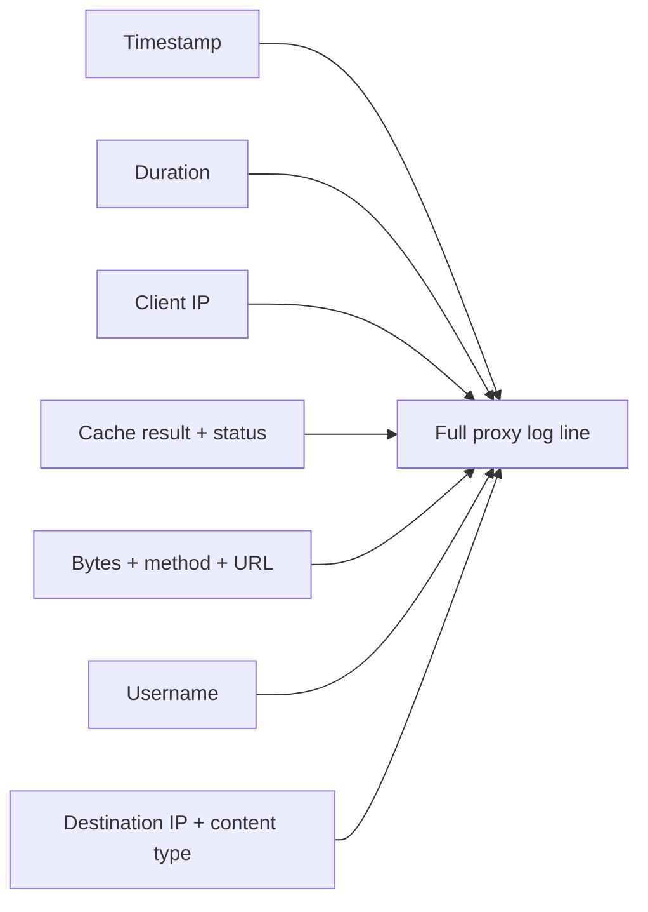
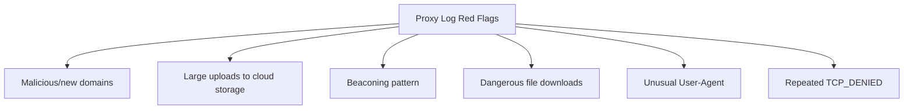
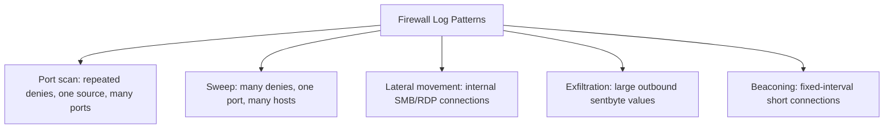
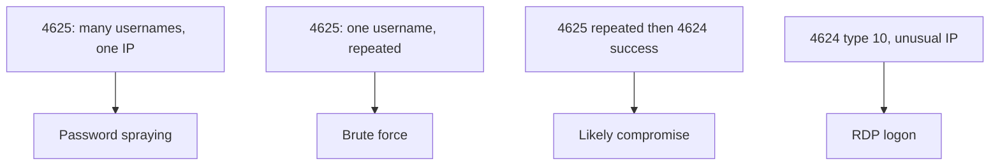
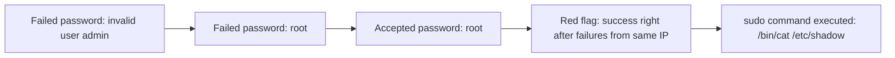
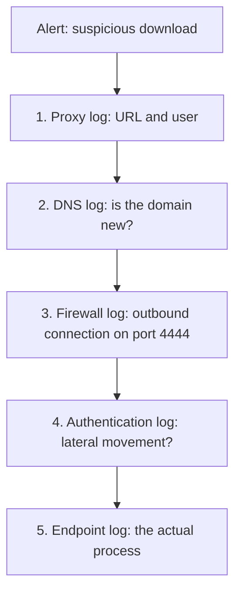

| Topic | Level | Reading Time | Prerequisites |
|---|---|---|---|
| Network and Authentication Logs | Intermediate | ~25 min | Core Log Types and Web Server Logs |

> **Goal of this section:**
> You'll understand how to read proxy logs, firewall logs, and WAF logs, learn the most important Event IDs in Windows authentication logs, how to read SSH logs on Linux and VPN authentication logs, and finally see how an analyst ties all of them together in a real investigation.

## Learning Objectives

By the end of this section, you will be able to:

- Read a **Squid proxy log** field by field and list what an analyst looks for in it.
- Compare **proxy logs** and **web server logs** across position, direction, and typical use cases.
- Read a **firewall log** entry, including a Cisco ASA deny message, and list key patterns to watch.
- Explain what a **WAF log** confirms that a firewall log cannot.
- Interpret Windows **Event ID 4624/4625** authentication logs, including logon types and status codes.
- Read a Linux **SSH authentication log** and recognize a successful brute-force pattern.
- Read a **VPN authentication log** and explain why the assigned internal IP matters for correlation.
- Walk through a **mini-investigation** that stitches five different log sources into one story.

## Table of Contents

- [Learning Objectives](#learning-objectives)
- [Proxy Logs (Squid Example)](#proxy-logs-squid-example)
  - [What a Forward Proxy Does](#what-a-forward-proxy-does)
  - [Reading the Fields](#reading-the-fields)
  - [What the Analyst Looks For](#what-the-analyst-looks-for)
- [Proxy Log Versus Web Server Log](#proxy-log-versus-web-server-log)
- [Firewall Logs](#firewall-logs)
  - [A Basic Allow Entry](#a-basic-allow-entry)
  - [Cisco ASA Deny Example](#cisco-asa-deny-example)
  - [What to Look For](#what-to-look-for)
- [WAF Logs](#waf-logs)
- [Authentication Logs: Windows](#authentication-logs-windows)
  - [The Essential Event IDs](#the-essential-event-ids)
  - [A Failed Logon Event (4625) in Detail](#a-failed-logon-event-4625-in-detail)
- [Authentication Logs: Linux / SSH](#authentication-logs-linux--ssh)
- [VPN Authentication Log](#vpn-authentication-log)
- [DNS Logs, a Short Example](#dns-logs-a-short-example)
- [Putting Logs Together: A Mini-Investigation](#putting-logs-together-a-mini-investigation)
- [Career Path Connections](#career-path-connections)
- [Key Terms Glossary](#key-terms-glossary)
- [Summary](#summary)

## Proxy Logs (Squid Example)

### What a Forward Proxy Does

A **Forward proxy** sits between internal users and the internet. Users' web requests pass through it, and it can filter, authenticate, and log them.

```text
1759483200.123   245 10.1.5.23 TCP_MISS/200 15432 GET
http://news.example.com/index.html jsmith HIER_DIRECT/93.184.216.34 text/html

1759483230.789     0 10.1.5.23 TCP_DENIED/403 3890 GET http://gambling-
site.example/ jsmith HIER_NONE/- text/html
```

### Reading the Fields

| Field | Explanation |
|---|---|
| `1759483200.123` | Timestamp: the exact time the proxy processed the request, in Unix timestamp format |
| `245` | Request duration: 245 milliseconds to process |
| `10.1.5.23` | Client IP: the internal address of the machine that sent the request |
| `TCP_MISS/200` | Cache result and HTTP status: `TCP_MISS` means the content wasn't in the cache, so Squid fetched it from the destination; `200` means the request succeeded |
| `15432` | Bytes sent to the client |
| `GET` | HTTP method |
| `http://news.example.com/index.html` | The requested URL |
| `jsmith` | Username: the identity Squid associated with the request through a configured authentication mechanism (possibly via Active Directory) |
| `HIER_DIRECT/93.184.216.34` | The connection path and the destination IP: `HIER_DIRECT` means Squid connected directly to the server instead of the cache |
| `text/html` | The content type |



### What the Analyst Looks For

| Signal | Why It Matters |
|---|---|
| Access to malicious or newly registered sites | May indicate communication with suspicious infrastructure |
| Unusually large uploads to cloud storage services | May indicate exfiltration |
| **Beaconing**: a compromised machine connecting to the same URL at regular intervals (every 60 seconds, for example) | May indicate malware communicating with a command-and-control server |
| Downloads of dangerous file types (`.exe`, `.ps1`, `.zip`) from suspicious sources | May contain malware |
| Unusual User-Agent values (`python-requests`, `curl`, or empty) from a regular workstation | May indicate the use of scripts or command-line tools instead of a normal browser (although this can happen in legitimate activity too) |
| Repeated `TCP_DENIED` from the same user or machine | May indicate attempts to reach blocked destinations |



## Proxy Log Versus Web Server Log

| | Proxy Log | Web Server Log |
|---|---|---|
| **Position** | Between internal users and the internet | In front of or on your application |
| **Direction** | Outbound (your employees going out) | Inbound (the world coming to you) |
| **Typical question** | Where did our employees go? | Who visited or attacked our site? |
| **Client IP** | Internal address (10.x.x.x) | External address (real visitors from the internet) |
| **Username** | Usually present (proxy authentication) | Usually not, unless the site has its own login |
| **Destination** | Thousands of different sites | One site (yours) |
| **HTTPS visibility** | Only the host:port, unless there's TLS inspection | The full path, because the server decrypts the traffic |
| **Use cases** | Malware downloads, phishing clicks, data leakage, policy violations | Web attacks (SQLi, XSS, scanning), brute force, application errors |

> [!TIP]
> Easy way to remember the difference: the proxy log watches your people going out, the web server log watches strangers coming in. A reverse proxy or load balancer is the opposite of a forward proxy, because it protects servers rather than users.

## Firewall Logs

### A Basic Allow Entry

The firewall inspects network connections against its rules and logs whether each connection was allowed or blocked.

```text
srcip=192.168.1.10 dstip=8.8.8.8 dstport=53 action=accept service=DNS
```

**Reading it:** a machine with IP `192.168.1.10` sent a request to `8.8.8.8` on port 53 (DNS). The firewall allowed the connection because the action was `accept`.

| Field | Meaning |
|---|---|
| `srcip` | The source machine |
| `dstip` | The destination |
| `dstport` | The targeted port |
| `service` | The service involved |
| `action` | Whether the firewall allowed or blocked the connection |

### Cisco ASA Deny Example

```text
Oct 03 2026 09:31:05 FW1 : %ASA-4-106023: Deny tcp src outside:203.0.113.45/44312 dst inside:10.0.0.5/3389 by access-group
"OUTSIDE_IN" [0x0, 0x0]
```

**Reading it:** someone from the internet tried to reach RDP (port 3389) on an internal server, and the `OUTSIDE_IN` rule blocked them. `%ASA-4-106023` is a standard message ID, and the number in the text is the severity.

### What to Look For

| Pattern | Possible Meaning |
|---|---|
| Repeated denies from one source across many ports | **Port scan** |
| Many denies on one port across many hosts | A **Sweep** for a specific service |
| Allowed outbound connections to unusual countries or ports | Suspicious activity |
| Internal machines connecting to each other over SMB (445) or RDP (3389) | May indicate **lateral movement** |
| Large `sentbyte` values to external destinations | May indicate exfiltration |
| **Beaconing**: the same short connections at fixed intervals | A C2 signal |



## WAF Logs

**WAF logs** record the attack type, the violation, the request status (blocked or alerted), the support ID shown to the user on the block page, and the matching signature.

```text
attack_type="SQL-Injection", violations="Attack signature detected",
request_status="blocked", support_id="1234567890123456789",
uri="/products", client_ip="198.51.100.77"
```

**This is the best source for confirming exactly what any HTTP attack looked like.**

> [!NOTE]
> This connects directly to the WAF file from Defense in Depth and Evasion Techniques: a firewall log shows that a connection on port 443 was allowed, but only the WAF log reveals what was actually inside that HTTP request.

## Authentication Logs: Windows

### The Essential Event IDs

| Event ID | Meaning |
|---|---|
| **4624** | Successful logon |
| **4625** | Failed logon |

| Pattern | Likely Meaning |
|---|---|
| Many `4625` events with different usernames from one IP | **Password spraying** or **user enumeration** |
| Many `4625` events for a single user | **Brute force** |
| Repeated `4625` followed by a successful `4624` from the same source | Likely compromise |
| `4624` with logon type `10` from an unusual IP | Logon via RDP |



### A Failed Logon Event (4625) in Detail

```text
EventID: 4625   Time: 2026-10-03 09:40:12
Account For Which Logon Failed: Account Name: administrator   Account Domain: CORP
Logon Type: 3
Failure Reason: Unknown user name or bad password
Status: 0xC000006D   Sub Status: 0xC000006A
Workstation Name: PC-FINANCE-07
Source Network Address: 10.1.8.50   Source Port: 51444
```

| Field | Meaning |
|---|---|
| **Logon Type** | `2` interactive (at the keyboard), `3` network (file share), `4` batch, `5` service, `7` unlock, `10` RemoteInteractive (RDP), `11` cached credentials |
| **Status** | `0xC000006D` generic logon failure |
| **Sub Status** | `0xC000006A` wrong password; `0xC0000064` user doesn't exist; `0xC0000234` locked out; `0xC0000072` account disabled |
| **Source Network Address** | Where the attempt came from |

## Authentication Logs: Linux / SSH

The file: `/var/log/auth.log` (Debian/Ubuntu) or `/var/log/secure` (RHEL/CentOS).

```text
Oct 3 09:45:01 srv01 sshd[2211]: Failed password for invalid user admin from 203.0.113.45 port
42122 ssh2
Oct 3 09:45:03 srv01 sshd[2213]: Failed password for root from 203.0.113.45 port 42130 ssh2
Oct 3 09:45:09 srv01 sshd[2217]: Accepted password for root from 203.0.113.45 port 42150 ssh2
Oct 3 09:46:00 srv01 sudo:   jsmith : TTY=pts/0 ; PWD=/home/jsmith ; USER=root ; COMMAND=/bin/cat
/etc/shadow
```

**Reading it:**

- `invalid user` means the username doesn't exist at all (the attacker is guessing).
- The **`Accepted`** that comes **right after** failed attempts from the same IP is **the red flag**.
- The `sudo` line shows the use of privileges and the exact command.



> [!WARNING]
> This exact log pattern, repeated failures followed immediately by a success from the same source, is one of the clearest brute-force success indicators across any authentication system, not just SSH. It connects directly to the credential-cracking concepts covered in the Password Cracking Techniques file.

## VPN Authentication Log

```text
2026-10-03 09:55:10 vpn-gw01 user=jsmith src=185.220.101.9 result=SUCCESS auth=RADIUS+MFA
assigned_ip=10.200.0.15 session_id=88421
2026-10-03 11:30:44 vpn-gw01 user=jsmith session_id=88421 event=DISCONNECT bytes_in=2.1GB
bytes_out=14MB
```

The VPN log gives you: the login time, the public source IP, the assigned internal IP (essential for correlating with later activity), the MFA result, and the data volume.

> [!TIP]
> The assigned internal IP is the critical pivot point: once you have it, you can search every other internal log (firewall, proxy, authentication) for that same internal IP to reconstruct exactly what the VPN session did inside the network.

## DNS Logs, a Short Example

```text
03-Oct-2026 10:01:02 queries: client @0x7f 10.1.5.23#52344 (www.microsoft.com): query:
www.microsoft.com IN A + (10.0.0.2)
```

The fields: the time, the client IP, the requested name, the record type (A, AAAA, MX, TXT), and the resolver.

**DNS logs reveal phishing domains, malware callbacks, DGA domains, and tunnels.**

> [!NOTE]
> Full detection detail for DNS-based exfiltration techniques is covered in the Data Exfiltration and DNS Tunneling file in the Data Loss Prevention and Exfiltration category.

## Putting Logs Together: A Mini-Investigation

**Alert:** the user `jsmith` downloaded a suspicious file.

| # | Log | What It Reveals |
|---|---|---|
| 1 | **Proxy log** | `10.1.5.23 jsmith GET http://cdn-update.example/setup.exe TCP_MISS/200 2.1MB`, so we learn the URL and the user |
| 2 | **DNS log** | Shows when `cdn-update.example` was first resolved (to see whether the domain is new) |
| 3 | **Firewall log** | Confirms later outbound connections from `10.1.5.23` to an unknown IP on port 4444 |
| 4 | **Authentication log** | Shows whether this machine later logged in to other systems (lateral movement) |
| 5 | **Endpoint log** | The process that made the connection |



> [!IMPORTANT]
> The lesson: each log is one piece of the puzzle. No single source, including this five-step example, can answer every part of the investigation alone. This is the practical, end-to-end demonstration of the correlation principle introduced at the start of this file.

## Career Path Connections

| Career Path | How This Topic Applies |
|---|---|
| SOC Analyst | This file's log types and the mini-investigation pattern represent core daily Tier 1/Tier 2 investigative work |
| Penetration Tester | Understanding which log source reveals which evidence helps plan engagements that stay under or deliberately trigger detection |
| GRC | Authentication log retention (4624/4625, SSH, VPN) is a direct, auditable compliance requirement |
| Cloud Security | Cloud-native firewall, proxy, and identity logs follow the same field logic, often correlated in a cloud-native SIEM |

## Key Terms Glossary

| Term | Definition |
|---|---|
| Forward Proxy | A system sitting between internal users and the internet, able to filter, authenticate, and log traffic |
| Beaconing | Regular, periodic communication from a compromised host to a command-and-control server |
| Reverse Proxy | A system that sits in front of servers to protect them, the opposite of a forward proxy |
| Port Scan | Repeated connection attempts across many ports from one source |
| Sweep | Repeated connection attempts to one port across many hosts |
| Lateral Movement | An attacker's movement from one compromised system to another inside the network |
| Logon Type | A Windows field indicating how a logon occurred (interactive, network, RDP, etc.) |
| Password Spraying | Trying one or a few common passwords against many different accounts |
| Assigned Internal IP | The internal network address a VPN gateway assigns to a connecting user, used for correlation |

## Summary

- **Proxy logs reveal outbound activity:** cache result, status, bytes, username, and the connection path, and they expose beaconing, exfiltration, and malware downloads.
- **Proxy and web server logs differ in direction and purpose:** the proxy watches your employees going out; the web server watches strangers coming in.
- **Firewall logs reveal allow/deny decisions:** and patterns such as port scans, sweeps, and lateral movement.
- **WAF logs confirm what a firewall cannot see:** the full attack details at the HTTP level.
- **Windows 4624/4625 events, with logon types and status codes, reveal brute force and compromise patterns.**
- **Linux SSH logs show the same brute-force pattern:** repeated failures followed immediately by a success from the same source.
- **VPN logs provide the pivot point (assigned internal IP) for correlating later internal activity.**
- **DNS logs reveal phishing domains, malware callbacks, and tunneling attempts.**
- **No single log source answers a full investigation alone:** the five-step example shows how five different sources build one complete story.

