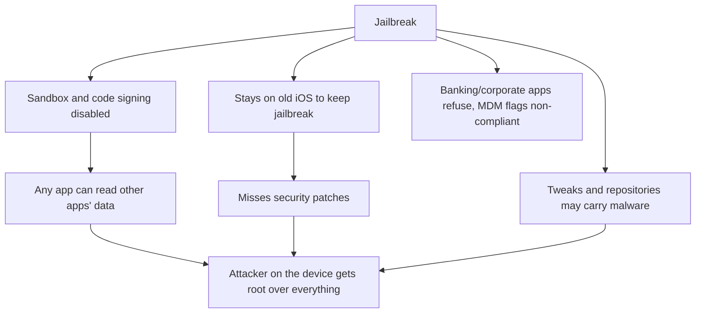
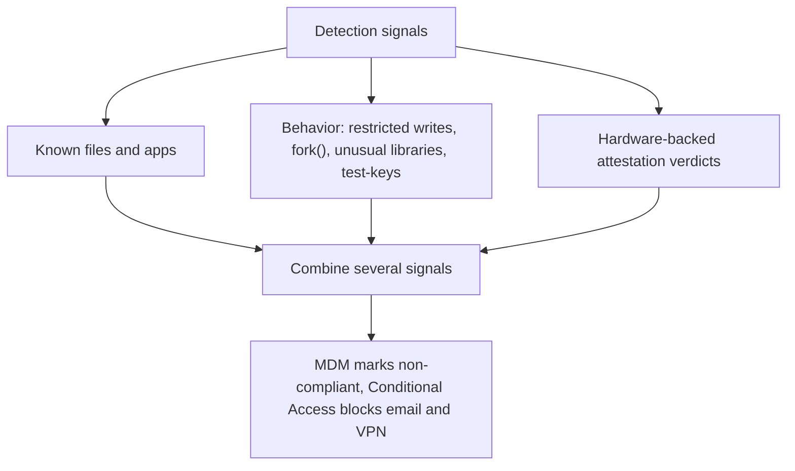
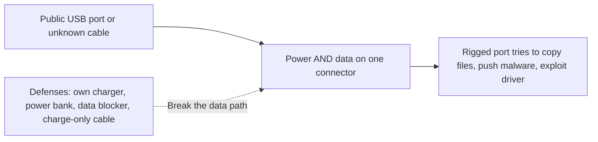
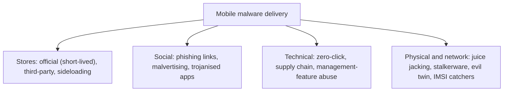

| Topic | Level | Reading Time | Prerequisites |
|---|---|---|---|
| Jailbreaking, Rooting, and Mobile Malware | Intermediate | ~20 min | Mobile Threats and Platform Security |

> **Goal of this section:**
> You'll understand what jailbreaking and rooting mean and why they break a phone's protections at the root, how organizations detect them, what juice jacking is and whether its risk is real, and how malware actually reaches a phone through five main paths and five additional ones.

## Learning Objectives

By the end of this section, you will be able to:

- Define **jailbreaking** and list the four jailbreak types (tethered, semi-tethered, semi-untethered, untethered).
- Explain why jailbreaking is dangerous in terms of sandbox, patching, malware, and compliance.
- Describe **rooting** on Android at a high level, and explain why a custom hardened ROM like GrapheneOS shows that unlocking is not always bad.
- List the signals organizations use to detect jailbroken or rooted devices, and explain why detection is a cat-and-mouse game.
- Explain **juice jacking**, its history, and the practical defenses.
- List ten ways malware reaches a mobile device and the Android permissions most often abused.
- Apply the mobile security best-practices checklist.

## Table of Contents

- [Learning Objectives](#learning-objectives)
- [Jailbreaking (iOS)](#jailbreaking-ios)
  - [What It Is](#what-it-is)
  - [Jailbreak Types](#jailbreak-types)
  - [Why It Is Dangerous](#why-it-is-dangerous)
- [Rooting Android](#rooting-android)
  - [What It Is](#what-it-is-1)
  - [The Usual Steps](#the-usual-steps)
  - [Custom ROMs and the GrapheneOS Case](#custom-roms-and-the-grapheneos-case)
  - [Risks](#risks)
- [How Organizations Detect Jailbroken or Rooted Devices](#how-organizations-detect-jailbroken-or-rooted-devices)
- [Juice Jacking](#juice-jacking)
  - [How It Works](#how-it-works)
  - [History](#history)
  - [Defenses](#defenses)
- [How Malware Reaches a Mobile Device](#how-malware-reaches-a-mobile-device)
  - [Five Common Delivery Paths](#five-common-delivery-paths)
  - [Five More Delivery Paths](#five-more-delivery-paths)
  - [Android Permissions Attackers Love](#android-permissions-attackers-love)
- [Mobile Security Best Practices](#mobile-security-best-practices)
- [Career Path Connections](#career-path-connections)
- [Key Terms Glossary](#key-terms-glossary)
- [Summary](#summary)

## Jailbreaking (iOS)

### What It Is

**Jailbreaking** means exploiting vulnerabilities in iOS to remove Apple's restrictions and gain **root-level access**. It allows installing unsigned apps, tweaks, and alternative stores (such as **Cydia** and **Sileo**), and customizing the system.

### Jailbreak Types

| Type | Behavior |
|---|---|
| **Tethered** | Must be connected to a computer on every boot, or the device won't start |
| **Semi-tethered** | Boots normally, but the jailbreak is lost until it's reapplied from a computer |
| **Semi-untethered** | Boots normally, and the jailbreak is reapplied from an app on the device itself |
| **Untethered** | Persists after a reboot (very rare today) |

Well-known tools (as examples): **checkra1n, palera1n, unc0ver, Dopamine**.

### Why It Is Dangerous

- **It disables sandbox and code-signing protections**, so any app can access other apps' data.
- Users often **stay on old iOS versions** to keep the jailbreak, so they miss security patches.
- Tweaks and repositories may contain **malware** (spyware that steals credentials or data).
- Banking and corporate apps **refuse to run**, and the MDM flags the device as **non-compliant**.
- Warranty and support problems.
- Any attacker who reaches a jailbroken phone **gets root access to everything**.

## Rooting Android

### What It Is

**Rooting** gives the user (or malware) **superuser access** on Android.

### The Usual Steps

At a high level (for understanding only):

| # | Step |
|---|---|
| 1 | Enable Developer Options and OEM unlocking |
| 2 | Unlock the bootloader. **This wipes the device and changes the boot state to Orange** |
| 3 | Install a custom recovery (such as **TWRP**), or patch the boot image with **Magisk** and flash it |
| 4 | Magisk provides `su` (superuser) access, with a manager app that grants root to apps |

### Custom ROMs and the GrapheneOS Case

**Custom ROMs** (such as **LineageOS** and **GrapheneOS**) replace the OS entirely. **GrapheneOS** is an interesting case: a **hardened, security-focused** ROM, which shows that unlocking the bootloader **isn't always bad**. The real risk lies in **running untrusted or unpatched systems**.

> [!IMPORTANT]
> Unlocking a bootloader is not automatically a security failure. What makes a rooted or modified device dangerous is running an untrusted, unpatched, or unverified system. A hardened custom ROM maintained and updated by a security-focused project can be more secure than a neglected stock device.

### Risks

- The app sandbox **can be bypassed**.
- Any malware with root can do anything: read other apps, hide itself, and intercept SMS and OTPs.
- **Verified Boot is off.**
- **SafetyNet / Play Integrity fails**, so banking and work apps may refuse to run.
- Rooted phones are often **outdated**.

> [!WARNING]
> This section describes rooting at the level needed to understand why it is a risk and how it is detected. It is not a guide for rooting a device you manage for an organization. Corporate-managed devices should never be rooted, and doing so typically violates the acceptable-use policy and triggers a non-compliant status.

## How Organizations Detect Jailbroken or Rooted Devices

| Method | Detail |
|---|---|
| **MDM compliance checks** | Look for jailbreak indicators, mark the device non-compliant, and block access to email and VPN through **Conditional Access** |
| **File and app checks** | iOS: the presence of Cydia, Sileo, `/bin/bash`, and `/usr/sbin/sshd`. Android: the presence of the `su` binary or the Magisk app |
| **Behavior checks** | The ability to write to restricted directories, the ability to call `fork()` (blocked in the sandbox), unusual libraries loaded in the app, and a `test-keys` build on Android |
| **Hardware-backed attestation** | Apple **App Attest/DeviceCheck** and Google **Play Integrity** return signed verdicts about the device's integrity |

**Reality check:** detection is a **cat-and-mouse** game, because there are tools that hide root. So you combine **several signals** together.

> [!TIP]
> In an interview, the strongest answer on root detection is not any single check but the principle: hiding tools exist, so no single check is trustworthy on its own. Hardware-backed attestation is the strongest signal because it is signed by the platform, not by software the attacker can modify.

## Juice Jacking

### How It Works

**Juice jacking** is an attack through a **public USB charging port or cable**. Charging stations in airports, hotels, cafés, and conference centers use USB ports that carry **power and data over the same connector**. A malicious station (or a rigged cable) may try to access the phone's data or install malware while it charges.

| # | Step |
|---|---|
| 1 | The victim plugs the phone into the port or cable |
| 2 | The USB connection also opens a **data channel** |
| 3 | A rigged port or cable tries to talk to the phone: copy files, push malware, or exploit a vulnerability in a USB driver |

### History

- The term was coined in **2011** by researcher **Brian Krebs** after a demonstration at **DEF CON** (the "Wall of Sheep" project) proved the risk.
- Researchers later demonstrated proofs of concept for the iPhone (the **"Mactans"** charger from Georgia Tech in 2013).
- Malicious cables such as the **O.MG cable** look like an ordinary cable but contain a **hidden Wi-Fi-enabled implant** that can inject keystrokes (a **badUSB**-type attack).
- The **FBI** and the **FCC** issued public warnings. **Confirmed criminal cases are rare**, so the risk is mostly **theoretical in practice**, but **the technique is real**.
- 2025 research from **Graz University of Technology** called **"ChoiceJacking"** showed that attackers can bypass the "Allow data access?" prompt by spoofing user input, so even **the security prompt itself isn't absolute**.

### Defenses

- Use **your own charger** and plug it into a wall outlet.
- Carry a **power bank**.
- Use a **USB data blocker** ("USB condom") that passes only the power pins.
- Use **charge-only cables**.
- Keep the phone **locked and updated**. Decline any "Trust this computer?" or "Allow data transfer?" prompt.
- Avoid public stations and unknown cables, **including free "giveaway" cables**.

**A teaching question:** what's the difference between a charging cable and a data cable? **The answer:** a data cable has **data wires** inside it, and the data blocker cuts them.

> [!NOTE]
> Juice jacking is a real technique with a modest real-world probability. The right way to present it is calibrated: the technology is real and demonstrated, confirmed criminal cases are rare, and the defenses are cheap, so following them costs almost nothing.

## How Malware Reaches a Mobile Device

### Five Common Delivery Paths

| # | Path | Detail |
|---|---|---|
| 1 | **Official app stores** | Malicious apps sometimes get through — often an innocent app that turns malicious after an update or contains hidden code. They're removed once discovered, so they're short-lived. A common lure: "download YouTube videos" apps |
| 2 | **Third-party app stores and sideloading** | Mainly affects Android and jailbroken iOS. There's no vetting by Google/Apple |
| 3 | **Phishing links and attachments** | Via SMS, email, WhatsApp/Telegram/social media, and QR codes. The link leads to a fake site or a malicious app or profile |
| 4 | **Malicious websites and malvertising** | Drive-by downloads, fake update pop-ups ("Your Chrome is outdated"), and scareware |
| 5 | **Trojanised legitimate apps** | Counterfeit copies of popular apps (a fake WhatsApp, a fake banking app) or modified apps |

### Five More Delivery Paths

| # | Path | Detail |
|---|---|---|
| 6 | **Zero-click exploits** | Delivered by a message or call with no interaction (Pegasus) |
| 7 | **Physical access** | Juice jacking, malicious cables, stalkerware |
| 8 | **Rogue networks** | Evil twin Wi-Fi and fake cell towers (**IMSI catchers / "Stingrays"**) that downgrade or intercept communications |
| 9 | **Supply chain** | Malware preinstalled on cheap devices, and compromised SDKs inside apps |
| 10 | **Abuse of management features** | Malicious configuration profiles, rogue MDM enrolment, enterprise certificates |

### Android Permissions Attackers Love

On Android, **the permission model is a favorite target**. Apps request **"Accessibility service,"** **"Device admin,"** **"Draw over other apps,"** or **"Notification access,"** and then **take control of the phone**.

> [!WARNING]
> An Android app asking for Accessibility service, Device admin, Draw over other apps, or Notification access is requesting far more power than almost any normal app needs. If a simple utility app asks for any of these, treat the request itself as the red flag.

## Mobile Security Best Practices

| # | Practice |
|---|---|
| 1 | Update the OS and apps |
| 2 | Use a **strong passcode** and biometrics; enable device encryption (on by default on modern phones) |
| 3 | Install apps from **official stores only**, and review the permissions |
| 4 | **Don't jailbreak or root** |
| 5 | Use an **authenticator app or security key** instead of SMS; and set a carrier PIN |
| 6 | Be wary of links in SMS and QR codes |
| 7 | Use a **VPN on untrusted Wi-Fi**, and disable auto-join for open networks |
| 8 | Turn off Bluetooth/NFC when you don't need them |
| 9 | Enable **Find My / remote wipe** |
| 10 | Don't use public USB ports; use your own charger |
| 11 | For organizations: **deploy MDM** (the next file) |

## Career Path Connections

| Career Path | How This Topic Applies |
|---|---|
| SOC Analyst | Uses MDM compliance and device-integrity signals when triaging a sign-in or an endpoint alert |
| Penetration Tester | Assesses mobile attack surface in authorized scope, including rooted-device behavior and permission abuse |
| GRC | Policies must explicitly prohibit jailbreaking and rooting on corporate or BYOD-enrolled devices |
| Cloud Security | Device-integrity attestation (App Attest, Play Integrity) feeds conditional access for cloud apps |

## Key Terms Glossary

| Term | Definition |
|---|---|
| Jailbreaking | Exploiting iOS to remove Apple's restrictions and gain root-level access |
| Rooting | Gaining superuser access on Android |
| Magisk | A tool that patches the Android boot image to provide `su` access |
| Custom ROM | A replacement operating system image such as LineageOS or GrapheneOS |
| Play Integrity | Google's API letting apps verify a device is genuine and unmodified |
| App Attest / DeviceCheck | Apple's hardware-backed mechanisms for verifying app and device integrity |
| Juice Jacking | An attack through a public USB charging port or cable that carries both power and data |
| USB Data Blocker | An adapter passing only power pins so no data channel can open |
| badUSB | An attack where a USB device impersonates a keyboard to inject keystrokes |
| IMSI Catcher (Stingray) | A fake cell tower that intercepts or downgrades mobile connections |
| Sideloading | Installing an app from outside the official store |
| Malvertising | Malicious advertisements delivering drive-by downloads or fake prompts |

## Summary

- **Jailbreaking removes Apple's sandbox and code-signing protections:** and users stay on old iOS, so they miss patches.
- **Four jailbreak types exist:** tethered, semi-tethered, semi-untethered, and untethered.
- **Rooting follows a standard path on Android:** OEM unlock, bootloader unlock (Orange state), recovery or Magisk, and su access.
- **Unlocking is not inherently bad:** GrapheneOS is an example of a hardened ROM; the risk lies in untrusted or unpatched systems.
- **Detection is cat-and-mouse:** files, behavior, and attestation, with several signals combined because hiding tools exist.
- **Juice jacking is real technology with modest real-world probability:** ChoiceJacking shows that even the security prompt isn't absolute.
- **Malware reaches phones through ten paths:** stores, sideloading, phishing, malvertising, counterfeit apps, zero-click, physical access, rogue networks, supply chain, and abuse of management features.
- **Android permissions are a favourite target:** Accessibility, Device admin, Draw over other apps, and Notification access.
- **Best practices combine updates, strong passcodes, official stores, no jailbreaking, non-SMS MFA, careful links, VPN, and MDM for organizations.**

