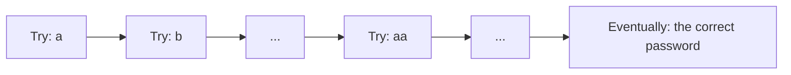
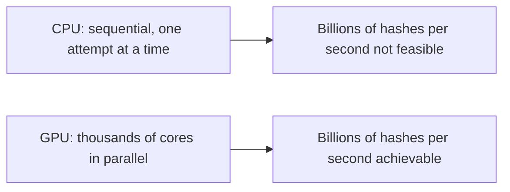
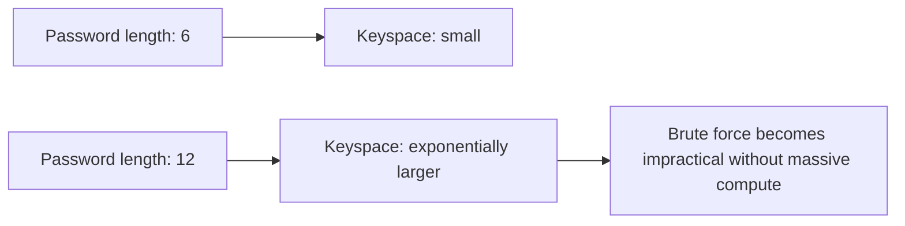
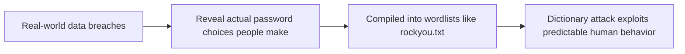
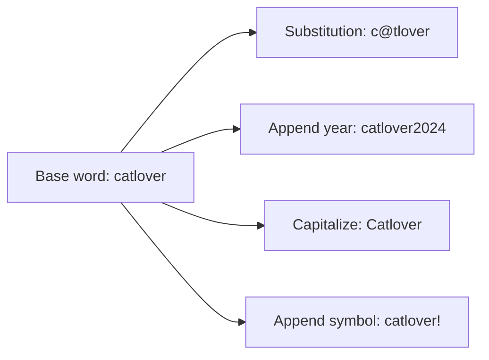
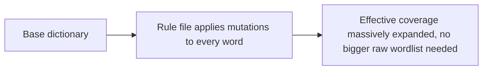
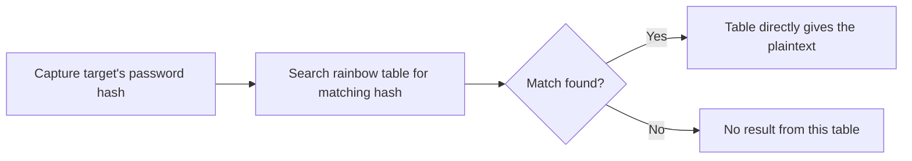
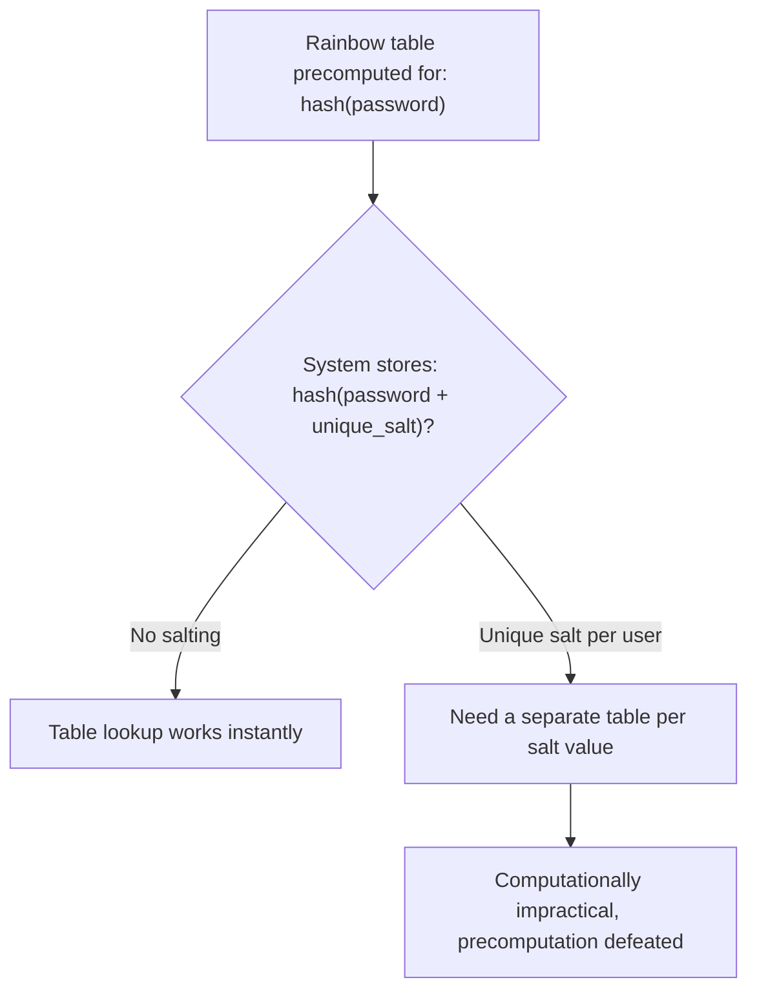
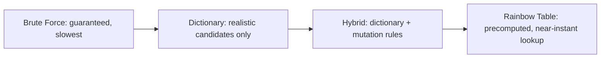

| Topic | Level | Reading Time | Prerequisites |
|---|---|---|---|
| Password Cracking Techniques | Intermediate | ~20 min | Password Hashing, Salting, and Peppering |

> **Goal of this section:**
> You'll understand the four main techniques attackers use to crack passwords, what makes each one faster or slower than the others, and why GPUs and quantum computing always come up in this context.

## Learning Objectives

By the end of this section, you will be able to:

- Explain how **brute force attacks** work, and why they are mathematically guaranteed to succeed given unlimited time.
- Explain why **GPU acceleration** matters so much for password cracking, and how it differs structurally from CPU computation.
- Explain how **dictionary attacks** trade completeness for speed, and why wordlists like `rockyou.txt` remain relevant today.
- Explain how **hybrid attacks** combine dictionary words with rule-based mutations, and why they defeat the common "swap letters for symbols" habit.
- Explain how **rainbow tables** turn cracking into a lookup instead of a computation, and why salting defeats them completely.

## Table of Contents

- [Learning Objectives](#learning-objectives)
- [Brute Force Attack](#brute-force-attack)
  - [The Core Guarantee](#the-core-guarantee)
  - [Why GPUs Change Everything](#why-gpus-change-everything)
  - [The Quantum Computing Threat](#the-quantum-computing-threat)
  - [The Trade-Off](#the-trade-off)
- [Dictionary Attack](#dictionary-attack)
  - [The Core Idea](#the-core-idea)
  - [Popular Wordlists](#popular-wordlists)
  - [The Weak Point](#the-weak-point)
  - [The Real Vulnerability Is Human Behavior](#the-real-vulnerability-is-human-behavior)
- [Hybrid Attack](#hybrid-attack)
  - [How It Works](#how-it-works)
  - [Why Character Substitution Does Not Help](#why-character-substitution-does-not-help)
  - [Rule Files in Practice](#rule-files-in-practice)
- [Pre-Computed Attack: Rainbow Tables](#pre-computed-attack-rainbow-tables)
  - [The Time-Memory Trade-Off](#the-time-memory-trade-off)
  - [The Lookup Process](#the-lookup-process)
  - [Why Salting Defeats This Completely](#why-salting-defeats-this-completely)
- [Comparing the Four Techniques](#comparing-the-four-techniques)
- [Career Path Connections](#career-path-connections)
- [Key Terms Glossary](#key-terms-glossary)
- [Summary](#summary)

## Brute Force Attack

### The Core Guarantee

**Brute force** **systematically generates and tries every possible combination of characters** until the correct password is found.

**Given unlimited time**, brute force is **mathematically guaranteed to succeed**. It's not a question of "if," only of "when."

### Why GPUs Change Everything

Speed here is a **direct function of computing power**. That's why **GPU acceleration** matters so much: GPUs contain **thousands of small cores** designed for parallel computation (originally for rendering graphics), which maps perfectly onto hash computation.

The result: you can compute **billions of hash attempts per second** by **splitting the work across the cores**, instead of trying one password at a time sequentially on a CPU.

| Hardware | Approach | Relative Speed |
|---|---|---|
| CPU | One attempt at a time, sequentially | Much slower |
| GPU | Thousands of attempts in parallel | Dramatically faster |

Common tools: **Hashcat** and **John the Ripper** (both support GPU acceleration).

### The Quantum Computing Threat

Algorithms such as **Grover's algorithm** could theoretically provide a **quadratic speedup** for brute-forcing symmetric keys and hashes, meaning a search space that would traditionally take years could **shrink significantly**.

However, **cryptographically relevant quantum computers of sufficient size don't yet exist in practice**.

> [!NOTE]
> This is a forward-looking consideration, not a current practical threat. It is worth knowing the concept exists in security discussions, but it does not change today's password policy recommendations.

### The Trade-Off

Brute force is the **slowest method per additional unit of password strength**. Every additional character **increases the keyspace (the search space) exponentially**, so although it's guaranteed, it's **often impractical** against complex passwords without massive computing resources.

## Dictionary Attack

### The Core Idea

It uses a **ready-made wordlist** (a text file) containing common passwords, leaked credentials, or likely candidates, and tries each one **directly** against the target.

This is **much faster than brute force**, because it **doesn't try the entire keyspace**; it tries **only the realistic candidates**.

### Popular Wordlists

| Wordlist | Source |
|---|---|
| `rockyou.txt` | From a **real data breach in 2009**; very common in labs and CTFs |
| **SecLists** | A huge GitHub repository with wordlists for many purposes: passwords, usernames, fuzzing payloads, and more |

### The Weak Point

Its effectiveness **depends entirely on the quality of the wordlist**; it's only useful against passwords **that are actually on the list**. It's useless against passwords that are **unique, random, or long enough** and don't appear on any list.

### The Real Vulnerability Is Human Behavior

The real vulnerability being exploited here is **human behavior**. People reuse common patterns (`password123`, `qwerty`, pet names, football teams), and these wordlists are **actually built from real breach data** that shows what people really choose.

> [!IMPORTANT]
> A dictionary attack is not guessing in the mathematical sense; it is pattern-matching against documented human behavior. This is why password policies focused purely on complexity rules (one uppercase, one symbol) are less effective than they appear: predictable patterns still end up in these lists.

## Hybrid Attack

### How It Works

It starts from a **base word from a dictionary** (for example, `catlover`) and applies **transformation rules**:

- Character substitution: `a→@`, `o→0`
- Appending numbers and years: `catlover2024`
- Capitalization changes: `Catlover`
- Appending symbols: `catlover!`

### Why Character Substitution Does Not Help

This attack targets the **common (and mistaken) belief** that replacing letters with numbers and symbols **meaningfully strengthens the password**.

Attackers **have already automated exactly these substitution patterns**, because they're **highly predictable**.

> [!WARNING]
> Replacing "a" with "@" or "o" with "0" feels clever, but it follows a predictable pattern attackers have automated for years. A truly stronger password comes from length and genuine randomness, not from substitution patterns that are already well-known.

### Rule Files in Practice

Tools such as **Hashcat** implement this through **rule files** (`.rule`), which define these transformation patterns and apply them to **every word in the base dictionary**, expanding the effective coverage **enormously without needing a bigger raw wordlist**.

This attack is a **middle ground**: faster than brute force, and more comprehensive than a plain dictionary attack.

## Pre-Computed Attack: Rainbow Tables

### The Time-Memory Trade-Off

Instead of computing hashes during the attack itself, hashes for huge sets of likely passwords are **computed in advance and stored** in a lookup structure called a **Rainbow Table**.

This is a **time-memory trade-off**: the heavy computation is done **once, in advance**, and stored. The result: the actual attack becomes a **near-instant lookup**, not a live computation.

### The Lookup Process

- The attacker captures the target's password hash.
- They search the rainbow table for a matching hash.
- If a match is found, the table **directly gives them the plaintext** that produced that hash.

### Why Salting Defeats This Completely

**Salting defeats this attack completely**.

A **salt** is random data added to the password **before hashing**, unique to each user. Since the rainbow table **was precomputed for unsalted hashes** (or with a different salt), the stored hash **won't match**.

The attacker would need to **build a completely separate rainbow table for every possible salt value**, which **defeats the entire purpose of precomputation**.

> [!IMPORTANT]
> This is precisely why modern systems store `hash(password + unique_salt)` rather than `hash(password)` alone, a point covered in depth in the Password Hashing, Salting, and Peppering file. Rainbow tables and salting are the direct attack-and-defense pair that explains why salting became standard practice.

## Comparing the Four Techniques

| Technique | Coverage | Speed | Key Weakness It Exploits |
|---|---|---|---|
| Brute Force | Every possible combination | Relatively the slowest | A mathematical guarantee, but impractical against complex passwords |
| Dictionary | Realistic candidates only | Faster than brute force | Predictable human behavior |
| Hybrid | Dictionary + transformations | Medium | The mistaken belief that substitution strengthens the password |
| Rainbow Table | Precomputed hashes | Near-instant, if the table exists | The absence of salting |

> [!TIP]
> Notice the progression: each technique trades completeness for speed, except the rainbow table, which trades storage space for speed instead. Understanding which trade-off each defense targets (longer passwords defeat brute force and dictionary attacks, salting defeats rainbow tables) is more useful than memorizing the techniques in isolation.

## Career Path Connections

| Career Path | How This Topic Applies |
|---|---|
| SOC Analyst | Recognizes signs of offline cracking attempts and advises on password policy effectiveness against each technique |
| Penetration Tester | Directly applies these four techniques, using tools like Hashcat and John the Ripper, during authorized assessments |
| GRC | Password complexity and salting requirements in policy documents map directly to which attacks they actually mitigate |
| Cloud Security | Cloud identity providers apply salting and rate limiting natively, reducing exposure to all four techniques by default |

## Key Terms Glossary

| Term | Definition |
|---|---|
| Brute Force Attack | Systematically trying every possible character combination until the correct password is found |
| Keyspace | The total search space of possible password combinations |
| GPU Acceleration | Using a graphics processing unit's parallel cores to compute hashes far faster than a CPU |
| Dictionary Attack | Testing a prebuilt wordlist of likely passwords directly against a target |
| Hybrid Attack | Combining dictionary words with rule-based mutations such as substitutions and appended numbers |
| Rule File | A file defining mutation patterns applied to a base wordlist, used by tools like Hashcat |
| Rainbow Table | A precomputed lookup structure mapping hashes to the plaintext passwords that produced them |
| Time-Memory Trade-Off | Doing heavy computation once in advance and storing the result, to make the actual attack a fast lookup |
| Salt | A random value added to a password before hashing, unique per user, defeating rainbow tables |

## Summary

- **Brute force is guaranteed but slow:** It will definitely succeed given unlimited time, but every additional character increases the search space exponentially.
- **GPUs transform cracking speed:** Thousands of parallel cores make computing billions of hashes per second possible.
- **Dictionary attacks exploit human predictability:** They don't try the entire keyspace; they try realistic patterns built from real breaches such as rockyou.txt.
- **Hybrid attacks defeat the "swap letters for symbols" myth:** Attackers have automated exactly these substitution patterns.
- **Rainbow tables turn cracking into a lookup:** Heavy computation once, in advance, then near-instant retrieval.
- **Salting is the direct counter to rainbow tables:** A unique value per user completely eliminates the usefulness of the precomputed table.
- **Each technique trades a different resource:** Time, accuracy, or storage, and understanding that trade-off matters more than memorizing the four techniques in isolation.

