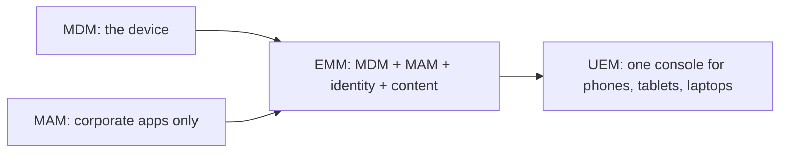
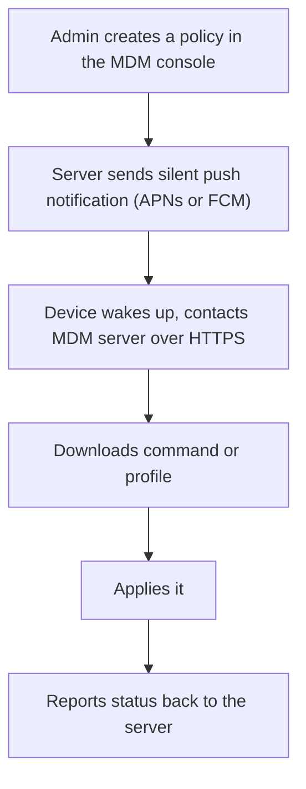
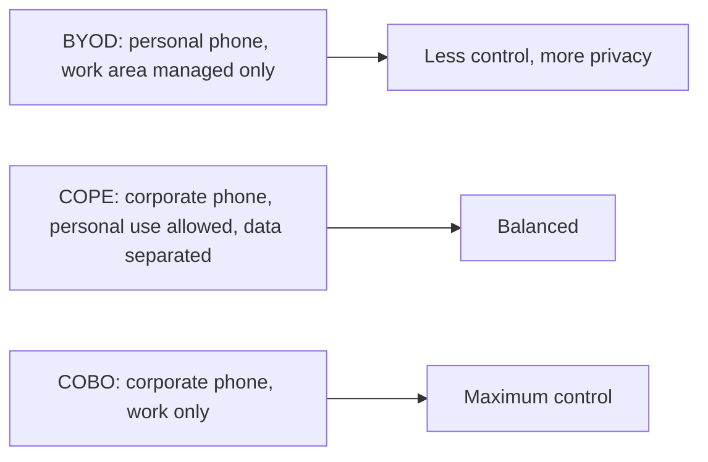
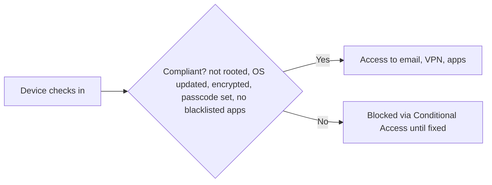
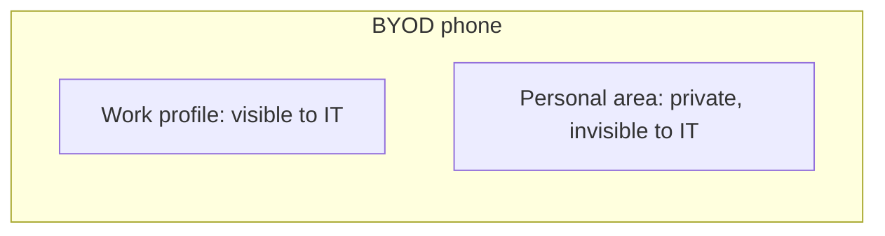
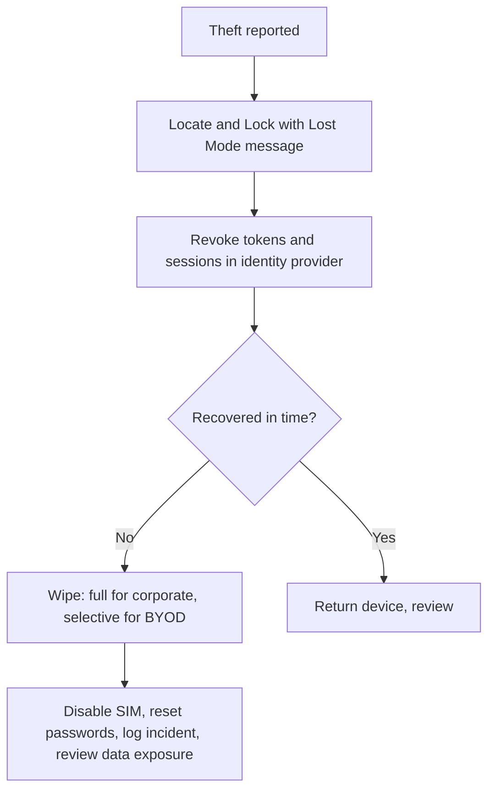
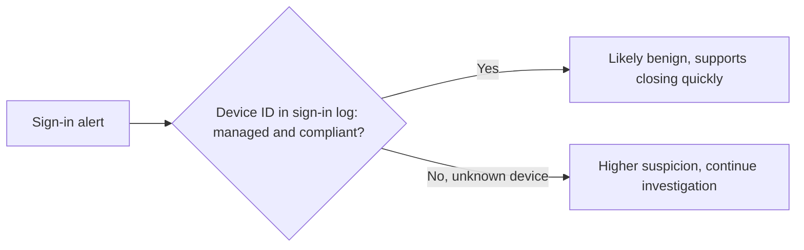
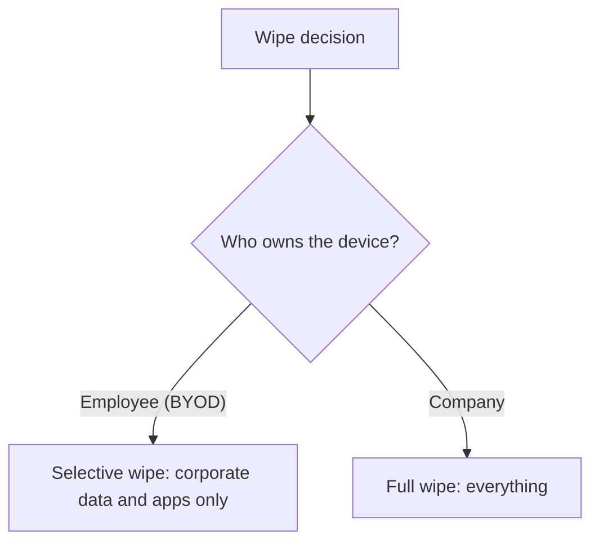

| Topic | Level | Reading Time | Prerequisites |
|---|---|---|---|
| Mobile Device Management (MDM) | Intermediate | ~25 min | Jailbreaking, Rooting, and Mobile Malware |

> **Goal of this section:**  
> You'll understand how organizations control the phones that access their data through MDM, the difference between BYOD, COBO, and COPE, how enrolment, compliance, and remote wipe work, and why MDM itself is a high-value target that must be secured.

## Learning Objectives

By the end of this section, you will be able to:

- Define **MDM** and differentiate it from **MAM**, **EMM**, and **UEM**.
- Describe the six components of an MDM architecture and the simple flow from policy to device.
- Compare the **ownership models** (BYOD, COBO, COPE) and map them to Android Enterprise and iOS modes.
- List the main **enrolment methods** and explain why automated enrolment is preferred for corporate devices.
- Describe what MDM can do: configuration, security policies, compliance and conditional access, app management, remote actions, data protection, and network controls.
- Explain **containerisation** and what IT can and cannot see on a BYOD device.
- Walk through a **stolen phone** response, and explain how MDM data supports SOC investigations.
- Explain why MDM is a high-value target, and apply the twelve-point best-practice checklist.

## Table of Contents

- [Learning Objectives](#learning-objectives)
- [What Is MDM](#what-is-mdm)
  - [The Core Idea](#the-core-idea)
  - [Related Terms People Mix Up](#related-terms-people-mix-up)
- [How MDM Works: The Architecture](#how-mdm-works-the-architecture)
  - [The Six Components](#the-six-components)
  - [The Simple Flow](#the-simple-flow)
- [Ownership Models](#ownership-models)
- [Enrolment Methods](#enrolment-methods)
- [What MDM Can Do](#what-mdm-can-do)
  - [Device Configuration and Provisioning](#device-configuration-and-provisioning)
  - [Security Policy Enforcement](#security-policy-enforcement)
  - [Compliance Checking and Conditional Access](#compliance-checking-and-conditional-access)
  - [Application Management](#application-management)
  - [Remote Actions](#remote-actions)
  - [OS Update Management](#os-update-management)
  - [Data Protection, Inventory, and Network Security](#data-protection-inventory-and-network-security)
  - [Kiosk Mode and Security Tool Integration](#kiosk-mode-and-security-tool-integration)
- [Containerisation: Separating Work and Personal](#containerisation-separating-work-and-personal)
  - [The Three Approaches](#the-three-approaches)
  - [What IT Can and Cannot See on BYOD](#what-it-can-and-cannot-see-on-byod)
- [MDM in Action: A Stolen Phone Scenario](#mdm-in-action-a-stolen-phone-scenario)
- [MDM and the SOC](#mdm-and-the-soc)
- [Risks and Limitations of MDM](#risks-and-limitations-of-mdm)
- [MDM Best-Practice Checklist](#mdm-best-practice-checklist)
- [Review Questions](#review-questions)
- [Career Path Connections](#career-path-connections)
- [Key Terms Glossary](#key-terms-glossary)
- [Summary](#summary)

## What Is MDM

### The Core Idea

**Mobile Device Management (MDM)** is a technology and a set of policies that let an organization **centrally configure, secure, monitor, and control** the mobile devices (phones, tablets, sometimes laptops and IoT devices) that access company data.

Think of it as **"the IT department's remote control for every device."** Without MDM, the company doesn't know how many phones are reading its email, whether they have a passcode, whether they've been jailbroken, or what happens if one gets stolen. With MDM, IT can enforce rules and take action **in seconds, remotely**.

### Related Terms People Mix Up

| Term | Meaning |
|---|---|
| **MDM** | Manages **the device itself** (settings, security, wipe) |
| **MAM** (Mobile Application Management) | Manages **only the corporate apps and their data**, not the whole device (useful for personal phones) |
| **EMM** (Enterprise Mobility Management) | MDM + MAM + identity and content management |
| **UEM** (Unified Endpoint Management) | The modern term. **A single console** for phones, tablets, laptops (Windows, macOS), and more |

## How MDM Works: The Architecture

### The Six Components

| # | Component | Detail |
|---|---|---|
| 1 | **MDM server/console** | (cloud or on-premises) where admins define the policies. Examples: **Microsoft Intune, Jamf Pro, VMware Workspace ONE, Ivanti, Kandji, Hexnode, Samsung Knox Manage** |
| 2 | **Management channel on the device** | iOS and macOS: the built-in **MDM framework**, which receives commands via the **Apple Push Notification service (APNs)**. Android: an **agent app / Device Policy Controller (DPC)** and Google's **Android Enterprise** framework, with **Firebase Cloud Messaging (FCM)** for notifications |
| 3 | **Enrolment** | The device must be registered with the MDM. The user (or automatic provisioning) installs a management profile or agent and approves it |
| 4 | **Configuration profiles and policies** | The settings the server sends to the device |
| 5 | **Reporting** | The device reports back its inventory and compliance status |
| 6 | **Identity integration** (Entra ID, Okta) | The device's compliance status feeds **Conditional Access** decisions |

### The Simple Flow

The admin creates a policy, the server sends a **silent push notification**, the device wakes up and contacts the MDM server over HTTPS, downloads the command or profile, applies it, and reports back.

## Ownership Models

**Who owns the phone?** That determines the appropriate level of control.

| Model | Description |
|---|---|
| **BYOD** (Bring Your Own Device) | The employee's personal phone. Lower cost, higher privacy concerns. The company usually manages **only a work area** (a work profile on Android, User Enrolment on iOS), not the whole device |
| **COBO** (Corporate-Owned, Business Only) | A company device for work only. **Maximum control** |
| **COPE** (Corporate-Owned, Personally Enabled) | A company device that employees can also use personally, with **separation between work and personal data** |

**Android Enterprise modes:** Work Profile (BYOD), Fully Managed (corporate), Fully Managed with Work Profile (COPE), and Dedicated devices (kiosks, scanners).

**On iOS:** **Supervised mode** (for corporate devices purchased through Apple Business Manager) unlocks deeper control, and **User Enrolment** is the privacy-friendly BYOD mode.

## Enrolment Methods

| Method | Detail |
|---|---|
| **Manual enrolment** | The user installs a company portal app and signs in (typical for BYOD) |
| **Automated enrolment** for corporate devices | **Apple Automated Device Enrolment** (formerly called DEP) via **Apple Business Manager**, and **Android zero-touch enrolment**. The device is assigned to the company at the time of purchase. As soon as the employee turns it on, it enrolls automatically and installs the policies, **and the user cannot skip this** |
| **QR code or token enrolment** | Common on Android |
| **Bulk enrolment** | Through resellers or a provisioning tool |

> [!TIP]
> Automated enrolment is strongly preferred for corporate devices because the user cannot skip it. Manual enrolment depends on the user doing the right thing, which is acceptable for BYOD but weak for devices the company owns.

## What MDM Can Do

### Device Configuration and Provisioning

It pushes Wi-Fi settings, VPN profiles, email accounts, certificates (for Wi-Fi or VPN authentication), proxy settings, the wallpaper, and restrictions.

### Security Policy Enforcement

- Require a **passcode** with a minimum length and complexity, plus an auto-lock timeout.
- Require **device encryption**.
- Limit the number of failed passcode attempts, followed by a **wipe**.
- Disable risky features: the camera, screen capture, USB file transfer, Bluetooth sharing, AirDrop, installing apps from unknown sources, and backup to a personal cloud.
- Enforce a **minimum OS version**.

### Compliance Checking and Conditional Access

It continuously checks whether the device meets the requirements: **not jailbroken/rooted, OS up to date, encrypted, passcode enabled, no blacklisted apps**. **Non-compliant devices are blocked** from company email, the VPN, and apps until they're fixed.

### Application Management

Pushing mandatory apps; a company-specific app catalogue; a blacklist or whitelist; silently updating apps; removing apps; managing app settings and **per-app VPN**.

### Remote Actions

| Action | Effect |
|---|---|
| **Lock** | Immediate lock |
| **Locate** | Show the location (lost mode on iOS) |
| **Ring / lost mode** | Display a message with a contact number |
| **Selective wipe** (enterprise wipe) | Removes **only company data and apps**, leaving personal data untouched (for BYOD, or when an employee leaves the company) |
| **Full wipe** (factory reset) | Erases **everything** (a stolen corporate device) |
| **Reset/clear passcode** | Reset the passcode |

### OS Update Management

Controlling which iOS/Android versions are allowed to be installed, deferring or enforcing updates, and scheduling them.

### Data Protection, Inventory, and Network Security

| Area | Detail |
|---|---|
| **Data protection** (mobile-level DLP) | Blocking copy/paste from work apps to personal apps; preventing attachments from being saved to personal storage; restricting "Open in" to approved apps; encrypting work data; containerisation |
| **Inventory and reporting** | A list of all devices, models, OS versions, apps, owners, last check-in, and compliance status; reports and alerts for audits |
| **Network security** | Per-app VPN, always-on VPN, **certificate-based Wi-Fi (802.1X)**, content filtering, DNS filtering |

### Kiosk Mode and Security Tool Integration

- **Kiosk and dedicated device mode:** locking the device to a single app (a ticketing terminal, a hospital tablet).
- **Integration with security tools:** feeding compliance and risk data to **EDR** and **MTD (Mobile Threat Defence)** tools such as Lookout, Zimperium, and Defender for Endpoint, and to the **SIEM**.

> [!NOTE]
> The mobile-level data protection here is the endpoint version of the DLP concepts from Data Loss Fundamentals and DLP Operations: block copy/paste, restrict where attachments can be saved, and encrypt work data, all aimed at stopping sensitive data from leaving through the phone.

## Containerisation: Separating Work and Personal

### The Three Approaches

To protect privacy while securing company data:

| Approach | How It Works |
|---|---|
| **Android Work Profile** | A separate, encrypted area on the phone with its own apps (the briefcase icon). The company manages only this area **and can't see personal apps or photos** |
| **iOS User Enrolment and managed apps** | Work apps and accounts are managed ("managed open in" controls govern how data moves), while personal data stays private |
| **Third-party containers or MAM** | (Intune App Protection, BlackBerry): protection is applied to **the app itself** |

### What IT Can and Cannot See on BYOD

**This is a common concern among employees.**

| Device Type | What IT Typically Sees |
|---|---|
| **BYOD (configured correctly)** | The device model, OS version, compliance status, and work apps. **IT can't read personal messages, photos, browsing history, or personal apps** |
| **Fully managed corporate device** | Much more |

> [!IMPORTANT]
> A clear, written BYOD policy that states exactly what IT can and cannot see is just as important as the technical container. User resistance in BYOD usually comes from uncertainty about privacy, not from the technology itself.

## MDM in Action: A Stolen Phone Scenario

| # | Step |
|---|---|
| 1 | An employee reports that their phone was stolen in a taxi |
| 2 | The helpdesk opens the MDM console and finds the device |
| 3 | They send **Lock and Lost Mode** with a message to contact the company |
| 4 | They check the last known location |
| 5 | They revoke the user's **tokens and sessions** at the identity provider so the phone can't open company email |
| 6 | If the phone isn't recovered within a set time, they send a **Wipe**: a full wipe for a corporate device, a selective wipe for BYOD |
| 7 | They have the mobile carrier disable the SIM, and reset the user's passwords |
| 8 | They log the incident and review whether there was sensitive data on the device |

**The wipe is executed as soon as the phone connects to the internet.** And since the data is encrypted and a passcode is required, **the thief gets nothing in the meantime**.

> [!NOTE]
> Step 5, revoking tokens and sessions at the identity provider, is the same containment action from the Impossible Travel investigation: the MDM controls the device, but the identity provider controls what that device can still reach.

## MDM and the SOC

- **MDM compliance data is a signal:** non-compliant devices (jailbroken, outdated, without a passcode) **raise the risk level**.
- **Conditional access:** blocking access to cloud apps from unmanaged or non-compliant devices.
- **In an impossible travel investigation:** the **device ID** in the sign-in log shows whether the login came from a **managed and compliant** device or an unknown one, and that **often settles the case quickly**.
- **MDM audit logs** show who changed policies or issued wipes; important for detecting abuse.
- **Mobile Threat Defence alerts** (a malicious app, phishing, a network attack) can be forwarded to the SIEM.

## Risks and Limitations of MDM

| Risk | Detail |
|---|---|
| **MDM is a high-value target** | If an MDM server or admin account is compromised, the attacker can **push malware, install profiles, or wipe every device at once**. A real example: vulnerabilities in **Ivanti (MobileIron)** products were exploited, including a 2023 campaign against Norwegian government systems |
| **Privacy and user resistance** | With BYOD, you need a **clear written policy** |
| **It doesn't stop every attack** | (zero-day, social engineering). It has to be combined with Mobile Threat Defence, training, and updates |
| **Jailbreak detection can be bypassed** | |
| **Misconfiguration** | Policies that are too strict disrupt work, and policies that are too loose don't protect |
| **Cost** | Licenses, admin time, and support |

**Protection:** protect MDM admin accounts with **phishing-resistant MFA**, role-based access, and monitoring.

> [!WARNING]
> An MDM console that can wipe or push software to every device is the most powerful account in the mobile estate. It deserves the same protection as a Domain Admin account, covered in the Privileged Access Management file: phishing-resistant MFA, least privilege, and logging of every administrative action.

## MDM Best-Practice Checklist

| # | Practice |
|---|---|
| 1 | Write a **mobile security policy** and an acceptable use / BYOD agreement |
| 2 | Choose an **ownership model** for each user group |
| 3 | Use **automated enrolment** for corporate devices |
| 4 | Enforce a **passcode, encryption, and a minimum OS version** |
| 5 | Use **compliance policies + Conditional Access**: "no compliance, no access" |
| 6 | **Block jailbroken/rooted devices** |
| 7 | **Separate work data from personal data** |
| 8 | **Manage and vet apps**; use an app catalogue |
| 9 | Enable **remote lock, locate, and wipe**, **and test them** |
| 10 | **Secure the MDM console itself** (MFA, least privilege, logging) |
| 11 | **Monitor and send the logs to the SIEM** |
| 12 | **Review the policies regularly** and train users |

## Review Questions

**1. Why should an employee on a rooted phone be blocked by the company?**

Because rooting disables the sandbox and Verified Boot and makes Play Integrity fail, and any malware on the device has access to everything. The MDM marks the device as **non-compliant**, and Conditional Access blocks email, the VPN, and apps until the device returns to a secure state, following the "no compliance, no access" principle.

**2. On a BYOD phone, would you do a full wipe or a selective wipe, and why?**

**Selective wipe.** The device is personal, and the company only has a right to the work data and apps. A full wipe would erase the employee's personal photos and data, which have nothing to do with the company, and that's a privacy and legal problem. The full wipe is reserved for a stolen corporate device.

## Career Path Connections

| Career Path | How This Topic Applies |
|---|---|
| SOC Analyst | Uses MDM compliance status, device ID, and audit logs to speed up identity investigations and detect MDM abuse |
| Penetration Tester | Tests whether MDM policies, enrolment, and conditional access can be bypassed, within authorized scope |
| GRC | Owns the mobile security policy, BYOD agreement, ownership-model decisions, and policy reviews |
| Cloud Security | Integrates MDM compliance with identity providers such as Entra ID so device health drives access decisions |

## Key Terms Glossary

| Term | Definition |
|---|---|
| MDM | Mobile Device Management, central configuration, security, monitoring, and control of mobile devices |
| MAM | Mobile Application Management, managing only corporate apps and their data |
| EMM | Enterprise Mobility Management, MDM plus MAM plus identity and content management |
| UEM | Unified Endpoint Management, one console for phones, tablets, and laptops |
| APNs | Apple Push Notification service, used to wake iOS devices for MDM commands |
| DPC | Device Policy Controller, the Android agent that applies MDM policies |
| BYOD | Bring Your Own Device, an employee's personal phone used for work |
| COBO | Corporate-Owned, Business Only |
| COPE | Corporate-Owned, Personally Enabled |
| Supervised Mode | An iOS mode for corporate devices that unlocks deeper management controls |
| Selective Wipe | Removing only corporate data and apps from a device |
| Containerisation | Separating work and personal data into isolated areas on one device |
| MTD | Mobile Threat Defence, a tool detecting malicious apps, phishing, and network attacks on phones |
| Conditional Access | Access decisions based on conditions such as device compliance |

## Summary

- **MDM is the IT department's remote control for devices:** it enforces rules and takes action in seconds, remotely.
- **MDM, MAM, EMM, and UEM are related but different:** the device, the apps, integration with identity and content, and a unified console for all devices.
- **Architecture has six parts:** server, management channel, enrolment, profiles/policies, reporting, and identity integration.
- **Ownership model decides control level:** BYOD has the least control and the most privacy, COBO has maximum control, and COPE sits between them.
- **Automated enrolment suits corporate devices because users cannot skip it.**
- **Compliance plus Conditional Access means no compliance, no access:** a jailbroken or outdated device, or one without a passcode, gets blocked.
- **Remote actions differ by ownership:** a selective wipe for BYOD, a full wipe for a stolen corporate device.
- **Containerisation protects privacy:** IT sees only the work area on BYOD.
- **MDM data accelerates SOC investigations:** the device ID in the sign-in log often settles the case.
- **MDM itself is a high-value target:** the console needs phishing-resistant MFA, least privilege, and monitoring.

