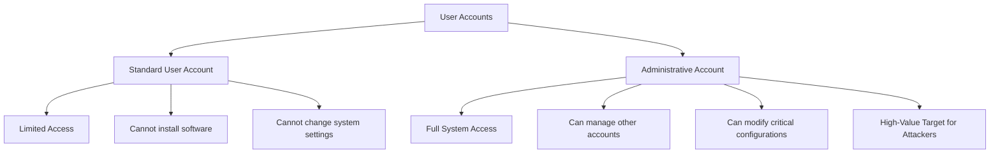
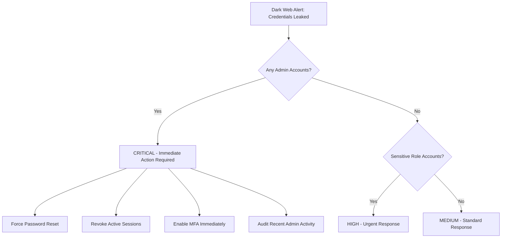
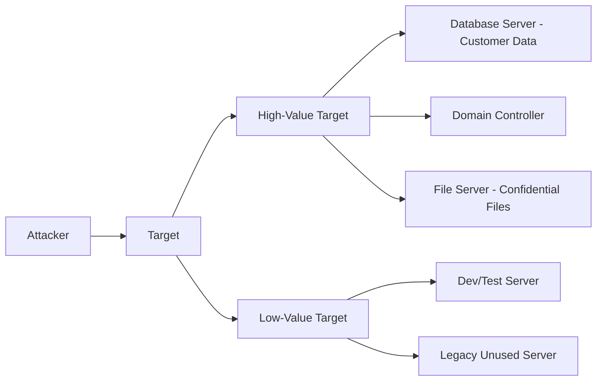
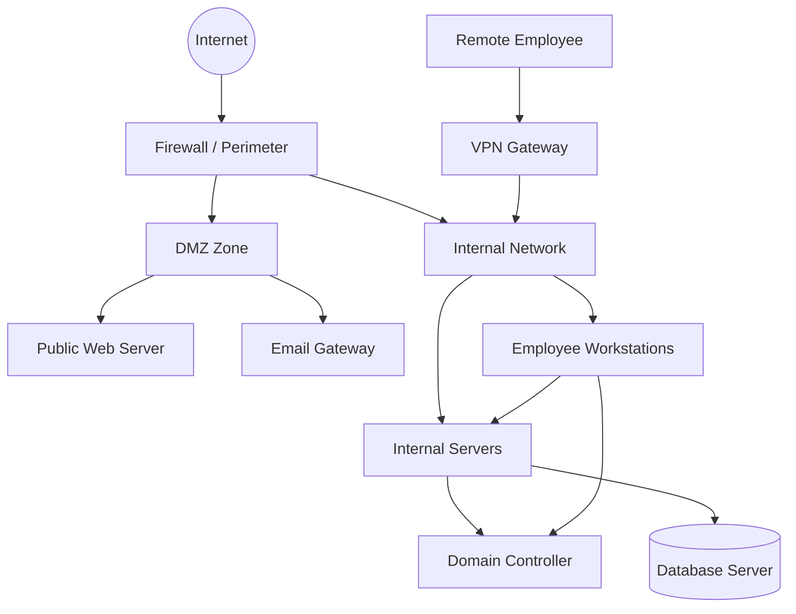
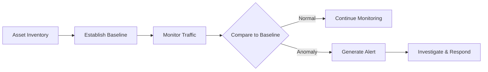

> **The goal of this section:**  
> You'll understand what you're protecting as a SOC Analyst, why you need to know the organization's sensitive Assets, and how to assess the severity of any Incident based on what was affected — and that's the foundation of your work in Security Operations.
---

## Table of Contents

- [What Are You Protecting?](#1-what-are-you-protecting)
   - [Critical Assets & Their Importance](#11-critical-assets--their-importance)
   - [Assessing the Severity of an Incident](#12-assessing-the-severity-of-an-incident)
   - [User Accounts: Administrative vs. Standard](#13-user-accounts-administrative-vs-standard)
   - [Dark Web Credential Exposure](#14-dark-web-credential-exposure)
   - [Understanding What the Attacker Wants](#15-understanding-what-the-attacker-wants)
- [Communication Flow](#2-communication-flow)
   - [Why Communication Flow Matters](#21-why-communication-flow-matters)
   - [Types of Communication in an Organization](#22-types-of-communication-in-an-organization)
   - [Asset Inventory & Baseline](#23-asset-inventory--baseline)
- [Summary](#3-summary)

---

## What Are You Protecting?

### Critical Assets & Their Importance

The first question you should have as a SOC Analyst is: **What are you protecting?**

Not everything on the network is equally important. Some Assets have very high value, while others can be affected without leading to a major disaster. **Critical Assets** are the ones that, if Compromised, could affect the organization in a fundamental way — whether financially, operationally, or reputationally.

> [!IMPORTANT]
> Knowing your Critical Assets doesn't just help you protect the network — it's what lets you know **whether a Breach actually happened or not**, and how serious it is. Without that understanding, Alerts are just noise without context.

**A practical example:**
Imagine you get 500 Alerts a day — if you don't understand your Assets, you won't be able to tell an ordinary Alert from one telling you that someone has accessed the Database that holds customer data.

---

### Assessing the Severity of an Incident

When an Incident happens, you need to assess its **Severity** — that is, how serious it is. And that depends directly on the type of Asset that was affected.

```
Severity = f(Asset Criticality + Data Sensitivity + Blast Radius)
```

| Asset Type | Example | Severity Level |
|---|---|---|
| Database Server (Sensitive Data) | Customer PII / Financial Records | Critical |
| Domain Controller | Active Directory | Critical |
| Email Server | Internal Communications | High |
| Web Server (Public) | Company Website | Medium |
| Standard Workstation | Employee PC | Low to Medium |
| Low-Value Server | Test/Dev Server | Low |

> [!NOTE]
> The "Blast Radius" is the extent of the impact that can spread from the point of compromise. For example, if a Domain Controller is compromised, the Blast Radius is enormous because it controls everything on the Network.

**How do you identify Critical Assets?**
- Assets that store **Sensitive Data** (customer data, financial information, IP)
- Assets that would stop the business if they went down (Mission-Critical Systems)
- Assets that control other assets (such as Domain Controllers, Firewalls, SIEM)

---

### User Accounts: Administrative vs. Standard

One of the clearest examples of why knowing your Assets matters is the difference between two types of Accounts:



> [!WARNING]
> If you don't understand the difference between an Admin Account and a Standard Account, you won't be able to determine which Account is the most dangerous if it gets Compromised. And that's a serious mistake in any Incident Response.

**Why are Admin Accounts more dangerous?**
- They can perform **Lateral Movement** — spreading through the network from machine to machine
- They can perform **Privilege Escalation** on other accounts
- They can modify or delete Logs to cover their tracks
- They can install Backdoors or Malware at the System level

---

### Dark Web Credential Exposure

There are Security Solutions that monitor the **Dark Web** and alert you when your organization's Credentials show up there — meaning someone has sold or published your employees' login details.

**The scenario:**
```
Dark Web Alert: 50 Employee Credentials Leaked
```

The first question you should ask:

> [!IMPORTANT]
> **Are there any Admin Accounts among these Credentials?**
> That's the decisive question. If yes, the problem immediately becomes Critical, regardless of how many other Accounts were exposed.

**Order of priorities when a Credential Leak happens:**



---

### Understanding What the Attacker Wants

It's not only important to know what you have — it's also important to think like the Attacker and understand **what they want**.

**The key question:** Is the Attacker trying to reach a sensitive Database Server, or did they just find a Server that isn't worth much?



| Target | Attacker's Likely Goal | Required Response |
|---|---|---|
| Database Server | Data theft / Ransomware | Critical - Full IR Activation |
| Domain Controller | Complete network Takeover | Critical - Isolate Immediately |
| Email Server | Internal Phishing / information gathering | High |
| Low-Value Server | A Pivot Point to reach something else | Medium - Monitor Closely |

> [!TIP]
> If you find an Attacker on a Low-Value Server, don't underestimate it — they're probably using it as a **Pivot Point** or **Staging Area** to reach something more important. Their next step is the most dangerous one.

---

## Communication Flow

### Why Communication Flow Matters

**Communication Flow** is one of the most important things you need to understand to succeed as a SOC Analyst — because you don't just need to know the Assets; you also need to know **who talks to whom, and how**.

> [!IMPORTANT]
> Communication Flow is the foundation you build your **Baseline** on. Anything that happens outside the normal pattern is an **Anomaly** — and that's what should catch your attention.

**A simple example:**
- An HR employee connects to the Finance Database at 3 AM — is that Normal or Suspicious?
- A Web Server talks to a Domain Controller on an unusual Port — is that normal or not?

Without understanding the normal Communication Flow, you won't be able to answer these questions.

---

### Types of Communication in an Organization

There are different types of Communication you need to understand:



**Types of Communication that matter to you:**

| Type | Description | Why It Matters |
|---|---|---|
| Client to Server | An employee accessing an Internal Server | You know who is supposed to access what |
| Server to Server | A server talking to another server | Any unusual connection between Servers is suspicious |
| Internal to Internet | An employee going out to the internet | Data Exfiltration can happen here |
| Internet to Internal | Requests from outside coming in | The most common Attack Entry Point |
| Remote Access (VPN) | An employee outside connecting to the network | You need to verify that Authentication is correct |

---

### Asset Inventory & Baseline

To be able to judge any Communication as **Normal or Suspicious**, you need two things:

**First: Asset Inventory**
- A list of all the Assets in the organization
- Who uses what, and why
- What the Normal Behavior is for each Asset

**Second: Baseline**
- The normal pattern of Traffic on the network
- The normal times for Access
- The Protocols and Ports normally in use



> [!WARNING]
> **The sad reality:** in most organizations, the Asset Inventory either doesn't exist or isn't up to date. That makes the SOC Analyst's job very hard — because you're trying to identify Anomalies without a clear Baseline. If you find yourself in that situation, **take notes and start building the Inventory yourself** through Monitoring.

> [!TIP]
> If you don't find an existing Asset Inventory, start with Network Discovery Tools like **Nmap** or **Nessus** to build a Passive Inventory of the network. The SIEM also helps you build a picture of the Communication Patterns over time.

**How to build a Baseline from scratch:**

1. **Network Traffic Analysis** — monitor the Traffic for a period (two weeks, for example) and record the normal patterns
2. **Log Collection** — collect Logs from all Systems (Firewalls, Servers, Endpoints)
3. **User Behavior Analysis** — understand the normal habits of each User or User Group
4. **Document Everything** — record every observation, even the ones that seem minor

---

## Summary

### Key Takeaways

**What we learned in this section:**

- 🔐 **Knowing your sensitive Assets** is the foundation — without it, Alerts are meaningless noise. You need to know what you're protecting before you can actually protect it.

- ⚖️ **Assessing Severity** depends on the type of Asset that was affected — not every Incident is serious, and not every Incident is minor. Asset Criticality is what determines your response.

- 👤 **The difference between Admin and Standard Accounts** is critical — if an Admin Account is Compromised, the priority is Immediate, regardless of any other circumstances.

- 🌐 **Dark Web Monitoring** is an important tool — if Credentials have leaked, the first question is: are there any Admin Accounts among them?

- 🔍 **Understanding the Attacker's intent** helps you assess the threat correctly — are they trying to reach something important? Or are they using a minor Server as a Pivot Point?

- 🌊 **Communication Flow** is the backbone of Detection — anything outside the Normal Pattern is an Anomaly worth investigating.

- 📋 **Asset Inventory and Baseline** are the tools you base all your decisions on — and their absence in an organization is a real problem you need to take seriously, and start building them yourself.

> [!IMPORTANT]
> A successful SOC Analyst doesn't just see the Alerts — they understand the context. And that context comes from your understanding of the Assets, the Communication Flow, and the Baseline. Without these three, you're working in the dark.
