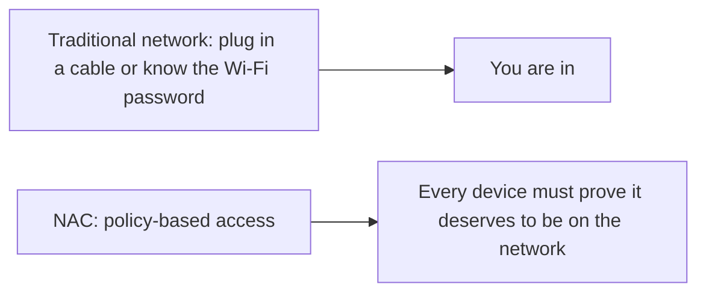
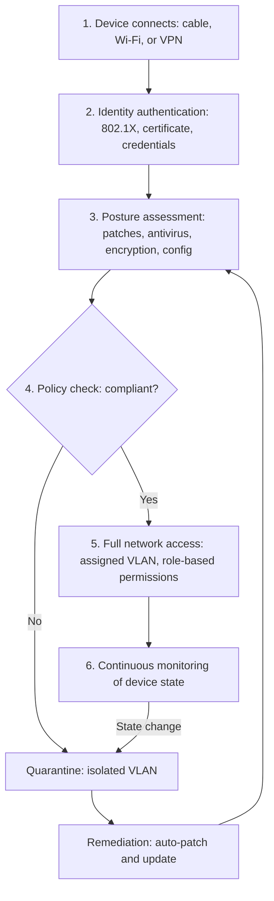
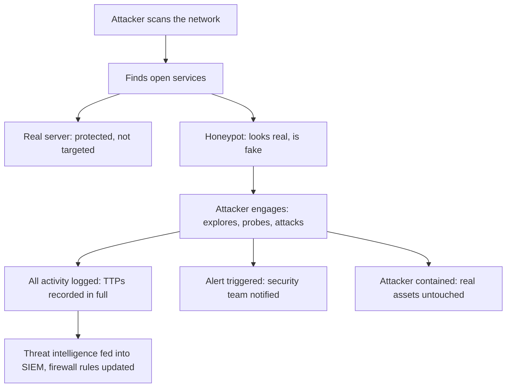
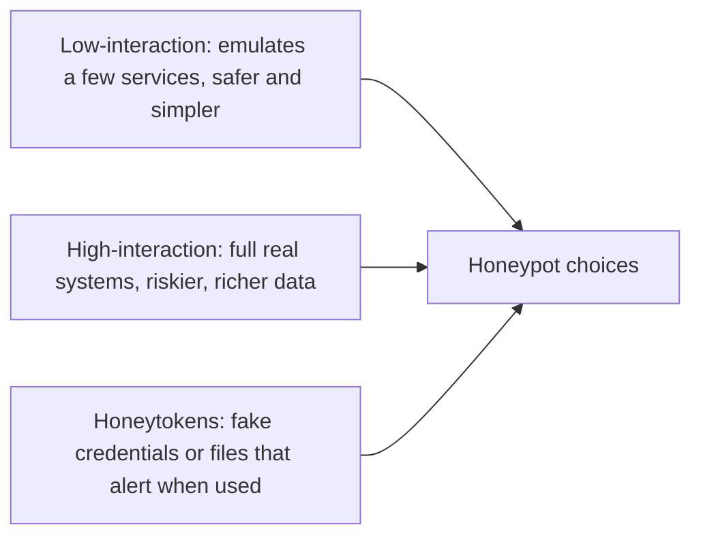

| Topic | Level | Reading Time | Prerequisites |
|---|---|---|---|
| Network Access Control and Honeypots | Intermediate | ~20 min | Firewalls and Network Placement |

> **The goal of this section:**  
> You'll understand how NAC makes every device prove it deserves to join the network instead of letting anyone plug in a cable and get in, how the posture assessment decides the outcome (full access, limited, or quarantine), and how a honeypot flips the game: instead of blocking the attacker, it invites them into a fake environment and records their every move.

## Learning Objectives

By the end of this section, you will be able to:

- Define **Network Access Control (NAC)** and explain why device health matters as much as identity.
- Explain the shift from **open networks** to **policy-based access**, and the role of **802.1X**.
- List what a **posture assessment** checks and the three possible outcomes.
- Walk through the six stages of a NAC flow, including the remediation loop and continuous monitoring.
- Define a **honeypot** and explain why its alerts are very high-fidelity.
- Compare **low-interaction** honeypots, **high-interaction** honeypots, and **honeytokens**.
- Explain why a honeypot must be isolated.

## Table of Contents

- [Learning Objectives](#learning-objectives)
- [Network Access Control (NAC)](#network-access-control-nac)
  - [What It Is](#what-it-is)
  - [Beyond Identity](#beyond-identity)
  - [From Open to Policy-Based](#from-open-to-policy-based)
- [NAC Posture Assessment and Outcomes](#nac-posture-assessment-and-outcomes)
  - [What NAC Checks](#what-nac-checks)
  - [The Three Outcomes](#the-three-outcomes)
  - [The Six-Stage Flow](#the-six-stage-flow)
- [Honeypots](#honeypots)
  - [The Core Idea](#the-core-idea)
  - [Why the Alerts Are High-Fidelity](#why-the-alerts-are-high-fidelity)
  - [Benefits](#benefits)
  - [How a Honeypot Works](#how-a-honeypot-works)
- [Honeypot Types and Cautions](#honeypot-types-and-cautions)
  - [Three Types](#three-types)
  - [The Isolation Caution](#the-isolation-caution)
- [Career Path Connections](#career-path-connections)
- [Key Terms Glossary](#key-terms-glossary)
- [Summary](#summary)

## Network Access Control (NAC)

### What It Is

**NAC** is a solution that controls **who and which devices can connect to the network, and what they can reach once connected**.

### Beyond Identity

It is **not only about identity**, it is also about **the device's health and compliance**. **A valid username is worthless if the laptop is outdated or infected.**

### From Open to Policy-Based

In traditional networks, **plug in a cable or know the Wi-Fi password and you are in.** NAC enforces **policy-based access**, so every device **must prove it deserves to be on the network.**

> [!NOTE]
> This is NAC's place in the network layer of defense in depth: only authorized, compliant devices can even join the network. The device-health idea is also the network-level cousin of the trust scoring in Zero Trust Model, where device state feeds the access decision.

## NAC Posture Assessment and Outcomes

### What NAC Checks

| Check | Question |
|---|---|
| Patch level | Is the OS up to date? |
| Antivirus | Is it installed and up to date? |
| Host firewall | Is it enabled? |
| Disk encryption | Is it on? |
| Applications | Are any unauthorized applications running? |
| Ownership | Is the device domain-joined or a registered corporate asset? |
| Device type | What type is it (laptop, phone, IoT, printer)? |

**It is usually built on 802.1X authentication.**

### The Three Outcomes

| Outcome | Meaning |
|---|---|
| **Full access** | The device is compliant |
| **Limited access** | Restricted access |
| **Quarantine VLAN** | **For non-compliant devices** |

### The Six-Stage Flow

| # | Stage | What Happens |
|---|---|---|
| 1 | **Connect** | The device connects (cable, Wi-Fi, or VPN) |
| 2 | **Identify** | Identity authentication: 802.1X, certificate, or credentials |
| 3 | **Assess** | Posture assessment: OS patches, antivirus, encryption, config |
| 4 | **Decide** | Policy check |
| 5 | **Access** | If compliant: **full network access** with a dedicated VLAN and role-based permissions |
| 6 | **Monitor** | The device's state is checked **throughout the session** |

If the device is **non-compliant**, it goes to **Quarantine (isolated VLAN)**, then **Remediation** (auto-patch and update), then a **re-check**.

> [!IMPORTANT]
> NAC continuously re-evaluates device state, so access can be revoked mid-session. A device that was compliant at 9:00 and had its antivirus disabled at 11:00 can be moved to quarantine without the user logging in again. This is continuous verification applied to the network port.

> [!TIP]
> The quarantine VLAN is not a punishment, it is a waiting room: the device can usually still reach the update servers it needs to fix itself, and nothing else. That is why remediation loops back into the posture check.

## Honeypots

### The Core Idea

A **honeypot** is **a deliberate deception tool**. Instead of **blocking** attackers, **it invites them into a fake environment** where they can do no real damage, while you **watch everything they do.**

### Why the Alerts Are High-Fidelity

**The core idea:** if **no legitimate user is supposed to touch this system**, then anyone who touches it **is a threat by definition.** That makes its alerts **high-fidelity, with very few false positives.**

### Benefits

- **Early warning** of intrusions and internal scanning.
- **Collecting attacker tools, techniques, and indicators of compromise (IOCs).**
- **Distracting attackers** from the real assets.

### How a Honeypot Works

The attacker runs a network scan and finds open services. **The real server is protected and not targeted**, but the honeypot **looks real and is fake**. The attacker interacts with it, so all their activity is recorded, the alert fires, and they are placed in containment while the real assets stay safe. The recorded TTPs then become **threat intelligence** that feeds the SIEM and updates the firewall rules.

> [!NOTE]
> Every action inside a honeypot is recorded while the attacker believes they are winning. The recorded TTPs are exactly the kind of data that feeds the MITRE ATT&CK mapping described in the MITRE ATT&CK file, and the IOCs feed the IP-based blocklists discussed in the DNS Sinkhole file.

## Honeypot Types and Cautions

### Three Types

| Type | Description |
|---|---|
| **Low-interaction** | Emulates **only some services**. **Safer and simpler** to run |
| **High-interaction** | **Full real systems**, which makes it **more dangerous** |
| **Honeytokens** | **Fake credentials or files** that raise an alert **when they are used** |

### The Isolation Caution

> [!WARNING]
> A honeypot must be isolated, or attackers could use it as a pivot. A high-interaction honeypot is a real system an attacker can fully compromise, so if it can reach the production network it becomes the attacker's best stepping stone. Place it in its own segment with strict rules in both directions.

> [!TIP]
> Honeytokens are the cheapest honeypot to start with: a fake "admin_backup" credential or a decoy spreadsheet named like payroll data costs nothing to run, carries no pivot risk, and alerts the moment anyone uses it. This is the same "nobody legitimate should touch this" logic, with no server to maintain.

## Career Path Connections

| Career Path | How This Topic Applies |
|---|---|
| SOC Analyst | Treats any honeypot or honeytoken alert as high-priority because legitimate use is essentially zero |
| Penetration Tester | Must recognize honeypots during an engagement, since touching one can alert the defenders and waste time |
| GRC | NAC posture policies and device-compliance requirements are direct, auditable access controls |
| Cloud Security | Cloud-native equivalents include device-compliance-based conditional access and decoy resources with alerting |

## Key Terms Glossary

| Term | Definition |
|---|---|
| NAC | Network Access Control, controlling which devices can connect and what they can access |
| 802.1X | A port-based authentication standard commonly used by NAC |
| Posture Assessment | Checking a device's health and compliance before granting access |
| Quarantine VLAN | An isolated VLAN for non-compliant devices |
| Remediation | Fixing a non-compliant device so it can pass the posture check |
| Honeypot | A deliberately deceptive system designed to attract and record attackers |
| High-Fidelity Alert | An alert with very few false positives |
| IOC | Indicator of Compromise, an artifact associated with malicious activity |
| Low-Interaction Honeypot | A honeypot emulating only a few services |
| High-Interaction Honeypot | A honeypot built from full real systems |
| Honeytoken | A fake credential or file that triggers an alert when used |
| Pivot | Using a compromised system as a stepping stone to reach others |

## Summary

- **NAC controls who and what can connect:** and then what they can reach, not only identity.
- **Device health matters as much as identity:** a valid username on an infected laptop is worthless.
- **Posture assessment checks seven things:** patches, antivirus, host firewall, encryption, applications, ownership, and device type.
- **Three outcomes exist:** full access, limited access, and quarantine VLAN.
- **The flow has six stages with a remediation loop:** connect, identify, assess, decide, access, monitor, and continuous monitoring can send the device back to quarantine.
- **A honeypot invites attackers instead of blocking them:** and every move they make is recorded.
- **Honeypot alerts are high-fidelity:** because no legitimate user is supposed to touch it.
- **Three honeypot types:** low-interaction is the safest, high-interaction is richer and more dangerous, and honeytokens are the cheapest.
- **A honeypot must be isolated:** otherwise it becomes a pivot point for the attacker.

