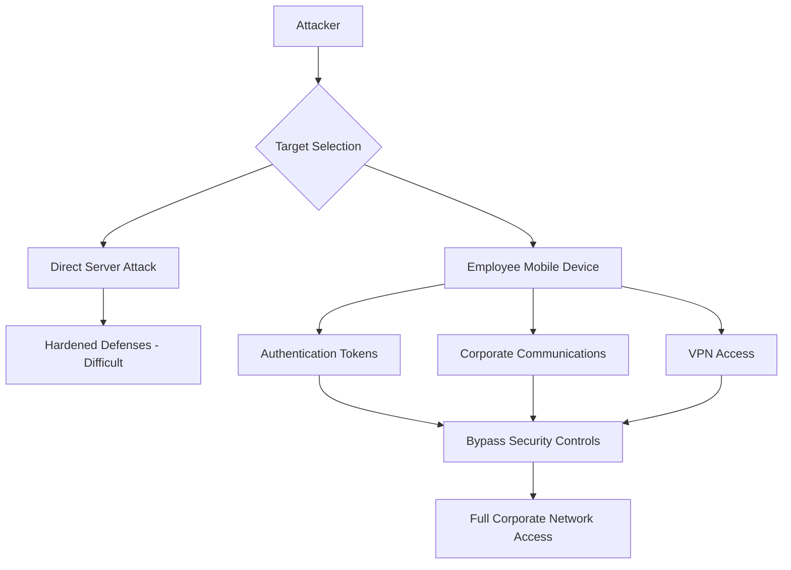
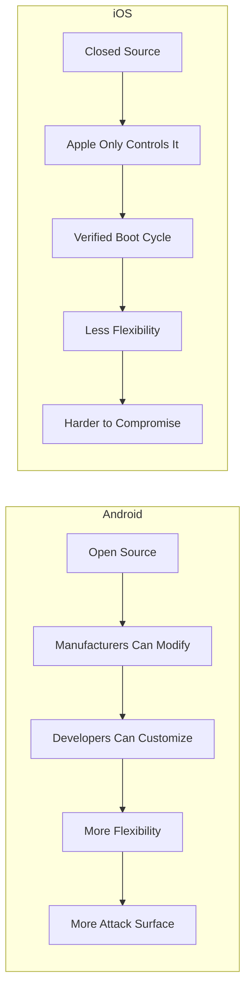
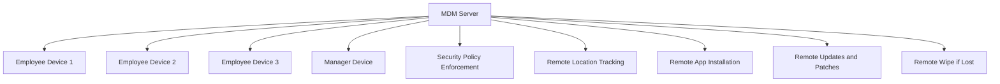
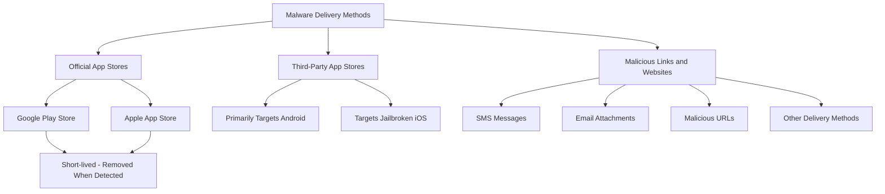

> **Goal of this section:**
> You'll understand why Mobile Security has become one of the most important areas of Cybersecurity, learn the difference between Android and iOS in terms of Security, see how organizations control devices with MDM, and learn how Malware reaches mobile phones.

---

## Table of Contents

- [What is Mobile Security?](#what-is-mobile-security)
- [Why Mobile Security Matters](#why-mobile-security-matters)
- [iOS vs Android — Security Comparison](#ios-vs-android--security-comparison)
- [Mobile Device Management (MDM)](#mobile-device-management-mdm)
- [How Malware is Delivered to Mobile Devices](#how-malware-is-delivered-to-mobile-devices)
- [Summary](#summary)

---

## What is Mobile Security?

**Mobile Security** is the set of practices and technologies that protect mobile devices from various threats. This protection covers four main areas:

| Area | Description |
|---|---|
| **The Device** | The device itself — the hardware and the OS |
| **The Data** | The data stored on the device |
| **The Applications** | The installed apps |
| **The Network Communication** | The communications that take place over the network |

> [!IMPORTANT]
> A mobile phone isn't just a personal device — in many organizations it's considered a **gateway** to sensitive systems protected by MFA. That means if the phone is taken, the Access to everything may be taken along with it.

---

## Why Mobile Security Matters

### The phone as a Gateway to sensitive systems

In modern environments, employees use their phones for:
- **Email Access** — accessing corporate email
- **VPN Authentication** — verifying identity to enter the internal network
- **MFA for Privileged Accounts** — two-step verification for highly privileged accounts

This means the phone has become a **critical link** in the corporate security chain.

### A realistic attack scenario

Picture this scenario with me:

```
The target: a large organization holding highly sensitive information

The attacker has two options:
1. Attack the Hardened Servers directly  ← very difficult
2. Look for the weakest entry point ← much easier

The weakest entry point = the employee = their phone
```



> [!WARNING]
> If the attacker succeeds in compromising the phone of **just one employee**, they may obtain:
> - **Authentication Tokens**
> - **Corporate Communications**
> - **VPN Access** — access to the internal network
>
> This means they are effectively bypassing all traditional security controls.

### How organizations respond

That's why many organizations take proactive steps:

- Providing **dedicated mobile devices** to employees with high privileges
- **Monitoring devices** continuously to spot any suspicious activity
- Making sure devices are **Updated & Patched** at all times

---

## iOS vs Android — Security Comparison

### The fundamental difference

**Android** is an **Open Source** system — anyone can modify it, whether manufacturers or developers.

**iOS** is a **Closed Ecosystem** — under Apple's full control, and no one outside can modify it.



### Why is iOS more secure?

Apple verifies **every stage of the Boot Cycle**, meaning that from the moment the device starts up, it makes sure everything is legitimate and signed by Apple.

> [!NOTE]
> This **Boot Cycle Verification** means that any unauthorized modification to the system will be detected as soon as the device starts up — which makes Jailbreaking and unauthorized modifications very difficult.

### Why is Android targeted more?

**Android holds ~80% of the Global Market Share.**

This means:
- There are far more users
- The chance of a successful attack is higher
- Attackers focus their energy on the most widespread systems

### A comprehensive comparison

| Criterion | Android | iOS |
|---|---|---|
| **Source** | Open Source | Closed Source |
| **Customization** | Very high | Very limited |
| **Boot Verification** | Varies by Manufacturer | Strict, by Apple |
| **Market Share** | ~80% | ~20% |
| **Attacker Focus** | High | Relatively low |
| **Third-party Apps** | Easily available | Restricted to the App Store |
| **Jailbreak/Root** | Relatively easier | Much harder |

> [!TIP]
> In Enterprise environments with highly sensitive data, iOS is usually the better choice in terms of Security — but that doesn't mean it's completely immune.

---

## Mobile Device Management (MDM)

### What is MDM?

**Mobile Device Management** is a system an Organization uses to control and secure the mobile devices that access or store corporate information.

Think of it as a **central control panel** that lets the IT Team manage all the devices from one place.



### The most important MDM Features

#### 1. Security Policy Enforcement

MDM ensures that all devices have the right security policies applied, such as:
- A mandatory Screen Lock
- Encryption of stored data
- Blocking apps from unapproved sources

#### 2. Device Location Tracking

The ability to locate the device at any time — useful when:
- The device has been stolen
- The device has been lost
- Tracking is needed in work environments

#### 3. Remote App Management

- **Installing apps** on the device remotely
- **Removing unauthorized apps**
- **Updating the system and apps** without user intervention

> [!IMPORTANT]
> MDM can perform a **Remote Wipe** — meaning it can erase all the data on the device remotely if the device is stolen or if an employee is fired and doesn't return the device.

### Summary of MDM functions

| Function | Description | Benefit |
|---|---|---|
| **Policy Enforcement** | Applying security policies | Ensuring compliance |
| **Location Tracking** | Tracking the device's location | Recovering lost devices |
| **Remote App Install** | Installing apps remotely | Standardizing the environment |
| **Remote Updates** | Updating the system remotely | Closing security vulnerabilities |
| **Remote Wipe** | Wiping data remotely | Protecting data when a device is lost |

---

## How Malware is Delivered to Mobile Devices

### How Malware is delivered to phones

Attackers have more than one way to get Malware onto your phone:



### 1. Official App Stores (Google Play / App Store)

Even the Official Stores aren't completely immune.

- Malicious Apps sometimes get through the Review process
- But they're usually removed quickly **once their harmful behavior is discovered**
- A practical example: apps that claim to download YouTube videos — these are often not legal and can be dangerous

> [!NOTE]
> This shows that even the Official Stores aren't 100% safe — always check the developer, the Reviews, and the Permissions the app requests.

### 2. Third-Party App Stores

These are the most dangerous.

- They mainly target **Android** — because it allows installing apps from external sources (Sideloading)
- They also target **Jailbroken iOS Devices** — devices whose operating system has been modified

> [!WARNING]
> Installing any app from an unofficial source on Android (Sideloading) opens a wide door to Malware. The system itself warns you, but many people ignore the warning.

### 3. Malicious Links, URLs & Attachments

This is the most common and dangerous method.

There are several Attack Vectors here:
- **SMS (Smishing)** — text messages containing booby-trapped links
- **Email (Phishing)** — emails with dangerous attachments or links
- **Malicious Websites** — sites designed to exploit browser vulnerabilities
- **Other Delivery Methods** — WhatsApp, social media, etc.

> [!WARNING]
> **Smishing** (SMS Phishing) is very dangerous because people trust text messages more than emails — which gives it a higher success rate.

### Comparing delivery methods

| Method | Targeted device | Risk level | Note |
|---|---|---|---|
| **Official App Stores** | Android & iOS | Medium | Removed quickly |
| **Third-Party Stores** | Android & Jailbroken iOS | High | No oversight |
| **Malicious Links/SMS** | All | Very high | The most common |
| **Email Attachments** | All | High | Phishing |

---

## Summary

### Mobile Security summary

- **Mobile Security** protects the device, the data, the applications, and the communications.

- The phone has become a **critical entry point** to corporate systems because it's used for MFA, VPN, and corporate Email — compromising it means compromising the entire organization.

- **iOS is more secure** than Android because of its Closed Ecosystem and Boot Cycle Verification, while **Android is targeted more** because it's Open Source and has a large market share (~80%).

- **MDM** is the enterprise solution for controlling mobile devices — it provides Policy Enforcement, tracking, remote management, and Remote Wipe.

- **Malware** reaches phones in three main ways:
  1. Through the Official Stores (rare and short-lived)
  2. Through Third-Party Stores (high risk — Android and Jailbroken iOS)
  3. Through Malicious Links in SMS, Email, or websites (the most common)

> [!TIP]
> **For interviews:** If you're asked "Why does mobile Security matter?" — the ideal answer is that the phone has become the Weakest Link in the MFA chain, and any attacker who can reach it can bypass all the Perimeter Defenses.
