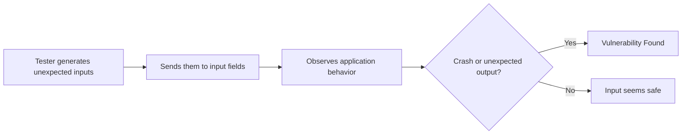
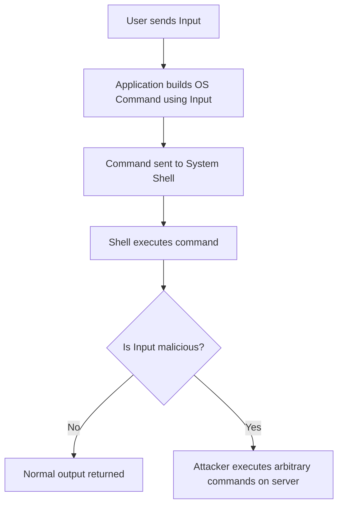
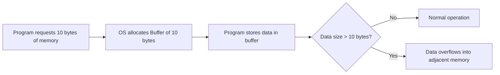
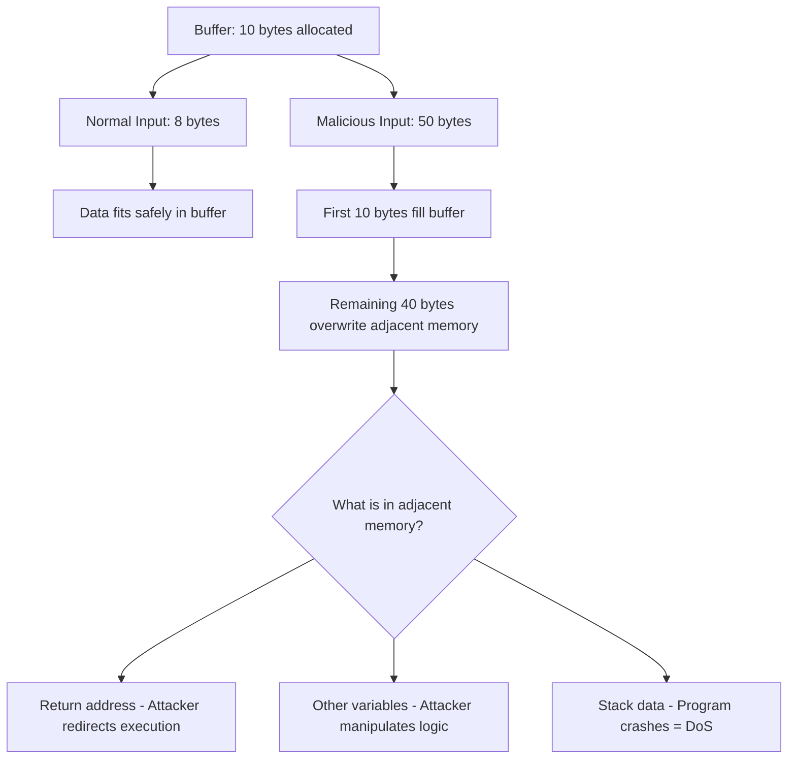
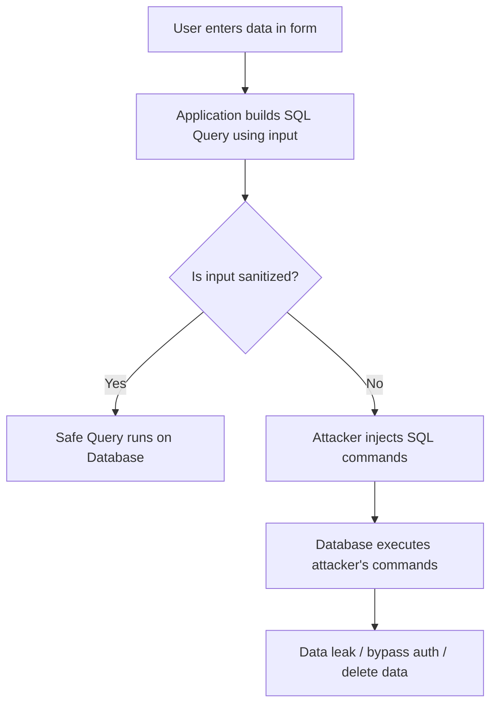
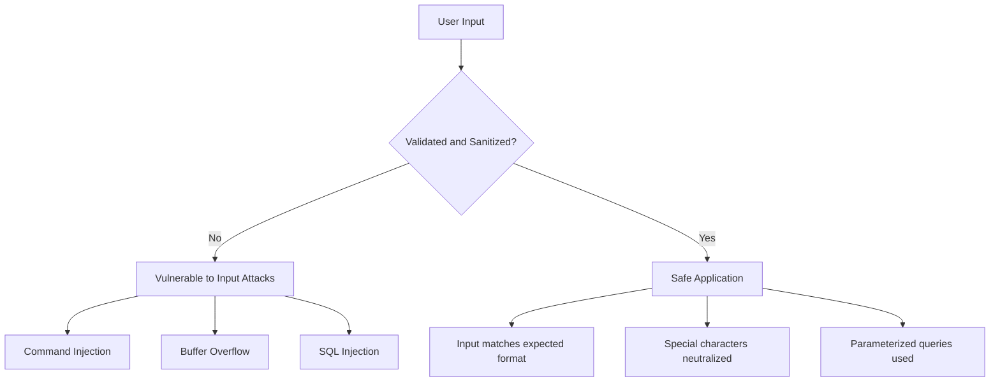

> **Goal of this section:**
> You'll understand what Input Attacks are and how attackers exploit user input to take control of an application, learn the difference between Command Injection, Buffer Overflow, and SQL Injection, and how to deal with them as a defender or developer.

---

## Table of Contents

- [What are Input Attacks?](#what-are-input-attacks)
- [Where Do Input Attacks Happen?](#where-do-input-attacks-happen)
- [How to Mitigate Input Attacks](#how-to-mitigate-input-attacks)
- [OS Command Injection](#os-command-injection)
  - [How it Works](#how-it-works)
  - [Real-World Example](#real-world-example)
  - [Prevention](#prevention)
- [Buffer Overflow](#buffer-overflow)
  - [How Memory Buffers Work](#how-memory-buffers-work)
  - [What Happens During Overflow](#what-happens-during-overflow)
- [SQL Injection (SQLi)](#sql-injection-sqli)
  - [How it Works](#how-it-works)
  - [Real-World Example](#real-world-example)
  - [Breaking Down the Query](#breaking-down-the-query)
- [Comparison Table](#comparison-table)
- [Summary](#summary)

---

## What are Input Attacks?

**Input Attacks** are a type of cyberattack in which the attacker tampers with the data they send to the application: instead of sending normal input, they send malicious input to make the application behave incorrectly or harmfully.

Simply put: the application thinks the user is entering normal data, but in reality the attacker is entering **commands or code**.

```
Normal Input:   username = "ahmed"
Malicious Input: username = "ahmed; cat /etc/passwd"
```

> [!IMPORTANT]
> The root cause is always the same: developers trust user input without performing proper validation or sanitization.

**Why does this happen?**
- The developer doesn't consider that the user might send unexpected input.
- The application takes the input and uses it directly in sensitive operations such as database queries or system commands.
- There's no **Input Validation** — meaning no check that the input is in the correct format.
- There's no **Input Sanitization** — meaning dangerous characters such as `'`, `;`, `--` aren't cleaned out.

---

## Where Do Input Attacks Happen?

Input comes from many places in any application, and every one of them can be an attack point:

| Input Source | Example |
|---|---|
| **Login Forms** | Username / Password fields |
| **Search Bars** | Search queries sent to DB |
| **URL Parameters** | `example.com/page?id=5` |
| **HTTP Headers** | `User-Agent`, `Cookie`, `Referer` |
| **File Uploads** | Uploading a file with malicious name/content |
| **APIs** | JSON/XML body sent to backend |

> [!WARNING]
> Any place that accepts input from the user is a potential **Attack Surface**. Not just the visible forms — even hidden fields and HTTP headers are dangerous.

---

## How to Mitigate Input Attacks

There are two main strategies for dealing with input attacks:

### Defense from the Developer Side

- **Never trust user input** — take this as a golden rule: any input coming from the user could be malicious.
- **Validate Input** — make sure the input is in the correct format (a number? text? an email?).
- **Sanitize Input** — clean out dangerous characters before using the input in any operation.
- **Use Allowlists** — decide what is allowed instead of trying to block everything that isn't.

### Defense from the Tester Side — Fuzzing

**Fuzzing** is a testing technique used by security testers, in which they send strange or malformed inputs to the application to see how it behaves.



> [!TIP]
> Fuzzing isn't a replacement for secure coding; it's a tool for confirming the developer didn't get something wrong, and it uncovers edge cases the developer may have overlooked.

---

## OS Command Injection

### How it Works

Sometimes the application needs to run commands on the operating system — such as creating a folder, running a ping, or getting the date.

**OS Command Injection** happens when the application takes user input and places it inside a command that is sent to the system shell, without performing validation.



> [!IMPORTANT]
> The shell can't tell the difference between the command the developer wrote and the command the attacker injected; it treats everything as a command to be executed.

### Real-World Example

Imagine we have a mailbox application that creates a folder named after the user to store the attachments in.

The developer wrote this code:

```python
import subprocess

username = input("Enter username: ")
subprocess.run(f"mkdir {username}", shell=True)
```

If the user types their name normally, `ahmed`, the command will be:
```bash
mkdir ahmed
```

But if the attacker types `ahmed; cat /etc/passwd`, the command will be:
```bash
mkdir ahmed; cat /etc/passwd
```

The shell will create the folder, and then display the contents of the system's password file!

> [!WARNING]
> The semicolon `;` in Unix/Linux makes the shell run more than one command on a single line. The attacker uses metacharacters like this to inject additional commands.

**Common metacharacters in Command Injection:**

| Symbol | Effect |
|---|---|
| `;` | Run next command regardless |
| `&&` | Run next command if first succeeds |
| `\|\|` | Run next command if first fails |
| `\|` | Pipe output to next command |
| `` ` `` | Execute command inside backticks |
| `$()` | Command substitution |

### Prevention

**The best solution: use built-in libraries instead of system calls**

❌ **Unsafe — Using System Call:**
```python
import subprocess

# Dangerous: shell=True passes input directly to shell
result = subprocess.run("date", shell=True, capture_output=True)
print(result.stdout)
```

✅ **Safe — Using Built-in Library:**
```python
from datetime import datetime

# No shell involved, no system call
current_date = datetime.now()
print(current_date)
```

> [!NOTE]
> The fundamental difference: in the safe version, no shell runs at all. The Python library talks directly to the OS API without going through the shell, so there's no chance for injection.

**If there's no alternative to system calls:**
- Use **Allowlist Validation** — allow only the expected values.
- Use **Parameterized Commands** — not string concatenation.
- Apply the **Principle of Least Privilege** — don't run the application as root.

---

## Buffer Overflow

### How Memory Buffers Work

A **Buffer** is a limited space in memory that a program allocates to store temporary data.

When the developer writes code that tells the OS, "Reserve this many bytes of memory for me," the OS creates the buffer at exactly that size.



### What Happens During Overflow

A **Buffer Overflow** happens when the program tries to write more data into the buffer than it can hold, so the extra data "overflows" and overwrites the adjacent memory.

**Picture it like this:**
Imagine you have a cup that holds 200ml. If you try to pour 500ml into it, the extra 300ml will spill onto the table and soak the things next to it. The buffer in memory is like that cup, and the adjacent memory is like the things on the table.



**Possible results:**

| Result | Description |
|---|---|
| **Program Crash** | The program suddenly shuts down — Denial of Service |
| **Data Corruption** | Other data in memory gets corrupted |
| **Arbitrary Code Execution** | The attacker modifies the return address and runs malicious code |
| **Privilege Escalation** | If the program runs as admin, the attacker gains admin privileges |

> [!IMPORTANT]
> A buffer overflow doesn't just affect security — it can also crash the system entirely. This means that even if the attacker can't run code, they can easily cause a **Denial of Service**.

**A simple example:**

```c
// Dangerous C code
char buffer[10];      // Buffer can hold only 10 characters
gets(buffer);         // gets() does NOT check input length — dangerous!
```

If the user enters 50 characters, `gets()` will write all of them into memory, overrunning the 10 reserved bytes.

> [!TIP]
> Buffer overflows were far more common in C and C++ because they give you direct control over memory. Newer languages such as Python and Java perform automatic bounds checking, meaning they automatically make sure the input doesn't exceed the allowed size.

---

## SQL Injection (SQLi)

### How it Works

**SQL Injection** happens when the application builds a SQL query using user input without sanitizing it, so the attacker can inject SQL commands that change the query's behavior.



### Real-World Example

**Normal Login Request:**
```
URL: http://www.example.com/login.php?passwd=1234&user=ahmed
```

The application builds this query:
```sql
SELECT * FROM users WHERE username = 'ahmed' AND password = '1234';
```

**Malicious Login Request (SQL Injection):**
```
URL: http://www.example.com/login.php?passwd=' or userID='admin';--
```

The application builds this query:
```sql
SELECT * FROM users WHERE username = 'admin' AND password = '' or userID='admin';--';
```

> [!WARNING]
> The `--` at the end of the query is a **SQL Comment**. Everything after it is treated as a comment and isn't executed. The attacker uses it to cancel the rest of the original query and control the result.

### Breaking Down the Query

Let's understand the original SQL query:

```sql
SELECT * FROM users WHERE username = 'admin' AND password = '1234';
```

| Part | Meaning |
|---|---|
| `SELECT` | The command that retrieves the data |
| `*` | Means all columns |
| `FROM users` | From the table named `users` |
| `WHERE username = 'admin'` | Whose username is `admin` |
| `AND password = '1234'` | **And** the password is also correct |

**Why does the single quote matter?**

The single quote `'` in SQL is used to start and end a string. When the attacker puts a `'` in the input, they "close" the string before it is supposed to end and can add extra SQL code.

**Types of SQL Injection:**

| Type | Description | Example |
|---|---|---|
| **Classic SQLi** | Attacker sees output directly | `' OR '1'='1` |
| **Blind SQLi** | No output, Attacker infers from behavior | True/False questions to DB |
| **Error-Based SQLi** | Extracts info from error messages | Trigger DB error with info |
| **Union-Based SQLi** | Uses UNION to retrieve extra data | `' UNION SELECT username, password FROM users--` |

> [!NOTE]
> SQL injection doesn't just let the attacker bypass the login; they may also be able to read all the data in the database, modify it, delete it, or even run commands on the server in some configurations.

**Prevention:**

```python
# Unsafe — String concatenation (Vulnerable to SQLi)
query = "SELECT * FROM users WHERE username = '" + username + "' AND password = '" + password + "'"

# Safe — Parameterized Query (Prepared Statement)
query = "SELECT * FROM users WHERE username = ? AND password = ?"
cursor.execute(query, (username, password))
```

> [!TIP]
> **Parameterized Queries** (or prepared statements) are the strongest defense against SQL injection. With them, the SQL code and the data are sent to the database separately, so the database treats the input as data only, not as part of the query.

---

## Comparison Table

| Attack | Target | How it Works | Primary Impact | Prevention |
|---|---|---|---|---|
| **Command Injection** | OS Shell | Injects shell commands via user input | RCE — Remote Code Execution | Avoid system calls, use libraries, validate input |
| **Buffer Overflow** | Application Memory | Sends input larger than buffer size | Crash, Code Execution, Privilege Escalation | Bounds checking, safe languages, ASLR/DEP |
| **SQL Injection** | Database | Injects SQL code via user input | Data theft, Auth bypass, Data destruction | Parameterized queries, ORMs, input validation |

---

## Summary

### Key Takeaways

- **Input Attacks** all share one cause: **Trust in User Input** without validation or sanitization.

- **OS Command Injection** happens when the application injects user input directly into a system command. The fix: use built-in libraries instead of OS commands.

- A **Buffer Overflow** happens when the data sent is larger than the allocated buffer. The extra data overwrites the adjacent memory and can lead to a crash or code execution.

- **SQL Injection** happens when the attacker injects SQL code into the application's query. The best fix is **Parameterized Queries**.

- **Fuzzing** is an important tool that helps security testers uncover input validation issues before attackers do.

- A golden rule for developers and defenders: **"Never Trust User Input"** — always validate, sanitize, and restrict.


