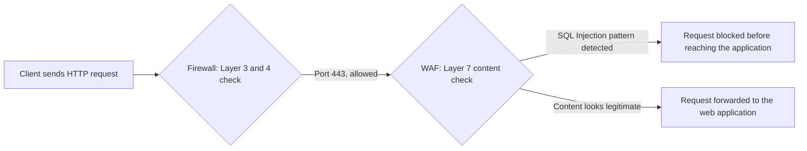
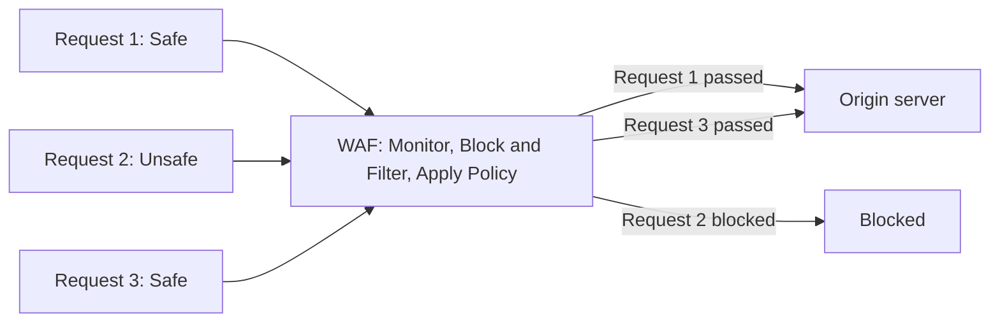
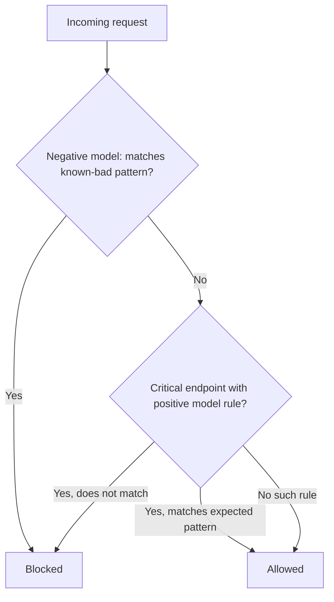

| Topic | Level | Reading Time | Prerequisites |
|---|---|---|---|
| WAF (Web Application Firewall) | Intermediate | ~15 min | Defense in Depth Model, basic idea of HTTP requests |

> **Goal of this section:**
> You'll understand exactly what a WAF is, how it decides to block a particular request, and the limits that no one can get around.


## Learning Objectives

By the end of this section, you will be able to:

- Explain why a **WAF** exists as a separate control from a traditional firewall, in terms of OSI layers.
- List the three deployment modes of a WAF and explain why cloud-based WAFs became the most common.
- Differentiate between the **negative security model** and the **positive security model** used in WAF detection.
- List concrete attack types a WAF can block, and explain the concept of **virtual patching**.
- Identify what a WAF cannot do, and why those gaps require other Defense in Depth layers.

## Table of Contents

- [Learning Objectives](#learning-objectives)
- [Why a WAF Exists](#why-a-waf-exists)
  - [The Layer Gap a Firewall Leaves Open](#the-layer-gap-a-firewall-leaves-open)
  - [A Concrete Example](#a-concrete-example)
- [What a WAF Is and How It Is Deployed](#what-a-waf-is-and-how-it-is-deployed)
  - [Definition](#definition)
  - [Deployment Modes](#deployment-modes)
  - [How a WAF Sits in the Traffic Path](#how-a-waf-sits-in-the-traffic-path)
- [How a WAF Decides What to Block](#how-a-waf-decides-what-to-block)
  - [Negative Security Model](#negative-security-model)
  - [Positive Security Model](#positive-security-model)
  - [The Hybrid Approach in Practice](#the-hybrid-approach-in-practice)
- [What a WAF Can and Cannot Do](#what-a-waf-can-and-cannot-do)
  - [What It Can Block](#what-it-can-block)
  - [What It Cannot Fix](#what-it-cannot-fix)
  - [What It Cannot See](#what-it-cannot-see)
  - [What It Cannot Stop](#what-it-cannot-stop)
- [A Basic WAF Rule Example](#a-basic-waf-rule-example)
- [Career Path Connections](#career-path-connections)
- [Key Terms Glossary](#key-terms-glossary)
- [Summary](#summary)

## Why a WAF Exists

### The Layer Gap a Firewall Leaves Open

Networks are organized in layers (the **OSI model**), and traditional firewalls operate at **Layer 3** (IP addressing) and **Layer 4** (ports and TCP/UDP behavior). At these two layers, the firewall can only see things like: "someone is trying to connect to port 443 from this IP." **It has no visibility into the connection itself** once it's allowed.

The **WAF** operates at **Layer 7** (the application layer), which means it can **read the actual content** of the HTTP request: the URL, the parameters, the headers, the cookies, and the request body.

### A Concrete Example

| Control | What It Sees | Verdict |
|---|---|---|
| Firewall | `TCP 443 is ALLOWED` — just a web connection that looks legitimate, so it allows it | Passes |
| WAF | `GET /login.php?user=admin' OR '1'='1` — this is an **SQL Injection** attempt trying to manipulate the database query to bypass the login | Blocked |



> [!IMPORTANT]
> The firewall's decision and the WAF's decision happen at two completely different layers. A connection can be perfectly valid at Layer 3-4 and still be a full attack at Layer 7. This is why the WAF is a genuinely independent layer, not a duplicate of the firewall.

## What a WAF Is and How It Is Deployed

### Definition

A **WAF** is a security control placed in front of web applications that inspects HTTP and HTTPS traffic **specifically**, looking at Layer 7 content and not just network-layer metadata.

### Deployment Modes

A WAF can be deployed in three ways:

| Deployment Mode | Description |
|---|---|
| Network appliance | A physical or virtual device placed in front of the data center |
| Host-based | A module that runs directly on the web server itself |
| Cloud-based (reverse proxy) | A cloud service that traffic is routed to before it reaches your servers |

**Cloud-based WAFs** have become the most widely used in modern environments, for these reasons:

- They're easy to deploy without touching the application's underlying infrastructure at all.
- They receive continuous threat signature updates from the provider with no effort on the customer's side.

### How a WAF Sits in the Traffic Path



The diagram shows that the WAF stands like a gate between the clients and the origin server: it monitors, filters, and applies policy, and forwards to the server only the requests that passed inspection.

## How a WAF Decides What to Block

There are two main detection models in WAFs, and it's important to distinguish between them clearly.

### Negative Security Model

The **negative security model (blocklisting)**: the WAF has a list of patterns known to be **bad** (such as SQL Injection signatures or XSS patterns), and it blocks any request that matches them.

- **The advantage:** easy to deploy.
- **The disadvantage:** it may miss **completely new** attack patterns that aren't on the list yet.

### Positive Security Model

The **positive security model (allowlisting)**: the WAF only allows requests that match a **known-good, precisely defined** pattern for a specific application (the expected parameters, expected value formats, expected lengths), and blocks everything else **by default**.

- **The advantage:** much stronger.
- **The disadvantage:** it takes more effort to configure correctly for each individual application.

### The Hybrid Approach in Practice

Most real-world WAFs use **a mix of both**: blocklists for known signatures, plus some allowlist-style rules on critical, well-understood endpoints, such as login pages.



> [!TIP]
> When designing WAF policy for a critical endpoint like a login page or a payment form, invest the extra effort in a positive security rule. The cost of configuration is worth it for the endpoints attackers target most.

## What a WAF Can and Cannot Do

### What It Can Block

A WAF can block a variety of attack types:

- **SQL Injection**
- **Cross-Site Scripting (XSS)**
- **Local and Remote File Inclusion**
- Some forms of **Cross-Site Request Forgery**
- **Basic bot traffic**
- It can also enforce **rate limiting** to slow down **brute-force login** attempts

### What It Cannot Fix

A WAF **doesn't fix** a vulnerability that actually exists in the application's own code. It's a **mitigating control**, not a permanent fix, and it's sometimes called **virtual patching**, because it buys time until the actual code is fixed.

> [!IMPORTANT]
> A WAF blocking an SQL Injection attempt does not mean the underlying vulnerability in the application code is gone. It means the exploit path is temporarily closed at the edge, while the real fix still needs to happen in the code.

### What It Cannot See

A WAF **can't see** encrypted traffic unless it's placed where it can **decrypt and re-encrypt** the connection. That's why WAFs are usually placed where they can terminate or inspect **TLS**.

### What It Cannot Stop

A WAF **doesn't stop** attacks that don't go through HTTP at all, such as attacks on the underlying server OS or the network layer. That's the job of the other layers in the Defense in Depth model.

| Attack Category | Does the WAF Cover It? |
|---|---|
| SQL Injection through a web form | Yes |
| Cross-Site Scripting | Yes |
| Brute-force login attempts | Yes, via rate limiting |
| Vulnerability in the application's own code | No, only mitigates the exploit path |
| Attack against the server's operating system | No, this is the Host layer's job |
| Attack against the network itself | No, this is the Perimeter or Network layer's job |

## A Basic WAF Rule Example

An illustrative example of a **ModSecurity** rule (one of the most popular open-source WAF engines) that blocks a simple SQL Injection pattern in the query string:

```text
SecRule ARGS "@rx (?i)(\bunion\b.*\bselect\b|\bor\b\s+1=1)" \
    "id:1001,phase:2,deny,status:403,msg:'Possible SQL Injection detected'"
```

This rule inspects the arguments (`ARGS`) for common SQLi patterns (such as `UNION SELECT` or `OR 1=1`), and if it finds a match, it rejects the request with HTTP 403.

> [!WARNING]
> This is a simplified illustrative example for learning purposes, not a production-ready rule. Real WAF rule sets are far more comprehensive and are usually maintained by a dedicated rule set project, such as the OWASP Core Rule Set, rather than written from scratch.

## Career Path Connections

| Career Path | How This Topic Applies |
|---|---|
| SOC Analyst | Reviews WAF logs and alerts to confirm whether a blocked request was a genuine attack or a false positive |
| Penetration Tester | Tests whether WAF rules can be bypassed through encoding tricks or unusual request structures |
| GRC | WAF deployment is often a compliance requirement, for example under PCI DSS for organizations handling payment card data |
| Cloud Security | Configures and tunes cloud-based WAF services such as those offered by major cloud providers |

## Key Terms Glossary

| Term | Definition |
|---|---|
| WAF | Web Application Firewall, inspects Layer 7 HTTP and HTTPS content for application-layer attacks |
| Layer 7 | The application layer of the OSI model, where HTTP content lives |
| Reverse Proxy | A server that sits in front of backend servers and forwards client requests to them |
| Negative Security Model | A WAF detection approach that blocks requests matching known-bad patterns |
| Positive Security Model | A WAF detection approach that only allows requests matching a known-good pattern |
| Virtual Patching | Using a WAF rule to mitigate a known vulnerability without changing the application code |
| TLS Termination | The point where encrypted traffic is decrypted so its content can be inspected |
| Rate Limiting | Restricting how many requests a client can make in a given time period |
| SQL Injection | An attack that manipulates a database query through unvalidated input |
| Cross-Site Scripting (XSS) | An attack that injects malicious scripts into content viewed by other users |

## Summary

- **A WAF fills the gap a firewall leaves open:** the firewall sees only the IP and the port, while the WAF sees the full HTTP content.
- **Three deployment modes:** network appliance, host-based, or cloud-based, and the last is the most widespread today.
- **Two detection models:** negative (blocklisting) blocks the known-bad, and positive (allowlisting) allows only the known-good; most WAFs use a mix of both.
- **A WAF blocks real attack categories:** SQL Injection, XSS, File Inclusion, some forms of CSRF, and brute force via rate limiting.
- **A WAF is a mitigation, not a fix:** virtual patching buys time, but the real vulnerability in the code still has to be fixed.
- **A WAF has real limits:** it can't see encrypted traffic without TLS termination, and it doesn't stop non-HTTP attacks; those are the responsibility of other layers in the Defense in Depth model.

