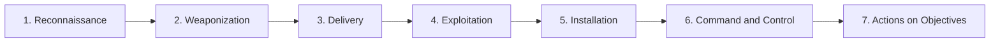
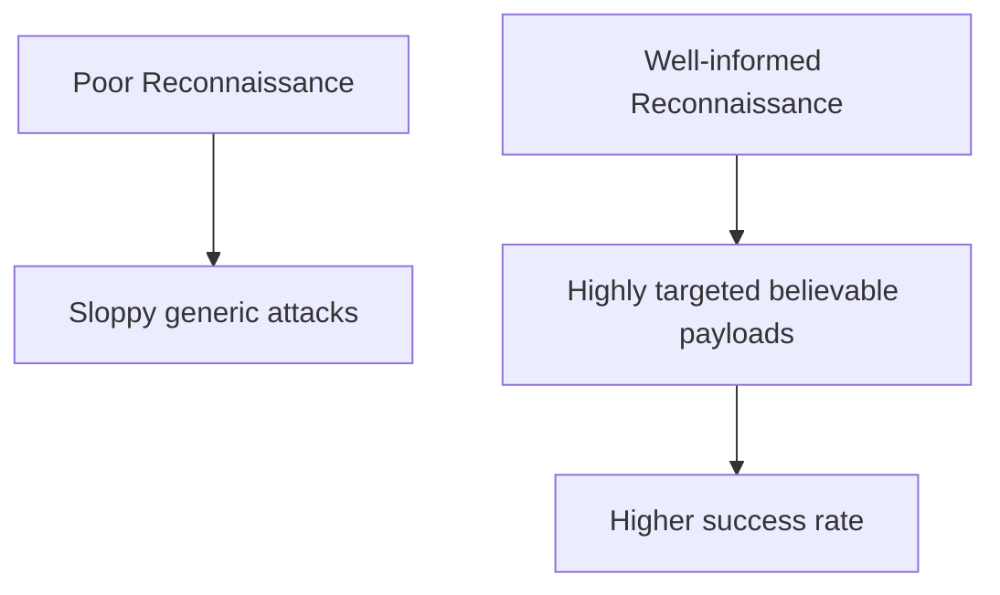
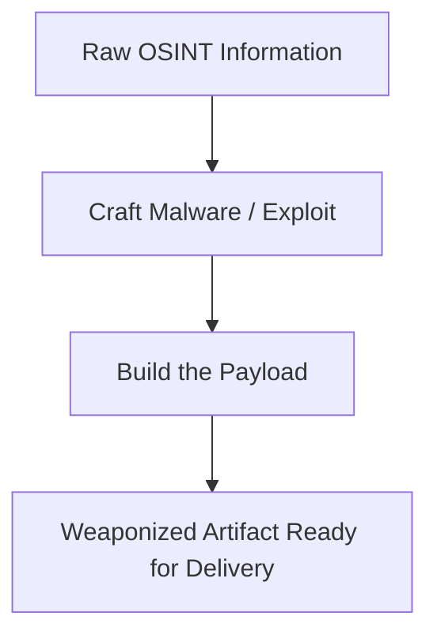
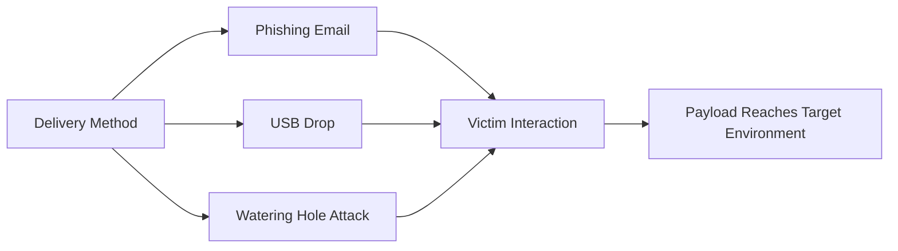
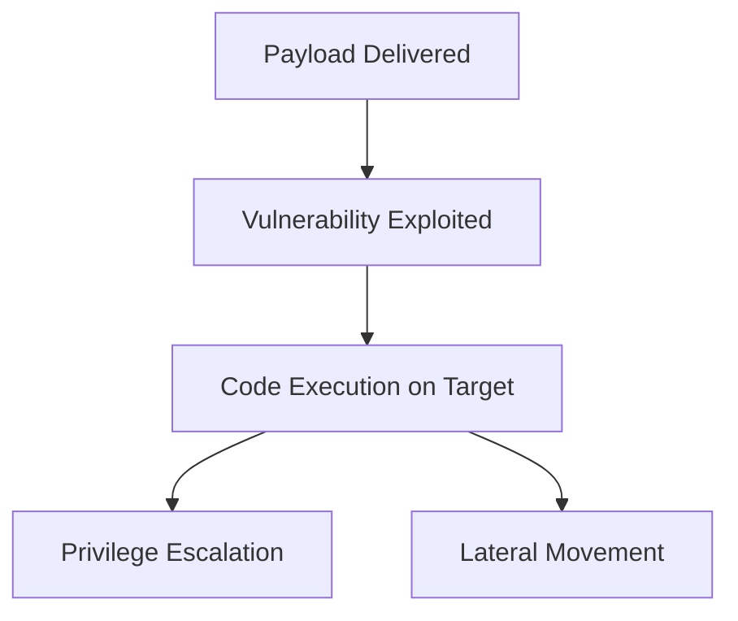
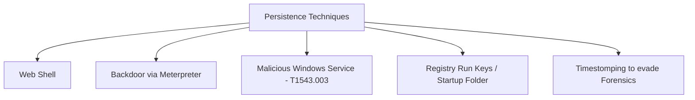
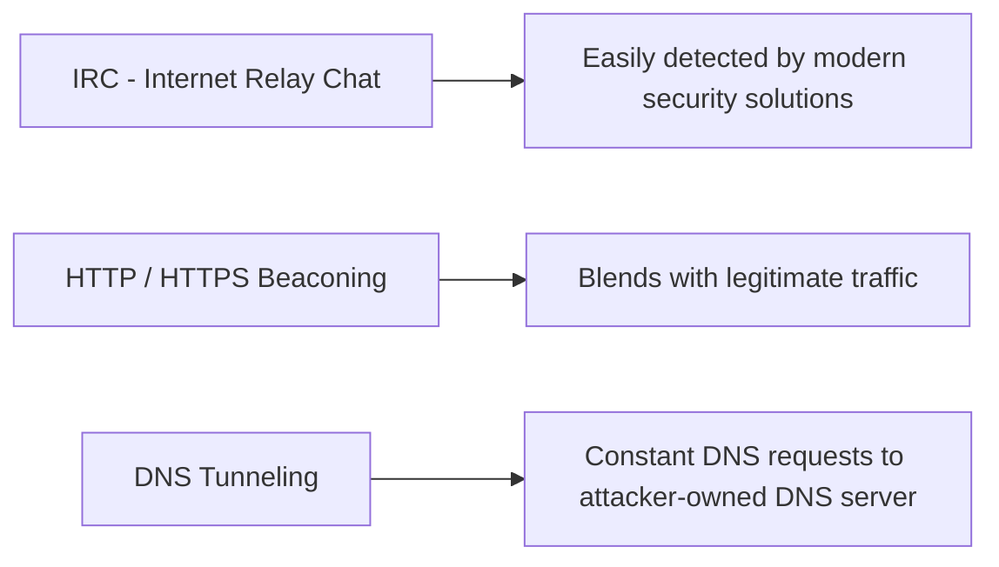
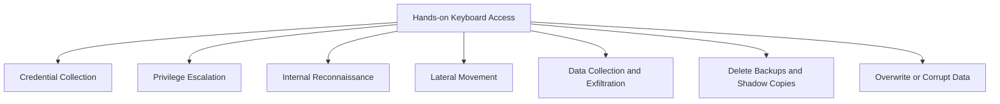
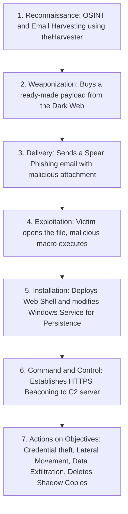

> **Goal of this section:**
> You'll understand how an attacker plans and carries out a cyberattack, from the moment they start gathering information about you until they reach their final objective inside your network. And as a SOC Analyst, you'll learn how to "break" this chain at any phase to stop the attack before it goes any further.


## Table of Contents

- [Introduction: What is the Cyber Kill Chain?](#introduction-what-is-the-cyber-kill-chain)
- [Why Should a SOC Analyst Care?](#why-should-a-soc-analyst-care)
- [The 7 Phases Overview](#the-7-phases-overview)
- [Phase 1: Reconnaissance](#phase-1-reconnaissance)
- [Phase 2: Weaponization](#phase-2-weaponization)
- [Phase 3: Delivery](#phase-3-delivery)
- [Phase 4: Exploitation](#phase-4-exploitation)
- [Phase 5: Installation](#phase-5-installation)
- [Phase 6: Command & Control (C2)](#phase-6-command--control-c2)
- [Phase 7: Actions on Objectives](#phase-7-actions-on-objectives)
- [Full Attack Walkthrough — "Megatron" Scenario](#full-attack-walkthrough--megatron-scenario)
- [Summary](#summary)

---

## Introduction: What is the Cyber Kill Chain?

The term **Kill Chain** originally comes from the military, where it describes the steps of a military attack in order: first you identify the target (Target Identification), then you make a decision and give the order to attack (Decision & Order to Attack), and finally you destroy the target (Target Destruction).

**Lockheed Martin** (a global Aerospace and Security company) took this military concept, applied it to the world of Cybersecurity in 2011, and turned it into a framework called the **Cyber Kill Chain®**.

> [!IMPORTANT]
> The core idea of the Kill Chain: for the attacker to succeed, they have to pass through **every** phase of the chain in order. If you, as a Defender, can stop them at any one of these phases, the whole attack fails — and that's what we call **"Breaking the Kill Chain"**.

This is exactly what gives the framework its real value: it doesn't just explain how an attack happens, it gives you a clear map of every point where you can step in and prevent the attack.

---

## Why Should a SOC Analyst Care?

Understanding the Cyber Kill Chain isn't a luxury; it's fundamental to your work as a:

- **SOC Analyst**
- **Security Researcher**
- **Threat Hunter**
- **Incident Responder**

Why? Because it helps you with:

1. **Protecting against Ransomware, Data Breaches, and APTs** (Advanced Persistent Threats).
2. **Assessing network security (Security Assessment)**: You can use the Kill Chain as a checklist to identify which Security Controls are missing in your infrastructure and close any existing gaps.
3. **Recognizing the intruder's intentions**: When you see a specific indicator in the logs, you can determine which phase of the attack it belongs to, and that guides how you respond.

> [!TIP]
> If you see a strange process making very frequent DNS requests to an unknown domain, you as an Analyst can immediately link it to the **Command & Control** phase, which saves you a lot of time in the investigation.

---

## The 7 Phases Overview

The framework consists of 7 sequential phases, each building on the one before it:



| # | Phase | Goal |
|---|-------|---------------------|
| 1 | Reconnaissance | Gather information about the victim before the attack |
| 2 | Weaponization | Prepare the Payload or the Malware |
| 3 | Delivery | Get the Payload to the victim |
| 4 | Exploitation | Execute the code and exploit the vulnerability |
| 5 | Installation | Establish a lasting foothold (Persistence) on the machine |
| 6 | Command & Control | Open a control channel with the attacker's server |
| 7 | Actions on Objectives | Achieve the final goal of the attack |

> [!NOTE]
> Throughout this explanation, we'll follow a fictional scenario about an attacker named **"Megatron"** who is planning an advanced cyberattack, so we can understand each phase from the attacker's point of view and then connect it to our point of view as Defenders.

---

## Phase 1: Reconnaissance

### Definition

**Reconnaissance** is the research and planning phase. In it, the attacker gathers every possible piece of information about the target before taking any action. This information can include:

- Infrastructure details (servers, IP Ranges, Domains).
- Employee data.
- Business processes.
- Exposed technologies.

> [!IMPORTANT]
> Reconnaissance is usually **Passive** and **Undetected** — it happens without the victim noticing anything at all. That's what makes it dangerous, because in most cases no alert is generated while the attacker is gathering information.

The relationship between the quality of the recon and the quality of the attack is simple:



### OSINT — Open-Source Intelligence

The most important tool in recon is **OSINT**. Simply put, the attacker gathers information about the target from **publicly available** sources — information that isn't secret at all and that anyone can access — but the attacker collects it and connects the pieces to build a complete picture of the victim.

OSINT sources include:

- Search engines
- Print and online media
- Social media accounts
- Online forums and blogs
- Public record databases
- WHOIS data and technical data

> [!TIP]
> OSINT isn't just a tool for attackers — as a Defender or SOC Analyst, you should regularly run OSINT on your own company to know what information about you is visible to the outside world, and close any unintended leaks (such as emails or technologies exposed in Job Postings, for example).

### Reconnaissance Types

| Type | Description | Examples |
|-------|--------|--------|
| **Passive Recon** | No direct interaction with the target | WHOIS lookups, Social media scraping, reviewing old breach data |
| **Active Recon** | Involves direct contact with the target | Social Engineering, Port Scanning, Banner Grabbing, scanning open services |

> [!WARNING]
> Active Recon is easier to detect than Passive Recon, because it leaves traces on the network or servers (such as Connection Logs or Scan Attempts). As a Defender, this is your real chance to catch the attacker early.

### Email Harvesting

One of the most important recon techniques is **Email Harvesting** — the process of collecting email addresses from public, paid, or free sources. Its main purpose is to use them later in **Phishing** attacks (a type of Social Engineering aimed at stealing sensitive data such as login credentials and credit card numbers).

Popular tools used in Reconnaissance:

| Tool | Function |
|--------|---------|
| **theHarvester** | Collects emails, names, Subdomains, IPs, and URLs from multiple public sources |
| **Hunter.io** | A tool specialized in collecting contact details associated with a specific domain |
| **OSINT Framework** | A comprehensive collection of OSINT tools organized by category |

---

## Phase 2: Weaponization

After "Megatron" successfully finished the Reconnaissance phase, it was time to turn the raw information he gathered into an **actionable attack tool** — by crafting Malware and Exploits and bundling them into a **Payload**.

> [!NOTE]
> Not all attackers write their own Malware. Most use automated tools or buy ready-made Malware from the Dark Web. But APT Groups (nation-sponsored groups) usually write their own custom Malware to make sure it's **Unique** and can evade detection tools.

### Key Terms You Need to Understand Well

| Term | Definition |
|---------|---------|
| **Malware** | A program or software designed to harm, disrupt, or gain unauthorized access to a computer |
| **Exploit** | A program or code that takes advantage of a vulnerability or flaw in an application or system |
| **Payload** | The malicious code that the attacker actually executes on the target system |

In our scenario, "Megatron" decided to buy a ready-made Payload written by someone else on the Dark Web, to save time and focus on the remaining phases of the attack.

### Weaponization Tactics

In this phase, the attacker can use tactics such as:

1. **Creating an infected Office document**: containing malicious Macros or VBA (Visual Basic for Applications) scripts.
2. **Building an advanced Payload or Worm**: and planting it on USB Drives that are distributed in public places.
3. **Setting up a Command & Control (C2) infrastructure**: to execute commands on the victim's machine or deliver additional Payloads later.
4. **Planting a Backdoor**: which provides a way to access the system and bypass security mechanisms.
5. **Customizing Phishing templates or OAuth-consent applications**: so they look legitimate and convincing to the victim.



> [!WARNING]
> Any application that requests OAuth Consent from an employee, even if it looks legitimate, must be reviewed and must not be granted broad permissions without verification. This is one of the most widespread Weaponization techniques in recent years (Consent Phishing).

---

## Phase 3: Delivery

In the **Delivery** phase, "Megatron" decides on the **method** he'll use to get the Payload or Malware into the target environment.

### Common Delivery Methods

#### 1. Phishing Email

After finishing recon and choosing his targets, the attacker crafts a malicious email that can target:

- **One specific person**: this is called **Spear Phishing**.
- **A large group of employees** in the company.

The email usually contains a malicious link or an infected attachment, and opening it results in a compromise.

#### 2. USB Drops

The attacker uses a physical delivery medium — such as leaving USB Drives in public places (cafes, parking lots, the street). In a more sophisticated attack, the attacker might print the company's logo on the USB and mail it to the company while pretending to be a customer sending a gift.

#### 3. Watering Hole Attacks

A targeted attack designed to hit a specific group of people by compromising a website they visit regularly and redirecting them to a malicious site the attacker has set up. The victims end up downloading Malware or a malicious application without meaning to, which is called a **Drive-by Download**. An example of this: a fake pop-up asking you to download a bogus browser extension.



> [!IMPORTANT]
> The Delivery phase is one of the most important points where you can break the Kill Chain from a defensive perspective — through Email Filtering, USB Device Control, and Web Filtering/Proxy. If you stop the Payload from arriving in the first place, the attack ends here.

---

## Phase 4: Exploitation

**Exploitation** is the moment the attacker's code actually runs on the victim's machine, taking advantage of a known vulnerability.

### Core Techniques

| Technique | Description |
|---------|--------|
| **Malicious Macro Execution** | Can arrive via a Phishing Email and execute Ransomware the moment the victim opens the file |
| **Zero-day Exploits** | Exploit unknown and unpatched vulnerabilities, which makes them hard to detect at first |
| **Known CVEs** | The attacker exploits well-known public vulnerabilities that still haven't been patched in the target environment |

Once the attacker gains access to the system, they can exploit vulnerabilities in the software, the operating system, or the server to perform:

- **Privilege Escalation**: raising their privileges.
- **Lateral Movement**: moving inside the network to other machines.

### Exploitation Signs to Watch for as a SOC Analyst

> [!IMPORTANT]
> These are key indicators that should be part of your Detection Rules:
> - **Unexpected process spawns** — processes starting for no clear reason or from an unusual parent process.
> - **Registry changes or the creation of new Services** — sudden changes in the Registry or the appearance of unrecognized Services.
> - **Suspicious command-line arguments** — strange or obfuscated commands showing up in the logs.



---

## Phase 5: Installation

As we learned in Weaponization, the **Backdoor** gives the attacker a way to bypass security measures and keep access to the system — which is why it's also called an **Access Point**.

### Why Does the Attacker Need Persistence?

After gaining access, the attacker needs to make sure they can get back into the system in these cases:

- If they lose the connection to the machine.
- If they're detected and their Initial Access is revoked.
- If the system is patched later.

That's why the attacker needs to install a **Persistent Backdoor** — a Backdoor that keeps working even if any of the above happens.

### Ways to Achieve Persistence

#### 1. Web Shell

A malicious script written in web development languages such as **ASP**, **PHP**, **JSP**, which the attacker uses to maintain access to the compromised system. A Web Shell can sometimes be hard to detect because of its simplicity and its file formats (`.php`, `.asp`, `.aspx`, `.jsp`), and it may be wrongly classified as Benign (harmless).

#### 2. A Direct Backdoor on the Victim's Machine

Example: using **Meterpreter** (a Payload from the **Metasploit Framework**) to open an Interactive Shell, through which the attacker can interact with the victim's machine remotely and execute malicious code.

#### 3. Creating or Modifying Windows Services

This technique is defined in MITRE ATT&CK under the ID **T1543.003**. The attacker can create or modify Windows Services so they execute malicious scripts or Payloads periodically as part of Persistence.

Tools used in this technique:

```
sc.exe   # To create, start, stop, query, or delete any Windows Service
Reg      # To modify Service settings
```

> [!WARNING]
> The attacker may use a technique called **Masquerading**, which means naming the malicious Service something very close to the name of a legitimate Service belonging to the operating system or well-known software, so it slips past the ordinary Analyst's eye. Always compare the Service Name with its actual Path, not just the name.

#### 4. Registry Run Keys / Startup Folder

The attacker adds an entry to the "Run Keys" in the Registry or to the Startup Folder, so the Payload runs automatically every time the user logs in.

> [!NOTE]
> According to MITRE ATT&CK, there are:
> - **A Startup Folder specific to each user account (Per-User)**.
> - **A general Startup Folder for the entire system (System-wide)**, which is triggered no matter which user logs in.

### Timestomping

An additional technique used in this phase, which lets the attacker modify a file's **Timestamps** (Modify, Access, Create, Change times) in order to:

1. Evade detection by the Forensic Investigator.
2. Make the Malware look like part of a legitimate, long-installed program on the system.



> [!TIP]
> As a SOC Analyst, you need to continuously monitor: the creation of new Services, changes to Run Keys, and new files in Startup Folders. These are among the strongest Detection Points for the Installation phase.

---

## Phase 6: Command & Control (C2)

After "Megatron" achieved Persistence and executed the Malware on the victim's machine, he opens a **C2 (Command and Control)** channel through the Malware so he can control and manipulate the victim remotely.

> [!NOTE]
> This term is also known as **C&C** or **C2 Beaconing**, and it's a type of malicious communication between the C&C server and the Malware on the infected machine. The infected machine keeps communicating with the C2 server continuously — which is where the term **"Beaconing"** comes from (like a signal sent out periodically).

Once the connection is established, the attacker has **Full Control** over the victim's machine.

### The Evolution of C2 Channels



| Channel | Details |
|--------|----------|
| **IRC** | Used to be the traditional channel, but it's now easy to detect with modern security tools |
| **HTTP (Port 80) / HTTPS (Port 443)** | This type of Beaconing blends in with legitimate traffic, which helps the attacker evade Firewalls |
| **DNS (DNS Tunneling)** | The infected machine sends continuous DNS requests to a DNS server owned by the attacker |

> [!IMPORTANT]
> It's very important to know that the owner of the C2 infrastructure might be the Adversary themselves, or it might be **another, already compromised Host** that the attacker uses as an intermediary (like an extra layer to hide their real identity).

> [!TIP]
> As a SOC Analyst, focus on **Beaconing Patterns**: periodic connections at fixed or near-fixed intervals to an unknown domain or external IP, especially if the traffic looks like ordinary HTTPS but the destination is suspicious. Network Detection (NDR) tools and DNS Log analysis are essential here.

---

## Phase 7: Actions on Objectives

After "Megatron" successfully went through 6 phases of the attack, he finally reached the last phase — achieving the **original goal of the attack**. Once he reaches **Hands-on Keyboard Access**, the attacker can achieve:

| Objective | Description |
|-------|--------|
| **Collect Credentials** | Stealing Usernames and Passwords |
| **Privilege Escalation** | Gaining higher privileges — such as Domain Admin Access — starting from an ordinary Workstation, by exploiting a Misconfiguration |
| **Internal Reconnaissance** | Interacting with internal software to discover new vulnerabilities inside the network |
| **Lateral Movement** | Moving between different machines inside the company environment |
| **Collect & Exfiltrate Sensitive Data** | Collecting sensitive data and leaking it outside the network |
| **Deleting Backups and Shadow Copies** | Shadow Copy is a Microsoft technology that creates backups (Snapshots) of files or Volumes — deleting them prevents the victim from recovering easily |
| **Overwrite or Corrupt Data** | Sabotaging or overwriting the original data |



> [!WARNING]
> Deleting Shadow Copies is often a **very strong sign** of an imminent or ongoing Ransomware attack. If you see a command like `vssadmin delete shadows` in the logs, that's a major Red Flag that must be escalated immediately (Immediate Escalation).

---

## Full Attack Walkthrough — "Megatron" Scenario

To tie together everything we've covered, let's follow "Megatron's" full journey from start to finish:



> [!IMPORTANT]
> Every arrow in this diagram is a **potential failure point for the attacker** if you, as a Defender, put the right Control in place there. This is the essence of the Kill Chain philosophy: you don't have to stop everything — stopping just one link is enough for the whole chain to collapse.

---

## Summary

- The **Cyber Kill Chain** is a framework from Lockheed Martin (2011), based on a military concept, that describes 7 phases an attacker must pass through in order to succeed in their attack.
- The seven phases are: **Reconnaissance → Weaponization → Delivery → Exploitation → Installation → Command & Control → Actions on Objectives**.
- **Reconnaissance**: Gathering information about the target, usually in a Passive and undetected way, using OSINT and tools like theHarvester and Hunter.io.
- **Weaponization**: Turning the information into an actual attack tool — building or buying Malware/Exploits and bundling them into a Payload.
- **Delivery**: Getting the Payload to the victim through a Phishing Email, USB Drops, or Watering Hole Attacks.
- **Exploitation**: The moment the malicious code actually runs and the vulnerability is exploited — a Zero-day, a Known CVE, or a malicious Macro.
- **Installation**: Establishing Persistence on the machine through Web Shells, Backdoors (like Meterpreter), modifying Windows Services (T1543.003), or Registry Run Keys — along with the Timestomping technique to hide traces.
- **Command & Control**: Opening a persistent communication channel (Beaconing) between the infected machine and the attacker's server, usually over HTTP/HTTPS or DNS Tunneling to evade detection.
- **Actions on Objectives**: The final phase, in which the attacker achieves their real goal — stealing data, Privilege Escalation, Lateral Movement, data exfiltration, and destroying backups.
- **The most important principle for the Defender**: There's no need to stop the whole attack at once — breaking **just one link** in the chain is enough to stop the attacker completely, and that's what's called **Breaking the Kill Chain**.

> [!TIP]
> When you analyze any real incident as a SOC Analyst, try to arrange the evidence you have according to the Kill Chain phases. This helps you know exactly how far the attacker got, and lets you anticipate their next step before it happens.
