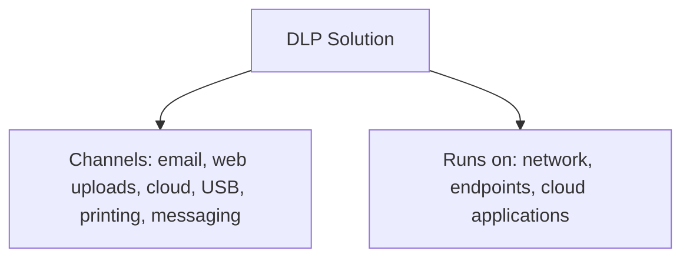
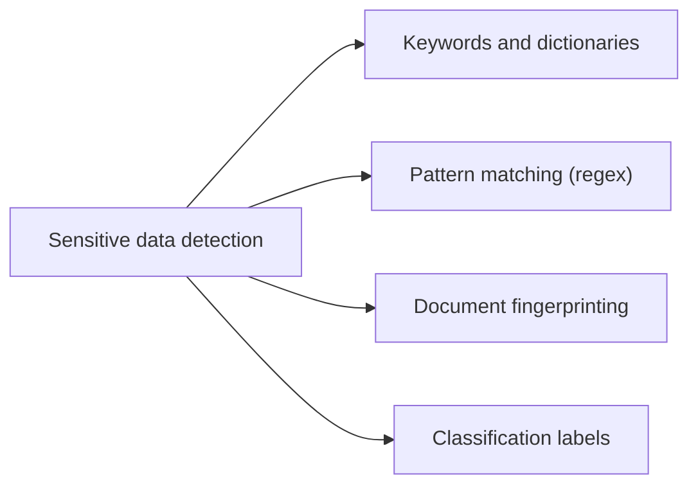
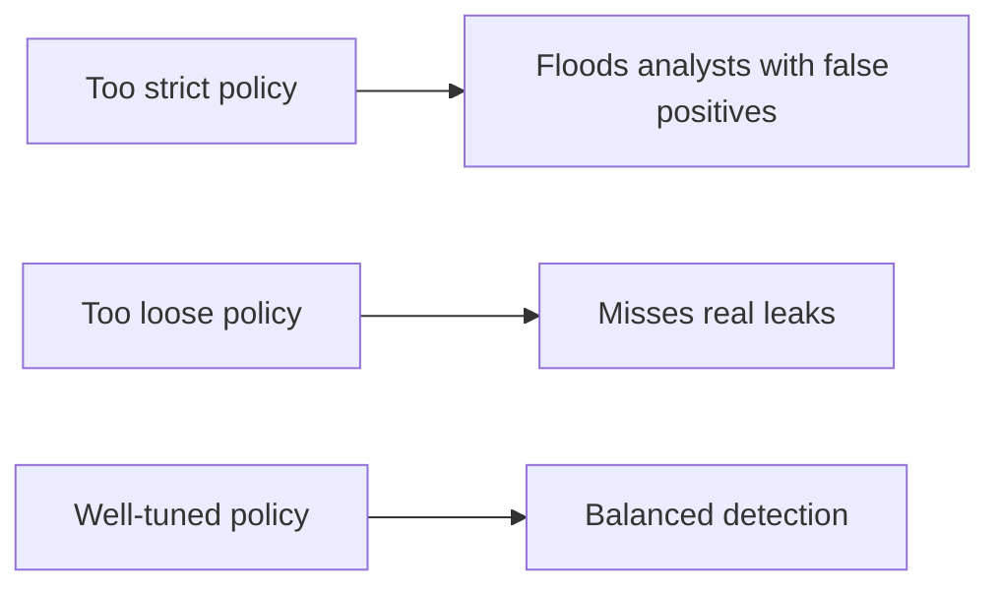
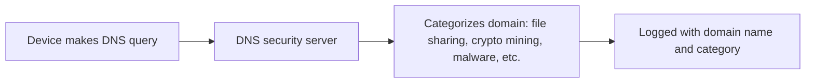
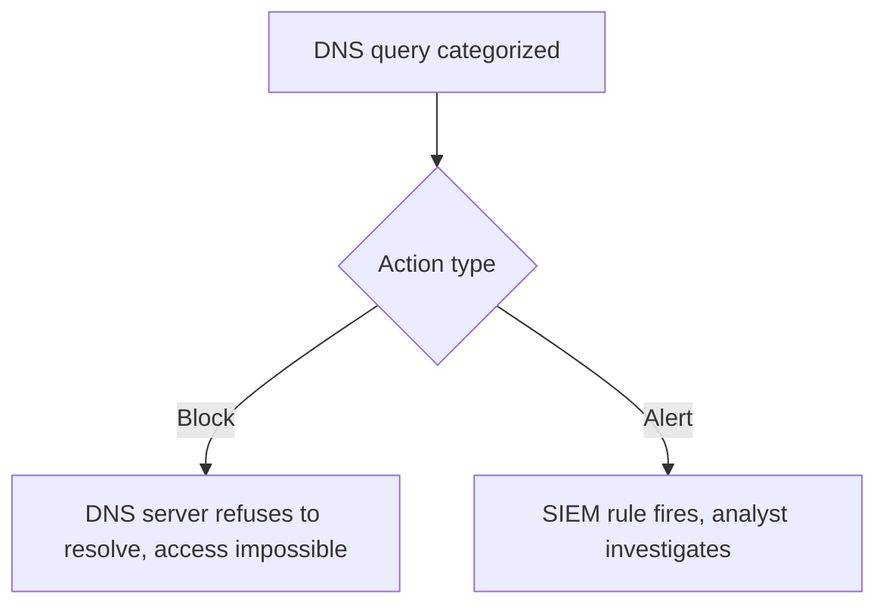
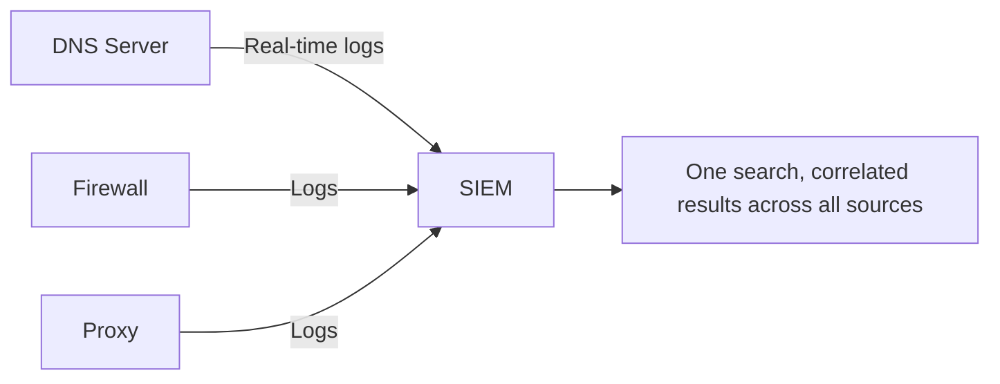
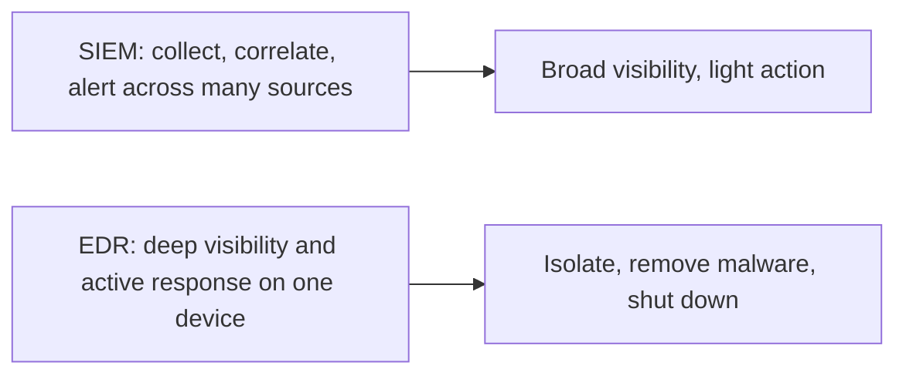
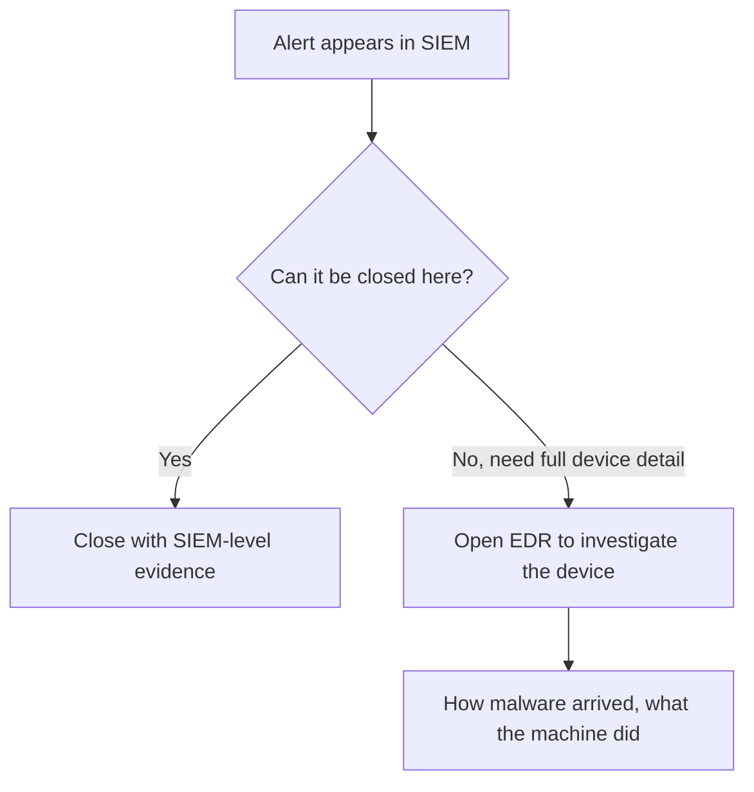

| Topic | Level | Reading Time | Prerequisites |
|---|---|---|---|
| DLP Tools and SIEM Integration | Intermediate | ~20 min | Data Loss Fundamentals and DLP Operations |

> **Goal of this section:**
> You'll understand how DLP tools detect sensitive data and act on it, how DNS security tools categorize websites and block them or alert you about them, why centralizing in the SIEM is more important than searching each security tool directly, and what the practical difference is between a SIEM and an EDR.

## Learning Objectives

By the end of this section, you will be able to:

- Explain what a **DLP solution** monitors, where it runs, and how policies decide its actions.
- List the detection methods DLP tools use: **keywords**, **pattern matching**, **document fingerprinting**, and **classification labels**.
- Explain how **DNS security servers** categorize domains, and the trade-offs between blocking a category and alerting on it.
- Explain, with five concrete reasons, why organizations route DNS logs through a **SIEM** instead of searching the DNS server directly.
- Differentiate between **SIEM** and **EDR**, and describe the typical workflow that moves between them.

## Table of Contents

- [Learning Objectives](#learning-objectives)
- [DLP Tools](#dlp-tools)
  - [What a DLP Solution Does](#what-a-dlp-solution-does)
  - [Channels and Where It Runs](#channels-and-where-it-runs)
  - [Policies and SIEM Integration](#policies-and-siem-integration)
- [How DLP Detects Sensitive Data and What It Does](#how-dlp-detects-sensitive-data-and-what-it-does)
  - [Detection Methods](#detection-methods)
  - [Actions It Can Take](#actions-it-can-take)
  - [Tuning Matters](#tuning-matters)
- [DNS Security Servers and Website Categories](#dns-security-servers-and-website-categories)
  - [Every Visit Starts with DNS](#every-visit-starts-with-dns)
  - [How Categorization Works](#how-categorization-works)
  - [Why a Dedicated Appliance](#why-a-dedicated-appliance)
- [Acting on Categories: Blocking and Alerts](#acting-on-categories-blocking-and-alerts)
  - [Two Ways to Use Categories](#two-ways-to-use-categories)
  - [Why Not Just Block Everything](#why-not-just-block-everything)
- [Why Use a SIEM Instead of Searching the DNS Server Directly](#why-use-a-siem-instead-of-searching-the-dns-server-directly)
  - [Five Reasons](#five-reasons)
  - [A Realistic Scenario](#a-realistic-scenario)
- [SIEM Versus EDR](#siem-versus-edr)
  - [What Each One Does](#what-each-one-does)
  - [Typical Workflow](#typical-workflow)
  - [Why Not Send Everything from EDR to the SIEM](#why-not-send-everything-from-edr-to-the-siem)
  - [Sysmon](#sysmon)
- [Career Path Connections](#career-path-connections)
- [Key Terms Glossary](#key-terms-glossary)
- [Summary](#summary)

## DLP Tools

### What a DLP Solution Does

A **Data Loss Prevention** solution monitors, detects, and can **prevent the unauthorized transfer of sensitive data**.

### Channels and Where It Runs

| Aspect | Coverage |
|---|---|
| Channels it monitors | Email, web file uploads, cloud services, removable media (USB), printing, and messaging |
| Where it runs | On the network, on endpoints (laptops), and in cloud applications |

### Policies and SIEM Integration

**Policies** are the rules that define what is sensitive and what the appropriate action is. **Classification is a prerequisite**: policies depend on knowing what is sensitive in the first place (we explained this in detail in the Data Loss Fundamentals and DLP Operations note).

**SIEM integration**: DLP alerts show up in your SIEM. The logs often need **parsing**, meaning converting the raw messages into a readable format so Tier 1 analysts understand what the DLP tool is reporting.

> [!NOTE]
> This connects directly to the asset and data classification work covered in the previous file. Without classification, a DLP policy has nothing concrete to check against.

## How DLP Detects Sensitive Data and What It Does

### Detection Methods

| Method | How It Works |
|---|---|
| **Keywords and dictionaries** | Words like "confidential" |
| **Pattern matching (regular expressions)** | Structures such as credit card numbers or national ID numbers |
| **Document fingerprinting** | A unique signature for a specific sensitive document, so that even **parts of it** are recognized by the tool |
| **Classification labels** | Files that are already labeled, such as "Restricted" |

### Actions It Can Take

- Alert only.
- Block the transfer.
- Quarantine the file.
- Encrypt the file.
- Warn the user and ask for a **business reason**.

### Tuning Matters

**Tuning is very important**. A policy that's **too strict** floods analysts with false positives, and a policy that's **too loose** misses real leaks.

## DNS Security Servers and Website Categories

### Every Visit Starts with DNS

Every website visit **starts with a DNS query**. A DNS security server (such as **Infoblox**) can see **every domain** that every device in the company queries.

### How Categorization Works

Many DNS security products also categorize domains. Each log can show the domain name (the query) and its category, for example **file sharing**, **crypto mining**, or **malware**.

Category databases are built by the vendors, often automatically through scripts that scan websites and match patterns. Some firewall vendors, such as **Fortinet**, are known for very strong categorization databases.

### Why a Dedicated Appliance

Large companies often use a **dedicated DNS security appliance**, separate from the firewall, because **the volume of domain queries is too large** for the firewall to handle efficiently.

> [!NOTE]
> This DNS categorization approach is conceptually related to the DNS sinkhole technique covered in the Defense in Depth and Evasion Techniques category, but the goal here is broader: monitoring and classifying all DNS activity, not just blocking a specific known-malicious domain list.

## Acting on Categories: Blocking and Alerts

### Two Ways to Use Categories

| Method | How It Works |
|---|---|
| **Block at the DNS server** | You tell the server not to answer queries for a specific category (such as file sharing or crypto mining). The user can't reach the site at all. This is similar to a DNS sinkhole |
| **Alert in the SIEM** | You create a rule that says if a DNS log arrives with category = file sharing, trigger an alert |

### Why Not Just Block Everything

- **Business needs**: business teams sometimes need file-sharing services to work with other companies. Blocking could stop legitimate work.
- **Categorization isn't perfect**: a domain can be miscategorized, and blocking a category can block an innocent site by mistake. For example, if a cache or redirect service is labeled "file sharing," websites that use it could be blocked by mistake.

**Blocking is safer** for categories you're completely sure about, such as **crypto mining**. Otherwise, send the information to the SIEM and let the analysts investigate.

> [!IMPORTANT]
> Always verify: when an alert says a site belongs to a category, confirm the category is really correct before you report a violation. Blocking confidently misclassified categories is how legitimate business workflows get disrupted.

## Why Use a SIEM Instead of Searching the DNS Server Directly

A logical question: **if the DNS server already has the data, why send it to the SIEM?**

### Five Reasons

| # | Reason | Explanation |
|---|---|---|
| 1 | **Centralization and least privilege** | The analyst shouldn't need accounts on every security device. Every additional account is an additional path the attacker can exploit. If an attacker took control of the DNS server, it would be a disaster |
| 2 | **Multiple sources** | Organizations often have several DNS servers, firewalls, and proxies. Searching each one individually is slow and error-prone. In the SIEM, a single search returns results from all of them |
| 3 | **Correlation and context** | If the same domain appears in DNS, proxy, and firewall logs, you can see what each device said in one place. You can pivot: take the IP and look up what that device did before and after |
| 4 | **Reliability** | The SIEM keeps the data even if the connection to the DNS server is lost |
| 5 | **Real-time integration** | The DNS server sends logs to the SIEM the moment they occur |

> [!IMPORTANT]
> Reason 1 is the one worth remembering most: centralizing access through the SIEM, rather than granting direct accounts on every security appliance, is itself a least-privilege control. This is the same principle covered in Access Control Models, applied specifically to security tooling access.

### A Realistic Scenario

Sometimes the user **didn't choose the bad website themselves**. A compromised government website could **redirect** its visitors. So you need to trace what the user was doing **before** the visit, and that's exactly the kind of pivoting the SIEM makes easy.

## SIEM Versus EDR

### What Each One Does

| Tool | Role |
|---|---|
| **SIEM** | Collects and correlates logs from many sources and generates alerts. It can take some light actions, but that isn't its main job |
| **EDR (Endpoint Detection and Response)** | Runs **on the device itself**. It can see deep details, and it can **take action**: isolate the device from the network, remove the malware, or shut the device down |

### Typical Workflow

### Why Not Send Everything from EDR to the SIEM

EDR can **generate a huge number of alerts and false positives**, which can **flood the SIEM**. That's why only the important, condensed information is sent, not every detail.

### Sysmon

A related tool: **Sysmon** records detailed events on Windows machines. It gives digital forensics teams **very precise visibility** into what happened, which is one of the reasons forensics teams need carefully controlled access to it.

> [!TIP]
> A clean way to summarize SIEM vs EDR in an interview: "SIEM answers 'what happened across the organization', EDR answers 'exactly what happened on this one machine, and I can act on it directly'."

## Career Path Connections

| Career Path | How This Topic Applies |
|---|---|
| SOC Analyst | Daily work moves between SIEM triage and EDR deep-dives, exactly as described in the typical workflow above |
| Penetration Tester | Understanding DLP detection methods and DNS categorization helps design evasive techniques during authorized engagements |
| GRC | DLP policy tuning and category-blocking decisions are documented, auditable risk-management choices |
| Cloud Security | Cloud-native SIEM and DLP integrations follow the exact same centralization and correlation principles |

## Key Terms Glossary

| Term | Definition |
|---|---|
| DLP Solution | A tool that monitors, detects, and can block unauthorized transfer of sensitive data |
| Document Fingerprinting | A unique signature of a specific sensitive document, recognized even in partial form |
| DNS Security Server | An appliance that logs and categorizes every DNS query made by devices on the network |
| Category Database | A vendor-maintained classification of domains by type (file sharing, malware, crypto mining, etc.) |
| SIEM | Security Information and Event Management, a tool that centralizes and correlates logs from many sources |
| EDR | Endpoint Detection and Response, a tool that monitors and acts directly on an individual device |
| Pivoting | Using one piece of evidence (such as an IP address) to search related activity across other log sources |
| Sysmon | A Windows logging tool providing detailed, forensic-level visibility into system events |

## Summary

- **DLP tools monitor multiple channels across network, endpoint, and cloud:** email, web uploads, cloud, USB, printing, messaging.
- **Four detection methods power DLP:** keywords, pattern matching, document fingerprinting, and classification labels.
- **Tuning is critical:** a policy that's too strict floods the analysts, and one that's too loose misses leaks.
- **DNS security servers see and categorize every domain lookup:** because every website visit starts with a DNS query.
- **Blocking a category is safest when certainty is high (e.g. crypto mining), alerting is safer otherwise:** to avoid disrupting legitimate work or blocking sites by mistake.
- **Five reasons justify routing DNS logs through a SIEM:** centralization/least privilege, multiple sources, correlation, reliability, and real-time integration.
- **SIEM and EDR solve different problems:** the SIEM collects and correlates across many sources, while EDR sees and acts in depth on a single device.
- **The typical workflow moves from SIEM triage to EDR investigation when needed.**

