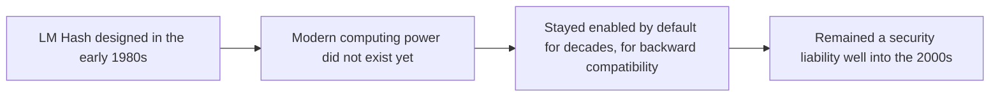
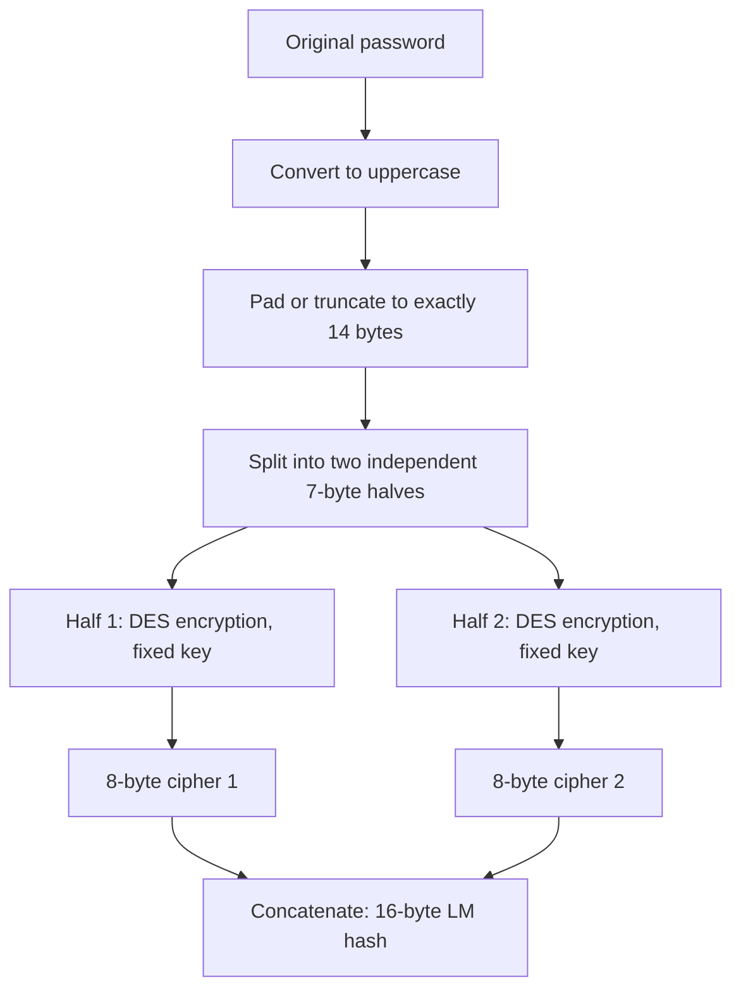
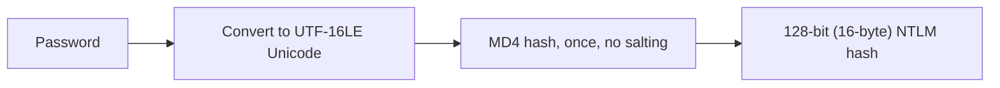
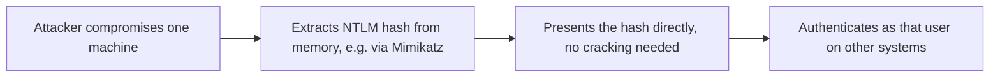
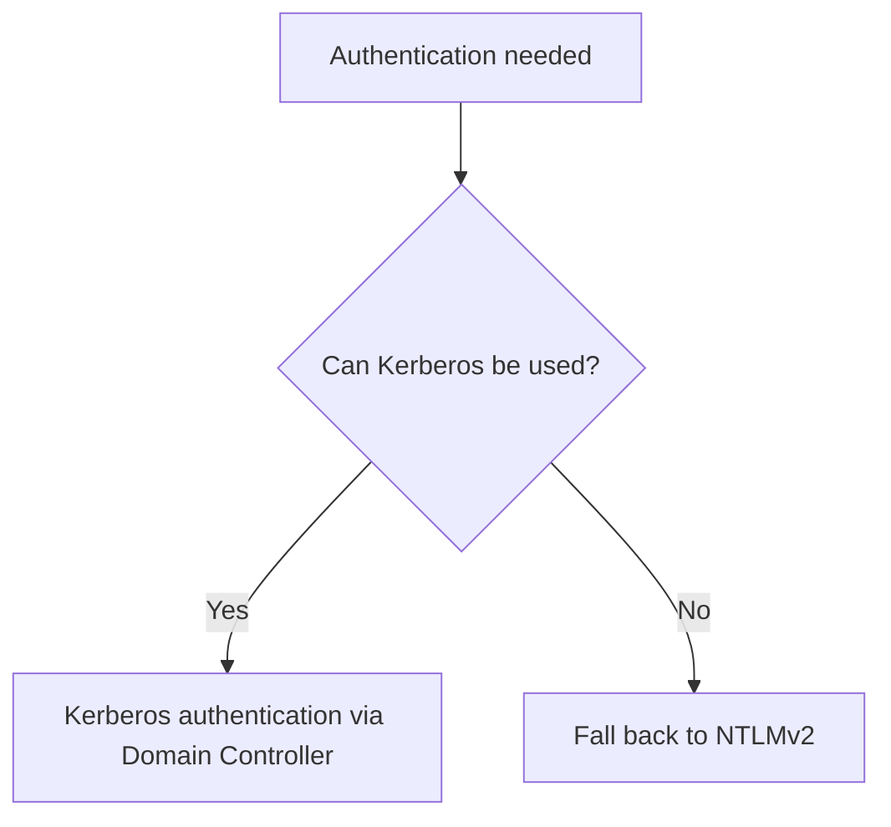
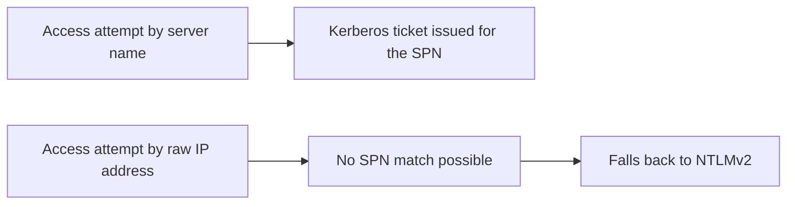
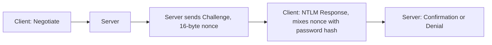
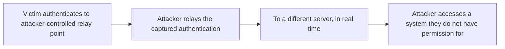
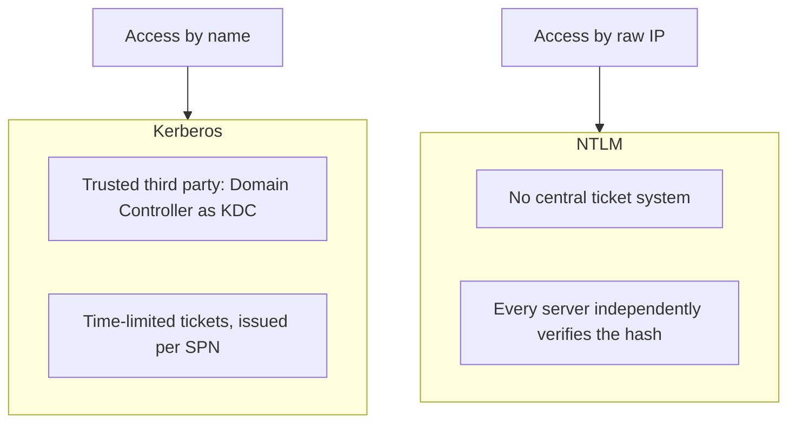

| Topic | Level | Reading Time | Prerequisites |
|---|---|---|---|
| Windows Authentication Hashes: LM, NTLM, and NTLMv2 | Intermediate | ~25 min | Password Hashing, Salting, and Peppering, Active Directory Core Concepts |

> **The goal of this section:**  
> You'll understand how Windows evolved over decades in how it stores and checks passwords, from the very weak LM Hash all the way to NTLMv2, and you'll understand why modern networks prefer Kerberos whenever possible, while NTLM remains around as a fallback.

## Learning Objectives

By the end of this section, you will be able to:

- Explain the historical origin of **LM Hash** and describe step by step why its design makes it trivially weak today.
- Explain how **NTLM Hash** improved on LM, and why it is still vulnerable to **rainbow tables** and **Pass-the-Hash** attacks.
- Describe the **NTLMv2 Challenge-Response** process from Negotiate to Confirmation/Denial.
- Explain why **Kerberos** is preferred over NTLM, and the specific technical reason (name resolution and SPNs) that forces a fallback to NTLM.
- List concrete mitigations against NTLM relay attacks: **SMB/LDAP Signing**, **EPA**, and disabling legacy protocols via Group Policy.

## Table of Contents

- [Learning Objectives](#learning-objectives)
- [LM Hash: Background](#lm-hash-background)
  - [Origin and Why It Persisted](#origin-and-why-it-persisted)
- [LM Hash: How It Works and Why It Is Weak](#lm-hash-how-it-works-and-why-it-is-weak)
  - [The Step-by-Step Process](#the-step-by-step-process)
  - [Why Splitting the Password Is Catastrophic](#why-splitting-the-password-is-catastrophic)
  - [Practical Implication](#practical-implication)
- [NTLM Hash: Introduction](#ntlm-hash-introduction)
  - [What NTLM Fixed](#what-ntlm-fixed)
- [NTLM Hash: Computation and Weaknesses](#ntlm-hash-computation-and-weaknesses)
  - [How It Is Computed](#how-it-is-computed)
  - [Improvements Over LM](#improvements-over-lm)
  - [Why NTLMv1 Is Still Weak](#why-ntlmv1-is-still-weak)
  - [Pass-the-Hash](#pass-the-hash)
- [NTLMv2: Why It Was Created](#ntlmv2-why-it-was-created)
  - [Kerberos as the Preferred Protocol](#kerberos-as-the-preferred-protocol)
- [NTLMv2: Why Kerberos Is Not Always Used](#ntlmv2-why-kerberos-is-not-always-used)
  - [The Name Resolution Requirement](#the-name-resolution-requirement)
- [NTLMv2: Challenge-Response Process](#ntlmv2-challenge-response-process)
  - [The Four Steps](#the-four-steps)
- [NTLMv2: Completing Authentication](#ntlmv2-completing-authentication)
  - [How the Server Verifies the Response](#how-the-server-verifies-the-response)
  - [What Makes NTLMv2 Stronger Than NTLMv1](#what-makes-ntlmv2-stronger-than-ntlmv1)
- [NTLMv2: Remaining Vulnerabilities and Mitigations](#ntlmv2-remaining-vulnerabilities-and-mitigations)
  - [NTLM Relay Attacks](#ntlm-relay-attacks)
  - [Mitigations](#mitigations)
- [Kerberos Versus NTLM: Summary Comparison](#kerberos-versus-ntlm-summary-comparison)
- [Career Path Connections](#career-path-connections)
- [Key Terms Glossary](#key-terms-glossary)
- [Summary](#summary)

## LM Hash: Background

### Origin and Why It Persisted

The **LM (LAN Manager) hash** was used to convert passwords into hash values and then store them in the **SAM** database, and it was designed by **Microsoft**.

LM was designed in the **early 1980s** for the original **LAN Manager** software, **long before modern computing power existed**. Even so, it remained **enabled by default in Windows for decades** because of **backward compatibility**, which is why it stayed **a real security liability until the late 2000s**.

> [!NOTE]
> This connects directly to the dedicated password-hashing algorithms (bcrypt, scrypt, Argon2) covered in the previous file. LM Hash is a historical example of exactly the opposite design philosophy: fast, structurally weak, and never updated for decades.

## LM Hash: How It Works and Why It Is Weak

### The Step-by-Step Process

- Convert the password entirely to **uppercase**.
- **Pad** it (if it's shorter than 14 bytes) or **truncate** it (if it's longer than 14 bytes) until it's exactly **14 bytes**.
- Split the result into **two independent halves of 7 bytes each**.
- Each half is encrypted separately using the old **DES** algorithm with a fixed key, which produces **an 8-byte cipher for each half**.
- The two **8-byte ciphers** are **concatenated** to form the **final 16-byte LM hash**.

### Why Splitting the Password Is Catastrophic

**Password123** and **PASSWORD123** produce **exactly the same hash**, because the entire password is converted to uppercase before hashing, which **collapses the possible character space**.

And because the two halves are hashed **completely independently**, the attacker can **crack each 7-byte half on its own**, instead of the full 14-character password all at once, which **shrinks the effective keyspace enormously**.

If the password is **7 characters or fewer**, the second half becomes a **fixed, known padding value**, which **immediately reveals** that the password is short.

| Weakness | Consequence |
|---|---|
| Conversion to uppercase | Greatly reduces the guessing space |
| Splitting into two independent halves | Cracking 7 bytes x2 is much easier than cracking 14 characters at once |
| Padding for short passwords | Immediately reveals the password's length |

### Practical Implication

LM hashes can be **cracked in seconds to minutes** with modern tools, because the reduced search space makes **dedicated rainbow tables very effective**.

**Microsoft disabled LM hash storage by default** starting with **Windows Vista** and **Server 2008**.

> [!IMPORTANT]
> LM Hash is the historical object lesson in why "deterministic, one-way, avalanche effect, fixed output length" alone is not enough: a hash function must also resist being decomposed into smaller, independently crackable pieces. LM Hash violated this by design.

## NTLM Hash: Introduction

### What NTLM Fixed

**NTLM** became the **successor** to LM hashes, designed to fix LM's weaknesses.

It uses the stronger **MD4** algorithm. It addressed some of LM's weaknesses, including the **14-character limit** and the lack of **distinction between uppercase and lowercase letters**.

**NTLMv1 is still weak** and can be cracked with attacks such as **rainbow tables**.

## NTLM Hash: Computation and Weaknesses

### How It Is Computed

The password is converted to **Unicode (UTF-16LE)** and passed through the **MD4** algorithm **exactly once**, **without any salting**, producing a **128-bit (16-byte)** hash.

### Improvements Over LM

| Improvement | Detail |
|---|---|
| Preserves case sensitivity | No conversion to uppercase |
| Removes the 14-character split | The password is hashed in full, all at once |
| Full Unicode support | LM was limited to a specific character set |

### Why NTLMv1 Is Still Weak

- **No salting at all**: identical passwords across different accounts produce **exactly the same hash**, which makes **rainbow tables effective**.
- **MD4 is a broken, deprecated algorithm** with known cryptanalytic weaknesses (collisions can be generated quickly).

### Pass-the-Hash

Since Windows authentication historically **only needed the hash** (not the plaintext password) to verify, **an attacker who stole an NTLM hash from memory** (using tools like **Mimikatz**) **doesn't even need to crack it**; they can **present the hash directly** to authenticate as that user on other systems.

This is one of the **most common lateral movement techniques** in real-world attacks on Windows networks.

> [!WARNING]
> Pass-the-Hash means that cracking the password is not even necessary for lateral movement. The hash itself functions as a usable credential. This is why protecting memory (where hashes are cached) and limiting NTLM usage are both treated as critical defenses.

## NTLMv2: Why It Was Created

Since **NTLMv1 was vulnerable to rainbow tables**, Microsoft developed a stronger mechanism for storing and authenticating with password hashes: **NTLMv2**.

### Kerberos as the Preferred Protocol

Most organizations today authenticate using **Kerberos authentication** in an **Active Directory** environment. The server responsible for this authentication is the **Domain Controller**.

When **Kerberos isn't possible**, Windows **falls back** to using **NTLMv2** for authentication.

## NTLMv2: Why Kerberos Is Not Always Used

### The Name Resolution Requirement

**Kerberos needs names to work**; if there's no name, Kerberos **can't be used**.

Example: a file share on a remote server has **a name that resolves to an IP address**. Normal access to the share uses **the server's name or its IP**.

If someone accesses the share **using the IP address instead of the server's name**, **Kerberos can't be used**, and Windows **downgrades** to **NTLMv2** authentication.

**An additional technical detail:** Kerberos tickets are issued for a specific **Service Principal Name (SPN)**, **not for an IP address**; that's **exactly** why **name resolution** is so important for Kerberos to work.

> [!NOTE]
> This is the same underlying principle as the TLS certificate mismatch covered in the DNS Sinkhole file: a certificate is bound to a domain name, not an IP, and a Kerberos ticket is bound to a service name, not an IP. Both protocols fail, or fall back, when identity is tied to a name that a raw IP connection cannot provide.

## NTLMv2: Challenge-Response Process

### The Four Steps

- The device sends an authentication request called **Negotiate** to the authentication server.
- This negotiation packet tells the server **which authentication version and parameters to use**.
- The server then sends a **Challenge** to the client.
- The challenge, also called a **nonce**, is a **16-byte** random number.
- The client takes this nonce and combines it (through mathematical/cryptographic calculations) with the **password hash** to generate a **response**.

## NTLMv2: Completing Authentication

### How the Server Verifies the Response

The response is sent back to the server. Since the server **already knows the user's password hash**, it **computes its own response independently** using the same nonce and compares it with the incoming response. If they match, the user is authenticated successfully.

### What Makes NTLMv2 Stronger Than NTLMv1

**Technical detail:** NTLMv2 uses **HMAC-MD5** instead of raw MD4, and incorporates additional data into the response beyond just the nonce, including a **timestamp**, a **client-generated nonce**, and information about the **target server**. This additional data makes **replay attacks** and rainbow-table-style precomputation **much harder** compared to NTLMv1.

Since the **actual password/hash doesn't cross the network directly**, someone capturing the traffic (an **eavesdropper**) **can't immediately extract the password**.

| Aspect | NTLMv1 | NTLMv2 |
|---|---|---|
| Hash algorithm used | MD4 raw | HMAC-MD5 |
| Extra data in response | Nonce only | Timestamp + client nonce + target server info |
| Replay resistance | Weak | Much stronger |
| Rainbow table precomputation | Effective | Far harder |

> [!TIP]
> The additional data NTLMv2 incorporates (timestamp, client nonce, server info) is conceptually similar to why a nonce exists at all: it ties each authentication exchange to a specific, non-repeatable context, making captured traffic far less reusable by an attacker.

## NTLMv2: Remaining Vulnerabilities and Mitigations

### NTLM Relay Attacks

Instead of trying to crack the response, an attacker **positioned in the middle** **relays** a captured authentication attempt to a different server **in real time**, effectively **"borrowing"** the victim's authentication to access a system the attacker isn't authorized to access.

Common tools: **Responder**, **ntlmrelayx**.

**Offline cracking is still theoretically possible** if an attacker captures a **complete challenge-response exchange** and has significant computing power, although it's **much harder** than cracking NTLMv1.

### Mitigations

| Mitigation | What It Does |
|---|---|
| **SMB Signing and LDAP Signing** | Cryptographically signs every message, so a relayed session is detected and rejected |
| **Extended Protection for Authentication (EPA)** | Binds authentication to the **specific TLS channel** it was negotiated over, and prevents relaying to a different channel |
| **Disable NTLM entirely where possible** | And enforce **Kerberos-only authentication** in Active Directory |
| **Disable LM and NTLMv1 via Group Policy** | Setting: **Network security: LAN Manager authentication level** — leaves only NTLMv2 as a fallback |

> [!IMPORTANT]
> Even NTLMv2's strongest protections do not eliminate relay attacks; they only make cracking the captured response harder. Relay attacks sidestep cracking entirely by reusing the authentication attempt itself in real time, which is why signing and channel-binding (EPA) are the actual mitigations, not stronger hashing.

## Kerberos Versus NTLM: Summary Comparison

| Aspect | Kerberos | NTLM |
|---|---|---|
| Trust model | A trusted third party (the Domain Controller acts as the **Key Distribution Center**) | No central ticket system |
| Verification | **Time-limited tickets**; nothing sends password-derived data with every request | Every server the client talks to must **know or verify the password hash independently** |
| Scalability | Suited to large networks | A structural weakness in large networks |
| Identifier used | **Service Principal Name (SPN)** | Usually an IP or machine name, with no ticket |
| Why name resolution matters | Kerberos tickets **are issued for a specific SPN, not an IP** | Without an SPN, the system **downgrades** to NTLM |

> [!IMPORTANT]
> Kerberos avoids sending password-derived material for every single authentication request, which is both more secure and more scalable. NTLM's lack of a centralized ticket system is a structural weakness for large networks, not just a cryptographic one: every single server must independently trust and verify the hash.

## Career Path Connections

| Career Path | How This Topic Applies |
|---|---|
| SOC Analyst | Monitors for Pass-the-Hash indicators and unexpected NTLM authentication where Kerberos should be used |
| Penetration Tester | NTLM relay (via tools like Responder and ntlmrelayx) and Pass-the-Hash are core techniques in internal Active Directory assessments |
| GRC | Disabling LM/NTLMv1 via Group Policy is a standard, auditable hardening requirement |
| Cloud Security | Hybrid identity environments (cloud plus on-premises AD) must account for legacy NTLM fallback on internal resources |

## Key Terms Glossary

| Term | Definition |
|---|---|
| LM Hash | The original, deeply weak Windows password hash from the 1980s, disabled by default since Windows Vista/Server 2008 |
| NTLM Hash | A successor to LM Hash using MD4, with no salting |
| Pass-the-Hash | An attack where a stolen hash is presented directly for authentication without ever being cracked |
| NTLMv2 | An improved challenge-response authentication mechanism replacing NTLMv1 |
| Nonce | A random, single-use number (16 bytes in NTLMv2) used in a challenge-response exchange |
| Kerberos | A ticket-based authentication protocol using a trusted third party, typically the Domain Controller |
| Key Distribution Center (KDC) | The Domain Controller's role when issuing Kerberos tickets |
| Service Principal Name (SPN) | The specific service identifier a Kerberos ticket is issued for |
| NTLM Relay Attack | Forwarding a captured authentication attempt to a different server in real time, rather than cracking it |
| SMB/LDAP Signing | Cryptographically signing messages to detect and reject relayed sessions |
| Extended Protection for Authentication (EPA) | Binding authentication to the specific TLS channel it was negotiated over |

## Summary

- **LM Hash is historically weak by design:** uppercase conversion, splitting into two 7-byte halves, and DES with a fixed key all shrank the search space enormously.
- **NTLM improved on LM but kept no salting:** identical passwords produce the same hash, and MD4 itself is a broken algorithm.
- **Pass-the-Hash skips cracking entirely:** the hash itself works as a directly usable credential.
- **NTLMv2 adds real improvements:** HMAC-MD5, plus additional data (timestamp, client nonce, server info) that makes replay and precomputation harder.
- **Kerberos is preferred, with Domain Controller as KDC:** time-limited tickets and a single verification, not one per server.
- **Name resolution is the technical reason for NTLM fallback:** Kerberos tickets are tied to an SPN, not an IP; access by IP forces a downgrade to NTLMv2.
- **NTLM relay remains a real threat even with NTLMv2:** the real defense is SMB/LDAP Signing and EPA, not the strength of the hashing itself.
- **The structural difference matters at scale:** Kerberos is centralized and scalable, while NTLM requires every server to verify independently, which is a structural weakness in large networks.
