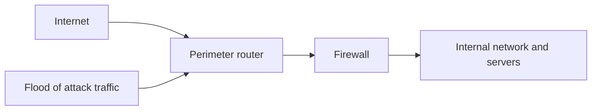
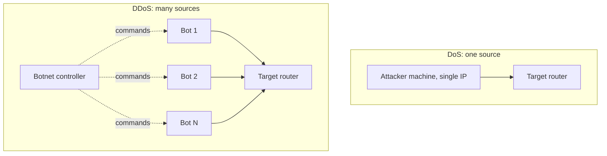
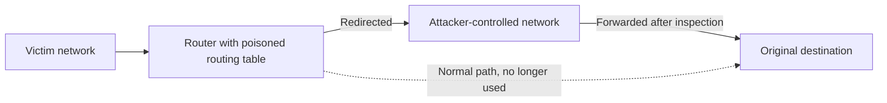
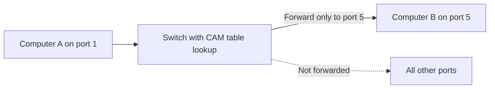
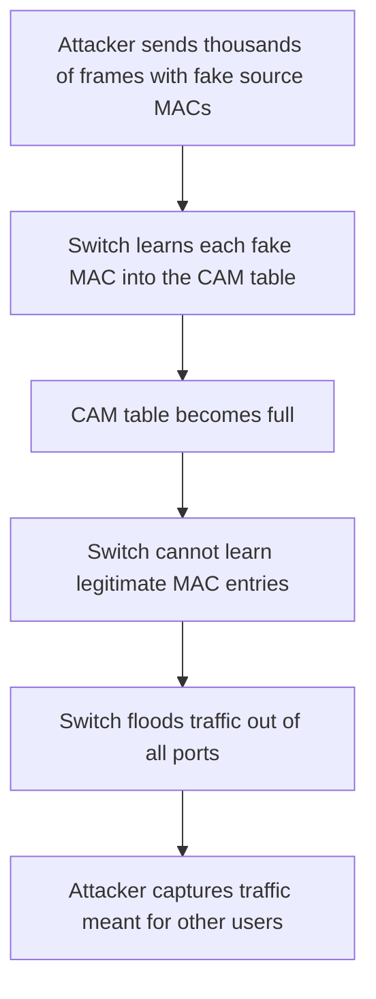
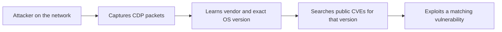

| Topic | Level | Reading Time | Prerequisites |
|---|---|---|---|
| Router and Switch Attacks | Intermediate | ~20 min | Asset Awareness and Traffic Flow, basic idea of what routers and switches do |

> **Goal of this section:**
> You will understand how routers and switches are targeted, and the core defenses that shut down each attack.


## Learning Objectives

By the end of this section, you will be able to:

- Explain why routers and switches are high-value targets that are often overlooked during security testing.
- Differentiate between **DoS** and **DDoS** attacks and describe how each one is mitigated.
- Describe how packet sniffing and routing table poisoning work against a router, including the idea behind **BGP hijacking**.
- Explain how a **MAC flooding** attack forces a switch to behave like a hub, and how **Port Security** stops it.
- Explain what **CDP** reveals to an attacker and why it should be disabled on untrusted ports.

## Table of Contents

- [Learning Objectives](#learning-objectives)
- [Why Network Infrastructure Is Overlooked](#why-network-infrastructure-is-overlooked)
  - [Servers Get the Attention](#servers-get-the-attention)
  - [Single Point of Failure](#single-point-of-failure)
- [Router Attacks](#router-attacks)
  - [Denial of Service Attacks on Routers](#denial-of-service-attacks-on-routers)
  - [DoS Versus DDoS](#dos-versus-ddos)
  - [The Mirai Botnet](#the-mirai-botnet)
  - [Planned Downtime Versus Attack Downtime](#planned-downtime-versus-attack-downtime)
  - [Mitigating DoS and DDoS](#mitigating-dos-and-ddos)
  - [Packet Sniffing on Routers](#packet-sniffing-on-routers)
  - [Routing Table Poisoning](#routing-table-poisoning)
  - [BGP Hijacking](#bgp-hijacking)
- [Switch Attacks](#switch-attacks)
  - [How Switches Normally Work](#how-switches-normally-work)
  - [MAC Flooding](#mac-flooding)
  - [Mitigating MAC Flooding with Port Security](#mitigating-mac-flooding-with-port-security)
  - [CDP Information Disclosure](#cdp-information-disclosure)
  - [Securing CDP](#securing-cdp)
- [Attack Comparison](#attack-comparison)
- [Career Path Connections](#career-path-connections)
- [Key Terms Glossary](#key-terms-glossary)
- [Summary](#summary)

## Why Network Infrastructure Is Overlooked

### Servers Get the Attention

In penetration tests, most organizations focus on servers and applications and ignore network infrastructure devices such as **routers** and **switches**. That makes sense in that the servers hold the data, but it's a big mistake.

The router is the device that connects your network to other networks and decides where each packet goes. The switch is the device that connects the devices inside the same network to each other. Think of the router as the city gate that every car passes through, and the switch as the mail carrier inside the building who knows where every apartment is.

If you compromise a single server, you control a single server. But if you compromise the router, **you affect the entire network**.

### Single Point of Failure

An outdated router with a bad configuration can become a **single point of failure** for the entire company's connectivity, meaning one point that, if it goes down, takes everything down with it.

> [!IMPORTANT]
> Compromising a router affects the entire network, not just a single system. Network devices deserve the same security attention as servers.

## Router Attacks

### Denial of Service Attacks on Routers

A **DoS (Denial of Service)** attack aims to flood the router with more traffic than it can handle, so it can no longer process legitimate traffic. The source is **a single machine and a single IP address**.

The router's availability is very important, especially the **perimeter router**, which is the router at the edge of the network (the first point of contact with the internet). If it gets hit, the entire organization can lose internet access, not just one server.



| Attack Target | What Goes Down | Scope |
|---|---|---|
| Company public website only | The website | One service |
| Perimeter router | Every department, every server, every remote employee connection | The entire organization |

### DoS Versus DDoS

**DDoS (Distributed Denial of Service)** is the same idea, but the source is **thousands or millions of IP addresses at the same time**, and it is usually carried out using a **botnet**, a group of compromised devices working together under the attacker's control.



| Aspect | DoS | DDoS |
|---|---|---|
| Source | Single machine, single IP | Many compromised devices, many IPs |
| Blocking difficulty | Easier, block the one source | Much harder, no single source to block |
| Typical mitigation | ACL and ISP filtering | Specialized scrubbing services |

Analogy: A DoS is like one person calling your phone nonstop; you can block their number. A DDoS is like a million people calling you at the same moment; blocking one number won't make a difference.

### The Mirai Botnet

A famous real-world example is the **Mirai botnet**. It used thousands of compromised IoT devices (cameras, routers) to launch massive DDoS attacks. The most famous was the attack on **Dyn DNS in 2016**, which took major sites such as Twitter and Netflix offline for hours.

> [!NOTE]
> Mirai spread mainly by scanning for IoT devices that still used default credentials. This is a good reminder that unmanaged devices are part of your attack surface too.

### Planned Downtime Versus Attack Downtime

There's an important irony here: applying security patches to the router is technically a **self-inflicted denial of service**, because the router has to reboot and go offline temporarily.

Even so, patching is essential, because unpatched routers have known vulnerabilities that attackers exploit. And the cost of downtime can be huge, sometimes reaching millions of dollars depending on the size of the organization.

| Approach | How It Reduces Impact |
|---|---|
| Maintenance windows | Patching during low-traffic hours, commonly nights and weekends |
| Redundant routers | A backup router takes over automatically, avoiding planned downtime |

> [!TIP]
> Large enterprises often use redundant routers with first-hop redundancy protocols such as HSRP or VRRP, so a patch or failure on one router does not cut connectivity.

### Mitigating DoS and DDoS

DoS is easier to block because all the malicious traffic comes from a single IP:

- Block that IP using an **ACL (Access Control List)**.
- Ask the **ISP (Internet Service Provider)** to filter it at their level.

An example of an ACL on a Cisco router (the IP here is from the range reserved for documentation):

```text
Router(config)# access-list 101 deny ip host 203.0.113.50 any
Router(config)# access-list 101 permit ip any any
Router(config)# interface GigabitEthernet0/0
Router(config-if)# ip access-group 101 in
```

DDoS, on the other hand, is much harder because the traffic comes from a huge number of IPs, so blocking a single IP has no effect. The solution usually requires specialized services such as **traffic scrubbing centers**, which filter out the malicious traffic before it reaches the company's network. Companies such as **Cloudflare** and **Akamai** specialize in absorbing and filtering massive DDoS attacks before they reach the real servers.

> [!WARNING]
> An ACL on your own router cannot help if the internet link is already saturated, because the flood consumes bandwidth before it reaches the ACL. This is why upstream filtering by the ISP or a scrubbing provider matters. Also, attackers can spoof source IP addresses, so simple IP blocking is not a complete defense.

### Packet Sniffing on Routers

Every packet that needs to be routed to another network **passes through the router**. This makes the router one of the most valuable places for an attacker to install a **sniffer**, because they can capture a huge amount of traffic from a single location instead of targeting devices one by one.

If an attacker compromises a core router, they can capture:

- Unencrypted login credentials.
- Session tokens.
- Sensitive files while they are being transferred across the network.

All of this from a single point. The protection here is **encryption**: HTTPS, VPN tunnels, and encrypted DNS. Even if the attacker sniffs the traffic, encrypted data is worth far less to them.

> [!NOTE]
> Encryption protects the content, not everything. Metadata such as source and destination IP addresses, packet sizes, and timing can still be visible to a sniffer.

### Routing Table Poisoning

The **routing table** is the table that tells the router where to send traffic based on the destination address. The attacker can **poison** this table, meaning add fake routes, to redirect certain traffic through a network they control.

This is used in two cases:

- **Man-in-the-middle attack:** The attacker intercepts the traffic, reads or modifies it, and then sends it on to the original destination, so the victim doesn't notice anything wrong.
- **Traffic blackholing:** The attacker directs the traffic to a nonexistent network, so the traffic disappears and the connection breaks for anyone who depends on it.



> [!IMPORTANT]
> Routing table poisoning is dangerous because the victim often sees no errors. The traffic still arrives, but it took a detour through the attacker.

### BGP Hijacking

The famous real-world version of this is **BGP hijacking**. **BGP (Border Gateway Protocol)** is the protocol that large networks (and ISPs) use to exchange routing information across the internet. If someone announces fake routes, they can pull large portions of internet traffic through servers they control, sometimes affecting major companies or even entire countries.

Common protection methods:

- Route filtering: accepting only specific routes from neighbors.
- Authentication for routing protocols.
- **RPKI**: A system that verifies that the party announcing a specific prefix is actually authorized to announce it.

> [!NOTE]
> Not every BGP incident is malicious. Some large outages were caused by accidental misconfigurations. The technical effect on traffic is similar either way.

## Switch Attacks

### How Switches Normally Work

The switch forwards traffic intelligently using the **CAM table (Content Addressable Memory)**. This is a record that maps each **MAC address** to the specific port it is connected to. That way, the switch sends the traffic only to the port where the intended device is, not to all ports.

Example: Computer A on port 1 wants to send to Computer B on port 5. The switch looks in the CAM table and sends the traffic out of port 5 only.



| MAC Address | Port |
|---|---|
| AAAA.AAAA.AAAA | 1 |
| BBBB.BBBB.BBBB | 5 |

Analogy: The CAM table is like the mail carrier's notebook that maps each resident's name to their apartment number, so the letter goes to the right apartment instead of the carrier calling out to the whole building.

### MAC Flooding

In a **MAC flooding** attack, the attacker floods the switch with a huge number of fake MAC addresses, filling up the CAM table completely. The CAM table has limited memory, so once it's full, the switch can no longer keep track of which MAC belongs to which port.

At that point, the switch behaves in a **fail open** manner, meaning it starts sending traffic out of all ports (for traffic whose destination it doesn't know), exactly like an old **hub**. This allows the attacker to capture traffic not meant for them, including other users' data.



One of the well-known tools that carries out this attack is **macof**, part of the **dsniff toolkit**. It generates thousands of fake MAC addresses per second, flooding the CAM table almost instantly.

> [!WARNING]
> Tools like macof must only be used in your own lab or with explicit written authorization. Running them on a network you do not own or manage is illegal and can disrupt real users.

> [!NOTE]
> The impact is usually limited to the VLAN where the flooding happens, and the attack needs the attacker to stay connected to the switch. Still, in a flat network with no segmentation, that can mean a lot of exposed traffic.

### Mitigating MAC Flooding with Port Security

The core solution is **Port Security**. You set the number of MAC addresses allowed on a single port, and you can shut the port down if the limit is exceeded.

```text
Switch(config)# interface GigabitEthernet0/1
Switch(config-if)# switchport mode access
Switch(config-if)# switchport port-security
Switch(config-if)# switchport port-security maximum 2
Switch(config-if)# switchport port-security mac-address sticky
Switch(config-if)# switchport port-security violation shutdown
```

| Command | Purpose |
|---|---|
| `switchport port-security` | Enables Port Security on the interface |
| `maximum 2` | Allows at most two MAC addresses on this port |
| `mac-address sticky` | Learns the first MAC addresses seen and saves them |
| `violation shutdown` | Puts the port in err-disabled state when the limit is exceeded |

And to verify the configuration:

```text
Switch# show port-security interface GigabitEthernet0/1
Switch# show mac address-table count
```

> [!TIP]
> Apply Port Security on access ports facing end users. A port that suddenly shows hundreds of MAC addresses is a strong sign of a flooding attempt, so alert on port-security violations in your monitoring.

### CDP Information Disclosure

**CDP (Cisco Discovery Protocol)** is used by Cisco devices to automatically discover and identify other Cisco devices connected to the same network. It was designed for convenience, because it helps network administrators map the infrastructure without manual configuration.

The problem is that this same convenience turns into a weakness if an attacker gets into the network. By capturing CDP packets, the attacker can learn:

- The device vendor.
- The exact operating system version on the switch.
- In some misconfigured cases, details related to administrative accounts.

Knowing the exact OS version is very valuable to the attacker, because they can search for **CVEs** (publicly known vulnerabilities) specific to that exact version and exploit them directly.



Analogy: CDP is like a sign hanging on the door of a room that states the exact type and model of the lock. Convenient for the workers, but a gift to the thief.

### Securing CDP

The best practice is to **disable CDP on ports facing untrusted networks or devices**, and keep it enabled only on trusted internal links between Cisco devices that actually need it.

```text
! Disable CDP on a single interface facing an untrusted device
Switch(config)# interface GigabitEthernet0/2
Switch(config-if)# no cdp enable

! Disable CDP globally on the device
Switch(config)# no cdp run
```

And to review what CDP reveals on your device:

```text
Switch# show cdp neighbors detail
```

> [!NOTE]
> LLDP is the vendor-neutral equivalent of CDP and carries similar information. The same principle applies: disable it on ports that face untrusted devices.

## Attack Comparison

| Attack | Target | Layer | Main Security Goal Affected | Primary Mitigation |
|---|---|---|---|---|
| DoS and DDoS | Router | Layer 3 and above | Availability | ACLs, ISP filtering, scrubbing services |
| Packet sniffing | Router | Layer 3 device | Confidentiality | Encryption (HTTPS, VPN, encrypted DNS) |
| Routing table poisoning | Router | Layer 3 | Integrity and availability | Routing authentication, route filtering, RPKI |
| MAC flooding | Switch | Layer 2 | Confidentiality | Port Security |
| CDP information disclosure | Switch | Layer 2 | Confidentiality | Disable CDP on untrusted ports |

## Career Path Connections

| Career Path | How This Topic Applies |
|---|---|
| SOC Analyst | Recognizes signs of DDoS, port-security violations, and unexpected routing changes in logs and alerts |
| Penetration Tester | Includes network devices in scope, enumerates CDP information, and tests for weak device configurations |
| GRC | Requires patch management, maintenance windows, and network device hardening standards |
| Cloud Security | Same concepts appear as DDoS protection services, route tables, and network security controls in cloud networking |

## Key Terms Glossary

| Term | Definition |
|---|---|
| Router | A device that forwards packets between different networks based on destination addresses |
| Switch | A device that connects devices within a network and forwards frames using MAC addresses |
| Perimeter Router | The router at the edge of the network, the first point of contact with the internet |
| Single Point of Failure | A component whose failure causes the entire system to fail |
| DoS | Denial of Service, an attack from a single source that overwhelms a target |
| DDoS | Distributed Denial of Service, the same attack launched from many sources at once |
| Botnet | A group of compromised devices controlled by an attacker |
| ACL | Access Control List, a set of rules that permit or deny traffic |
| ISP | Internet Service Provider, the company that provides internet connectivity |
| Traffic Scrubbing | Filtering malicious traffic out of a flood before it reaches the protected network |
| Redundant Router | A backup router that takes over automatically if the primary fails or is offline |
| Packet Sniffing | Capturing network traffic to inspect its contents |
| Routing Table | A table that tells a router where to send traffic for each destination |
| Routing Table Poisoning | Inserting false routes to redirect or disrupt traffic |
| Man-in-the-Middle | An attack where the attacker secretly intercepts and possibly alters communication |
| BGP | Border Gateway Protocol, the routing protocol used between networks on the internet |
| BGP Hijacking | Announcing false BGP routes to redirect internet traffic |
| CAM Table | A switch table mapping MAC addresses to physical ports |
| MAC Address | A hardware identifier assigned to a network interface |
| MAC Flooding | Filling a switch's CAM table with fake MAC addresses to force it to broadcast traffic |
| Fail Open | A failure mode where a device keeps passing traffic instead of blocking it |
| Hub | A simple device that repeats incoming traffic out of every port |
| macof | A tool in the dsniff toolkit that generates large numbers of fake MAC addresses |
| Port Security | A switch feature that limits and controls which MAC addresses can use a port |
| CDP | Cisco Discovery Protocol, used by Cisco devices to discover each other |
| CVE | Common Vulnerabilities and Exposures, a public identifier for a known vulnerability |

## Summary

- **Infrastructure is a target:** Routers and switches are often ignored in pentests, but compromising them affects the entire network.
- **DoS versus DDoS:** DoS comes from a single source and is blocked with an ACL or ISP filtering, while DDoS comes from many sources and needs scrubbing services such as Cloudflare and Akamai.
- **Mirai example:** It used compromised IoT devices to hit Dyn DNS in 2016 and took major sites down for hours.
- **Patching is a trade-off:** Patching the router causes planned downtime, so it is done during maintenance windows, and redundant routers reduce the impact.
- **Routers are sniffing targets:** All traffic between networks passes through them, and encryption is the main defense.
- **Routing table poisoning:** It enables man-in-the-middle or blackholing, and BGP hijacking is the real-world version at the internet level.
- **MAC flooding:** It fills the CAM table, so the switch fails open and behaves like a hub; the defense is Port Security.
- **CDP leaks information:** It reveals the vendor and the OS version, making it easier for the attacker to find matching CVEs; the fix is to disable it on untrusted ports.

