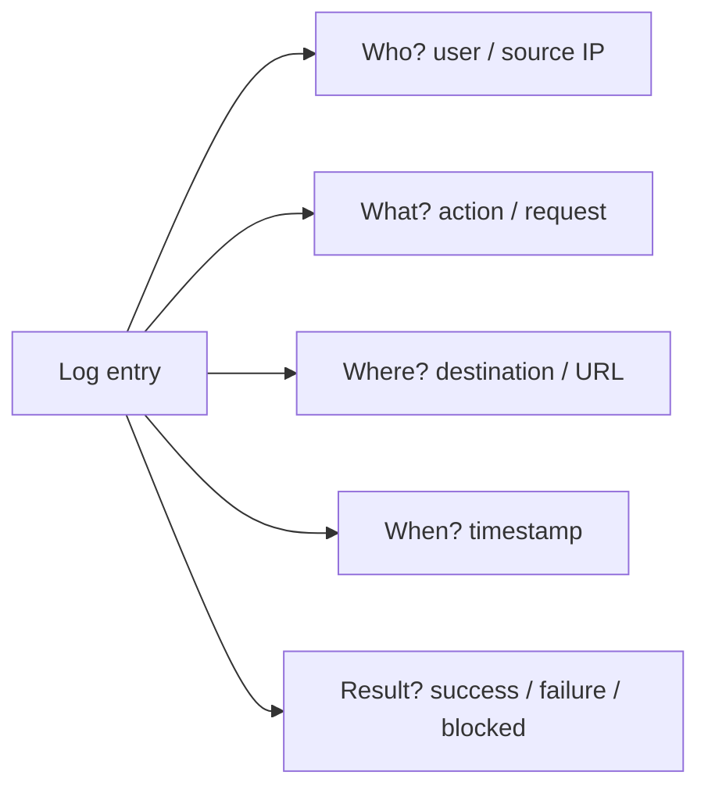
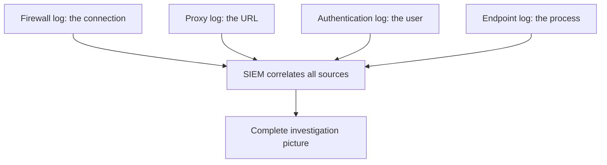
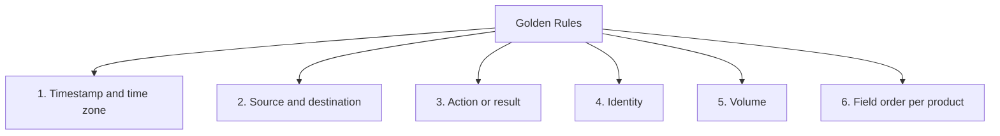
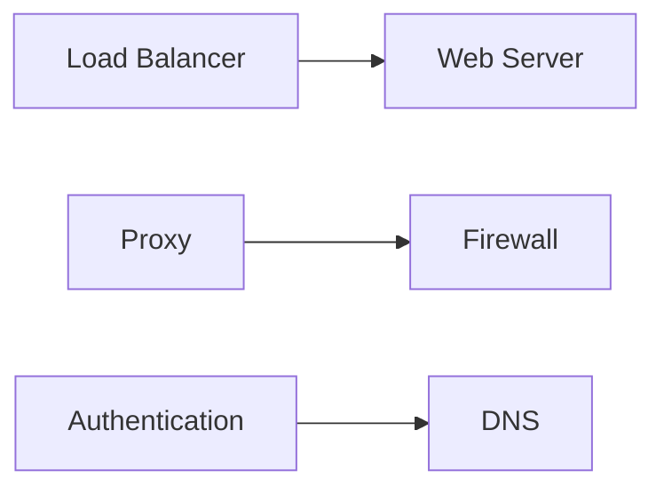
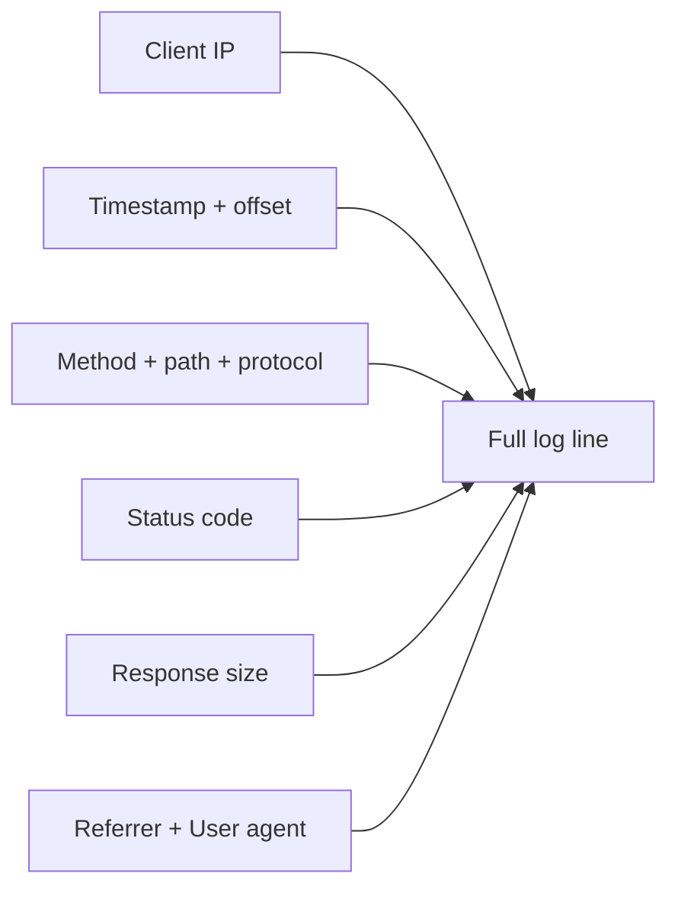
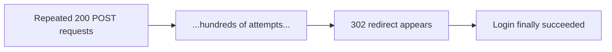
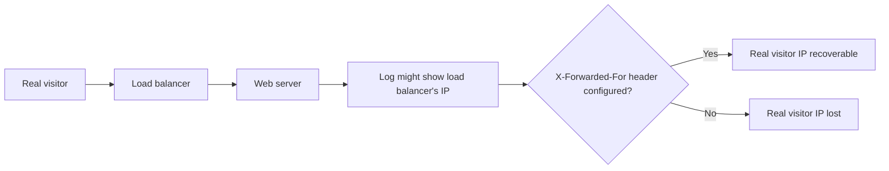

| Topic | Level | Reading Time | Prerequisites |
|---|---|---|---|
| Core Log Types and Web Server Logs | Beginner | ~20 min | None |

> **Goal of this section:**
> You'll understand what a log is and why a SOC analyst spends most of the day working with logs, learn the golden rules for reading any log regardless of its source, and see in detail how to read web server logs and spot real attacks in them, such as scanning, SQL injection, and brute force.

## Learning Objectives

By the end of this section, you will be able to:

- Define a **log** and explain the five questions every investigation needs it to answer.
- Explain why no single log tells the whole story, and the role of the **SIEM** in correlation.
- Apply the **six golden rules** for reading any log, regardless of its format.
- Identify the six core log types and the main question each one answers.
- Read an **Apache web server log** line field by field, including the HTTP status code cheat sheet.
- Recognize three common web attacks in raw log lines: **directory scanning**, **SQL injection**, and **brute force**.
- Explain why a load balancer or reverse proxy can hide the real client IP, and how to recover it.

## Table of Contents

- [Learning Objectives](#learning-objectives)
- [What Is a Log, and Why Do We Care](#what-is-a-log-and-why-do-we-care)
  - [Core Definition](#core-definition)
  - [The Five Investigation Questions](#the-five-investigation-questions)
  - [No Single Log Tells the Whole Story](#no-single-log-tells-the-whole-story)
- [Golden Rules When Reading Any Log](#golden-rules-when-reading-any-log)
- [Overview of Log Types and Where They Sit](#overview-of-log-types-and-where-they-sit)
- [Web Server Logs (Apache)](#web-server-logs-apache)
  - [Anatomy of a Log Line](#anatomy-of-a-log-line)
  - [HTTP Status Code Cheat Sheet](#http-status-code-cheat-sheet)
- [Attack Examples in a Web Server Log](#attack-examples-in-a-web-server-log)
  - [Directory and File Scanning](#directory-and-file-scanning)
  - [SQL Injection Attempt](#sql-injection-attempt)
  - [Brute Force on a Login Page](#brute-force-on-a-login-page)
  - [Other Patterns to Recognize](#other-patterns-to-recognize)
- [Load Balancers and the Real Client IP](#load-balancers-and-the-real-client-ip)
- [Career Path Connections](#career-path-connections)
- [Key Terms Glossary](#key-terms-glossary)
- [Summary](#summary)

## What Is a Log, and Why Do We Care

### Core Definition

A **Log** is a **time-ordered** record of something that happened on a system: someone logged in, a connection was allowed, a page was requested, a file was changed.

**A SOC analyst works with logs almost all day long.**

### The Five Investigation Questions

Logs answer the core investigation questions:

| Question | Answered By |
|---|---|
| **Who?** | The user, the source IP |
| **What?** | The action, the request, the event |
| **Where?** | The destination, the system, the URL |
| **When?** | The timestamp |
| **Result?** | Success, failure, blocked, allowed |



### No Single Log Tells the Whole Story

**We correlate logs**: the firewall log shows you the connection, the proxy log shows you the URL, the authentication log shows you the user, and the endpoint log shows you the process.

The **SIEM** (such as Splunk, QRadar, Sentinel, Elastic) collects and correlates all of these together.



> [!NOTE]
> This connects directly to the SIEM centralization principles covered in the DLP Tools and SIEM Integration file: a single search across correlated sources is far more powerful than checking each source individually.

## Golden Rules When Reading Any Log

| # | Rule | Why |
|---|---|---|
| 1 | **Find the timestamp and its time zone** | Many wrong conclusions come from mixing up UTC and local time, so always normalize the time |
| 2 | **Identify the source and destination** | Who initiated the connection, and who received it |
| 3 | **Identify the action or result** | allowed, denied, success, failure, status code |
| 4 | **Identify the identity** | The user, hostname, device |
| 5 | **Look at the volume** | Such as bytes sent and received; large uploads may mean exfiltration |
| 6 | **Learn the order of the log's fields** | Every product is different from the next |



> [!WARNING]
> Mixing UTC and local time is one of the most common causes of wrong conclusions in log analysis. Always normalize the timezone before comparing timestamps across different log sources, especially when correlating logs from systems in different regions.

## Overview of Log Types and Where They Sit

| Log | Where It Sits | Main Question It Answers |
|---|---|---|
| **Load balancer** | In front of the web servers | Who connected to my app, and how did it respond? |
| **Web server** | On the web server itself | What was requested from my site? |
| **Proxy** | Between users and the internet | What are employees browsing and downloading? |
| **Firewall** | The network perimeter or between segments | Which connections were allowed or blocked? |
| **Authentication** | servers, domain controllers, IdPs, VPN | Who logged in, from where, and did it succeed or not? |
| **DNS** | DNS server | Which names are being resolved? |



## Web Server Logs (Apache)

### Anatomy of a Log Line

The web server log records **every request that reached the application**.

```text
203.0.113.45 - - [03/Oct/2026:09:14:22 +0000] "GET /login HTTP/1.1" 200 5120
"https://shop.example.com/" "Mozilla/5.0 (Windows NT 10.0; Win64; x64)"
```

| Field | Meaning |
|---|---|
| `203.0.113.45` | The client's IP address |
| `[03/Oct/2026:09:14:22 +0000]` | The timestamp and the offset |
| `GET /login HTTP/1.1` | The method, the requested path, the protocol |
| `200` | HTTP status code |
| `5120` | The response size in bytes |
| `"https://shop.example.com/"` | The referrer (the page the link was followed from) |
| `"Mozilla/5.0 ..."` | The user agent |



### HTTP Status Code Cheat Sheet

| Range | Meaning |
|---|---|
| **2xx** | Success |
| **3xx** | Redirect |
| **4xx** | Client-side errors: `400` bad request, `401` unauthorized, `403` forbidden, `404` not found |
| **5xx** | Server-side errors: `500` internal error, `502` bad gateway, `503` unavailable |

## Attack Examples in a Web Server Log

### Directory and File Scanning

```text
198.51.100.77 - - [03/Oct/2026:09:20:01 +0000] "GET /admin HTTP/1.1" 404 196 "-" "Nikto/2.1.6"
198.51.100.77 - - [03/Oct/2026:09:20:01 +0000] "GET /phpmyadmin/ HTTP/1.1" 404 196 "-" "Nikto/2.1.6"
198.51.100.77 - - [03/Oct/2026:09:20:02 +0000] "GET /.env HTTP/1.1" 404 196 "-" "Nikto/2.1.6"
```

**The indicator:** a large number of `404`s from one IP, often with the user agent of a well-known scanning tool (such as `Nikto`).

### SQL Injection Attempt

```text
198.51.100.77 - - [03/Oct/2026:09:22:40 +0000] "GET /products?id=1%27%20OR%20%271%27=%271 HTTP/1.1"
200 8450 "-" "sqlmap/1.7"
```

If you decode the URL encoding: `id=1' OR '1'='1`.

> [!WARNING]
> A 200 status code with an unusual response size on an SQL injection attempt can mean it worked. A normal failed request would usually look very different in size from a successful injection that returned extra database content.

### Brute Force on a Login Page

```text
203.0.113.99 - - [03/Oct/2026:09:25:11 +0000] "POST /wp-login.php HTTP/1.1" 200 4012 "-" "Mozilla/5.0"
203.0.113.99 - - [03/Oct/2026:09:25:12 +0000] "POST /wp-login.php HTTP/1.1" 200 4012 "-" "Mozilla/5.0"
(... 500 times, then ...)
203.0.113.99 - - [03/Oct/2026:09:27:30 +0000] "POST /wp-login.php HTTP/1.1" 302 0 "-" "Mozilla/5.0"
```

**Reading it:** a large number of identical POSTs followed by a redirect (`302`) suggests the login eventually succeeded. WordPress returns `200` with the login form on failure and redirects on success.



### Other Patterns to Recognize

| Pattern | Example |
|---|---|
| **Path traversal** | `GET /download?file=../../../../etc/passwd` |
| **Web shell access** | `POST /uploads/images/shell.php 200` |

> [!IMPORTANT]
> A web shell is a malicious script, usually written in PHP, ASP, or JSP, that an attacker uploads to a compromised web server to execute commands remotely. It lets the attacker interact with the server through a web browser, run OS commands, browse files, upload or download data, and potentially maintain access to the compromised system.

## Load Balancers and the Real Client IP

When a **load balancer** or **reverse proxy** sits in front of the server, the web server log may **show the load balancer's own IP as the client**, not the real visitor.

**The fix:** the real IP is in a header called **`X-Forwarded-For`**. You need to make sure the server is configured to log it.



## Career Path Connections

| Career Path | How This Topic Applies |
|---|---|
| SOC Analyst | Reading web server and correlated logs is core, daily Tier 1 and Tier 2 investigative work |
| Penetration Tester | Understanding what shows up in logs helps design engagements that avoid or deliberately trigger specific detection patterns |
| GRC | Log retention and the ability to answer who/what/where/when/result are direct audit requirements |
| Cloud Security | Cloud-native load balancers and web application logs follow the same fields and the same X-Forwarded-For consideration |

## Key Terms Glossary

| Term | Definition |
|---|---|
| Log | A time-ordered record of something that happened on a system |
| SIEM | A tool that collects and correlates logs from multiple sources |
| Correlation | Combining evidence from several logs to reconstruct a full event |
| HTTP Status Code | A three-digit code indicating the result of an HTTP request |
| User Agent | A string identifying the client software making a request |
| Referrer | The page that linked to the current request |
| Web Shell | A malicious script uploaded to a server to allow remote command execution |
| X-Forwarded-For | An HTTP header carrying the original client IP when a proxy or load balancer sits in front |

## Summary

- **A log is a time-ordered record answering who, what, where, when, and result.**
- **No single log source tells the whole story:** the SIEM correlates firewall, proxy, authentication, and endpoint logs.
- **Six golden rules apply to any log:** timestamp/timezone, source/destination, action/result, identity, volume, and field order.
- **Six core log types cover most investigations:** load balancer, web server, proxy, firewall, authentication, and DNS.
- **Apache web server logs follow a predictable field order:** IP, timestamp, request line, status, size, referrer, user agent.
- **Three attack patterns are recognizable directly in raw logs:** directory scanning (404s with a scanning tool), SQL injection (encoded payloads), and brute force (repeated attempts followed by a redirect).
- **Load balancers can hide the real client IP:** the fix is the X-Forwarded-For header.

