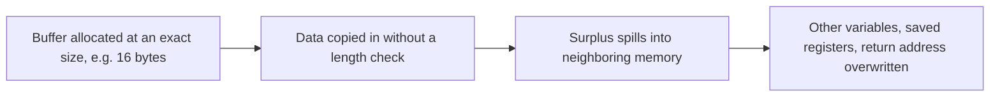
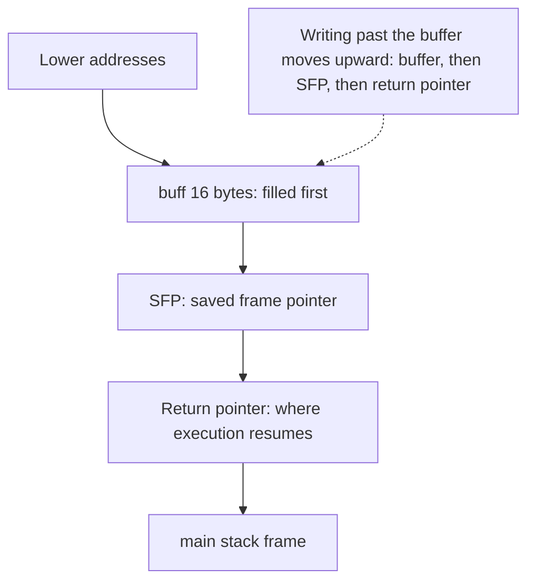
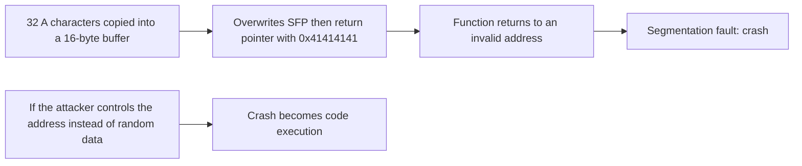
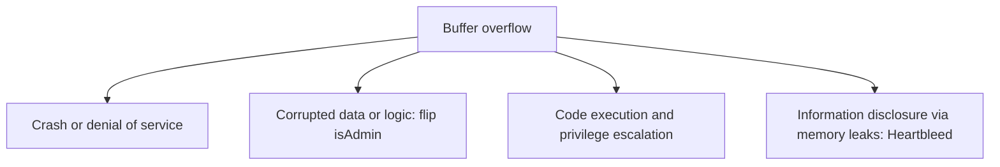
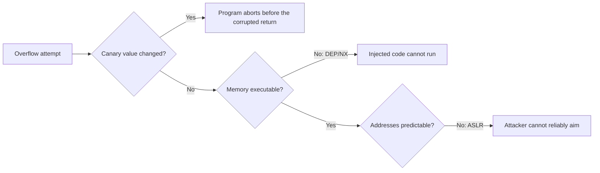

| Topic | Level | Reading Time | Prerequisites |
|---|---|---|---|
| Buffer Overflow | Intermediate | ~20 min | Input Attacks Fundamentals |

> **The goal of this section:**  
> You'll understand what happens when a program writes more data than the space it reserved in memory, how the stack frame is built and why the return pointer is the target, the types of buffer overflow and their consequences, the defences (from safe languages to stack canaries and ASLR), and what the SOC notices.


## Learning Objectives

By the end of this section, you will be able to:

- Define a **buffer overflow** and explain how unchecked copying lets surplus data overwrite adjacent memory.
- Name the **unsafe C/C++ functions** that commonly cause it.
- Describe a **stack frame** and why an overflow reaches the **saved frame pointer** and **return pointer**.
- Follow the four-step overflow example and explain why a crash can become code execution.
- List the types of overflow and their consequences, including **Heartbleed** as an over-read.
- Explain the defences: bounded functions, memory-safe languages, **stack canaries**, **DEP/NX**, and **ASLR**.
- List the SOC signals that suggest overflow attempts.

## Table of Contents

- [Learning Objectives](#learning-objectives)
- [What Is a Buffer Overflow](#what-is-a-buffer-overflow)
  - [Definition](#definition)
  - [Why It Is an Input Problem](#why-it-is-an-input-problem)
  - [Typical Cause](#typical-cause)
- [The Stack: Where the Danger Lives](#the-stack-where-the-danger-lives)
  - [A Stack Frame](#a-stack-frame)
  - [Vulnerable Code](#vulnerable-code)
- [The Overflow, Step by Step](#the-overflow-step-by-step)
- [Types and Consequences](#types-and-consequences)
  - [Types](#types)
  - [Consequences](#consequences)
- [Defending Against Buffer Overflows](#defending-against-buffer-overflows)
  - [Prevention](#prevention)
  - [SOC Detection](#soc-detection)
- [Career Path Connections](#career-path-connections)
- [Key Terms Glossary](#key-terms-glossary)
- [Summary](#summary)

## What Is a Buffer Overflow

### Definition

A **buffer overflow** is a vulnerability that happens when a program **writes more data into a memory buffer than it can hold**, so the extra data **overwrites adjacent memory.**

### Why It Is an Input Problem

Weak validation **doesn't only let an attacker run commands**, it **can also crash the system or cause a denial of service.** A string typed into an "age" field can **crash an application that doesn't validate.**

When a buffer is allocated, the program tells the system how many bytes it needs, and the buffer is created **at exactly that size.** If data is copied without checking its size, **the excess spills into adjacent memory**: other variables, saved registers, and the **return address.**

An analogy: a glass holds 200 ml, and you pour a litre into it without looking. The excess doesn't disappear; it runs onto the table and the papers next to it.

### Typical Cause

Unsafe C/C++ functions such as **`strcpy`, `gets`, and `sprintf`** **copy without checking the length.**



## The Stack: Where the Danger Lives

### A Stack Frame

| Element | Role |
|---|---|
| `buff[16]` | The 16-byte buffer |
| **SFP** | Saved frame pointer |
| **Return pointer** | **Where execution will continue from** |
| `main()`'s stack frame | The calling function's frame |

Data written into the buffer **fills toward higher addresses**, so the overflow runs into **the SFP and then the return pointer.**

### Vulnerable Code

```c
int overflow(char* input1) {
    char buff[16];
    strcpy(buff, input1);
    return 0;
}

int main(int argc, char* argv[]) {
    overflow(argv[1]);
}
```

`strcpy` **copies until the end of the input**, with no check of the length against the 16-byte buffer.



> [!NOTE]
> The stack frame order matters because of direction: the buffer sits below the saved frame pointer and the return pointer, and writes move upward. An overflow therefore does not randomly corrupt memory, it walks straight into the two values that control where the function returns.

## The Overflow, Step by Step

| # | Input | What Happens |
|---|---|---|
| 1 | **Normal input** | A short string fits in the 16 bytes, and the program works |
| 2 | **Input that fills the buffer** | All 16 bytes are used and nothing beyond them is overwritten |
| 3 | **Oversized input** (32 × `A`) | `strcpy` keeps copying past the 16 bytes: the extra A's **overwrite the SFP and then the return pointer** |
| 4 | **The function returns** | The return pointer now holds `0x41414141` (ASCII for "AAAA"), so the CPU **jumps to an invalid address**: **segmentation fault** |

**Why this matters:** if the attacker **supplies an address they control** instead of random data, **the crash turns into code execution.**



> [!WARNING]
> The lecture's small numeric example is illustrative. In practice the input must exceed the buffer plus the saved frame pointer to reach the return pointer, and the exact distance depends on the architecture and compiler. The point to remember is the principle: oversized input can reach the return pointer, and control of that value is control of execution.

## Types and Consequences

### Types

| Type | Description |
|---|---|
| **Stack-based** | Overwrites the stack (return address, saved registers). **The classic type** explained in the lecture |
| **Heap-based** | Overwrites dynamically allocated memory (`malloc`, `new`), such as adjacent objects or heap metadata |
| **Integer overflow** | The size calculation **wraps around**, so a buffer smaller than needed is allocated and then overfilled |
| **Off-by-one error** | Writing **just one byte** past the end of the buffer |
| **Format string flaws** (related) | User input is used as a `printf` format string, which allows reading or writing memory |

### Consequences

| Consequence | Example |
|---|---|
| **Crash or denial of service** | The program goes down |
| **Corrupted data or logic** | Flipping a variable such as `isAdmin` |
| **Arbitrary code execution and privilege escalation** | Shellcode, return-to-libc, ROP |
| **Information disclosure** | Leaking memory, as in **Heartbleed** (an over-read) |



> [!IMPORTANT]
> Heartbleed shows that the same bug family does not only write: an over-read returns more memory than it should, leaking secrets without any code being run. Both directions are "the program trusted a length it never checked".

## Defending Against Buffer Overflows

### Prevention

| Defence | How It Helps |
|---|---|
| **Secure coding** | Check input length. Use length-limited functions (`fgets`, `snprintf`, `strncpy` with care) and **never use `gets` or an unchecked `strcpy`** |
| **Memory-safe languages** | **Rust, Go, Java, Python, and C#** check bounds automatically |
| **Stack canaries** | A random value placed before the return address; **if it changes, the program stops itself** |
| **DEP / NX bit** | Marks the stack and heap as **non-executable** memory |
| **ASLR** | Randomizes the memory layout so addresses are **hard to predict** |
| **Testing and patching** | Fuzzing, static analysis (SAST), AddressSanitizer, and updating libraries |



> [!TIP]
> Each defence breaks a different step of an exploit: canaries catch the overwrite, DEP/NX stops injected code from running, and ASLR makes the target address unpredictable. This is defense in depth inside a single process, and it is why a bare overflow rarely gives an attacker code execution on a modern, well-built system.

### SOC Detection

| Signal | What It Suggests |
|---|---|
| **Repeated service crashes** and **segmentation fault** logs | Failed overflow attempts |
| **EDR alerts** on abnormal child processes | Successful exploitation |
| **Long runs of repeated characters** (`AAAA…`) or **NOP sleds** in requests | A payload trying to reach the return pointer |

> [!NOTE]
> Unlike the injection attacks in this category, a buffer overflow is not specific to web applications: it affects any program written in an unsafe language, including network services, drivers, and desktop software. The web is only one place the oversized input can arrive from, which is why this topic sits in Input Attacks and Injection rather than a web-only category.

## Career Path Connections

| Career Path | How This Topic Applies |
|---|---|
| SOC Analyst | Correlates repeated service crashes and EDR child-process alerts with suspicious oversized requests |
| Penetration Tester | Uses fuzzing to find crashes in services, then analyzes whether control of the return pointer is achievable |
| GRC | Memory-safety and secure-coding requirements appear in software assurance and vendor risk assessments |
| Cloud Security | Native-code components, containers, and agents carry the same risk, and patching base images is the defence |

## Key Terms Glossary

| Term | Definition |
|---|---|
| Buffer Overflow | Writing more data into a memory buffer than it can hold, overwriting adjacent memory |
| Stack Frame | The memory region holding a function's local variables, saved registers, and return address |
| SFP | Saved Frame Pointer, stored in the stack frame |
| Return Pointer | The saved address where execution resumes after a function returns |
| Segmentation Fault | A crash caused by accessing invalid memory |
| Stack Canary | A random value placed before the return address and checked before returning |
| DEP / NX | Data Execution Prevention, marking memory regions as non-executable |
| ASLR | Address Space Layout Randomization, randomizing memory layout |
| NOP Sled | A long run of no-operation instructions used to make a jump target easier to hit |
| Over-Read | Reading beyond a buffer's bounds, leaking memory contents |
| Heartbleed | A well-known over-read vulnerability that leaked memory from affected servers |

## Summary

- **A buffer overflow writes more data than a buffer holds:** and the excess overwrites adjacent memory.
- **Unsafe C/C++ functions are the typical cause:** `strcpy`, `gets`, and `sprintf` without a length check.
- **The stack layout makes the return pointer reachable:** buffer, then SFP, then return pointer, and writing moves upward.
- **A crash can become code execution:** if the attacker controls the address written into the return pointer.
- **Five related types exist:** stack-based, heap-based, integer overflow, off-by-one, and format string.
- **Consequences range from a crash to code execution and data leaks:** Heartbleed is an example of an over-read.
- **Defences stack up:** length-limited functions, safe languages, canaries, DEP/NX, ASLR, and testing.
- **SOC signals are crashes, EDR child-process alerts, and repeated-character or NOP-sled payloads.**

