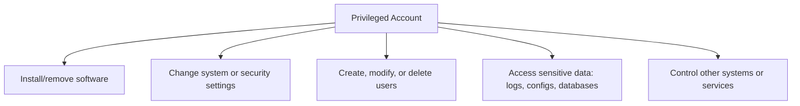
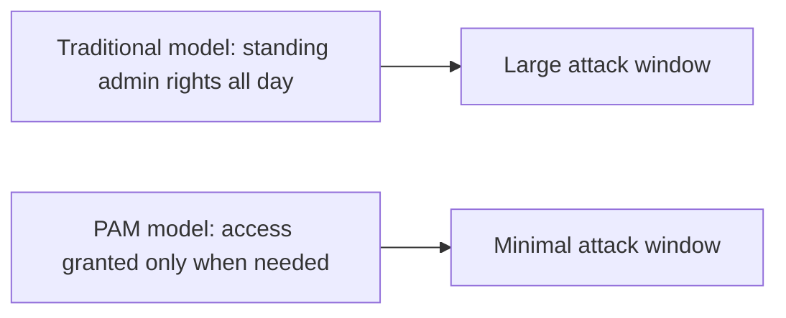
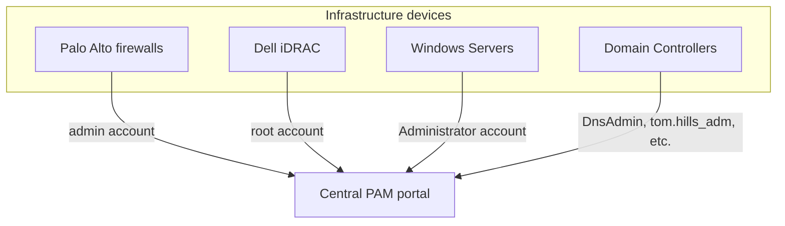
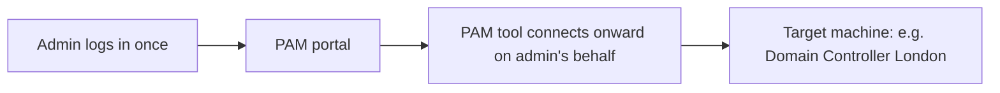
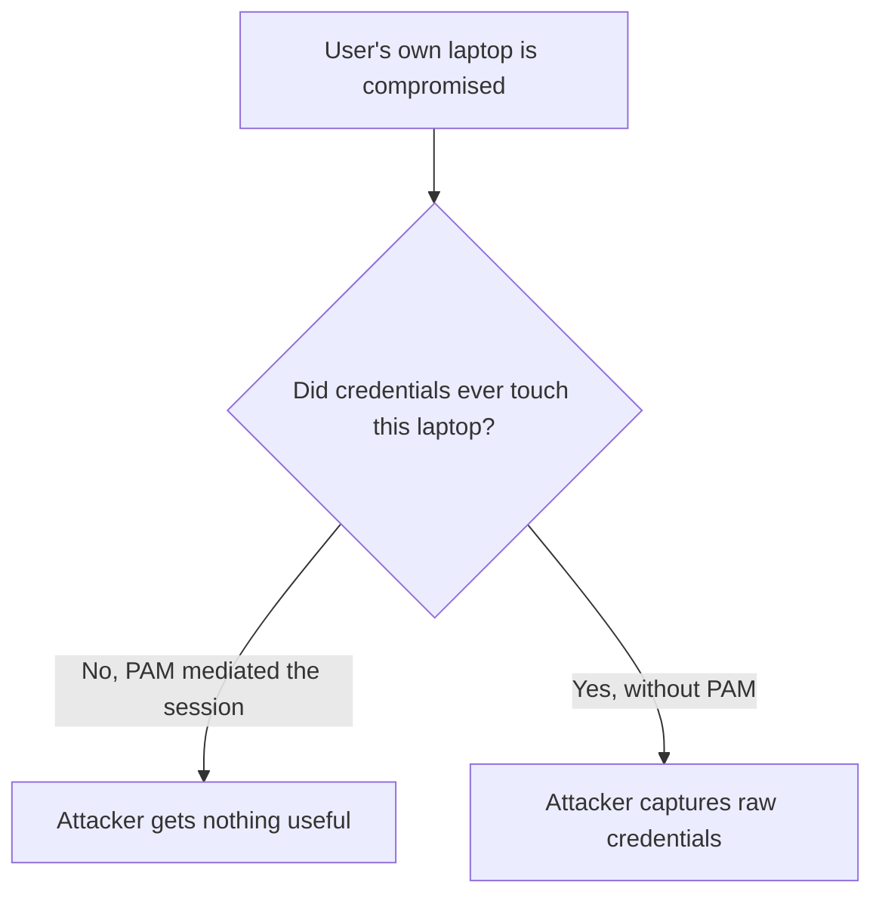
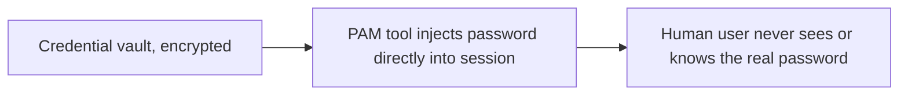
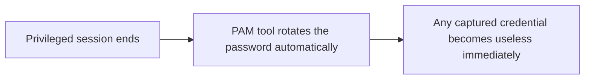
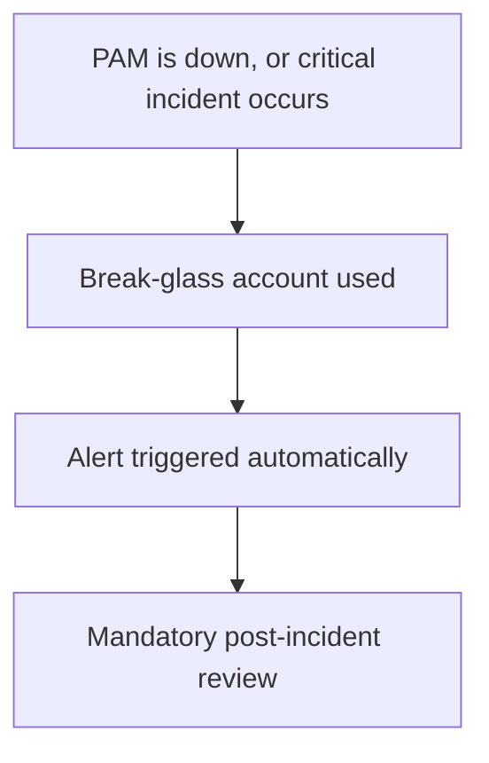
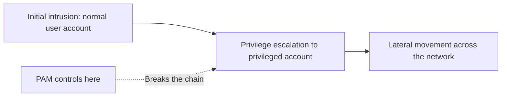

| Topic | Level | Reading Time | Prerequisites |
|---|---|---|---|
| Privileged Access Management (PAM) | Intermediate | ~20 min | Access Control Models, Active Directory Core Concepts |

> **Goal of this section:**
>  You'll understand exactly what a privileged account is, how PAM tools protect these accounts through session isolation, credential vaulting, and password rotation, and why securing these accounts is often more important than trying to prevent every initial intrusion.

## Learning Objectives

By the end of this section, you will be able to:

- Define a **privileged account** and list concrete examples beyond the obvious Administrator/root case.
- Explain the **Principle of Least Privilege (PoLP)** and how PAM enforces it by removing standing admin rights.
- Explain how PAM centralizes device and credential management across an entire organization.
- Explain **Session Isolation and Recording**, and why it protects credentials even if the user's own endpoint is compromised.
- Describe how **credential vaulting** and **automatic password rotation** work together to reduce the value of a stolen password.
- Explain **Just-in-Time (JIT) access** and **break-glass accounts**, and why organizations prioritize PAM over trying to stop every initial intrusion.

## Table of Contents

- [Learning Objectives](#learning-objectives)
- [What Is a Privileged Account](#what-is-a-privileged-account)
  - [The Core Definition](#the-core-definition)
  - [What a Privileged Account Can Do](#what-a-privileged-account-can-do)
  - [Types of Privileged Accounts Worth Knowing](#types-of-privileged-accounts-worth-knowing)
- [PAM: Privileged Access Management](#pam-privileged-access-management)
  - [The Core Idea](#the-core-idea)
  - [Enforcing Least Privilege](#enforcing-least-privilege)
- [Managing Devices Centrally](#managing-devices-centrally)
- [Session Control in Action](#session-control-in-action)
  - [How a PAM Session Works](#how-a-pam-session-works)
- [Why This Model Matters: Session Isolation](#why-this-model-matters-session-isolation)
  - [The Two Key Benefits](#the-two-key-benefits)
- [Password Policy, Vaulting, and Rotation](#password-policy-vaulting-and-rotation)
  - [Credential Vaulting](#credential-vaulting)
  - [Automatic Password Rotation](#automatic-password-rotation)
  - [Restricting Access by Context](#restricting-access-by-context)
- [Additional PAM Concepts Worth Knowing](#additional-pam-concepts-worth-knowing)
  - [Just-in-Time (JIT) Access](#just-in-time-jit-access)
  - [Break-Glass (Emergency Access)](#break-glass-emergency-access)
  - [Why Organizations Prioritize PAM](#why-organizations-prioritize-pam)
- [Career Path Connections](#career-path-connections)
- [Key Terms Glossary](#key-terms-glossary)
- [Summary](#summary)

## What Is a Privileged Account

### The Core Definition

A **Privileged account** is a **Windows Administrator** account, or **root** in Linux. These are user or system accounts with **elevated privileges** that allow **powerful, sensitive, and potentially dangerous** actions on systems.

Organizations **always prioritize** protecting this type of account **above** regular accounts.

### What a Privileged Account Can Do

A privileged account can:

- Install and remove software.
- Change system or security settings.
- Create, modify, or delete users.
- Access sensitive data (logs, configs, databases).
- Control other systems or services.

### Types of Privileged Accounts Worth Knowing

It's not just Administrator/root. There are other types that are important to know:

| Type | Example |
|---|---|
| Domain Admin accounts | Full control of Active Directory (explained in detail in the Active Directory Core Concepts file) |
| Local Administrator accounts | On individual machines |
| Service accounts | Run background services such as SQL Server or IIS — often **over-permissioned and rarely reviewed** |
| Database admin accounts | Such as `sa` in SQL Server, or `root` in MySQL |
| Network device accounts | routers, switches, firewalls |
| Cloud admin accounts | Such as AWS root, or Azure Global Administrator |
| Emergency (break-glass) accounts | Used only when normal administrative access fails |

> [!WARNING]
> Service accounts are among the most overlooked privileged accounts in real environments. They are frequently over-permissioned at creation and rarely re-reviewed afterward, which makes them an attractive long-term target for attackers.

## PAM: Privileged Access Management

### The Core Idea

**Privileged Access Management (PAM)** is carried out through **several tools** designed to manage these privileged accounts.

### Enforcing Least Privilege

**Principle of Least Privilege (PoLP)**: Every account should have **only the minimum** privileges needed for its job, and no more.

PAM tools enforce this principle by **removing standing admin rights**, and instead grant access **only at the time of actual need**.

> [!NOTE]
> This connects directly to the least privilege principle covered in the Access Control Models file, but applied specifically to the highest-risk category of accounts: privileged ones.

## Managing Devices Centrally

Instead of remembering separate credentials for every device in the organization, **all privileged accounts across the organization are centralized and managed from a single portal**.

This centralization lets security teams see, at a glance, **every privileged account that exists across the entire infrastructure**, which is something **very difficult to track manually**.

> [!TIP]
> If your organization cannot answer "how many privileged accounts exist across our infrastructure right now?" within minutes, that is itself a sign PAM centralization is missing or incomplete.

## Session Control in Action

### How a PAM Session Works

The PAM tool is responsible for **opening and recording every privileged session** in the organization. The user logs in to the PAM portal, and after that **all activity is fully controlled and brokered by the PAM tool**, **not through a direct login to the target machine**.

Instead of the admin logging in to each server and system separately, they **log in only once to the PAM portal**, and the PAM tool **handles the connection from there**.

## Why This Model Matters: Session Isolation

### The Two Key Benefits

The user **never connects directly to the target machine**; they connect to the **PAM server**, which then connects on their behalf.

Because of this:

- **Every keystroke and every on-screen action can be recorded**, for auditing and later forensic investigation.
- **If the user's own laptop is compromised**, the attacker **still can't obtain the raw credentials**, because those credentials **never touch the user's machine at all**.

This is called **Session Isolation and Recording**, and it's one of the **most valuable security benefits** that PAM tools provide.

> [!IMPORTANT]
> Session isolation is the structural reason PAM is more resilient than "just use a strong password." Even a fully compromised endpoint yields nothing, because the credential and the connection never pass through that endpoint at all.

## Password Policy, Vaulting, and Rotation

PAM tools can enforce **strict password policies** (such as requiring special characters), and can even **automatically generate strong passwords** for privileged users.

### Credential Vaulting

PAM tools store passwords securely in an **encrypted vault**; the passwords **are never present on the user's machine**.

With **Credential Vaulting**: the human user **doesn't even know the real password**; the PAM tool **injects** it directly into the session. This prevents users from:

- Writing passwords down somewhere visible.
- Reusing them across different systems.
- Leaking them through phishing.

### Automatic Password Rotation

The tool tracks **password change history** and enforces **automatic rotation** at set intervals, in compliance with security standards.

**Automatic Password Rotation**: After **every privileged session ends**, the PAM tool **changes the password automatically**. Even if the password was somehow stolen during use, it **becomes useless immediately** afterward.

### Restricting Access by Context

PAM tools can enforce policies that restrict access to critical systems, for example **allowing access to a specific system only from an approved device**.

> [!NOTE]
> This context-based restriction is the same idea as the attribute-based decisions covered in Access Control Models (ABAC): device, context, and conditions shape the decision, not identity alone.

## Additional PAM Concepts Worth Knowing

### Just-in-Time (JIT) Access

Instead of the user holding admin privileges **all day long**, PAM grants elevated access **for a limited time period** (for example, one hour) and revokes it **automatically** afterward.

### Break-Glass (Emergency Access)

A special account that is **sealed and kept outside** the normal PAM workflow, used **only** when the PAM tool itself goes down, or during a critical incident.

Using it **must always** trigger alerts and a mandatory post-incident review.

> [!WARNING]
> A break-glass account that does not trigger an alert on use is a serious gap. The entire value of this control depends on its use being rare, visible, and always reviewed, not quietly accepted as normal.

### Why Organizations Prioritize PAM

Most major breaches (such as **SolarWinds**, and many ransomware incidents) involve attackers who **escalate** from a regular user account to a privileged account, and then **move laterally (lateral movement)** across the network.

**Controlling privileged accounts** is often **more effective** than trying to prevent every possible initial intrusion.

> [!IMPORTANT]
> This is a strategic shift in defensive thinking: instead of trying to stop every possible initial intrusion, which is nearly impossible at scale, organizations focus heavily on making the escalation step (normal account to privileged account) as hard as possible. PAM is the primary control for that specific step.

## Career Path Connections

| Career Path | How This Topic Applies |
|---|---|
| SOC Analyst | Monitors PAM session logs and break-glass account usage as some of the highest-priority alert sources |
| Penetration Tester | Privilege escalation to a privileged account is often the explicit mid-point objective in an internal assessment |
| GRC | PAM deployment and password rotation policies are standard requirements in security compliance audits |
| Cloud Security | Cloud providers offer native PAM-equivalent features, such as Just-in-Time role activation for cloud admin accounts |

## Key Terms Glossary

| Term | Definition |
|---|---|
| Privileged Account | A Windows Administrator or Linux root-equivalent account with elevated permissions |
| Service Account | An account used to run background services, often over-permissioned and under-audited |
| PAM | Privileged Access Management, tools and practices for managing privileged accounts |
| Principle of Least Privilege (PoLP) | Granting only the minimum permissions needed to perform a job |
| Session Isolation and Recording | Mediating all privileged sessions through a PAM tool so credentials never touch the user's endpoint, with full activity logging |
| Credential Vaulting | Storing passwords in an encrypted vault and injecting them into sessions without the user ever seeing them |
| Automatic Password Rotation | Changing a privileged password automatically after each session ends |
| Just-in-Time (JIT) Access | Granting elevated access for a limited time window, then automatically revoking it |
| Break-Glass Account | A sealed emergency account used only when normal PAM access is unavailable |

## Summary

- **A privileged account is Administrator or root, and its many variants:** Domain Admin, service accounts, database admins, network devices, cloud admins, and break-glass accounts.
- **PAM enforces least privilege by removing standing rights:** Access is granted only at the time of actual need, not all the time.
- **PAM centralizes visibility across the whole organization:** One portal instead of scattered credentials for every device.
- **Session isolation protects credentials even on a compromised endpoint:** Because the credentials never touch the user's machine at all.
- **Credential vaulting hides the real password from the human user entirely:** The PAM tool injects it directly, so no one can leak or reuse it.
- **Automatic rotation neutralizes stolen credentials quickly:** The password changes automatically after every session.
- **JIT access and break-glass accounts minimize exposure windows:** Temporary privileges, plus a tightly monitored emergency account.
- **PAM targets the escalation step, not just initial intrusion:** Most major breaches rely on escalating to a privileged account, and PAM cuts off that step.

