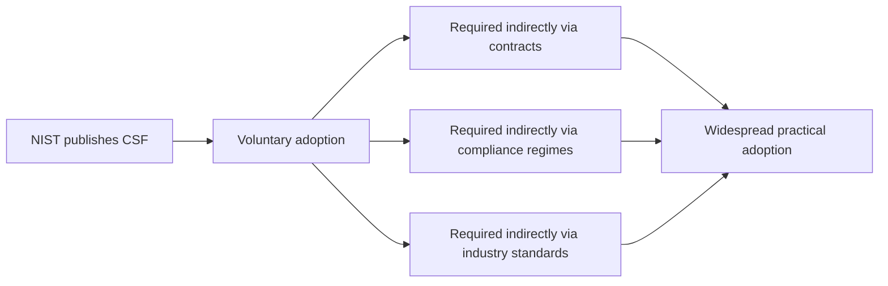
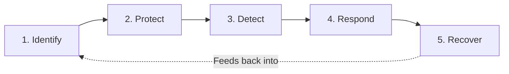

| Topic | Level | Reading Time | Prerequisites |
|---|---|---|---|
| NIST Cybersecurity Framework (CSF) | Beginner | ~10 min | None |

> **Goal of this section:**
> You'll understand what the NIST Cybersecurity Framework is, why many organizations adopt it even though it isn't a law, and what the five core functions are that organize the cyber risk management lifecycle.

## Learning Objectives

By the end of this section, you will be able to:

- Define **NIST** and explain the nature of the **Cybersecurity Framework (CSF)** it publishes.
- Explain why a **voluntary** framework becomes functionally required in practice, through contracts and compliance regimes.
- List the **five Core Functions** of the NIST CSF and describe what each one covers in the risk-management lifecycle.
- Explain how the five functions relate to each other as a continuous cycle, not a one-time checklist.

## Table of Contents

- [Learning Objectives](#learning-objectives)
- [What Is NIST](#what-is-nist)
  - [The Organization](#the-organization)
  - [The Cybersecurity Framework (CSF)](#the-cybersecurity-framework-csf)
  - [Voluntary, Yet Widely Required](#voluntary-yet-widely-required)
- [The Core Functions of the NIST CSF](#the-core-functions-of-the-nist-csf)
  - [Identify](#identify)
  - [Protect](#protect)
  - [Detect](#detect)
  - [Respond](#respond)
  - [Recover](#recover)
  - [The Functions as a Continuous Cycle](#the-functions-as-a-continuous-cycle)
- [Career Path Connections](#career-path-connections)
- [Key Terms Glossary](#key-terms-glossary)
- [Summary](#summary)

## What Is NIST

### The Organization

**NIST (National Institute of Standards and Technology)** is a **US government agency**. NIST publications have already come up in earlier notes in this series (such as AAL in IAM, and SP 800-63B in the hashing topic), but here we'll focus on a different, specific publication: **the Cybersecurity Framework** itself.

### The Cybersecurity Framework (CSF)

NIST publishes the **NIST Cybersecurity Framework (CSF)**: an **organized, voluntary** set of guidelines, best practices, and standards **for managing and reducing cyber risk**.

> [!NOTE]
> The CSF is not a technical standard like a specific encryption algorithm or protocol. It is a management framework: a structured way of thinking about and organizing cybersecurity work across an entire organization.

### Voluntary, Yet Widely Required

The CSF **isn't a law in itself**, but it's **very widely adopted**, often **indirectly** through:

- **Contracts**.
- **Compliance regimes**.
- **Industry standards**.

The reason: the CSF gives organizations a **common language**, instead of each organization inventing its own practices in an **ad-hoc** way.

> [!IMPORTANT]
> This is the same pattern covered in the IAM file regarding NIST's AAL guidelines: voluntary on paper, but functionally mandatory for organizations that need partners, regulators, or customers to trust them. A framework does not need legal force to shape real-world practice.

## The Core Functions of the NIST CSF

The framework is organized around **core functions** that describe the **cyber risk management lifecycle**:

| # | Function | What It Covers |
|---|---|---|
| 1 | **Identify** | Understanding the organization's assets, systems, data, and risks (what needs protection) |
| 2 | **Protect** | Implementing safeguards (access control, training, data security) to limit or contain incidents |
| 3 | **Detect** | Implementing monitoring to identify cybersecurity events as they happen |
| 4 | **Respond** | Taking action once an incident is detected (containment, communication, mitigation) |
| 5 | **Recover** | Restoring the affected services and improving resilience for the future |

### Identify

The first step: **understanding** what you have. This includes assets, systems, data, and the risks associated with them. This is exactly what you're supposed to protect.

> [!NOTE]
> This connects directly to the Asset Awareness file from Network Security Foundations. "Identify" in the CSF is the same discipline as asset inventory and criticality tiering, framed as the first stage of a formal risk-management cycle.

### Protect

Implementing **safeguards** such as access control, employee training, and data security, in order to **limit or contain** incidents.

### Detect

Implementing **monitoring** to identify cybersecurity events **as they actually happen**, not after it's too late.

> [!NOTE]
> Detect maps directly to the traffic baselining concept from the Asset Awareness file, and to the SIEM function covered in the Defense in Depth Model file: monitoring only has value if you know what normal looks like first.

### Respond

Taking action **as soon as an incident is detected**: containment, communication, and mitigation.

### Recover

Restoring the affected services and **improving resilience** for the future, not just returning things to the way they were.

### The Functions as a Continuous Cycle

It's important to understand that these five functions **aren't steps you do once and you're done**. The cycle is **continuous**: lessons from Recover feed back into Identify, newly discovered risks update Protect and Detect, and so on.

> [!TIP]
> A simple way to remember the five functions in order: before an incident (Identify, Protect), during detection and response (Detect, Respond), and after (Recover). This chronological framing helps when mapping a real incident back to the framework in an interview or an audit.

## Career Path Connections

| Career Path | How This Topic Applies |
|---|---|
| SOC Analyst | Directly operates within Detect and Respond, using monitoring tools and incident response procedures |
| Penetration Tester | Engagements often test the effectiveness of Protect and Detect controls against realistic attack scenarios |
| GRC | Primary owner of CSF adoption, mapping organizational controls to each of the five functions for audits and compliance |
| Cloud Security | Cloud-native tools (asset inventories, IAM, monitoring, automated response) implement each CSF function in a cloud context |

## Key Terms Glossary

| Term | Definition |
|---|---|
| NIST | National Institute of Standards and Technology, a U.S. government agency |
| NIST CSF | A voluntary, structured set of guidelines for managing and reducing cybersecurity risk |
| Identify | The CSF function covering understanding of assets, systems, data, and risk |
| Protect | The CSF function covering safeguards that limit or contain incidents |
| Detect | The CSF function covering monitoring to identify cybersecurity events as they occur |
| Respond | The CSF function covering action taken once an incident is detected |
| Recover | The CSF function covering restoration of services and improved future resilience |

## Summary

- **NIST publishes the CSF as a voluntary framework:** it isn't a law, but it's widely adopted through contracts, compliance regimes, and industry standards.
- **The CSF gives organizations a common language:** an alternative to ad-hoc practices that vary from one organization to another.
- **Five Core Functions structure the risk-management lifecycle:** Identify, Protect, Detect, Respond, and Recover.
- **The functions form a continuous cycle, not a checklist:** lessons from Recover continuously feed back into Identify.
- **Each function connects to concrete practices covered earlier in this series:** Identify ≈ asset inventory, Detect ≈ baselining and SIEM, and so on.

