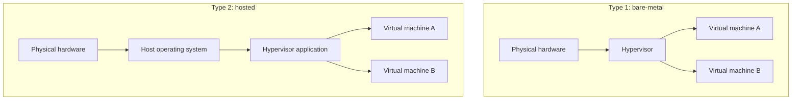
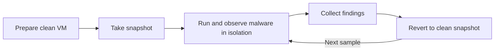
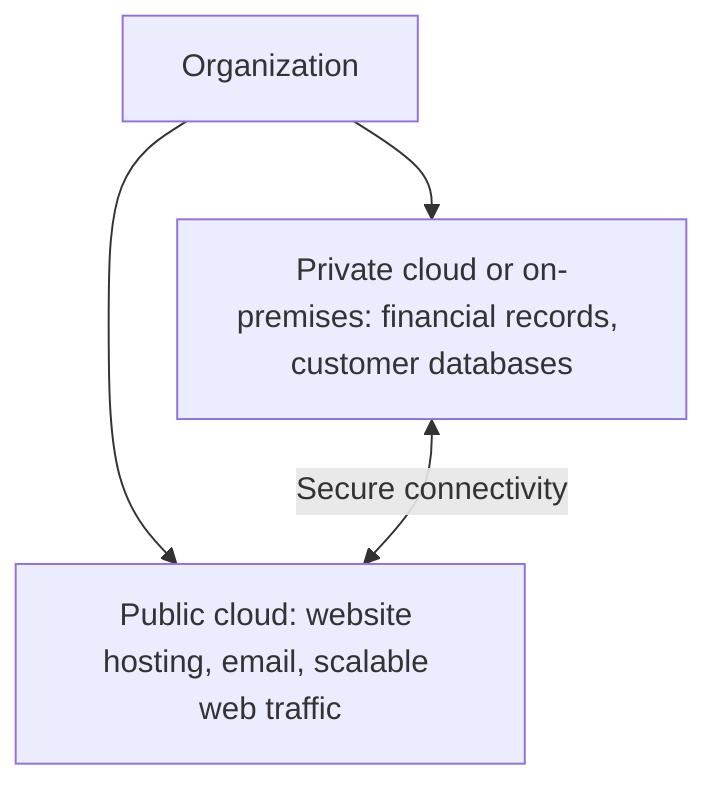

| Topic | Level | Reading Time | Prerequisites |
|---|---|---|---|
| Virtualization and Cloud Computing | Beginner | ~15 min | Basic idea of what an operating system is |


> **Goal of this section:**
> You'll understand what virtualization is and how to use it in a security lab, and you'll be able to tell the types of cloud apart and know what your security responsibility is in each.


## Learning Objectives

By the end of this section, you will be able to:

- Differentiate between Type 1 (bare-metal) and Type 2 (hosted) **hypervisors** and give examples of each.
- Explain what Kali Linux is and why security practitioners run it inside a virtual machine.
- Describe how virtual machines and **snapshots** make malware analysis safer, and what VM detection means.
- Compare private, public, and hybrid cloud deployment models.
- Explain the **Shared Responsibility Model** and why hybrid environments widen the attack surface.

## Table of Contents

- [Learning Objectives](#learning-objectives)
- [Virtualization Fundamentals](#virtualization-fundamentals)
  - [What Virtualization Is](#what-virtualization-is)
  - [Hypervisor Types](#hypervisor-types)
  - [Type 2 Hypervisors in This Course](#type-2-hypervisors-in-this-course)
- [Kali Linux for Security Practice](#kali-linux-for-security-practice)
  - [What Kali Linux Is](#what-kali-linux-is)
  - [Getting Kali Safely](#getting-kali-safely)
- [Virtualization for Malware Analysis](#virtualization-for-malware-analysis)
  - [Isolated and Contained Environments](#isolated-and-contained-environments)
  - [Snapshots](#snapshots)
  - [Basic Lab Safety](#basic-lab-safety)
  - [VM Detection by Malware](#vm-detection-by-malware)
- [Cloud Computing Deployment Models](#cloud-computing-deployment-models)
  - [Private Cloud](#private-cloud)
  - [Public Cloud](#public-cloud)
  - [Private Versus Public Comparison](#private-versus-public-comparison)
  - [Hybrid Cloud](#hybrid-cloud)
- [Cloud Security Considerations](#cloud-security-considerations)
  - [Split Attack Surface](#split-attack-surface)
  - [Shared Responsibility Model](#shared-responsibility-model)
  - [Logging Across Environments](#logging-across-environments)
  - [Common Cloud Misconfigurations](#common-cloud-misconfigurations)
- [Career Path Connections](#career-path-connections)
- [Key Terms Glossary](#key-terms-glossary)
- [Summary](#summary)

## Virtualization Fundamentals

### What Virtualization Is

**Virtualization** is a technology that lets you run more than one operating system on the same physical machine, with each system running inside a **virtual machine (VM)** that is isolated from the others. Each VM behaves as if it were a complete computer with its own CPU, memory, disk, and network card, but in reality it takes its share of the real machine's resources.

The program responsible for creating and managing VMs is called a **hypervisor**.

Analogy: imagine a large apartment building (the physical machine) divided into apartments (VMs). Each apartment has its own door, key, and residents, but they all share the same building foundations, water, and electricity.

### Hypervisor Types

There are two types of hypervisors:

| Aspect | Type 1 (Bare-Metal) | Type 2 (Hosted) |
|---|---|---|
| Runs on | Directly on hardware, no underlying OS | On top of an existing operating system |
| Typical use | Data centers, servers, cloud infrastructure | Laptops and desktops, learning, testing, labs |
| Setup complexity | Higher | Lower |
| Examples | VMware ESXi, Microsoft Hyper-V, Xen, KVM | VMware Workstation, VirtualBox, Parallels |



> [!NOTE]
> KVM is built into the Linux kernel, and Hyper-V runs beneath the Windows management OS. Both are commonly classified as Type 1 even though they are installed alongside a general-purpose operating system. The key point is that the hypervisor works at the hardware level.

### Type 2 Hypervisors in This Course

The course focuses on **hosted hypervisors (Type 2)**, because they run on top of a regular operating system such as Windows or macOS, which makes them much easier to set up for learning purposes. Examples: **VMware Workstation**, **VirtualBox**, and **Parallels**.

> [!TIP]
> Before you start, check that hardware virtualization (Intel VT-x or AMD-V) is enabled in your computer's BIOS or UEFI settings. It is the most common reason a VM refuses to start or runs very slowly.

## Kali Linux for Security Practice

### What Kali Linux Is

**Kali Linux** is a Linux distribution designed specifically for **penetration testing** and security research. It comes preloaded with tools such as:

- **Nmap** for discovering devices and open ports on the network.
- **Metasploit** for testing vulnerability exploitation in an authorized environment.
- **Wireshark** for capturing and analyzing network traffic.

Kali is maintained by **OffSec** (formerly known as Offensive Security), and it's one of the most widely used platforms in the cybersecurity industry, both for learning and for professional penetration testing engagements.

In this course, you'll run a **Kali Linux VM**, which gives you a complete testing environment without changing anything on your main machine.

### Getting Kali Safely

Download Kali only from the official website, and verify the checksum before using it, because a modified copy of a security tool is exactly what an attacker would love to distribute.

```bash
# Verify the integrity of a downloaded image (replace with your file name)
sha256sum kali-linux-image.iso
```

Compare the output with the hash published on the official download page. They must match exactly.

> [!WARNING]
> Pre-built VM images often ship with well-known default credentials. Change the default password immediately, especially if the VM will ever be reachable from a network. This is the same weakness that let the Mirai botnet spread through IoT devices, covered in Part 2.

> [!IMPORTANT]
> Tools like Nmap and Metasploit must only be used against systems you own or have explicit written permission to test. A home lab is the right place to practice.

## Virtualization for Malware Analysis

### Isolated and Contained Environments

VMs create an **isolated and contained** environment, which makes it possible to run and study malware without putting the host machine or the network at risk. If the malware causes damage, corrupts files, or tries to spread, all of that stays confined inside the VM.

### Snapshots

A **snapshot** is a saved capture of the VM's state at a specific moment. The analyst takes a snapshot **before** running the malware, and after the analysis reverts to that snapshot, so any damage that happened is undone immediately.



An example of managing snapshots in VirtualBox from the command line (the VM name here is illustrative):

```bash
# List the virtual machines on this host
VBoxManage list vms

# Take a snapshot of a clean analysis VM
VBoxManage snapshot "Win10-Analysis" take "clean-baseline"

# After the analysis, power off the VM and restore the snapshot
VBoxManage snapshot "Win10-Analysis" restore "clean-baseline"
```

> [!NOTE]
> Snapshots restore the VM's state, but they do not protect anything outside the VM. If the VM had network access or shared folders, malware could already have reached them. That is why the next section matters.

### Basic Lab Safety

Isolation depends on the right settings. Key notes:

| Setting | Recommended Practice | Reason |
|---|---|---|
| Network mode | Host-only or internal network, not bridged | Prevents malware from reaching your real network and the internet |
| Shared folders | Disabled | Prevents malware from touching host files |
| Clipboard and drag-and-drop | Disabled | Removes a data path between guest and host |
| Snapshots | Always take a clean one first | Enables quick recovery |
| Host software | Keep hypervisor and host OS updated | Reduces the chance of a VM escape vulnerability |

An example of setting the network adapter to host-only mode in VirtualBox (the adapter name varies by system):

```bash
VBoxManage modifyvm "Win10-Analysis" --nic1 hostonly --hostonlyadapter1 vboxnet0
```

> [!WARNING]
> VM isolation is strong but not absolute. Vulnerabilities that allow code to escape from a VM to the host (called VM escapes) are rare but have existed. Never analyze real malware on a machine that holds important data, and only work with samples from trusted research sources.

### VM Detection by Malware

The problem is that **advanced malware** sometimes includes **VM detection** techniques. It checks whether it's running inside a virtual machine, and if it detects that, it refuses to execute or behaves differently, to evade analysis by researchers.

It looks for indicators such as:

- Device and driver names specific to the hypervisor.
- Certain MAC address values belonging to virtualization vendors.
- The limited resources typical of VMs (few cores or a small disk).
- The absence of signs of real use of the machine.

> [!NOTE]
> This is a cat-and-mouse game. Analysts respond by hardening their lab VMs to look more like real machines, or by using bare-metal analysis systems for samples that detect virtual environments.

## Cloud Computing Deployment Models

### Private Cloud

In a **Private Cloud**, the organization itself **builds, owns, and maintains** all the infrastructure, whether on its own premises or in a dedicated data center that it fully controls.

This gives **maximum control** over security and data, but it's **very expensive** because of the hardware, maintenance, staff, and physical security requirements.

### Public Cloud

In a **Public Cloud**, the organization **rents computing resources** (servers, storage, databases) from a third-party cloud provider. Examples of providers:

- **Amazon Web Services (AWS)**
- **Microsoft Azure**
- **Google Cloud Platform (GCP)**

This greatly reduces upfront costs, because the organization doesn't need to buy or maintain physical hardware.

### Private Versus Public Comparison

| Aspect | Private Cloud | Public Cloud |
|---|---|---|
| Ownership | Organization builds, owns, and maintains everything | Resources are rented from a third-party provider |
| Control over security and data | Maximum | Shared with the provider |
| Upfront cost | Very high (hardware, staffing, physical security) | Low, no hardware to buy |
| Maintenance burden | On the organization | Mostly on the provider for the infrastructure |
| Examples | On-premises data center | AWS, Microsoft Azure, GCP |

### Hybrid Cloud

Most organizations **don't choose only private or only public**. They use a **hybrid cloud**, which combines the two, balancing the cost savings of the public cloud with the control and security of private infrastructure.

Example: a company might keep highly sensitive data (such as financial records or customer databases) on a private cloud or an on-premises server for greater control and compliance, and use the public cloud for less sensitive workloads such as hosting a website, running email services, or handling web traffic that varies in volume.



## Cloud Security Considerations

### Split Attack Surface

The hybrid model is very important for security teams, because the organization's **attack surface** is now **split across two environments**: on-premises and cloud. Each environment has different security tools, different logging systems, and different responsibility models.

The attack surface is the total of all the points an attacker might try to enter through or exploit. The more environments there are, the more places the security team has to monitor with more tools.

### Shared Responsibility Model

This is where the **Shared Responsibility Model** comes in: the cloud provider secures the **infrastructure**, but the organization is still responsible for securing its **data, configurations, and access controls** inside the cloud environment.

Analogy: the building owner is responsible for the foundations, the main entrance, and general security, but you're responsible for locking your own apartment door and for who you give the key to.

The division of responsibility changes depending on the type of service:

| Service Model | Provider Typically Secures | Customer Typically Secures |
|---|---|---|
| IaaS (Infrastructure as a Service) | Physical data centers, hardware, hypervisor | Operating system, applications, data, network configuration, access control |
| PaaS (Platform as a Service) | Infrastructure and the platform runtime | Applications, data, access control |
| SaaS (Software as a Service) | Infrastructure, platform, and the application | Data, user accounts, access configuration |

> [!IMPORTANT]
> In every cloud service model, the customer remains responsible for their data and for who can access it. "It is in the cloud" never means "the provider secures everything".

### Logging Across Environments

The SOC has to collect logs from both environments. Each provider has its own tools:

| Provider | Example Activity Logging Service |
|---|---|
| AWS | AWS CloudTrail |
| Microsoft Azure | Azure Activity Log |
| Google Cloud | Cloud Audit Logs |

And connecting this to the earlier sections: the same **baselining** principle is essential in the cloud. Without knowing the normal activity of the cloud accounts and resources, you won't be able to detect what's abnormal.

### Common Cloud Misconfigurations

Security problems in the cloud usually come from a **wrong configuration** by the customer, not from a breach of the provider's infrastructure. Common examples:

- Storage buckets accidentally left publicly accessible.
- Excessive permissions on accounts and roles.
- Management interfaces exposed to the internet without sufficient protection.
- Logging and monitoring not being enabled.

> [!TIP]
> Apply the same asset awareness principles from Part 1 to the cloud. If cloud resources are not in your inventory, you cannot classify them, prioritize alerts about them, or secure them.

## Career Path Connections

| Career Path | How This Topic Applies |
|---|---|
| SOC Analyst | Monitors logs from both on-premises and cloud environments and understands where each asset lives |
| Penetration Tester | Builds attack labs with Kali in virtual machines and tests cloud configurations within authorized scope |
| Malware Analyst | Uses isolated VMs, snapshots, and hardened lab setups to study malicious software safely |
| GRC | Evaluates cloud providers, maps the Shared Responsibility Model to compliance controls, and decides what data can go to the public cloud |
| Cloud Security | Secures configurations, identities, and data across AWS, Azure, and GCP environments |

## Key Terms Glossary

| Term | Definition |
|---|---|
| Virtualization | Running multiple isolated virtual machines on one physical computer |
| Virtual Machine (VM) | A software-based computer with its own virtual CPU, memory, storage, and network |
| Hypervisor | Software that creates and manages virtual machines |
| Type 1 Hypervisor | A bare-metal hypervisor that runs directly on hardware |
| Type 2 Hypervisor | A hosted hypervisor that runs on top of an existing operating system |
| Kali Linux | A Linux distribution built for penetration testing and security research, maintained by OffSec |
| Snapshot | A saved state of a VM that can be restored later |
| VM Detection | Malware techniques that check whether the code is running inside a virtual machine |
| VM Escape | A vulnerability that lets code break out of a VM and affect the host |
| Private Cloud | Infrastructure built, owned, and maintained by the organization itself |
| Public Cloud | Computing resources rented from a third-party provider |
| Hybrid Cloud | A combination of private and public cloud environments |
| Attack Surface | The total set of points where an attacker could try to enter or exploit a system |
| Shared Responsibility Model | The division of security duties between the cloud provider and the customer |
| IaaS | Infrastructure as a Service, where the customer manages OS, applications, and data on rented infrastructure |
| PaaS | Platform as a Service, where the provider manages the runtime and the customer manages applications and data |
| SaaS | Software as a Service, where the provider manages the application and the customer manages data and access |

## Summary

- **Virtualization runs isolated systems:** several VMs on a single machine, managed by the hypervisor.
- **Two hypervisor types:** Type 1 (bare-metal) runs directly on the hardware, and Type 2 (hosted) runs on top of a regular OS and is the one we use in the course.
- **Kali Linux is the practice platform:** a distribution specialized in pentesting that includes Nmap, Metasploit, and Wireshark, and it runs in a VM.
- **VMs make malware analysis safer:** isolation contains the damage, and a snapshot restores the original state immediately, provided the network and shared folders are configured correctly.
- **Malware can detect VMs:** some advanced malware refuses to run or behaves differently if it detects that it's in a VM.
- **Private cloud gives control, public cloud gives savings:** the first is expensive and gives you full control, and the second reduces upfront costs.
- **Most organizations use hybrid cloud:** sensitive data on private, less sensitive workloads on public.
- **Hybrid splits the attack surface:** two environments with different tools, logs, and responsibility models, which adds to the security team's workload.
- **Shared Responsibility Model:** the provider secures the infrastructure, and the organization is responsible for the data, configurations, and access controls.


