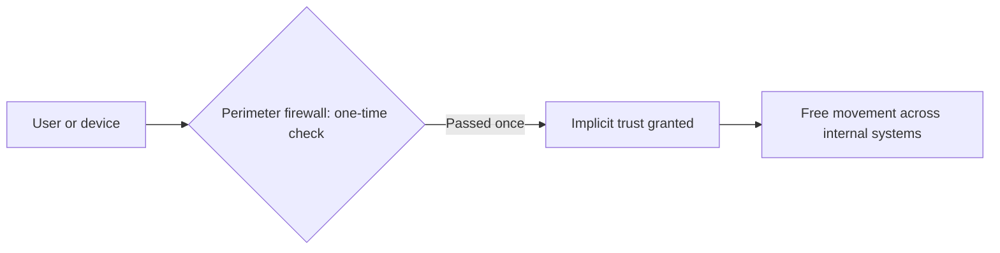
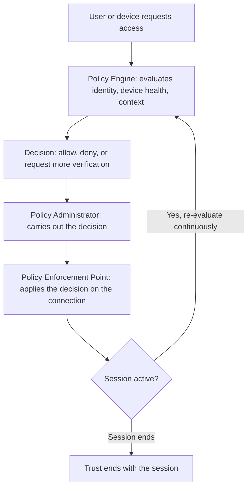
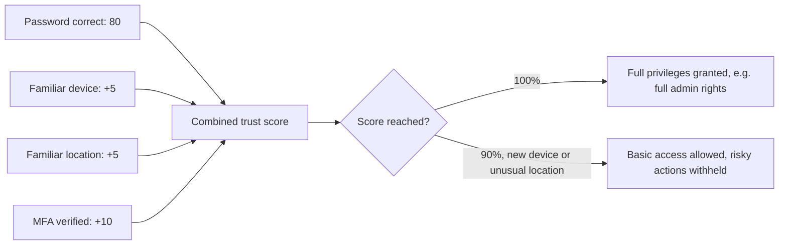
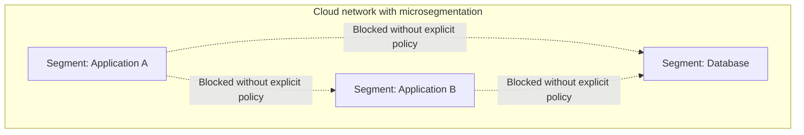

| Topic | Level | Reading Time | Prerequisites |
|---|---|---|---|
| Zero Trust Model | Intermediate | ~20 min | Basic idea of firewalls and network perimeters |

> **Goal of this section:**
>   You will understand why modern security assumes that nothing is trusted automatically, not even users who are already inside the network, and how Zero Trust is applied in practice through trust scoring and in the cloud environment.

## Learning Objectives

By the end of this section, you will be able to:

- Explain the core principle of **Zero Trust** and why "no default trust" applies even to users already inside the network.
- Describe why the old **perimeter security model** failed, and how **lateral movement** exploits that weakness.
- List the **NIST Zero Trust tenets (SP 800-207)** and explain what each one changes in practice.
- Describe the three building blocks of a **Zero Trust Architecture**: Policy Engine, Policy Administrator, and Policy Enforcement Point.
- Work through a **trust scoring** example and explain how it connects to Conditional Access and RBAC.
- Explain how Zero Trust is applied in the cloud through **ZTNA**, **microsegmentation**, and **CASB**.

## Table of Contents

- [Learning Objectives](#learning-objectives)
- [The Core Principle](#the-core-principle)
  - [No Default Trust](#no-default-trust)
  - [Continuous Verification](#continuous-verification)
  - [Assume Breach](#assume-breach)
  - [Encrypted Internal Traffic](#encrypted-internal-traffic)
- [Why the Old Perimeter Model Failed](#why-the-old-perimeter-model-failed)
  - [The Old Model](#the-old-model)
  - [The Core Weakness](#the-core-weakness)
  - [Lateral Movement](#lateral-movement)
  - [Why It Changed](#why-it-changed)
- [NIST Zero Trust Tenets (SP 800-207)](#nist-zero-trust-tenets-sp-800-207)
- [Zero Trust Architecture in Practice](#zero-trust-architecture-in-practice)
  - [The Three Building Blocks](#the-three-building-blocks)
  - [The Request Flow](#the-request-flow)
- [Trust Scoring: A Concrete Example](#trust-scoring-a-concrete-example)
  - [How the Score Is Built](#how-the-score-is-built)
  - [What the Score Means in Practice](#what-the-score-means-in-practice)
- [Applying Zero Trust in the Cloud](#applying-zero-trust-in-the-cloud)
  - [Zero Trust Network Access (ZTNA)](#zero-trust-network-access-ztna)
  - [Microsegmentation](#microsegmentation)
  - [Cloud Access Security Broker (CASB)](#cloud-access-security-broker-casb)
  - [Continuous Verification in the Cloud](#continuous-verification-in-the-cloud)
- [Career Path Connections](#career-path-connections)
- [Key Terms Glossary](#key-terms-glossary)
- [Summary](#summary)

## The Core Principle

### No Default Trust

**Zero Trust** is a modern security model built on one simple but radical idea: **no user, device, or system is trusted automatically**, whether it connects from inside the company's internal network or from the internet.

The fundamental difference from older models: there is no longer an assumption that "if you're inside, you're trusted." Geographic or network location is no longer proof of trust.

### Continuous Verification

Every access request is **verified and authorized at the moment it happens**, not just once at login. Even if the user signed in successfully in the morning, any new request after that is checked from scratch.

### Assume Breach

Security is designed on the assumption that **the attacker may already be inside the network**, so every action is still checked, even if it comes from inside the network.

Picture this idea like a hospital that treats everyone, even staff, as someone who has to show a valid badge at every door they pass through, not just at the building entrance. Simply being inside the building isn't proof that you should be able to reach every room in it.

### Encrypted Internal Traffic

Even communication **between internal systems themselves** (for example, the IT team talking to the database) is encrypted. If an attacker is sitting in the middle (man-in-the-middle), they won't be able to read anything useful.

> [!IMPORTANT]
> Zero Trust is not a single product you buy. It is a set of principles applied across identity, devices, network, applications, and data at the same time. A vendor selling "Zero Trust in a box" is usually selling one piece of a much larger architecture.

## Why the Old Perimeter Model Failed

### The Old Model

In the old model, **a single firewall** sat at the network edge and checked identity **only once**. After that check, the user or device was implicitly trusted and could move freely inside the network.

### The Core Weakness

The core weakness: **if an attacker steals a valid username and password**, they pass **the exact same single check** as any real employee. The perimeter **has no way to tell** the two apart.

### Lateral Movement

Once the attacker is inside, they can move from one internal system to another with very little additional checking. This is the technique behind most major **ransomware** incidents and **data breaches**.

> [!WARNING]
> Lateral movement is exactly why "trusted once, trusted forever" is dangerous. A single compromised credential, in a perimeter-only model, can become access to the entire internal network.

### Why It Changed

Internal sites and systems have become **much more complex**: multiple teams, multiple databases, and services constantly communicating with each other. **A single checkpoint** is no longer enough to protect the whole environment.

## NIST Zero Trust Tenets (SP 800-207)

The US standards institute **NIST** defined a set of core principles for Zero Trust in the document **SP 800-207**:

- **All data sources and internal services are treated as protected resources**, not just the network edge.
- **All communication is secured regardless of network location**; internal traffic is encrypted exactly like external traffic.
- **Access is granted per session**, not permanently. When the session ends, the trust ends with it.
- **Access decisions take into account the identity, the health of the requesting device, and the behavioral context** together, not just a single factor.
- **The organization continuously monitors** device integrity, network traffic, and access requests to keep improving the policy.

| Tenet | Old Model Equivalent | Zero Trust Change |
|---|---|---|
| Protect all resources, not just the edge | Only the perimeter was checked | Every internal service is a protected resource |
| Secure all communication | Only external traffic was encrypted | Internal traffic is encrypted too |
| Per-session access | Access persisted after one login | Trust expires with the session |
| Multi-factor access decisions | Identity alone was enough | Identity, device health, and behavior together |
| Continuous monitoring | Static, rarely reviewed | Ongoing monitoring feeds policy improvement |

> [!NOTE]
> SP 800-207 is a guideline, not a law. Organizations choose to adopt it, but many regulated sectors (banking, government, critical infrastructure) are expected to align with it to be considered trustworthy by partners and regulators.

## Zero Trust Architecture in Practice

### The Three Building Blocks

A Zero Trust architecture consists of three core components:

| Component | Role |
|---|---|
| Policy Engine (PE) | Evaluates every request and decides: allow, deny, or revoke access |
| Policy Administrator (PA) | Carries out that decision by opening or closing the connection |
| Policy Enforcement Point (PEP) | The gateway or agent that actually applies the decision to the connection itself |

### The Request Flow

The steps of the request flow:

- A user or device requests access to a specific resource.
- The **Policy Engine** evaluates the identity, the device health, and the context, and then makes a decision.
- The **Policy Administrator** and the **Policy Enforcement Point** apply that decision: allow, deny, or request additional verification.
- This decision is **continuously re-evaluated**, not just once at login.

> [!TIP]
> Compare this flow to the old perimeter model diagram above. The key structural difference is the loop back to the Policy Engine: trust is never a one-time gate, it is a continuously re-checked decision.

## Trust Scoring: A Concrete Example

### How the Score Is Built

Instead of relying on a single password check, Zero Trust systems calculate a **combined trust score** from multiple signals before deciding how much access to grant.

| Signal | Points |
|---|---|
| Correct username and password | 80 |
| Same device the user normally logs in from | +5 |
| Login location matches the user's usual country | +5 |
| Multi-factor authentication code entered correctly | +10 |
| **Total possible** | **100** |

### What the Score Means in Practice

- **A user who reaches 100%** is trusted with full privileges (such as full admin rights).
- **A user who signed in correctly but from a new device or an unusual location** may only reach 90%. That is enough to sign in, but **risky actions** such as deleting data or using admin privileges are withheld until this additional risk is resolved.

This approach is often called **Risk-Based Access** or **Conditional Access**. In Microsoft environments, it is implemented through **Conditional Access policies** integrated with **Role-Based Access Control (RBAC)**.

> [!NOTE]
> RBAC decides what the role is allowed to do at all. Conditional Access decides whether the current session has earned enough trust to actually use that permission right now. The two work together, not as alternatives.

## Applying Zero Trust in the Cloud

### Zero Trust Network Access (ZTNA)

**ZTNA** replaces the traditional VPN. Instead of granting access to the entire internal network, it grants access **only to the specific application requested**, after verifying the identity and the device health.

| Aspect | Traditional VPN | ZTNA |
|---|---|---|
| Access scope | Entire internal network | One specific application |
| Trust model | Trusted once connected | Verified per request |
| Lateral movement risk | High, once inside the VPN | Low, access is scoped narrowly |

### Microsegmentation

The cloud network is divided into **small, isolated segments**, so compromising one segment **doesn't automatically grant access** to the rest.

### Cloud Access Security Broker (CASB)

The **CASB** sits between users and cloud applications, enforcing policy and monitoring risky behavior across multiple cloud services at the same time.

### Continuous Verification in the Cloud

Cloud identity providers (such as **Microsoft Entra ID**) **re-check the session's validity** throughout its lifetime, not just at login.

> [!IMPORTANT]
> ZTNA, microsegmentation, and CASB are not three separate products solving three separate problems. They are the same Zero Trust principles (no default trust, continuous verification, least-privilege scope) applied to three different layers of a cloud environment: connectivity, network topology, and application access.

## Career Path Connections

| Career Path | How This Topic Applies |
|---|---|
| SOC Analyst | Monitors Policy Engine decisions and trust score anomalies as signals of compromised credentials |
| Penetration Tester | Tests whether lateral movement is actually blocked once a foothold is gained, a core Zero Trust promise to verify |
| GRC | NIST SP 800-207 alignment is often part of compliance assessments for regulated industries |
| Cloud Security | Configures ZTNA, microsegmentation, and CASB policies directly in cloud identity and network platforms |

## Key Terms Glossary

| Term | Definition |
|---|---|
| Zero Trust | A security model where no user, device, or system is trusted by default, regardless of location |
| Perimeter Security Model | An older approach where identity is checked once at the network edge, then trusted implicitly |
| Lateral Movement | An attacker's movement from one compromised system to others inside the network |
| NIST SP 800-207 | The NIST publication defining Zero Trust Architecture tenets |
| Policy Engine (PE) | The component that evaluates a request and decides whether to grant, deny, or revoke access |
| Policy Administrator (PA) | The component that carries out the Policy Engine's decision |
| Policy Enforcement Point (PEP) | The gateway or agent that applies the access decision on the connection itself |
| Trust Score | A combined score built from multiple signals used to decide how much access to grant |
| Conditional Access | Risk-based access decisions applied dynamically based on signals such as device and location |
| ZTNA | Zero Trust Network Access, grants access to a specific application rather than the whole network |
| Microsegmentation | Dividing a cloud network into small, isolated segments |
| CASB | Cloud Access Security Broker, enforces policy and monitors behavior across cloud applications |

## Summary

- **No default trust, ever:** no user or device is trusted automatically, whether inside the network or outside it.
- **Verification is continuous:** every request is checked at the moment it happens, not once at login.
- **The old perimeter model trusted too much, too easily:** one check followed by implicit trust, which is what opened the door to lateral movement.
- **NIST SP 800-207 formalizes the principles:** protect all resources, encrypt all communication, per-session access, multi-factor decisions, and continuous monitoring.
- **Three components run the architecture:** the Policy Engine decides, the Policy Administrator carries out, and the Policy Enforcement Point actually applies.
- **Trust scoring replaces the single password check:** multiple signals (device, location, MFA) combine into a single score that determines the level of privileges.
- **Zero Trust extends fully into the cloud:** ZTNA instead of VPN, microsegmentation instead of the flat network, and CASB to monitor cloud applications.

