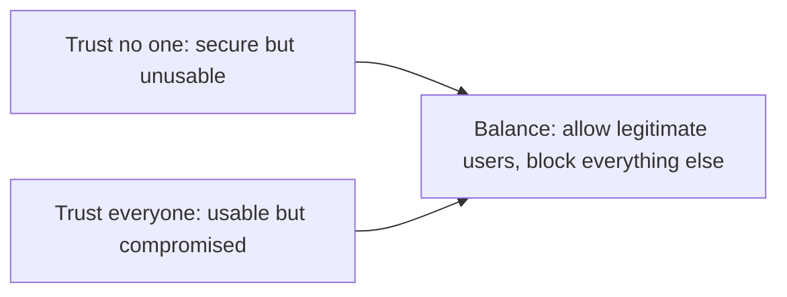
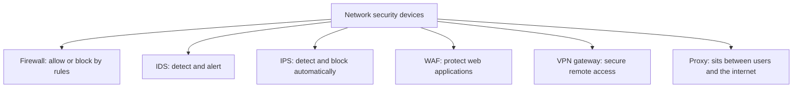
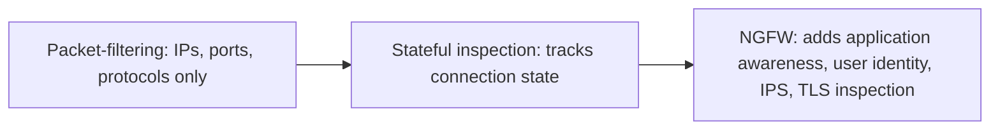
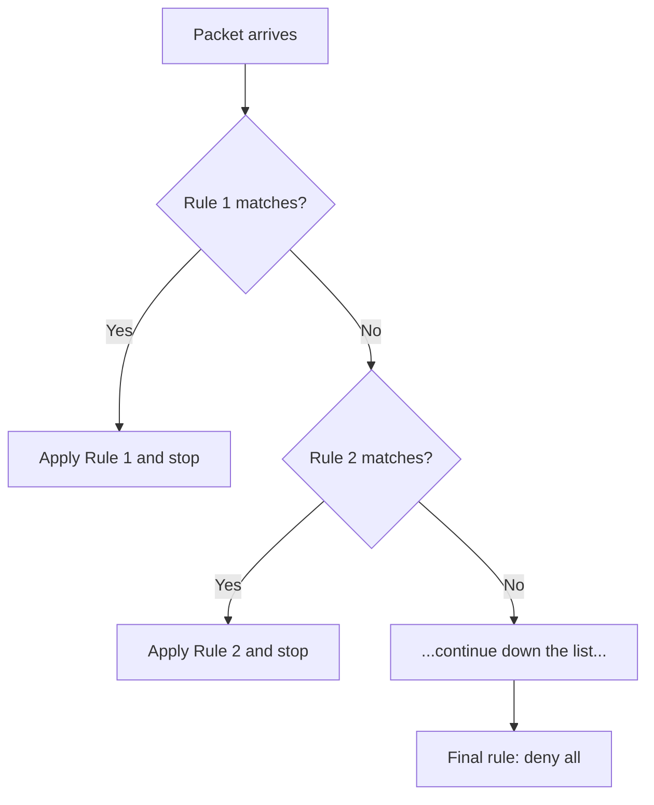
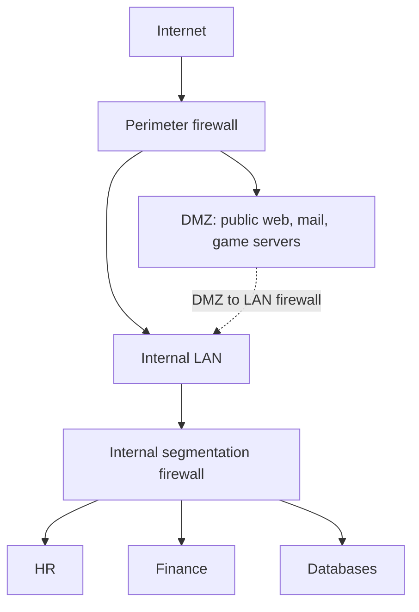
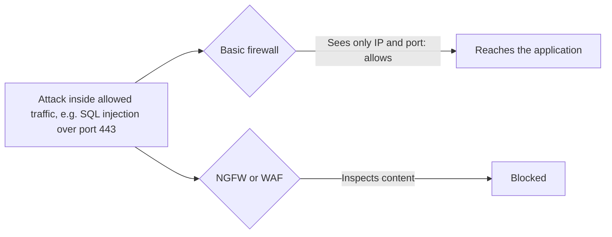

| Topic | Level | Reading Time | Prerequisites |
|---|---|---|---|
| Firewalls and Network Placement | Beginner | ~20 min | VLANs, Protocols, and Secure Topology Design |

> **The goal of this section:**  
> You'll understand why network security is always a balance between availability and restriction, what the main security devices are, how a firewall works and its three types, the five places a firewall is deployed, and what a firewall can and cannot do.

## Learning Objectives

By the end of this section, you will be able to:

- Explain the **balance between trust and restriction** that every network security device tries to strike.
- List the six main network security devices and the one-line role of each.
- Differentiate between **packet-filtering**, **stateful inspection**, and **next-generation (NGFW)** firewalls.
- Explain **default deny** and why **rule order** matters.
- Describe the five firewall locations and the purpose of each, including the **DMZ**.
- List the benefits and the shortcomings of a firewall, including what it cannot stop.

## Table of Contents

- [Learning Objectives](#learning-objectives)
- [The Balance Between Trust and Restriction](#the-balance-between-trust-and-restriction)
- [The Main Network Security Devices](#the-main-network-security-devices)
- [Firewalls: How They Work](#firewalls-how-they-work)
  - [The Core Idea](#the-core-idea)
  - [Three Firewall Types](#three-firewall-types)
  - [Default Deny and Rule Order](#default-deny-and-rule-order)
- [Firewall Placement](#firewall-placement)
  - [Perimeter Firewall](#perimeter-firewall)
  - [DMZ Firewall](#dmz-firewall)
  - [Internal Segmentation Firewall](#internal-segmentation-firewall)
  - [Firewall Locations at a Glance](#firewall-locations-at-a-glance)
- [Firewall Benefits Versus Shortcomings](#firewall-benefits-versus-shortcomings)
- [Career Path Connections](#career-path-connections)
- [Key Terms Glossary](#key-terms-glossary)
- [Summary](#summary)

## The Balance Between Trust and Restriction

Businesses **need to be available to grow**: shopping sites, banking portals, game servers.

**The shop analogy:** a shop displays its goods so customers can buy, but **unprotected goods get stolen**.

| Approach | Result |
|---|---|
| **Trust no one** | Secure, but **not usable** |
| **Trust everyone** | Usable, but **compromised** |

Network security devices let legitimate users in and protect systems from unauthorized access and attacks. **Security is about finding the right balance.**

> [!NOTE]
> This is the same tension behind Zero Trust, covered in the Zero Trust Model file: instead of choosing between trusting everyone inside and trusting no one, every request is verified based on identity, device health, and context.

## The Main Network Security Devices

| Device | Role |
|---|---|
| **Firewall** | **The most important device.** Monitors incoming and outgoing traffic and allows or blocks it based on rules |
| **IDS** (Intrusion Detection System) | Detects attacks and suspicious activity and raises **alerts** |
| **IPS** (Intrusion Prevention System) | Works like an IDS but **can block attacks automatically** |
| **WAF** (Web Application Firewall) | Protects websites and web applications **specifically** |
| **VPN gateway** | Lets remote users connect to the network securely through encryption |
| **Proxy** | Sits between users and the internet |

> [!TIP]
> The only difference between an IDS and an IPS is the reaction. An IDS tells you an attack happened, while an IPS can stop it in the moment, which is why an IPS is placed in-line with the traffic and an IDS can sit off to the side on a copy of it.

## Firewalls: How They Work

### The Core Idea

At its core, a firewall is **a routing device that inspects traffic and applies a rule set** to allow or deny it.

### Three Firewall Types

| Type | What It Does |
|---|---|
| **Packet-filtering** | Inspects IPs, ports, and protocols **only** (fast and basic) |
| **Stateful inspection** | Tracks the **connection state**, so it knows whether a packet belongs to an **existing, legitimate** session |
| **Next-Generation (NGFW)** | Adds **application awareness**, user identity, intrusion prevention (IPS), and TLS inspection |

> [!NOTE]
> The perimeter firewall described in Defense in Depth Model works at Layers 3 and 4, which matches the first two types. An NGFW is what reaches higher up the stack, which is why it can catch some things a basic firewall cannot, as the shortcomings section below explains.

### Default Deny and Rule Order

**Best practice:** a **default-deny** policy, meaning **anything not explicitly allowed is blocked.**

**Rule order matters**, because firewalls usually **apply the first rule that matches the connection.**

> [!WARNING]
> Because the first matching rule wins, a broad allow rule placed above a specific deny rule silently cancels the deny. The same ordering rule appears in the traffic policy matrix in VLANs, Protocols, and Secure Topology Design: specific rules first, default deny last.

## Firewall Placement

### Perimeter Firewall

It sits **between the internet and the internal network**, and it is **the most common placement**. It blocks attackers from the internet, lets users reach the internet, and controls incoming and outgoing traffic.

### DMZ Firewall

Public servers (web, mail, and game) **are not placed inside the internal network**. **Why a DMZ?** If a public server gets hacked, **the attacker still can't reach the internal network.**

### Internal Segmentation Firewall

It separates departments, for example **HR can't reach the Finance servers**, and users **can't reach the databases directly**. **It limits lateral movement** if an attacker gets in.

### Firewall Locations at a Glance

| Firewall Location | Purpose |
|---|---|
| Internet ↔ LAN | Protect the internal network |
| Internet ↔ DMZ | Protect the public servers |
| DMZ ↔ LAN | Protect the internal network from compromised servers |
| Inside LAN | Network segmentation |
| User ↔ Server | Protect critical servers |

> [!NOTE]
> This table is the same design logic as the secure topology exercise in VLANs, Protocols, and Secure Topology Design: a perimeter router and firewall at the edge, a DMZ for public services, and separate VLANs with rules between them. That file also introduces east-west traffic, which is exactly what the internal segmentation firewall controls.

## Firewall Benefits Versus Shortcomings

| Benefits | Shortcomings |
|---|---|
| Controls traffic at the network boundary and enforces policy centrally | **Can't stop attacks that travel inside allowed traffic** (such as SQL injection on port 443) unless it is an **NGFW** or paired with a **WAF** |
| Blocks unauthorized access and reduces the attack surface | **Can't see inside encrypted traffic** without TLS inspection |
| Provides logging and visibility into connections | **Can't stop insider threats** or users tricked by phishing |
| Enables segmentation | **A wrong rule** (such as any-any) **silently removes the protection** |
| | Needs **periodic rule reviews**, because old rules pile up and create risk |

> [!IMPORTANT]
> A firewall will happily allow port 443, and a WAF is what inspects what travels inside it. This is the exact layer distinction explained in the WAF file: the two are complementary, not interchangeable, and a missing WAF leaves a gap a perfect firewall configuration cannot close.

> [!TIP]
> For the full picture of how firewalls, IDS/IPS, proxies, WAF, SIEM, DLP, and NAC stack together, see Defense in Depth Model. This file and the next two cover the devices themselves; that file covers why they are layered.

## Career Path Connections

| Career Path | How This Topic Applies |
|---|---|
| SOC Analyst | Reads firewall logs and recognizes allow/deny patterns, as covered in Network and Authentication Logs |
| Penetration Tester | Tests whether firewall rules, DMZ isolation, and segmentation actually hold, including any-any style misconfigurations |
| GRC | Requires periodic firewall rule reviews and documented change control as an auditable control |
| Cloud Security | Cloud security groups and network ACLs are the cloud equivalent of firewall rules and follow the same default-deny logic |

## Key Terms Glossary

| Term | Definition |
|---|---|
| Firewall | A device that monitors traffic and allows or blocks it based on rules |
| IDS | Intrusion Detection System, detects attacks and raises alerts |
| IPS | Intrusion Prevention System, detects attacks and can block them automatically |
| VPN Gateway | A device that lets remote users connect securely through encryption |
| Packet-Filtering Firewall | A firewall checking only IPs, ports, and protocols |
| Stateful Inspection | Tracking connection state to know whether a packet belongs to a legitimate session |
| NGFW | Next-Generation Firewall, adding application awareness, user identity, IPS, and TLS inspection |
| Default Deny | A policy blocking everything not explicitly allowed |
| DMZ | A separate segment for public-facing servers, isolated from the internal network |
| Internal Segmentation Firewall | A firewall separating internal departments to limit lateral movement |
| Any-Any Rule | A rule allowing all sources to all destinations, silently removing protection |

## Summary

- **Network security is a balance:** trust no one and it becomes unusable, trust everyone and it becomes compromised.
- **Six main devices exist:** firewall, IDS, IPS, WAF, VPN gateway, and proxy.
- **Three firewall types build on each other:** packet-filtering, stateful inspection, and NGFW.
- **Default deny with correct rule order is the baseline practice:** the first matching rule is the one that applies.
- **Five placements serve five purposes:** perimeter, DMZ, DMZ-to-LAN, internal segmentation, and user-to-server.
- **A DMZ means a hacked public server still cannot reach the internal network.**
- **A firewall cannot see inside allowed or encrypted traffic, or stop phishing and insiders:** which is exactly why the WAF, TLS inspection, and training complement it.
- **Old rules accumulate into risk:** they need periodic review.
