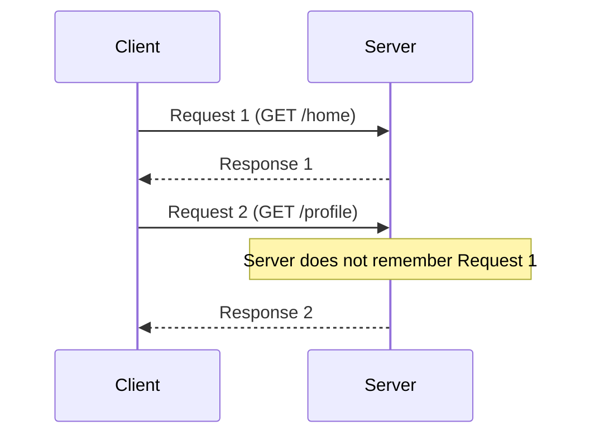
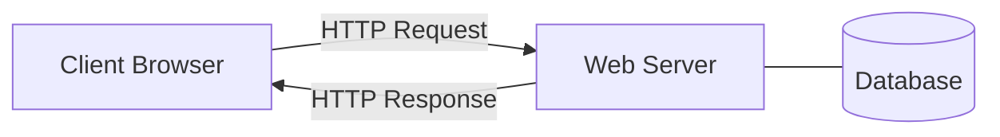
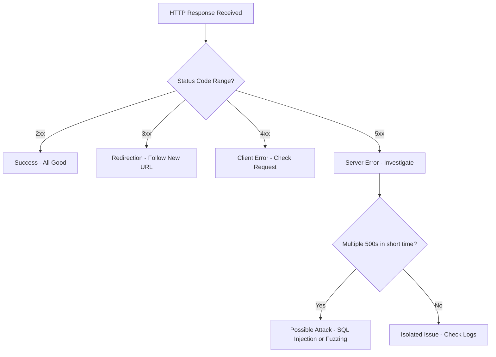
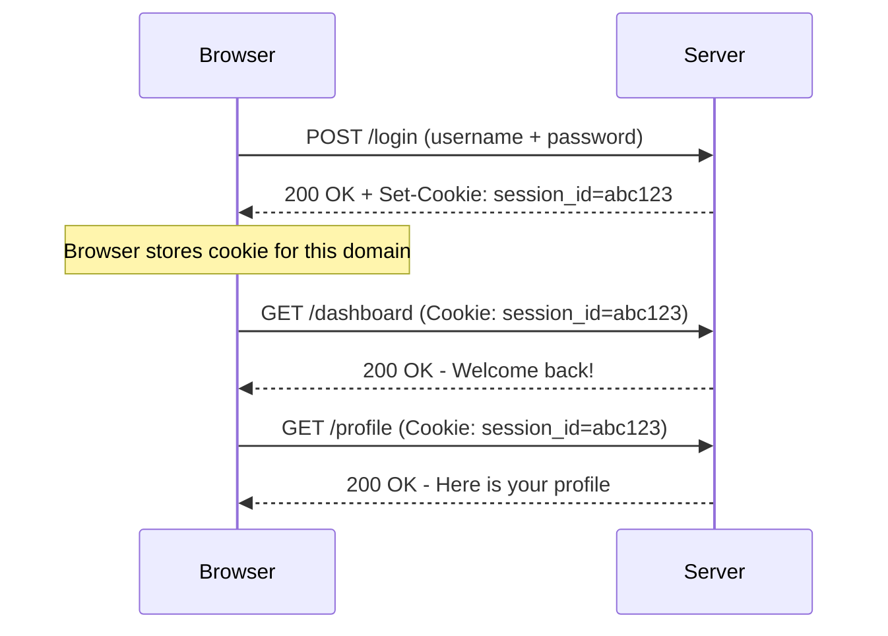
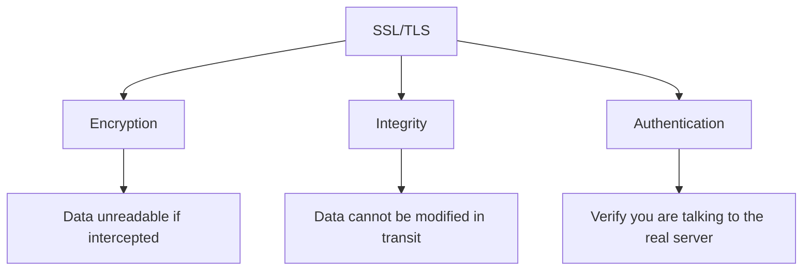
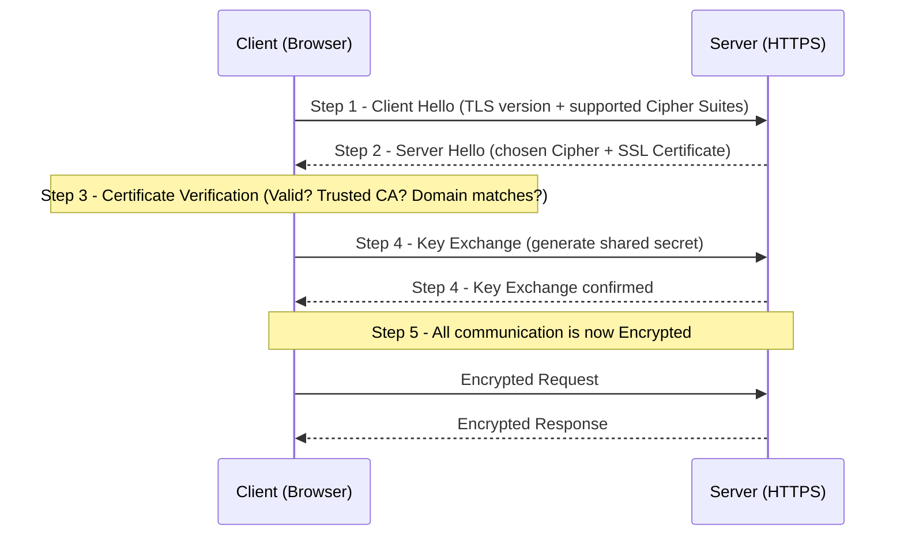

> **Goal of this section:**
> You'll understand how Web Communication works from the ground up, what HTTP is and how the different Requests differ, how Cookies work and why they get attacked, and how SSL/TLS protects the data that travels across the internet — all of which is essential for any SOC Analyst who needs to monitor Web Attacks.

---


## Table of Contents

- [Web Communication](#web-communication)
- [HTTP Requests](#http-requests)
  - [GET](#get)
  - [POST](#post)
  - [PUT](#put)
  - [PATCH](#patch)
  - [DELETE](#delete)
  - [HEAD](#head)
  - [OPTIONS](#options)
- [HTTP Responses and Status Codes](#http-responses-and-status-codes)
- [Cookies](#4-cookies)
  - [How Cookies Work](#how-cookies-work)
  - [Persistent vs Non-Persistent Cookies](#persistent-vs-non-persistent-cookies)
- [SSL/TLS](#5-ssltls)
  - [TLS Handshake](#tls-handshake)
- [Summary](#summary)

---

## Web Communication

All Web Communication is built on a protocol called **HTTP (HyperText Transfer Protocol)**, the protocol that governs the Requests and Responses exchanged between the Client (the browser) and the Web Server.

### HTTP is Stateless

One of the most important things you need to understand: HTTP is a **Stateless** protocol. What does that mean?

> **Stateless** = every Request that reaches the Server is completely independent of the one before it. The Server doesn't remember who you are.

So if you send a Request and get a response, and then send another Request, the Server won't know that both came from you — it's like talking to someone and having to introduce yourself from scratch every time you speak to them.

### Why Does This Matter?

Because websites usually need to "remember" the user — for example:

- **Logged-in users**: if you log in, the site should keep knowing that you're logged in.
- **Shopping carts**: if you add something to the cart, it should stay there.
- **User sessions**: so the Session keeps working.

To solve this Stateless problem, mechanisms like **Cookies** and **Sessions** were created — and we'll explain them in detail.



> [!NOTE]
> HTTP being Stateless isn't a flaw — it's a deliberate design choice that keeps the protocol simple and fast. State Management is handled in other ways, such as Cookies and Sessions.

---

## HTTP Requests

An **HTTP Request** is the message the Client (the browser) sends to the Server to request a specific resource or perform a specific action.

Every Request contains:
- **Method**: the type of Request (GET, POST, PUT, etc.).
- **URL**: the Resource being requested.
- **Headers**: additional information about the Request.
- **Body** (optional): the data sent along with the Request.



---

### GET

**GET** is the most common and simplest Method — the browser uses it when it requests a page or a resource.

**Used for:**
- Opening a web page.
- Fetching images or files.
- Retrieving data from an API.

**Example:**
```
GET /products?id=42 HTTP/1.1
Host: shop.example.com
```

> [!WARNING]
> With GET, the Parameters appear plainly in the URL — for example `/search?q=test`. This lets the attacker modify them easily and attempt attacks like **SQL Injection** or **Parameter Tampering**.

---

### POST

**POST** is used to send data to the Server.

**Used for:**
- Login Forms.
- Uploading files (File Upload).
- Any operation where the Client sends Data.

**Example:**
```
POST /login HTTP/1.1
Host: example.com
Content-Type: application/x-www-form-urlencoded

username=amr&password=secret123
```

> [!WARNING]
> POST is the Method most often used in attacks like **SQL Injection** and **Command Injection**, because it has a Body sent to the Server that may contain Malicious Input.

---

### PUT

**PUT** is used to create or **replace** an entire Resource on the Server.

**Example:** you want to replace all the data of the User whose ID is 10:

```
PUT /api/users/10 HTTP/1.1
Host: api.example.com
Content-Type: application/json

{
  "name": "Amr",
  "email": "amr@example.com",
  "role": "admin"
}
```

> [!IMPORTANT]
> PUT replaces the **entire** Resource — not just part of it. If you send a Request with missing fields, those fields will be set to null or removed.

---

### PATCH

**PATCH** is used to update only **part** of a Resource — not all of it.

| Method | Use |
|--------|-----------|
| PUT    | Replace the entire Resource |
| PATCH  | Update only part of the Resource |

**Example:**
```
PATCH /api/users/10 HTTP/1.1
Content-Type: application/json

{
  "email": "newemail@example.com"
}
```

---

### DELETE

**DELETE** is used to delete a Resource from the Server.

**Example:**
```
DELETE /api/users/10 HTTP/1.1
Host: api.example.com
```

> [!WARNING]
> DELETE is very dangerous if it isn't properly protected — if there's no proper **Authentication** and **Authorization** on this Endpoint, anyone could delete data that isn't theirs.

---

### HEAD

**HEAD** is exactly like GET, except the Server responds with **Headers only** — without the Body.

**Used for:**
- Checking whether a Resource exists without downloading it.
- Inspecting Metadata (file size, type, last modified).

```
HEAD /large-file.zip HTTP/1.1
Host: downloads.example.com
```

---

### OPTIONS

**OPTIONS** is used to find out which Methods the Server allows on a specific Endpoint.

**Example Response:**
```
Allow: GET, POST, PUT, DELETE
```

> [!TIP]
> **SOC Analyst Tip:** You need to understand the HTTP Methods used by your company's Web Application — and build **Detection Rules** for any unexpected Method.
>
> A practical example: if the company's website doesn't let users edit their data online and requires them to visit a branch instead, then any `PUT` Request hitting that API is suspicious and needs investigation.

---

## HTTP Responses and Status Codes

After the Server receives the Request, it replies with an **HTTP Response** that contains:

```
HTTP/1.1 200 OK
Content-Type: text/html
Content-Length: 3456

<html>...</html>
```

The Response has 3 main parts:
1. **Status Line**: contains the HTTP version and the Status Code.
2. **Headers**: additional information about the Response.
3. **Body**: the actual content (the page, the data, etc.).

### HTTP Status Codes

| Range | Meaning | Examples |
|-------|--------|-------|
| **1xx** | Informational | Rarely used |
| **2xx** | Success | 200 OK, 201 Created, 204 No Content |
| **3xx** | Redirection | 301 Moved Permanently |
| **4xx** | Client Errors | 400, 401, 403, 404 |
| **5xx** | Server Errors | 500, 502, 503 |

### 4xx Errors in Detail

| Code | Name | Meaning |
|------|-------|--------|
| **400** | Bad Request | The Request is wrong or Malformed — the Server can't understand it |
| **401** | Unauthorized | You need to Authenticate first |
| **403** | Forbidden | You're authenticated, but you don't have Permission |
| **404** | Not Found | The Resource doesn't exist |

### 5xx Errors in Detail

| Code | Name | Meaning |
|------|-------|--------|
| **500** | Internal Server Error | An error occurred on the Server — it doesn't know exactly what |
| **502** | Bad Gateway | The Server, acting as a Proxy, received an invalid Response from the Upstream Server |
| **503** | Service Unavailable | The Server is running but can't respond right now (Overload / Maintenance) |

> [!IMPORTANT]
> **SOC Analyst Tip:** A lot of repeated 500 Errors can be a sign of an attack — the attacker sends **Unexpected Input** to break the Application (Fuzzing), or **SQL Injection** and **Command Injection** attempts cause the Server to crash. If you see a spike in 500 errors, start investigating immediately.



---

## Cookies

### Why Do We Need Cookies?

We said HTTP is **Stateless** — every Request is independent. The problem is that many websites need to remember the user:

- If you log in, the Server should know you're logged in on every page.
- The Shopping Cart needs to remember the products you've added.

**The old (broken) solution:**
In the beginning, developers used to put the State in the URL itself:
```
http://www.shop.example.com/cart?acctno=182727&item1=12877&item2=92762
```

The problem with this was that the URL became very long and insecure.

**The right solution: Cookies**

A **Cookie** is a small piece of data that the Server sends to the browser; the browser stores it and sends it back with every Request to the same Domain.

---

### How Cookies Work



**The steps in order:**
1. The **Client** sends a Login Request.
2. The **Server** responds with `Set-Cookie: session_id=abc123` in the Response Header.
3. The **Browser** saves the Cookie in Cookie Storage.
4. With every subsequent Request to the same Domain, the Browser sends the Cookie automatically: `Cookie: session_id=abc123`.
5. The **Server** identifies the User from the Session ID.

> [!WARNING]
> **Session Hijacking:** If an attacker manages to steal the Victim's `session_id` (through XSS or Sniffing), they can send Requests to the Server with the same Cookie — and the Server will think it's the original User! This is called **Cookie Theft**, and its goal is **Impersonating the User**.

---

### Persistent vs Non-Persistent Cookies

| Property | Persistent Cookies | Non-Persistent (Session) Cookies |
|---------|-------------------|----------------------------------|
| **Storage location** | Hard Drive | Memory (RAM) |
| **Survives closing the browser?** | Yes | No |
| **Survives a restart?** | Yes | No |
| **Lifetime** | Long (days / months / years) | Short (the length of the Session) |
| **Use** | Remembering the user, tracking activity | Temporary data for the current Session |
| **Privacy concerns** | High | Lower |
| **Authentication** | No need to log in every time | You may need to re-authenticate |

> [!NOTE]
> The "Remember Me" option on Login pages usually uses a **Persistent Cookie** — so you stay logged in even if you close the browser and open it again.

---

## SSL/TLS

### What Is SSL/TLS?

- **SSL (Secure Sockets Layer)**: the older protocol — officially discontinued.
- **TLS (Transport Layer Security)**: the modern version, in use today.

Both are **Cryptographic Protocols** whose purpose is to secure the connection between the Client and the Server.

### Without SSL/TLS

Without encryption, anyone doing **Packet Sniffing** on the network will be able to read:
- Passwords.
- Cookies (and therefore perform Session Hijacking).
- Credit Card data.
- Any other data being transmitted.

---

### The 3 Main Functions of SSL/TLS

People usually think SSL does only one thing (encryption) — but in reality it does **3 things**:



| Function | Explanation |
|---------|-------|
| **Encryption** | Data is encrypted and becomes unreadable if intercepted |
| **Integrity** | Ensures the data hasn't been modified in transit |
| **Authentication** | Ensures you're talking to the real server — not someone performing Impersonation |

> [!IMPORTANT]
> **Authentication** in TLS works through the **SSL Certificate** — the Domain written in the Certificate must match the Domain in the Browser exactly. If it doesn't match, you'll see: **"Your connection is not private"**.

---

### TLS Handshake

When the Client connects to a Secure Website (HTTPS), a process called the **TLS Handshake** takes place:



**The steps explained:**

| Step | Name | What Happens |
|--------|-------|----------------|
| **1** | Client Hello | The Client says: "I support TLS 1.3, and these are my Cipher Suites" |
| **2** | Server Hello | The Server replies: "I chose this Cipher, and this is my SSL Certificate" |
| **3** | Certificate Verification | The Browser checks: Is the Certificate valid? Is it signed by a trusted CA? Does the Domain match? |
| **4** | Key Exchange | Both sides agree on a **Shared Secret Key** to use for Symmetric Encryption |
| **5** | Secure Communication | All communication from now on is **encrypted** |

> [!NOTE]
> After the Handshake, the Encryption is **Symmetric** — meaning both sides (Client and Server) use the same Key. The reason: Symmetric Encryption is much faster than the Asymmetric Encryption used in the Certificate itself.

> [!TIP]
> The difference between **HTTP** and **HTTPS**: the S in HTTPS means the connection runs over TLS. If your URL starts with `https://`, all the data is encrypted — including Cookies and Passwords.

---

## Summary

### Key Takeaways from This Section:

- **HTTP** is the core protocol of Web Communication, and it's **Stateless** — meaning the Server doesn't remember previous Requests, which is why we need mechanisms like Cookies.

- The different **HTTP Methods** have specific uses:
  - `GET` → fetch data (the Parameters are visible in the URL — a risk).
  - `POST` → send data (Login, Forms — a target for Injection).
  - `PUT` → replace an entire Resource.
  - `PATCH` → modify part of a Resource.
  - `DELETE` → delete a Resource (dangerous if not protected by Auth).
  - `HEAD` → Headers only, without a Body.
  - `OPTIONS` → find out which Methods are available on the Endpoint.

- **HTTP Status Codes** indicate the state of the Response:
  - **4xx** = a problem on the Client side (401 not logged in, 403 no Permission).
  - **5xx** = a problem on the Server — and many of them can be a sign of an attack.

- **Cookies** are the solution to the Stateless problem — sent from the Server to the Browser and stored there, then sent automatically with every Request.
  - **Session Hijacking** = stealing the Cookie = hijacking the User's identity.
  - **Persistent Cookies** are stored on the Disk and survive closing the browser.
  - **Non-Persistent (Session) Cookies** are removed when the browser is closed.

- **SSL/TLS** provides 3 core things: **Encryption** + **Integrity** + **Authentication**.

- The **TLS Handshake** is the process that happens before any HTTPS connection — in it, the Client and the Server agree on the Encryption and verify each other — and after that, all communication is Symmetric Encrypted.

> [!IMPORTANT]
> **As a SOC Analyst**: You need to understand the Normal Behavior of the Web Applications you monitor — the Methods used, the normal Status Codes, and the Cookie patterns. Anything out of the ordinary (lots of 500 errors, unexpected PUT requests, etc.) could be a sign of an attack that needs investigation.
****
