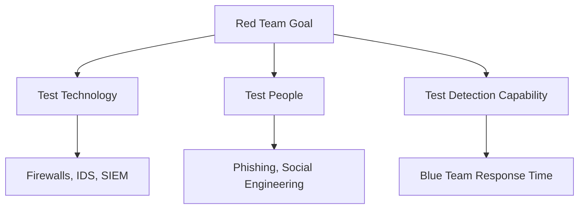
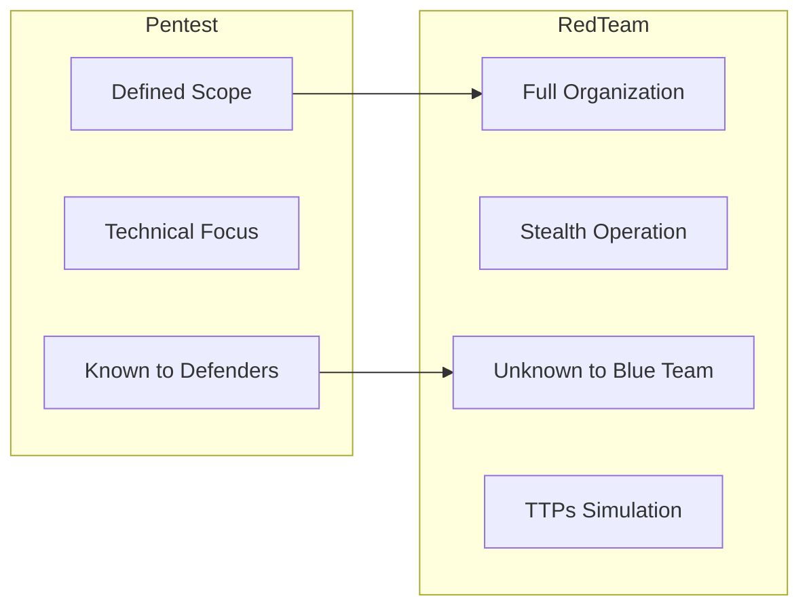
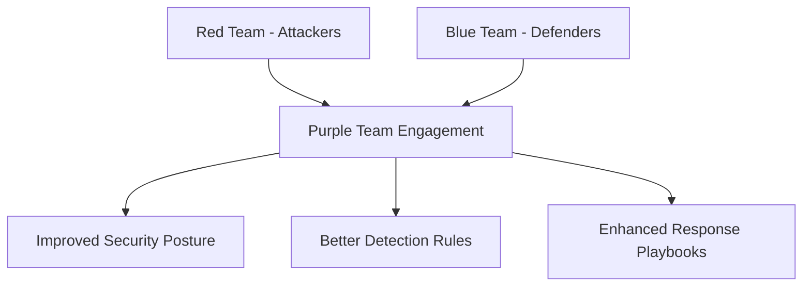
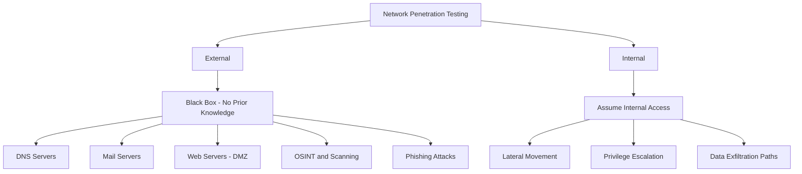
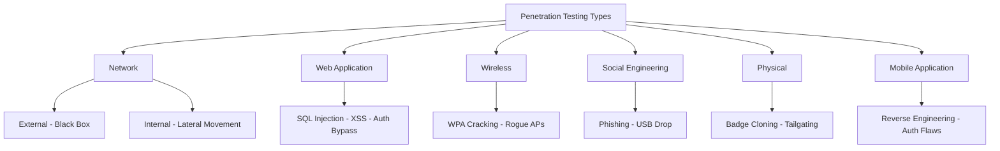
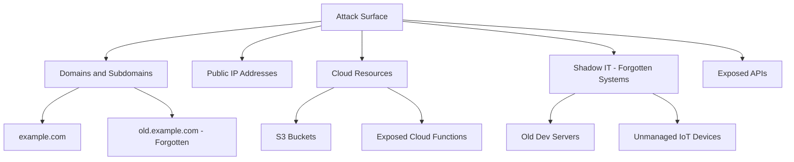
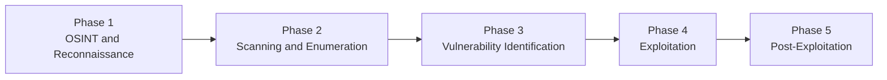
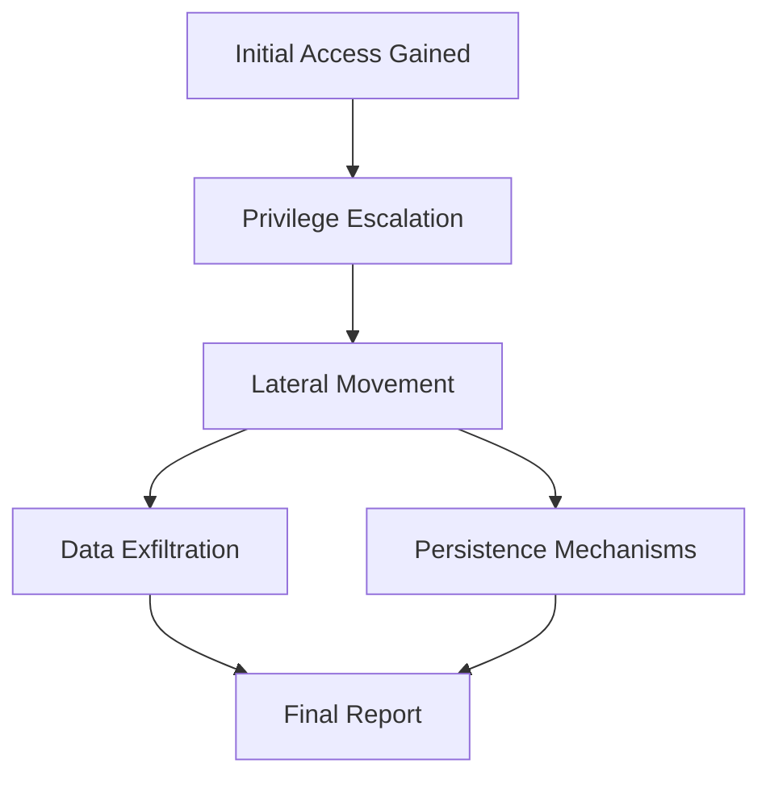

> **Goal of this section:**
> You'll understand what Penetration Testing means and how it differs from a Vulnerability Assessment, learn the difference between the Red Team, the Blue Team, and the Purple Team, the different types of pentesting, and how a pentest is carried out from the first step to the last — all from the perspective of a SOC Analyst and Security Professional.

---


## Table of Contents

- [What is Penetration Testing?](#what-is-penetration-testing)
- [Vulnerability Assessment vs Penetration Testing](#vulnerability-assessment-vs-penetration-testing)
- [Red Teaming](#red-teaming)
- [Red Teaming vs Penetration Testing](#red-teaming-vs-penetration-testing)
- [Purple Team](#purple-team)
- [Types of Penetration Testing](#types-of-penetration-testing)
- [Attack Surface Management (ASM)](#attack-surface-management-asm)
- [Penetration Testing Phases](#penetration-testing-phases)
- [Summary](#summary)

---

## What is Penetration Testing?

**Penetration Testing** (or **Pentest** for short) is a simulated, formally authorized cyberattack carried out against a system, network, application, or an entire organization — its goal is to find the vulnerabilities before a real attacker does.

### The Core Idea

Thinking and acting **the same way an attacker does** to discover weaknesses and show:
- How the vulnerability could be abused.
- What the **Impact** would be if the exploit happened.
- How to meet **Compliance Requirements**.

> [!IMPORTANT]
> A pentest doesn't just spot the vulnerability — it tries to **actually exploit it**. That's the fundamental difference between it and a vulnerability scanner.

```
Normal Vulnerability Scan:
"Port 445 is open" → Report

Penetration Test:
"Port 445 is open" → Try to exploit SMB → Gain Access → Escalate Privileges → Move Laterally → Full Report
```

---

## Vulnerability Assessment vs Penetration Testing

A **Vulnerability Assessment** (or vulnerability scanner) is a tool that tells you "what problems exist" — but it **doesn't try to exploit them**.

A **Penetration Tester** takes that same information and does something completely different with it:

| Step | Vulnerability Assessment | Penetration Testing |
|--------|--------------------------|---------------------|
| Discovering the problem | ✅ Yes | ✅ Yes |
| Attempting the exploit | ❌ No | ✅ Yes |
| Gaining access to the system | ❌ No | ✅ Yes |
| Escalating privileges | ❌ No | ✅ Yes |
| Moving within the network | ❌ No | ✅ Yes |

**A practical example:**
If the scanner finds that **Port 445** is open:
- The vulnerability scanner will say: "SMB port open — potential risk"
- The pentester will try: Exploit SMB → Gain Access → Escalate Privileges → Lateral Movement

> [!NOTE]
> In real business environments, both (Assessment + Pentest) are ultimately delivered as a detailed **Report** explaining the findings and recommendations.

---

## Red Teaming

**Red Teaming** is a full simulation of a real attacker (Adversary Simulation) — much broader and deeper than a regular pentest.

### What Does the Red Team Do?

It emulates the **TTPs** (Tactics, Techniques, and Procedures) of real attackers — the same ones we saw in the **MITRE ATT&CK Framework**.



### The Most Important Feature of Red Teaming

> [!IMPORTANT]
> The Red Team carries out the same TTPs as real attackers **on real, running infrastructure (Live Production)** — and the **Blue Team doesn't know** that an exercise is taking place. That's what makes the test realistic and useful.

---

## Red Teaming vs Penetration Testing

### Penetration Testing — Goal and Scope

- **Goal:** find the technical vulnerabilities before real attackers do.
- **Scope:** limited and agreed upon (for example: only a web app, or only the internal network).
- **The security team** usually **knows** that a pentest is being carried out.

**Example:**
A bank hired pentesters to test its online banking application. The pentesters found:
- **SQL Injection**
- **Broken Authentication**
- **Misconfigurations**

All of this was documented in a **Technical Report** with remediation steps.

---

### Red Teaming — Goal and Scope

- **Goal:** test the organization's overall security posture (technology + people + detection capability).
- **Scope:** much broader — it can cover the whole company.
- **The Blue Team** usually **doesn't know** an exercise is happening.

**Example:** the Red Team might send **Phishing Emails** to employees to test:
1. How aware the employees are.
2. How well the security tools detect the phishing.
3. How fast the Blue Team responds if they detect it.

---

### Full Comparison

| Aspect | Penetration Testing | Red Teaming |
|--------|---------------------|-------------|
| **Goal** | Finding vulnerabilities | Simulating a real attacker |
| **Scope** | Specific systems | The whole organization |
| **Duration** | Days to weeks | Weeks to months |
| **Focus** | Technical flaws | Detection and response |
| **Does the security team know?** | Usually yes | Usually no |
| **Methods** | Exploitation | Social Engineering, Phishing, Lateral Movement |



---

## Purple Team

The **Purple Team** is the joint collaboration between the **Red Team** and the **Blue Team** to improve security as a whole.



### How It Differs from Regular Red Teaming

| | Red Team Exercise | Purple Team Engagement |
|--|------------------|------------------------|
| **Does the Blue Team know?** | No (Blind) | Yes (Fully Known) |
| **Collaboration** | Separate | Working together |
| **Main Goal** | Testing detection | Improving detection and response together |

> [!TIP]
> The Purple Team is ideal when the organization wants to improve its detection rules in the SIEM or develop its playbooks — because Red and Blue are working together directly.

---

## Types of Penetration Testing

### 1. Network Penetration Testing

Network pentesting is divided into two main types:



#### External Network Penetration Testing

- The target is treated as a **Black Box** — the pentester has no prior information.
- It simulates exactly how a real attacker would see the organization from the outside.
- It targets internet-facing systems: **DNS, Mail, Web Servers**.
- It may include **Phishing Attacks** as a means of gaining access.
- It relies heavily on **OSINT** and **Scanning**.

#### Internal Network Penetration Testing

- It simulates a scenario in which the attacker **already has internal access** — whether an insider employee or someone who bought initial access on the dark web.
- The goal: find out what the attacker can do once inside, and how they can move laterally.

**What a Network Pentest covers:**

| Component | Reason |
|--------|--------|
| **Firewalls** | Are the rules configured correctly? |
| **Routers** | Are there any misconfigurations? |
| **VPN** | Are the encryption and authentication secure? |
| **DMZ Servers** | Are the exposed systems protected well enough? |

---

### 2. Web Application Penetration Testing

It focuses specifically on web applications and databases.

**The most commonly tested vulnerabilities:**

| Vulnerability | Description |
|-------------------|-------|
| **SQL Injection** | Injecting SQL code into input fields |
| **Cross-Site Scripting (XSS)** | Executing JavaScript in the user's browser |
| **Authentication Bypass** | Getting past the login without valid credentials |
| **File Upload Vulnerabilities** | Uploading malicious files to the server |
| **Session Hijacking** | Stealing the session token after login |

> [!WARNING]
> A web app pentest doesn't just check whether there's a SQL injection — it actually tries to exploit it to find out the real impact.

---

### 3. Wireless Penetration Testing

It focuses on the security of Wi-Fi networks.

**What it tests:**
- **Weak Encryption** — is the encryption weak?
- **Rogue Access Points** — are there fake access points?
- **WPA Cracking** — can the WPA password be cracked?

---

### 4. Social Engineering Testing

It targets human weaknesses, not technical ones.

**Methods:**
- **Phishing Emails** — fake emails
- **USB Drop Attacks** — fake USB drives containing malware left around the company

> [!NOTE]
> Social engineering testing is an important part of red teaming — because most real attacks start with human error, not a technical vulnerability.

---

### 5. Physical Penetration Testing

It tests the physical security of the building and assets.

**What it tests:**
- **Access Control Systems** — are the gates and locks secure?
- **Badge Cloning** — can the security badge be cloned?
- **Tailgating** — can someone walk in behind an employee without being noticed?

---

### 6. Mobile Application Testing

It tests iOS and Android applications.

**What it tests:**
- **Authentication Flaws** — vulnerabilities in the login
- **Reverse Engineering** — taking the app apart to understand its internal logic

---

### Pentesting Types Summary



---

## Attack Surface Management (ASM)

**Attack Surface Management** is a **continuous** process of discovering, monitoring, and securing every asset an attacker could reach.

### The Core Question of ASM

> **What assets does your organization expose to the internet that an attacker could see and target?**

### What Does the Attack Surface Include?



| Asset Type | Example | Risk |
|-----------|------|-------|
| **Domains/Subdomains** | `old.company.com` | May be old and not updated |
| **Public IP Addresses** | Internet-facing servers | Exploitable open ports |
| **Cloud Resources** | Unprotected S3 buckets | Data Exposure |
| **Shadow IT** | An old, forgotten dev server | No patches and no monitoring |

> [!IMPORTANT]
> The **Attack Surface** is the sum of all possible entry points an attacker can use to reach your system. The larger the attack surface, the greater the risk.

> [!TIP]
> ASM isn't done once — it's a **Continuous Process**, because infrastructure changes constantly: new subdomains get added, cloud resources get created, and developers set up shadow IT without the security team knowing.

---

## Penetration Testing Phases

A pentest follows methodical, ordered steps:



### Phase 1: OSINT and Reconnaissance

Collecting information about the target from open sources **without any direct interaction** with its systems.

**Tools and methods:**
- Searching Google, Shodan, and LinkedIn
- Collecting subdomains and email addresses
- Analyzing WHOIS and DNS records

> [!NOTE]
> Reconnaissance is the most important phase — every step that follows builds on the information collected here.

---

### Phase 2: Scanning and Enumeration

Interacting directly with the target to find out which systems are running and which services are available.

**Tools:**
```bash
# Network Scanning
nmap -sV -sC -p- target.com

# Enumerate web directories
gobuster dir -u http://target.com -w wordlist.txt

# Enumerate subdomains
subfinder -d target.com
```

---

### Phase 3: Vulnerability Identification

Identifying vulnerabilities in the systems and services we discovered in the previous phase.

**Tools:**
- **Nessus** or **OpenVAS** for vulnerability scanning
- Manually checking the CVEs associated with the exposed versions

---

### Phase 4: Exploitation

Attempting to exploit the identified vulnerabilities to prove that they are real and exploitable.

**Tools:**
```bash
# Metasploit Framework
msfconsole
use exploit/windows/smb/ms17_010_eternalblue
set RHOSTS target.com
run
```

> [!WARNING]
> Exploitation must have **formal, written permission** from the organization. Any exploit without permission = **a crime**.

---

### Phase 5: Post-Exploitation

Once inside the system, what does the attacker do?

**Goals:**
- **Privilege Escalation** — raising privileges
- **Lateral Movement** — moving to other systems
- **Data Exfiltration** — extracting sensitive data
- **Persistence** — maintaining access for longer



---

## Summary

### Key Points to Remember:

- **Penetration Testing** is a simulated, authorized attack whose goal is to find vulnerabilities before real attackers do — and the fundamental difference from a vulnerability scanner is that it tries to **actually exploit them**.

- A **Vulnerability Assessment** tells you "there's a problem"; a **Pentest** proves to you "this problem is serious and can be exploited like this."

- **Red Teaming** is broader than a pentest — it simulates a real attacker with the same TTPs, on real infrastructure, without the Blue Team knowing, and its scope covers the whole organization (technology + people + detection capability).

- **Purple Team** = Red + Blue working together to improve detection and response collaboratively.

- **Pentest types:** Network (External/Internal), Web Application, Wireless, Social Engineering, Physical, Mobile.

- **ASM** is a continuous process of knowing what your organization exposes to the internet — domains, IPs, cloud resources, Shadow IT.

- **Pentest phases:** OSINT → Scanning → Vulnerability ID → Exploitation → Post-Exploitation.

> [!IMPORTANT]
> As a SOC Analyst, understanding penetration testing methodology helps you understand **how the attacker thinks**, and therefore makes you better at detecting and preventing attacks.
