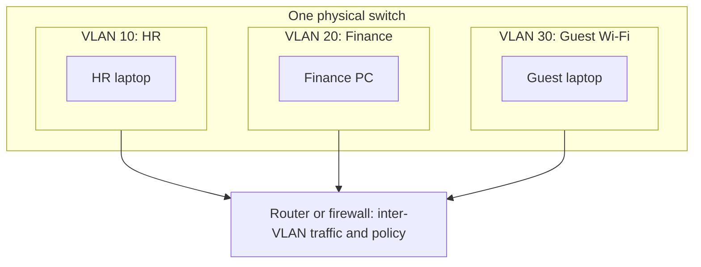
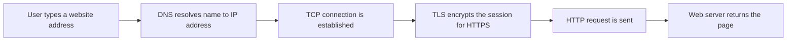
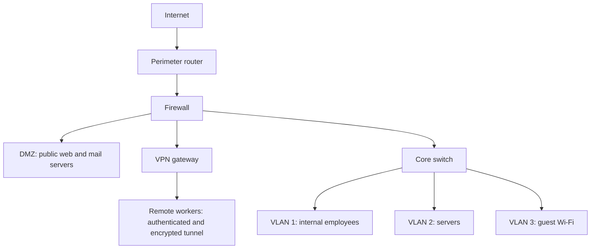
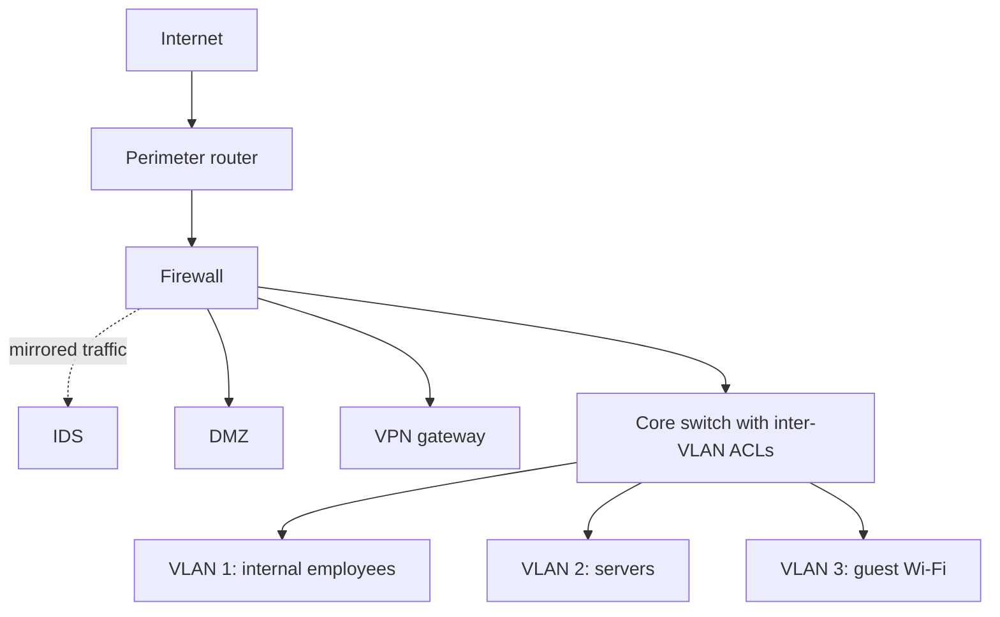

| Topic | Level | Reading Time | Prerequisites |
|---|---|---|---|
| VLANs, Protocols, and Secure Topology Design | Intermediate | ~25 min | Asset Awareness and Traffic Flow, Router and Switch Attacks |

> **Goal of this section:**
>  You'll understand what VLANs are and why they matter for security, review the core protocols, and be able to design a secure network for a small company from scratch.


## Learning Objectives

By the end of this section, you will be able to:

- Explain what a **VLAN** is and how it logically divides one physical network into isolated segments.
- Describe how VLANs limit **lateral movement** and why they are not a complete security control on their own.
- Explain what a network **protocol** is and map common protocols to their OSI layers.
- Identify the trust level and security requirement of each zone in a small company network.
- Design and justify a secure topology that uses a perimeter router, firewall, DMZ, VPN gateway, and separate VLANs.

## Table of Contents

- [Learning Objectives](#learning-objectives)
- [Virtual LANs and Network Segmentation](#virtual-lans-and-network-segmentation)
  - [What a VLAN Is](#what-a-vlan-is)
  - [Example of Segmentation](#example-of-segmentation)
  - [Configuring VLANs](#configuring-vlans)
- [VLANs and Security](#vlans-and-security)
  - [Limiting Lateral Movement](#limiting-lateral-movement)
  - [Different Policies for Different Teams](#different-policies-for-different-teams)
  - [VLAN Hopping](#vlan-hopping)
  - [Hardening VLANs](#hardening-vlans)
- [Network Protocols](#network-protocols)
  - [What Is a Network Protocol](#what-is-a-network-protocol)
  - [Protocols Working Together](#protocols-working-together)
  - [Protocols and the OSI Model](#protocols-and-the-osi-model)
  - [Common Protocols and Their Security Considerations](#common-protocols-and-their-security-considerations)
- [Secure Topology Design Exercise](#secure-topology-design-exercise)
  - [The Scenario](#the-scenario)
  - [Core Design Rules](#core-design-rules)
  - [Placing the Devices](#placing-the-devices)
  - [Simplified Topology Diagram](#simplified-topology-diagram)
  - [Traffic Policy Between Zones](#traffic-policy-between-zones)
  - [Going Beyond the Basic Design](#going-beyond-the-basic-design)
- [Career Path Connections](#career-path-connections)
- [Key Terms Glossary](#key-terms-glossary)
- [Summary](#summary)


## Virtual LANs and Network Segmentation

### What a VLAN Is

A **VLAN (Virtual LAN)** lets you divide a single physical network into multiple logical segments that are isolated from each other, even if all the devices are connected to **the same physical switch**.

Devices in one VLAN **cannot communicate directly** with devices in another VLAN unless the traffic is explicitly routed between them.

Analogy: imagine a single building that houses many companies. They all share the same building (the switch), but each company has its own locked floor that nobody from another company can enter without authorization (the routing and the firewall).

> [!NOTE]
> VLANs are typically created by network administrators for network management purposes, not primarily as a security measure. They do provide real security benefits, but that is a side effect of good network organization rather than their original goal.

### Example of Segmentation

A company could put HR in one VLAN, Finance in another VLAN, and Guest Wi-Fi in a completely separate VLAN. The result is that a compromised visitor's laptop **cannot directly reach** the HR or Finance systems.



The diagram shows that all the devices are on a single switch, but any traffic between the VLANs has to pass through a router or firewall, and that's where the policies are enforced.

### Configuring VLANs

An example of creating a VLAN and assigning a port to it on a Cisco switch:

```text
Switch(config)# vlan 10
Switch(config-vlan)# name HR
Switch(config-vlan)# exit
Switch(config)# interface GigabitEthernet0/5
Switch(config-if)# switchport mode access
Switch(config-if)# switchport access vlan 10
```

To verify:

```text
Switch# show vlan brief
```

## VLANs and Security

### Limiting Lateral Movement

Without VLANs, the network is a **flat network**, where every device can communicate with every other device. If an attacker compromises a single machine, they can try to reach anything else on the network.

VLANs restrict this by segmenting the traffic, making **lateral movement** (an attacker moving from one compromised system to another) noticeably harder.

| Aspect | Flat Network | Segmented Network with VLANs |
|---|---|---|
| Device reachability | Any device can try to reach any other device | Only devices in the same VLAN, or through approved routes |
| Impact of one compromised machine | Attacker can attempt to reach almost everything | Attacker is contained within one segment |
| Monitoring | Hard to tell normal from suspicious traffic | Cross-VLAN traffic is a natural place to monitor and filter |

### Different Policies for Different Teams

VLANs also let administrators apply **different security policies** to each team or department according to its needs. For example, the Finance VLAN could have stricter firewall rules and monitoring than the general employee VLAN, because Finance systems handle more sensitive data.

This ties directly to the first part of the series (Asset Awareness): the better the assets in a VLAN are classified by importance, the easier it is to apply protection proportionate to them.

### VLAN Hopping

> [!WARNING]
> VLANs alone are not a complete security control. Inter-VLAN routing, firewall rules between VLANs, and access control lists must still be configured properly. Otherwise an attacker can potentially hop between VLANs using **VLAN hopping** techniques.

**VLAN hopping** is a technique that lets an attacker reach traffic or devices in a VLAN they aren't supposed to reach. The two best-known methods:

| Technique | How It Works | Root Cause |
|---|---|---|
| Switch spoofing | The attacker's device pretends to be a switch and negotiates a **trunk** link, gaining access to traffic of many VLANs | Ports left in dynamic negotiation mode (DTP) |
| Double tagging | The attacker crafts a frame with two VLAN tags. The first switch removes the outer tag and forwards the frame, and the inner tag sends it into another VLAN | Attacker's port is in the same VLAN as the trunk's native VLAN |

A **trunk port** is a port that carries traffic for more than one VLAN between switches. The **native VLAN** is the VLAN whose traffic crosses the trunk without a tag.

> [!NOTE]
> Double tagging is generally a one-way attack. The attacker can send frames into the target VLAN but usually cannot receive the replies directly. It is still dangerous for delivering attacks and reaching hosts that were meant to be isolated.

### Hardening VLANs

The core defenses against VLAN hopping and misconfiguration problems:

- Explicitly set every user port as an access port and disable dynamic trunk negotiation.
- Use a dedicated native VLAN that isn't used by any user devices, and don't use VLAN 1 for regular traffic.
- Specify the allowed VLANs on each trunk instead of letting all of them through.
- Shut down unused ports and put them in an isolated VLAN.
- Configure firewall rules and ACLs between the VLANs; don't rely on separation alone.

```text
! User-facing port: force access mode
Switch(config)# interface GigabitEthernet0/5
Switch(config-if)# switchport mode access
Switch(config-if)# switchport nonegotiate

! Trunk port: explicit and restricted
Switch(config)# interface GigabitEthernet0/24
Switch(config-if)# switchport mode trunk
Switch(config-if)# switchport trunk native vlan 999
Switch(config-if)# switchport trunk allowed vlan 10,20,30
Switch(config-if)# switchport nonegotiate

! Unused port: isolate and shut down
Switch(config)# interface GigabitEthernet0/10
Switch(config-if)# switchport mode access
Switch(config-if)# switchport access vlan 999
Switch(config-if)# shutdown
```

> [!TIP]
> Treat VLAN 999 in this example as a "parking" VLAN that has no gateway and no users. Any device that ends up there has nowhere to go, which is exactly the point.

## Network Protocols

### What Is a Network Protocol

A **network protocol** is a set of defined rules and standards that determines **how data is formatted, transmitted, and received** between devices on a network.

Protocols ensure that devices from different vendors running different operating systems can understand each other and communicate correctly. Without them, there's no common language, and data from one device won't be interpreted correctly by another. Imagine two people who don't speak the same language with no translator between them.

### Protocols Working Together

When you type a website address into the browser, **several protocols work together** behind the scenes:

- **DNS** translates the website name into an IP address.
- **TCP** ensures the data arrives reliably and in the correct order.
- **HTTP** or **HTTPS** defines how the page content is requested and delivered.



> [!NOTE]
> HTTPS is simply HTTP carried inside a TLS-encrypted session. The application protocol is the same, but the content is protected from sniffing, which connects directly to the router sniffing risk covered in Part 2.

### Protocols and the OSI Model

Protocols usually operate at specific layers of the **OSI model** (such as the Network layer, the Transport layer, or the Application layer). Knowing which layer a protocol operates at helps a SOC analyst understand **which part of the communication could be affected** if that protocol is exploited.

| OSI Layer | Name | Example Protocols and Technologies | Related Attack From This Series |
|---|---|---|---|
| 7 | Application | HTTP, HTTPS, DNS, DHCP, SSH | Credential capture over unencrypted protocols |
| 4 | Transport | TCP, UDP | Flooding attacks that exhaust connections |
| 3 | Network | IP, ICMP, routing protocols such as BGP | Routing table poisoning, BGP hijacking |
| 2 | Data Link | Ethernet, ARP, CDP, 802.1Q VLAN tagging | MAC flooding, CDP disclosure, VLAN hopping |

> [!IMPORTANT]
> Knowing the layer tells you where to look. A problem at Layer 2 will not be fixed by a Layer 7 web filter, and a Layer 3 routing attack will not show up in an application log.

### Common Protocols and Their Security Considerations

| Protocol | Typical Port | Purpose | Security Consideration |
|---|---|---|---|
| DNS | 53 | Translates names to IP addresses | Spoofing and tampering; encrypted DNS and DNSSEC add protection |
| HTTP | 80 | Web traffic | Sent in plaintext, exposed to sniffing |
| HTTPS | 443 | Encrypted web traffic | Protects content in transit, does not hide destination metadata |
| SSH | 22 | Encrypted remote administration | Encrypted replacement for Telnet, still needs strong authentication |
| Telnet | 23 | Legacy remote administration | Plaintext, avoid it |
| MySQL | 3306 | Database access | Should be reachable only from the application servers that need it |

> [!TIP]
> Port numbers are conventions, not guarantees. Attackers can run services on any port, so a baseline of what normally runs where is more reliable than trusting the port number alone.

## Secure Topology Design Exercise

### The Scenario

This exercise brings together everything we've learned (VLANs, routers, switches, segmentation) into a single practical design. The task is to design a secure network for a **50-employee** company with five zones, each with a different trust level and security requirements:

| Zone | Description | Security Requirement |
|---|---|---|
| Public Services | Website, mail server | Must be reachable from the internet |
| Internal Network | Employee workstations | Employees only, not reachable from outside |
| Servers | Important and sensitive data | Highest protection |
| Remote Workers | Employees connecting from outside the office | Must be authenticated and encrypted |
| Guest Wi-Fi | Untrusted visitors | Zero access to internal resources |

### Core Design Rules

Before placing any device, there are four core rules:

- **The internet connection enters through the perimeter router first.** This is the first point of contact between the company network and the outside world.
- **The firewall sits directly behind the perimeter router**, so it filters traffic before it reaches anything internal.
- **Public-facing services** (such as the company website or the mail server) are placed in a **DMZ (Demilitarized Zone)**, a separate segment that is exposed to the internet but isolated from the internal network. If it is compromised, the attacker still can't reach the internal servers directly.
- **The internal network, the servers, and the guest Wi-Fi** each sit on a separate VLAN, and the firewall rules control exactly which traffic is allowed between them.

### Placing the Devices

Step by step:

- **Internet to Perimeter Router to Firewall:** this is the entry point, and the firewall is the first line of filtering.
- **Firewall to DMZ:** the public services are here, isolated from the rest of the network, so any compromise stays contained.
- **Firewall to Core Switch to VLANs:** behind the firewall, the core switch connects several VLANs:
  - VLAN 1: Internal Employee Network.
  - VLAN 2: Servers (the most sensitive, with the strictest firewall rules and monitoring).
  - VLAN 3: Guest Wi-Fi (allowed internet access only, with no access to VLAN 1 or VLAN 2).
- **Remote Workers:** they connect through a **VPN gateway** close to the firewall, so their traffic is encrypted and authenticated before it ever reaches the internal network.

> [!NOTE]
> The VLAN numbers follow the lecture exercise for clarity. In real deployments, VLAN 1 is the default VLAN on most switches, and best practice is to avoid using it for user traffic and to choose other VLAN IDs instead.

### Simplified Topology Diagram



What the diagram tells us:

- Traffic from the internet **must pass through the router and the firewall** before it reaches anything else.
- The DMZ is isolated, so the public services **don't touch the internal VLANs directly**.
- Remote workers **must authenticate through the VPN** before any internal access.
- The Guest Wi-Fi is completely separate and can't reach VLAN 1 or VLAN 2 **under any circumstances**.

> [!NOTE]
> The diagram follows the lecture layout. In practice, remote workers reach the VPN gateway across the internet, and the firewall controls that inbound connection before the tunnel is established.

### Traffic Policy Between Zones

VLAN separation alone isn't enough; you need a clear policy. Here is a simplified example of an allow/deny matrix, based on the **default deny** principle (everything is blocked except what is explicitly allowed):

| Source | Destination | Decision | Notes |
|---|---|---|---|
| Internet | DMZ | Allow selected ports only | For example web on 443 and mail on 25, nothing else |
| Internet | Internal VLAN and Servers VLAN | Deny | No direct inbound access |
| DMZ | Internal VLAN | Deny | Contains a compromise of a public server |
| DMZ | Servers VLAN | Deny by default | Allow only specific documented flows, if the business needs them |
| Internal VLAN | Servers VLAN | Allow required services only | Based on documented communication flow |
| Guest VLAN | Internet | Allow | Guests only need the internet |
| Guest VLAN | Internal VLAN and Servers VLAN | Deny | Zero access to internal resources |
| Remote workers over VPN | Internal VLAN | Allow after authentication | Encrypted and authenticated |
| Remote workers over VPN | Servers VLAN | Allow required services only | Least privilege |

And here is a simplified version of the rules as illustrative pseudo-rules (not the syntax of any specific device):

```text
allow  guest_vlan       -> internet
deny   guest_vlan       -> internal_vlan
deny   guest_vlan       -> servers_vlan
deny   dmz              -> internal_vlan
allow  internal_vlan    -> servers_vlan  (documented services only)
deny   any              -> any           (default deny, log)
```

> [!IMPORTANT]
> Ordering matters in firewall rule sets. Specific rules go first and the default deny goes last. Also log the denied traffic, because repeated denies from one zone are useful detection signals for a SOC.

### Going Beyond the Basic Design

In real deployments, two additions are usually made:

- An **IDS (Intrusion Detection System)** is often placed directly behind the firewall to monitor traffic entering the internal network. The IDS usually receives a copy of the traffic (through port mirroring or a network tap) so it can analyze it without disrupting the connection.
- **A separate firewall or ACL rule set between the VLANs**, not just at the perimeter, to control **east-west traffic**, which is traffic moving inside the internal network, not just traffic entering and leaving from the internet (which is called north-south).



> [!TIP]
> Most real-world breaches involve an attacker who is already inside, moving between systems. East-west controls are what turn a single compromised laptop from a network-wide incident into a contained one.

## Career Path Connections

| Career Path | How This Topic Applies |
|---|---|
| SOC Analyst | Uses zone and VLAN knowledge to judge whether traffic between two systems is expected, and monitors east-west traffic |
| Penetration Tester | Tests whether segmentation actually holds, tries VLAN hopping, and looks for paths from the guest or DMZ zones into internal zones |
| GRC | Segmentation and documented network diagrams support compliance requirements, for example reducing the scope of systems that handle payment card data |
| Cloud Security | Cloud networks use the same ideas through virtual networks, subnets, and security groups |

## Key Terms Glossary

| Term | Definition |
|---|---|
| VLAN | Virtual LAN, a logical segment of a physical network isolated from other segments |
| Flat Network | A network with no segmentation, where any device can reach any other |
| Lateral Movement | An attacker's movement from one compromised system to others inside the network |
| VLAN Hopping | Techniques that let an attacker reach a VLAN they should not have access to |
| Trunk Port | A switch port that carries traffic for multiple VLANs |
| Native VLAN | The VLAN whose traffic crosses a trunk without a VLAN tag |
| Double Tagging | A VLAN hopping technique that uses two VLAN tags in one frame |
| Inter-VLAN Routing | Routing traffic between different VLANs, where policy can be enforced |
| Network Protocol | A set of rules defining how data is formatted, transmitted, and received |
| OSI Model | A seven-layer reference model describing how network communication is organized |
| DNS | Domain Name System, translates domain names into IP addresses |
| TCP | Transmission Control Protocol, provides reliable, ordered delivery |
| HTTPS | HTTP over TLS, providing encrypted web communication |
| Perimeter Router | The router at the network edge, connecting the company to the internet |
| Firewall | A device or software that filters traffic based on security rules |
| DMZ | Demilitarized Zone, a segment for public-facing services that is isolated from the internal network |
| Core Switch | The central switch that connects the main network segments and VLANs |
| VPN Gateway | A device that terminates VPN tunnels, providing encrypted and authenticated remote access |
| IDS | Intrusion Detection System, monitors traffic and alerts on suspicious activity |
| East-West Traffic | Traffic moving between systems inside the internal network |
| North-South Traffic | Traffic entering or leaving the network, such as to and from the internet |
| Default Deny | A policy that blocks everything unless it is explicitly allowed |

## Summary

- **VLANs segment logically:** they divide a single physical network into isolated segments, and traffic between them has to be routed.
- **VLANs are for management first:** they were designed for management, but they have a major security benefit, especially in reducing lateral movement.
- **VLANs are not enough alone:** you need firewall rules and ACLs between the VLANs; otherwise VLAN hopping (switch spoofing or double tagging) can break the isolation.
- **Harden the configuration:** explicit access mode, a dedicated native VLAN, specific allowed VLANs on trunks, and unused ports shut down.
- **Protocols are shared rules:** they let different devices understand each other, and they work together (DNS, then TCP, then HTTP/HTTPS).
- **OSI layer tells you where to look:** knowing the layer helps the analyst figure out which part of the communication was affected.
- **Secure design starts at the edge:** Internet, then the perimeter router, then the firewall, followed by the DMZ, the VPN gateway, and the core switch.
- **DMZ contains public services:** if it is compromised, the attacker doesn't reach the internal servers directly.
- **Separate VLANs per trust level:** Internal, Servers, and Guest each on their own, and the Guest Wi-Fi gets internet access only.
- **Remote workers use VPN:** traffic is encrypted and authenticated before it reaches the internal network.
- **Add IDS and east-west controls:** the IDS for monitoring, and rules between the VLANs so protection exists inside the network, not just at the edge.

