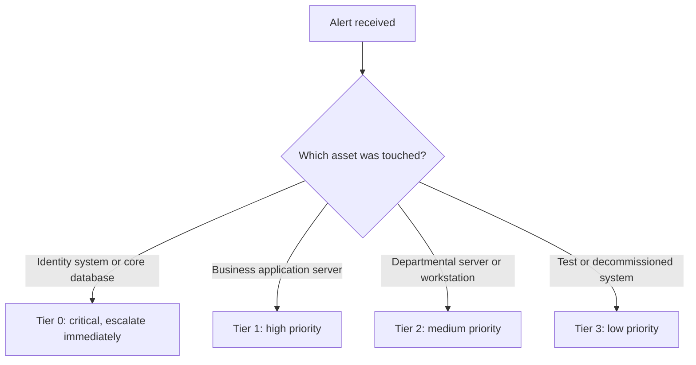
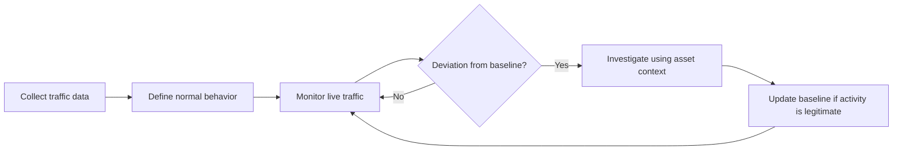
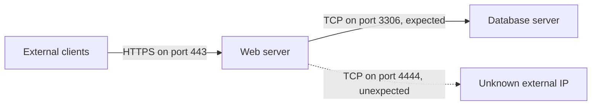

| Topic | Level | Reading Time | Prerequisites |
|---|---|---|---|
| Asset Awareness and Traffic Flow | Beginner | ~15 min | None |

> **Goal of this section:**
> You'll understand how to identify what needs protecting in any network, and how to tell normal traffic apart from suspicious traffic.


## Learning Objectives

By the end of this section, you will be able to:

- Define what an **asset** is and explain why identifying critical assets is the first step of network defense.
- Differentiate between standard user accounts and administrative accounts, and explain how each affects incident severity.
- Explain the role of a **CMDB** and of **asset criticality tiering** in alert prioritization.
- Describe what **communication flow** means and why a traffic **baseline** is essential for detection.
- Recognize a suspicious deviation from normal traffic, such as unexpected outbound connections from a server.

## Table of Contents

- [Learning Objectives](#learning-objectives)
- [Why Asset Awareness Matters](#why-asset-awareness-matters)
  - [You Cannot Defend What You Do Not Know](#you-cannot-defend-what-you-do-not-know)
  - [Not All Systems Are Equal](#not-all-systems-are-equal)
  - [Account Privilege and Incident Severity](#account-privilege-and-incident-severity)
- [Asset Inventory and the CMDB](#asset-inventory-and-the-cmdb)
  - [What Is a CMDB](#what-is-a-cmdb)
  - [What a Useful Asset Record Contains](#what-a-useful-asset-record-contains)
  - [Why Analysts Depend on the Inventory](#why-analysts-depend-on-the-inventory)
- [Alert Prioritization](#alert-prioritization)
  - [Credential Leaks and Dark Web Monitoring](#credential-leaks-and-dark-web-monitoring)
  - [The Value of the Target](#the-value-of-the-target)
  - [Asset Criticality Tiering](#asset-criticality-tiering)
- [Understanding Normal Traffic Flow](#understanding-normal-traffic-flow)
  - [Why Communication Flow Matters](#why-communication-flow-matters)
  - [Documenting Communication Flow](#documenting-communication-flow)
  - [Baselining Traffic](#baselining-traffic)
  - [Spotting Deviations From the Baseline](#spotting-deviations-from-the-baseline)
  - [Lateral Movement](#lateral-movement)
  - [Hands-On Inspection of Host Connections](#hands-on-inspection-of-host-connections)
- [Career Path Connections](#career-path-connections)
- [Key Terms Glossary](#key-terms-glossary)
- [Summary](#summary)

## Why Asset Awareness Matters

### You Cannot Defend What You Do Not Know

Before you think about firewalls, an IDS, or any security tool, you need to answer a simple question: **What exactly do I have, and what's the most important part of it?**

An **asset** is anything that has value to the organization and could be harmed or stolen. This includes:

- Servers, laptops, and network devices (routers, switches, firewalls).
- Applications and databases.
- User accounts, whether standard or administrative.
- The Data itself (customer records, financial data, source code).

Imagine a security guard in a large building who doesn't know which room holds the safe and which room holds the cleaning supplies. If an alarm goes off in a room, he won't be able to act quickly or with the right priority. Networks work exactly the same way: without knowledge of the assets, every alert is treated with the same weight, which means the dangerous things get lost in the noise.

### Not All Systems Are Equal

Not all systems are equally important. The difference between any two systems is determined by how much damage would be done if they were compromised.

| System | Typical Users | Data Handled | Impact if Compromised |
|---|---|---|---|
| File server used by three HR employees | 3 | Internal HR documents | Limited and contained, though not zero |
| Payment processing server | Thousands of customers | Card and transaction data | Financial loss, regulatory penalties, reputation damage |

The small HR file server is important, of course, but if it goes down, the damage is limited. A compromise of the payment processing server, on the other hand, could halt the entire business and expose the organization to legal penalties.

> [!IMPORTANT]
> The core skill is not detecting an alert. It is knowing how serious that alert is, based on what was touched.

### Account Privilege and Incident Severity

The same logic applies to accounts. You need to distinguish between two types:

- **Standard user account:** Its permissions are limited to the employee's own work (email, shared folders, business apps).
- **Administrative account:** It can change configurations, add users, and access many systems.

The most dangerous type is the **Domain Administrator**, an account that operates across the entire domain (usually in Active Directory). The **Domain Controller** is the server that authenticates every user and device on the network, and the Domain Admin controls it.

| Leaked Account | Reach | Severity |
|---|---|---|
| Marketing employee | Marketing files, email, a few apps | Bad, but usually contained |
| Domain administrator | Potentially every system in the domain | Potentially full control of the entire network |

A fitting analogy: a standard account is like the key to a single room, while the Domain Admin is like the master key to the whole building. Losing either key is a problem, but not to the same degree.

> [!WARNING]
> If you cannot tell which accounts are administrative, you cannot judge how severe a compromised account is. This is one of the most common gaps in real incident response.

## Asset Inventory and the CMDB

### What Is a CMDB

A **CMDB (Configuration Management Database)** is a database that records the organization's assets and the relationships between them. In practice, it serves as an **asset inventory** used for **asset classification**, meaning each system is categorized by its importance.

Put simply: it's the "logbook" that lists every device and every server, who is responsible for it, and how important it is.

### What a Useful Asset Record Contains

A record that's useful to the analyst answers the questions that come up during an incident: What is this? Who owns it? How important is it? Who should be contacted? Here is a simplified example in YAML format (the fields are illustrative, and each organization defines its own fields):

```yaml
asset_id: SRV-DB-014
hostname: db-prod-01
type: Database server
environment: Production
owner: Finance IT team
criticality_tier: 0
data_classification: Confidential customer payment data
expected_inbound:
  - source: web-prod-01
    port: 3306
    protocol: TCP
```

Notice that the last field (`expected_inbound`) documents **who is supposed to talk to this server**, which links the inventory to the traffic flow topic we'll explain shortly.

### Why Analysts Depend on the Inventory

Without an inventory, the analyst wastes time investigating an incident without knowing whether the affected device is a **test machine** or a **production database**. The difference between the two is the difference between "log it and move on" and "wake up the whole team."

> [!WARNING]
> In practice, most organizations do not maintain their inventory properly. Records become outdated, shadow IT goes undocumented, and ownership fields are left blank. An inaccurate inventory can be as misleading as having none.

## Alert Prioritization

### Credential Leaks and Dark Web Monitoring

**Dark web monitoring tools** watch leak sites and alert you when login credentials belonging to your organization show up in a leaked **data dump**.

Suppose the leak contains 50 accounts belonging to regular employees and one account belonging to an IT administrator. Logic says the administrator account should be handled **first**, even though it's just one, because its reach into the systems is far greater than the 50 regular accounts combined.

### The Value of the Target

You also need to ask: what is the attacker trying to reach?

| Scenario | Risk Level | Response |
|---|---|---|
| Attacker scans the network and hits a decommissioned print server | Low | Log, review, and clean up the device |
| Attacker touches an SQL database that holds customer records | Critical | Immediate escalation |

Same attacker, same scan, but the value of the target is what completely changes the priority.

### Asset Criticality Tiering

To solve this problem systematically, many SOCs use **asset criticality tiering**, which classifies assets into levels (Tier 0, 1, 2, 3). **Tier 0** usually includes domain controllers, identity systems, and core databases.

This table is illustrative, because the definition of each tier varies from one organization to another:

| Tier | Typical Examples | Alert Handling |
|---|---|---|
| Tier 0 | Domain controllers, identity systems, core databases | Highest priority, immediate escalation |
| Tier 1 | Business-critical application servers | High priority |
| Tier 2 | Departmental servers, standard employee workstations | Medium priority |
| Tier 3 | Test systems, decommissioned or low-value devices | Low priority |

The following flow shows how the tier affects the analyst's decision:



> [!NOTE]
> The tiering model above is a simplified SOC-style illustration. Other frameworks use different schemes. For example, Microsoft's enterprise access model describes tiers for identity, servers, and workstations. Always follow the model your organization has defined.

## Understanding Normal Traffic Flow

### Why Communication Flow Matters

One of the most important skills for a SOC analyst is understanding **communication flow**, meaning how normal traffic moves through the network. You need to know:

- Which systems talk to which servers.
- Whether external clients reach only the public-facing servers, or something else as well.
- Whether employees connecting from outside the company (remote work, VPN) are behaving normally.

It's like a building doorman who knows the residents and their regular visitors. The moment a stranger walks in through the service entrance at 3 AM, the doorman notices immediately, because he knows what normal looks like.

### Documenting Communication Flow

The asset inventory is supposed to document this: **who accesses what, and why**. But as we said, most organizations don't maintain this documentation properly, which makes the analyst's job harder.

### Baselining Traffic

The solution is **baselining**, meaning regularly recording what normal traffic looks like. The **baseline** is the reference picture you compare any new activity against.



> [!IMPORTANT]
> Without a baseline, analysts cannot tell the difference between normal business traffic and an attacker moving through the network. Detection depends on knowing what normal looks like first.

### Spotting Deviations From the Baseline

Take this example. Our web server talks to the database server on port `3306` (MySQL) and nothing else. Suddenly, it starts making connections to an unknown external IP on port `4444`.



This is a **big red flag**, because:

- The web server has no normal reason to initiate outbound connections to an unknown address.
- Port `4444` is the default listener port in many Metasploit examples, and it's used for reverse shells.

| Observation | Baseline Says | Verdict |
|---|---|---|
| Web server to database on port 3306 | Expected | Normal |
| Web server to unknown external IP on port 4444 | Never seen before | Investigate immediately |

> [!NOTE]
> Port 4444 is a strong indicator but not proof by itself. Attackers can use any port, and legitimate software can occasionally use 4444. The real signal is that the connection is unexpected compared to the baseline.

### Lateral Movement

**Lateral movement** is an attacker moving from a compromised system to other systems inside the network, usually to reach higher-value assets. Without a baseline, lateral movement looks like ordinary traffic between internal machines.

Example: a Marketing employee's machine suddenly tries to access the Finance file server at night. If the baseline says this has never happened before, it's suspicious activity worth investigating.

> [!TIP]
> When you triage an alert, ask two questions in order: what is the value of the asset involved, and is this traffic normal for that asset? The first answers "how serious", the second answers "how suspicious".

### Hands-On Inspection of Host Connections

On any Linux host, you can view current connections with the `ss` tool. These commands help you build a picture of a given machine's normal traffic:

```bash
# Show established TCP connections with the owning process
sudo ss -tnp state established

# Show listening TCP ports and the processes behind them
sudo ss -tlnp

# Show only connections to a specific destination port (example: MySQL)
ss -tn state established '( dport = :3306 )'
```

Compare the output with the expected baseline. Any connection to an unknown external address or an unfamiliar port is worth examining.

> [!TIP]
> Practice on your own lab machine. Run the commands during normal activity, save the output, and compare it after you install or run something new. This is the same idea as baselining, just at a smaller scale.

## Career Path Connections

| Career Path | How This Topic Applies |
|---|---|
| SOC Analyst | Uses asset context and traffic baselines to triage alerts and decide what to escalate |
| Penetration Tester | Identifies high-value targets and looks for lateral movement paths, the same way an attacker would |
| GRC | Asset inventory and classification are core requirements in frameworks such as the NIST Cybersecurity Framework and ISO 27001 |
| Cloud Security | Requires continuous inventory of cloud resources, since assets are created and destroyed dynamically |

## Key Terms Glossary

| Term | Definition |
|---|---|
| Asset | Anything of value to an organization, such as systems, devices, accounts, applications, and data |
| CMDB | Configuration Management Database, a database of assets and their relationships, commonly used as the asset inventory |
| Standard User Account | An account with limited permissions, scoped to a regular employee's job |
| Administrative Account | An account with elevated permissions that can change configurations and access many systems |
| Domain Controller | A server that authenticates users and devices in a Windows domain (Active Directory) |
| Dark Web Monitoring | A service that alerts an organization when its credentials or data appear in leaked datasets |
| Asset Criticality Tiering | A classification of assets into priority levels (Tier 0 to Tier 3) based on business and security importance |
| Communication Flow | The normal pattern of which systems talk to which, over which ports and protocols |
| Baseline | A recorded reference of normal behavior, used to detect deviations |
| Lateral Movement | An attacker's movement from one compromised system to other systems inside the network |
| Public-Facing Server | A server intentionally reachable from the internet, such as a website or mail server |

## Summary

- **Know your assets first:** You can't protect a network without knowing the assets in it and how important they are.
- **Not all systems are equal:** A system's value is determined by how much damage a compromise would cause, not just by the fact that it exists.
- **Account privilege drives severity:** A leaked Domain Admin account is far more dangerous than a leaked regular employee account.
- **The CMDB is the analyst's reference:** It's what tells a test machine apart from a production database, but it has to be kept up to date.
- **Prioritize by account and target value:** In a mass leak, the administrator account is handled first, and an SQL database holding customer records means a critical incident.
- **Tiering makes prioritization systematic:** Tier 0 usually includes domain controllers, identity systems, and core databases.
- **Baselining is critical:** Without a baseline, you can't tell business traffic apart from an attacker's movement.
- **Unexpected outbound connections are red flags:** Such as a web server connecting to an unknown IP on port 4444.
- **Lateral movement hides in normal-looking traffic:** The baseline is your tool for detecting it.

