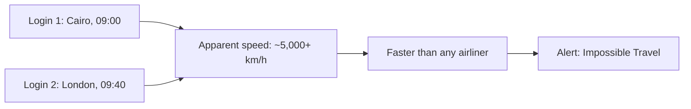
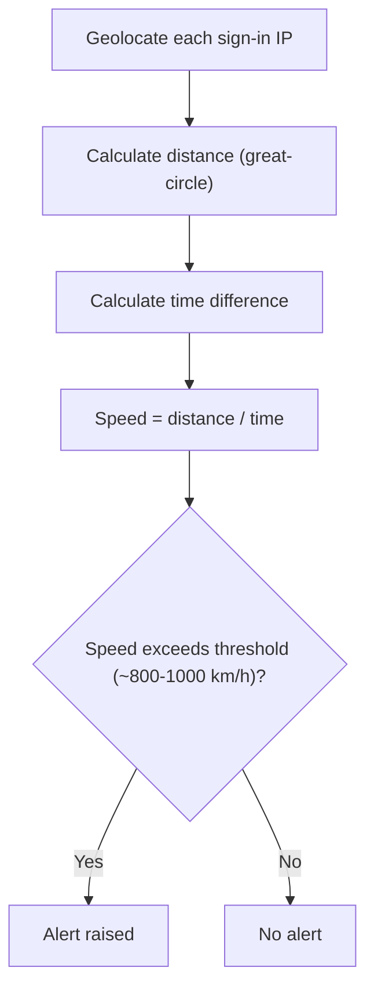
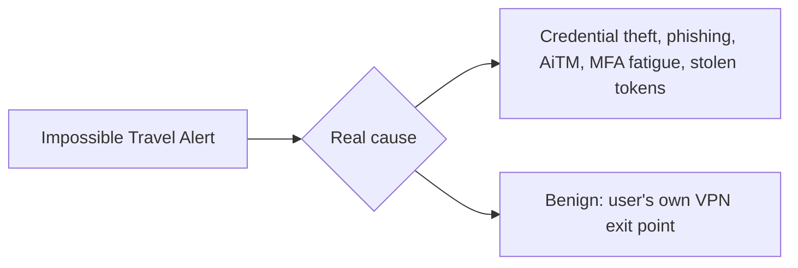
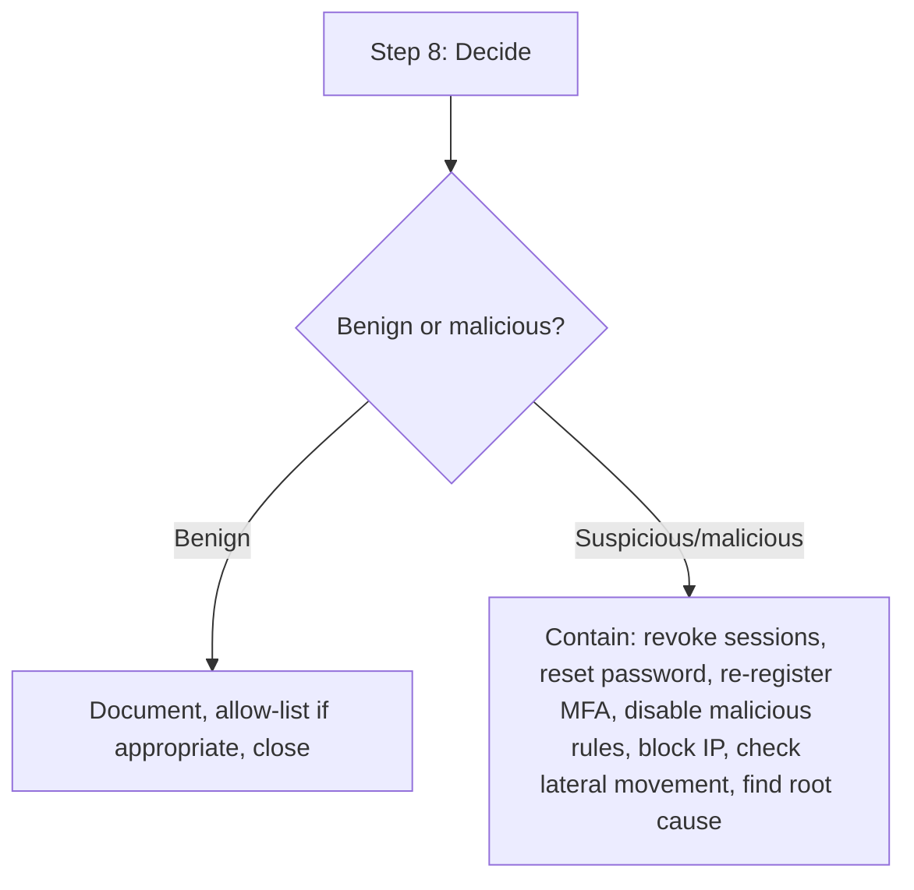
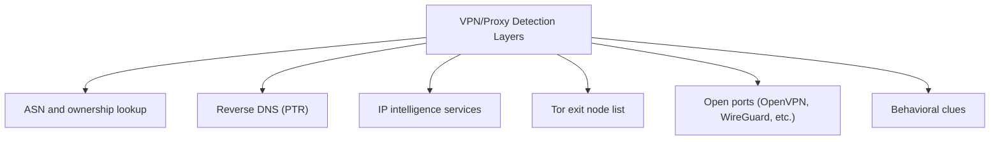

| Topic | Level | Reading Time | Prerequisites |
|---|---|---|---|
| Impossible Travel and VPN Detection | Intermediate | ~25 min | Zero Trust Model |

> **Goal of this section:**
> You will understand how identity systems detect "impossible travel" as a strong sign of account compromise, learn the complete eight investigation steps from receiving the alert to making a decision, and finally learn how to determine whether a specific IP belongs to a VPN or proxy using several layers of evidence.


## Learning Objectives

By the end of this section, you will be able to:

- Define **impossible travel** and calculate the apparent speed between two sign-ins to judge plausibility.
- Describe the five-step detection algorithm systems use to raise an impossible travel alert.
- Differentiate between **real malicious causes** and **common benign causes** (especially VPN usage) of an impossible travel alert.
- Walk through the full **eight-step investigation process**, from collecting alert details to deciding and acting.
- Identify several independent layers of evidence (ASN, reverse DNS, IP intelligence, Tor lists, behavior) used to determine whether a source IP belongs to a VPN or proxy.

## Table of Contents

- [Learning Objectives](#learning-objectives)
- [What Is Impossible Travel](#what-is-impossible-travel)
  - [A Concrete Example](#a-concrete-example)
  - [Why It Matters](#why-it-matters)
- [How the Detection Works](#how-the-detection-works)
  - [The Five-Step Algorithm](#the-five-step-algorithm)
  - [Products That Do This Out of the Box](#products-that-do-this-out-of-the-box)
- [Why It Happens: Real Attack Versus False Positive](#why-it-happens-real-attack-versus-false-positive)
  - [Real Malicious Causes](#real-malicious-causes)
  - [Benign Causes](#benign-causes)
- [Investigation Step by Step](#investigation-step-by-step)
  - [Step 1: Collect the Alert Details](#step-1-collect-the-alert-details)
  - [Step 2: Calculate and Sanity Check](#step-2-calculate-and-sanity-check)
  - [Step 3: Enrich Both IPs](#step-3-enrich-both-ips)
  - [Step 4: Compare With the User's Baseline](#step-4-compare-with-the-users-baseline)
  - [Step 5: Look at the Authentication Details](#step-5-look-at-the-authentication-details)
  - [Step 6: Ask the User, Carefully](#step-6-ask-the-user-carefully)
  - [Step 7: Look at What the Second Session Did](#step-7-look-at-what-the-second-session-did)
  - [Step 8: Decide and Act](#step-8-decide-and-act)
- [How Do I Know a Source IP Belongs to a VPN or Proxy](#how-do-i-know-a-source-ip-belongs-to-a-vpn-or-proxy)
  - [ASN and Ownership Lookup](#asn-and-ownership-lookup)
  - [Reverse DNS (PTR)](#reverse-dns-ptr)
  - [Commercial and Free IP Intelligence Services](#commercial-and-free-ip-intelligence-services)
  - [Tor Exit Node List](#tor-exit-node-list)
  - [Open Ports and Services](#open-ports-and-services)
  - [Behavioral Clues](#behavioral-clues)
- [Career Path Connections](#career-path-connections)
- [Key Terms Glossary](#key-terms-glossary)
- [Summary](#summary)

## What Is Impossible Travel

**Impossible travel** is an alert raised when **the same account** signs in from **two locations so far apart** that no human could travel between them in the time that has passed.

### A Concrete Example

`jsmith` logs in from Cairo at 09:00 and from London at 09:40. The distance is about **3,500 km in 40 minutes**, an apparent speed of **more than 5,000 km/h**, faster than any passenger airliner. **One of the two sign-ins is most likely not `jsmith`.**

### Why It Matters

This is **one of the clearest signs of account theft**, and cloud accounts (**Microsoft 365, Google, VPN, SaaS**) are a primary target for attackers.



## How the Detection Works

### The Five-Step Algorithm

For each user, the system looks at consecutive successful sign-ins and does the following:

| # | Step | What It Does |
|---|---|---|
| 1 | **Geolocate** each source IP | Country, city, latitude and longitude, using a **GeoIP database** |
| 2 | **Calculate the distance** between the two points | Great-circle distance |
| 3 | **Calculate the time difference** between the two sign-ins | |
| 4 | **Speed = distance ÷ time** | |
| 5 | If the speed **exceeds a certain threshold** (usually around 800-1,000 km/h, roughly the speed of a passenger airliner), **raise an alert** | |



### Products That Do This Out of the Box

**Microsoft Entra ID Protection, Microsoft Defender for Cloud Apps, Okta, Splunk, Sentinel, Google Workspace, and VPN gateways.**

An example **pseudo-query** in a SIEM:

```text
For each user:
   sort successful logins by time
   compare each login with the previous one
   if distance_km / hours > 900 → alert
```

> [!NOTE]
> This detection mechanism is a direct practical implementation of the trust scoring and continuous verification principles from the Zero Trust Model file: the system is not trusting a session just because the login succeeded once, it keeps evaluating context (here, location and time) across the session's lifetime.

## Why It Happens: Real Attack Versus False Positive

### Real Malicious Causes

| Cause | Detail |
|---|---|
| **Credential theft** | Through phishing, a leaked reused password, infostealer malware, or password spray |
| **Adversary-in-the-middle phishing** | Steals the session cookie and bypasses MFA |
| **MFA fatigue (push bombing)** | Repeated MFA requests until the exhausted user approves |
| **Stolen tokens or an abused OAuth app** | |

### Benign Causes

**(Very common!)**

- **The user's own VPN**: they sign in through a VPN exit point in the US while they normally appear in Egypt.



> [!WARNING]
> Benign causes, especially employee VPN use, are very common. Jumping straight to "this account is compromised" without investigation produces frequent false positives and erodes trust in the alert system. The eight-step process below exists specifically to separate the two cases reliably.

## Investigation Step by Step

### Step 1: Collect the Alert Details

The user, the two sign-ins (time, IP, country, city), the application, the device, and the result.

### Step 2: Calculate and Sanity Check

Verify the distance and the time, check the time zones (UTC versus local), and confirm the accuracy of the GeoIP by looking up the IP in a second source.

### Step 3: Enrich Both IPs

- Who owns the IP? (**ASN, ISP**) Is it a hosting/data-centre network, a residential ISP, or a mobile carrier?
- Is it a known **VPN, proxy, or Tor exit node**? (Details in the next section)
- **Threat intelligence**: VirusTotal, AbuseIPDB, Cisco Talos, internal blocklists.
- Is the IP on the company's list of known IPs (office, VPN gateway, cloud proxy)?

### Step 4: Compare With the User's Baseline

- Has this user logged in before from this country, IP range, or ISP?
- Which device, browser, OS, and user agent do they normally use?
- Is the device **registered/managed** (a known device ID, compliant according to MDM) or unknown?
- Does the user normally work at this hour?

### Step 5: Look at the Authentication Details

- Authentication method: password only or MFA? Which MFA method?
- Were there many failed attempts before the success (spray/brute force)?
- Is there MFA fatigue (many denials/timeouts, followed by a single approval)?
- Did the session start with a **refresh token or cookie** instead of a fresh password entry (a sign of token theft)?
- The Conditional Access result and the risk level.

### Step 6: Ask the User, Carefully

Contact them through a **trusted channel** (a phone call, not the email that may be compromised): **"Were you in London at 09:40? Did you approve an MFA request?"** Many cases are resolved here as **benign**. **Keep the verification outside the suspicious channel (out-of-band).**

### Step 7: Look at What the Second Session Did

This is what determines the **severity level**:

| Area | What to Check |
|---|---|
| **Mailbox** | New inbox rules (auto-forward, moving to RSS/Deleted folders, deleting security alerts), forwarding addresses, sent emails, bulk searches for "invoice", "password", "wire" |
| **OAuth** | New application consents |
| **MFA** | A new authentication method or registered phone number, a new registered device |
| **Files** | Bulk downloads or sharing from SharePoint/OneDrive/Drive |
| **Privilege** | Changes to roles, new admin accounts |
| **Internal phishing** | Sent from the account itself |
| **VPN** | Connections to internal resources |

### Step 8: Decide and Act

| Verdict | Action |
|---|---|
| **Benign** | Document the reason, add it to the allow-list if appropriate (such as a known corporate egress), close the case |
| **Suspicious or malicious** | Contain first: 1) revoke all active sessions and refresh tokens, 2) reset the password, 3) review and re-register the MFA methods (remove anything the attacker added), 4) disable any malicious inbox rules or OAuth grants, 5) block the attacker IP/range, 6) check other accounts that signed in from the same IP, 7) check for lateral movement and data loss, notify the owner and the IR team, 8) find the root cause (a phishing email? malware on the user's device? password reuse?) |



> [!IMPORTANT]
> Step 7 is often the step that actually decides severity, not step 5 or 6. A session that logged in from a VPN but touched nothing sensitive is very different from one that registered a new MFA method and created a mail-forwarding rule within minutes of logging in.

## How Do I Know a Source IP Belongs to a VPN or Proxy

**There's no perfect method, but the SOC uses several layers.**

### ASN and Ownership Lookup

Every IP belongs to an **Autonomous System (ASN)**. Check it with `whois`, **ipinfo.io**, **Team Cymru**, or the **Hurricane Electric BGP Toolkit**.

- Regular users usually come from **residential or mobile ISPs** (such as Telecom Egypt, Vodafone, Orange).
- VPN users come from **hosting/data-centre providers** (such as M247, DataCamp/CDN77, OVH, DigitalOcean, Hetzner, Amazon AWS, Choopa/Vultr, Leaseweb).

**A "home user" signing in from a data-centre ASN is suspicious.**

### Reverse DNS (PTR)

```bash
nslookup 185.220.101.9
```

It may return names such as `vpn-node-12.provider.com`, `exit-node.tor...`, or `ec2-...amazonaws.com`.

### Commercial and Free IP Intelligence Services

Services that maintain huge databases of VPN, proxy, hosting, and Tor IPs, and provide flags such as **"is_vpn / is_proxy / is_tor / is_hosting"**:

| Category | Examples |
|---|---|
| Commercial | MaxMind GeoIP2 Anonymous IP database, IPQualityScore, IP2Proxy, Spur, IPinfo Privacy Detection, Neustar, Digital Element |
| Free | AbuseIPDB, VirusTotal, GreyNoise, Shodan |

**Most SIEMs and identity providers (Entra ID, Okta) have built-in "anonymous IP" detections that use these feeds.**

### Tor Exit Node List

The **Tor Project** publishes a list of exit nodes (the **bulk exit list**). Match the IP against it.

### Open Ports and Services

Scan or look up the IP on **Shodan/Censys**. Common ports for VPN servers:

| Protocol | Port |
|---|---|
| OpenVPN | 1194 (UDP/TCP) |
| WireGuard | 51820 (UDP) |
| IPsec | 500 and 4500 (UDP) |
| PPTP | 1723 |
| SSTP or OpenVPN | over 443 |
| Proxies | 3128, 8080, 1080 (SOCKS) |

### Behavioral Clues

- Many different users or accounts coming from the same IP in a short time.
- Location jumping between countries while the device/browser stays the same.
- The time zone or browser language doesn't match the IP's country (for web apps that record this).
- **WebRTC/DNS leak** (for a web app you control).

**Latency and routing:** unusual latency may indicate an extra hop, although it is **weak evidence**.



> [!TIP]
> No single layer is conclusive on its own. The strength of this approach comes from combining multiple independent signals: an ASN flag alone is suggestive, but an ASN flag plus a matching reverse DNS name plus a known VPN port is much stronger evidence together.

## Career Path Connections

| Career Path | How This Topic Applies |
|---|---|
| SOC Analyst | The eight-step investigation process represents a core, frequently used identity investigation workflow |
| Penetration Tester | Understanding VPN/proxy detection techniques helps assess whether attacker infrastructure would be flagged |
| GRC | Conditional Access policies and investigation documentation are direct audit evidence for identity governance |
| Cloud Security | Cloud identity providers implement impossible travel and anonymous IP detection natively as risk signals |

## Key Terms Glossary

| Term | Definition |
|---|---|
| Impossible Travel | An alert raised when the same account signs in from two locations too far apart to travel between in the elapsed time |
| GeoIP Database | A database mapping IP addresses to approximate geographic locations |
| Great-Circle Distance | The shortest distance between two points on a sphere, used to calculate travel speed |
| Adversary-in-the-Middle (AiTM) Phishing | A phishing technique that steals session cookies to bypass MFA |
| MFA Fatigue (Push Bombing) | Repeatedly triggering MFA prompts until an exhausted user approves one |
| ASN | Autonomous System Number, identifying which network organization owns an IP range |
| Reverse DNS (PTR) | A DNS lookup that resolves an IP address back to a hostname |
| Tor Exit Node | The final server in the Tor network through which traffic reaches the open internet |
| Out-of-Band Verification | Confirming information through a separate, trusted channel from the one potentially compromised |

## Summary

- **Impossible travel compares the apparent speed between two sign-ins against physical travel limits.**
- **Detection follows a five-step algorithm:** geolocate, calculate distance, calculate time, compute speed, and alert if it exceeds a threshold.
- **Real causes include credential theft, AiTM phishing, MFA fatigue, and stolen tokens; benign causes are dominated by employee VPN use.**
- **The eight-step investigation moves from alert collection to containment and root-cause analysis.**
- **Step 7 (what the second session did) usually determines real severity**, not just the sign-in location.
- **No single signal proves an IP is a VPN or proxy:** ASN, reverse DNS, IP intelligence, Tor lists, open ports, and behavioral clues are all independent layers that add up together.
- **Treat VPN/proxy detection results as context, not absolute proof.**

