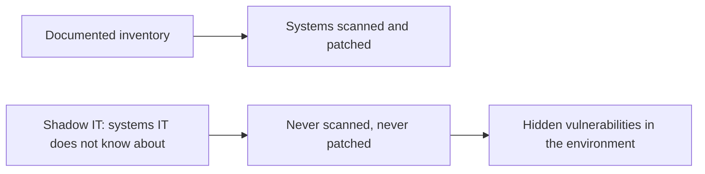
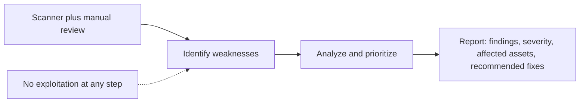
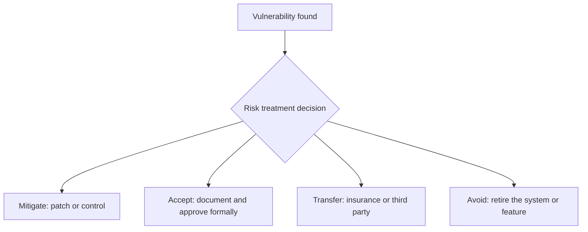
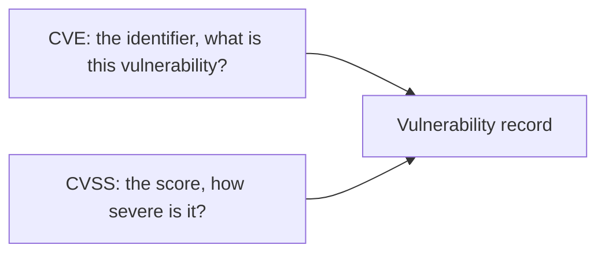
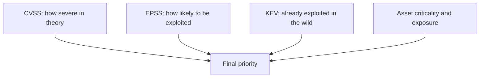
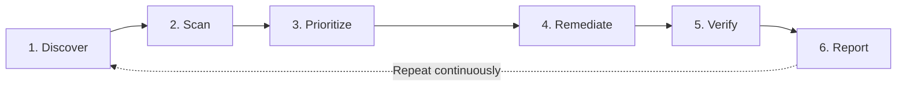

| Topic | Level | Reading Time | Prerequisites |
|---|---|---|---|
| Vulnerability Assessment and Risk Scoring | Beginner | ~20 min | Asset Awareness and Traffic Flow |

> **The goal of this section:**  
> You'll understand why the asset inventory is the first step in any vulnerability management program, what separates an assessment from actual exploitation, how a CISO decides to accept a vulnerability instead of fixing it, how vulnerability severity is rated with CVE and CVSS, and how the whole cycle keeps repeating.

## Learning Objectives

By the end of this section, you will be able to:

- Explain why an **asset inventory** must exist before any other security control, and what threatens its accuracy.
- Define a **vulnerability assessment** and explain why it must never exploit the weaknesses it finds.
- List the four **risk treatment options** and the factors a CISO weighs when accepting a risk.
- Differentiate between **CVE** and **CVSS**, and read the four CVSS severity bands.
- Explain why a CVSS score alone is not enough, and how **EPSS** and the **CISA KEV catalog** add context.
- Describe the six stages of the **vulnerability management lifecycle** and explain why it is a cycle, not a project.

## Table of Contents

- [Learning Objectives](#learning-objectives)
- [Why Asset Inventory Comes First](#why-asset-inventory-comes-first)
  - [You Cannot Protect What You Do Not Know You Have](#you-cannot-protect-what-you-do-not-know-you-have)
  - [What an Asset Inventory Contains](#what-an-asset-inventory-contains)
  - [Shadow IT](#shadow-it)
- [What Is a Vulnerability Assessment](#what-is-a-vulnerability-assessment)
  - [Definition and Method](#definition-and-method)
  - [No Exploitation](#no-exploitation)
  - [The Output](#the-output)
- [Risk Acceptance Is a Business Decision](#risk-acceptance-is-a-business-decision)
  - [The Four Risk Treatment Options](#the-four-risk-treatment-options)
  - [What Drives the Accept-or-Deny Decision](#what-drives-the-accept-or-deny-decision)
  - [Why Frameworks and Compliance Matter](#why-frameworks-and-compliance-matter)
- [Scoring Vulnerabilities: CVE and CVSS](#scoring-vulnerabilities-cve-and-cvss)
  - [CVE](#cve)
  - [CVSS](#cvss)
  - [Severity Bands](#severity-bands)
- [Beyond the Score](#beyond-the-score)
  - [What Goes Into a CVSS Score](#what-goes-into-a-cvss-score)
  - [Not Every Weakness Has a Score](#not-every-weakness-has-a-score)
  - [Modern Prioritization: EPSS and KEV](#modern-prioritization-epss-and-kev)
- [The Vulnerability Management Lifecycle](#the-vulnerability-management-lifecycle)
- [Career Path Connections](#career-path-connections)
- [Key Terms Glossary](#key-terms-glossary)
- [Summary](#summary)

## Why Asset Inventory Comes First

### You Cannot Protect What You Do Not Know You Have

Large organizations run **thousands of systems**, so keeping full visibility of every asset and where it lives is very hard. Even inside the SOC, teams keep **discovering systems nobody knew existed** as the environment grows. And many organizations **never built a documented inventory from the start**, which is a real security risk.

The rule here is simple: **you cannot protect what you do not know you have.** Every other security control depends on an accurate inventory.

> [!NOTE]
> This is the same principle introduced in Asset Awareness and Traffic Flow from Network Security Foundations, where the CMDB helps an analyst judge how serious an alert is. Here the same inventory plays a different role: it defines what must be scanned for vulnerabilities in the first place.

### What an Asset Inventory Contains

An **asset inventory** is an organized, up-to-date list of everything the organization owns or operates that has value, especially from a security point of view.

| Aspect | Detail |
|---|---|
| **Why it matters** | It lets the security team identify every system, understand its purpose, and manage it properly |
| **Examples of assets** | Servers, laptops, phones, network devices, IoT devices, applications, databases, cloud resources, domains, certificates, and data |
| **Useful fields for each asset** | Owner, location, purpose, criticality, operating system and version, installed software, and patch status |

### Shadow IT

**Shadow IT** is systems deployed **without the IT department's knowledge**. It is the **biggest threat to the accuracy of the inventory**.

> [!WARNING]
> A vulnerability scanner can only assess what it is pointed at. A system missing from the inventory is a system missing from every scan, which makes shadow IT one of the most common reasons a known vulnerability stays open for years.

## What Is a Vulnerability Assessment

### Definition and Method

A **vulnerability assessment** is a systematic process that identifies, analyzes, and prioritizes **security weaknesses** in systems, networks, and applications.

It is usually done with **automated scanners** such as **Nessus**, **OpenVAS**, and **Qualys**, together with **manual review**.

### No Exploitation

The assessment must **reveal the risk without exploiting it**: it reports that the weakness **exists**, not that it **was exploited**.

### The Output

A **prioritized** list of findings, with the severity, the affected assets, and the recommended fixes.

> [!IMPORTANT]
> The "no exploitation" rule is the defining boundary between a vulnerability assessment and a penetration test. An assessment answers "what weaknesses exist"; a penetration test answers "what can an attacker actually do with them". That difference is covered in the Penetration Testing, Red Teaming, and Purple Teaming file.

## Risk Acceptance Is a Business Decision

Don't be surprised if the **CISO** formally accepts some risks or vulnerabilities. Acceptance is reasonable when **the cost of remediation, the operational impact, and the business disruption** outweigh **the likelihood and impact of exploitation**.

Acceptance is valid **only if it is documented and formally approved**, not if it is simply ignored.

### The Four Risk Treatment Options

| Option | Meaning |
|---|---|
| **Mitigate** | Apply a patch or a control |
| **Accept** | Document it and live with it |
| **Transfer** | Use cyber insurance or a third party |
| **Avoid** | Retire the exposed system or feature |

### What Drives the Accept-or-Deny Decision

| Factor | What the CISO Weighs |
|---|---|
| **Likelihood of exploitation** | Is there a public exploit? Is the system reachable from the internet? |
| **Impact if exploited** | Data loss, downtime, financial or reputational damage |
| **Cost of remediation** | Money, team time, and testing effort |
| **Regulatory consequences** | Fines or legal action (GDPR, PCI DSS, HIPAA, and similar) |
| **Operational downtime** | Updating a production system may mean downtime |

### Why Frameworks and Compliance Matter

When **regulatory consequences are missing**, organizations may **deprioritize** some controls, such as protecting customer data. That is why **security frameworks and compliance requirements** matter: they enforce a **consistent minimum** standard.

> [!NOTE]
> This connects directly to the NIST CSF file in the Security Frameworks category. The CSF's Identify function is the formal home of asset inventory and risk assessment, and risk acceptance is one of the decisions the framework expects an organization to document.

## Scoring Vulnerabilities: CVE and CVSS

### CVE

**CVE (Common Vulnerabilities and Exposures)** is a **unique public ID** for a known vulnerability, such as `CVE-2021-44228`.

### CVSS

**CVSS (Common Vulnerability Scoring System)** is a **score from 0.0 to 10.0** based on exploitability and impact.

### Severity Bands

| Score | Severity |
|---|---|
| 0.1 – 3.9 | Low |
| 4.0 – 6.9 | Medium |
| 7.0 – 8.9 | High |
| 9.0 – 10.0 | Critical |

> [!TIP]
> Easy way to remember the difference: the CVE is the name tag, the CVSS is the severity rating on it. In an interview, say both together: "CVE-2021-44228 is Log4Shell, and it scored a CVSS of 10.0".

## Beyond the Score

### What Goes Into a CVSS Score

| Group | Includes |
|---|---|
| **Exploitability factors** | The attack vector (network or local), complexity, privileges required, and user interaction |
| **Impact factors** | The impact on confidentiality, integrity, and availability |

### Not Every Weakness Has a Score

A system can be at risk because of a **bad configuration**, such as default passwords, open shares, or excessive permissions. Attackers exploit these **with legitimate tools**, and they have no CVE and no score.

### Modern Prioritization: EPSS and KEV

Teams also use extra context:

| Source | What It Tells You |
|---|---|
| **EPSS** | The probability that the vulnerability will actually be exploited |
| **CISA KEV catalog** | Vulnerabilities **known to be actively exploited** in the real world (in the wild) |

> [!IMPORTANT]
> A Critical CVSS on a lab server nobody can reach may matter less than a Medium on an internet-facing payment system that appears in the KEV catalog. Severity describes the vulnerability; priority describes the vulnerability on a specific asset in a specific environment.

## The Vulnerability Management Lifecycle

A **continuous** cycle, not a project that ends.

| # | Stage | What Happens |
|---|---|---|
| 1 | **Discover** | Build and maintain the asset inventory |
| 2 | **Scan** | Run **authenticated and unauthenticated** scans on a regular schedule |
| 3 | **Prioritize** | Combine CVSS with asset criticality and threat intelligence |
| 4 | **Remediate** | Patch, reconfigure, or apply a compensating control (such as a WAF rule or segmentation) |
| 5 | **Verify** | Rescan to confirm the fix worked |
| 6 | **Report** | Track metrics such as time-to-remediate and the number of open critical findings |

> [!NOTE]
> A compensating control such as a WAF rule is the same idea as virtual patching covered in the WAF file: it closes the exploit path at the edge while the real fix waits for a maintenance window. It reduces risk, but the vulnerability itself is still there until it is patched.

## Career Path Connections

| Career Path | How This Topic Applies |
|---|---|
| SOC Analyst | Uses scan findings and KEV context to judge whether an alert touches a known-exploited weakness |
| Penetration Tester | Starts from the same inventory and findings, then goes further by exploiting weaknesses to prove real impact |
| GRC | Owns risk acceptance documentation, remediation metrics, and compliance evidence |
| Cloud Security | Cloud resources are assets too, and ephemeral workloads make continuous discovery even more important |

## Key Terms Glossary

| Term | Definition |
|---|---|
| Asset Inventory | A structured, up-to-date list of everything an organization owns or operates that has value |
| Shadow IT | Systems deployed without the IT department's knowledge |
| Vulnerability Assessment | A systematic process of identifying, analyzing, and prioritizing weaknesses without exploiting them |
| Risk Acceptance | A formally documented and approved decision to live with a risk |
| Risk Transfer | Shifting risk to another party, for example through cyber insurance |
| CVE | Common Vulnerabilities and Exposures, a unique public ID for a known vulnerability |
| CVSS | Common Vulnerability Scoring System, a 0.0 to 10.0 severity score |
| EPSS | Exploit Prediction Scoring System, the probability that a vulnerability will be exploited |
| KEV | CISA's Known Exploited Vulnerabilities catalog |
| Authenticated Scan | A scan run with valid credentials, able to see inside the system |
| Compensating Control | A control that reduces risk when the vulnerability cannot be patched immediately |
| Time-to-Remediate | The time between discovering a vulnerability and fixing it |

## Summary

- **Inventory comes first:** every security control depends on an accurate inventory, and shadow IT is the biggest threat to its accuracy.
- **A vulnerability assessment finds weaknesses without exploiting them:** scanners such as Nessus, OpenVAS, and Qualys plus manual review, and the output is a prioritized list.
- **Risk acceptance is a legitimate business decision:** as long as it is documented and formally approved, not ignored.
- **Four treatments exist:** mitigate, accept, transfer, avoid.
- **The CISO weighs five factors:** likelihood of exploitation, impact, cost of remediation, regulatory consequences, and operational downtime.
- **CVE names the vulnerability, CVSS rates it:** from 0.0 to 10.0 in four bands.
- **A score is not a priority:** misconfigurations have no score, and EPSS and KEV add real-world context.
- **The lifecycle is a continuous cycle:** discover, scan, prioritize, remediate, verify, report, and then start again.

