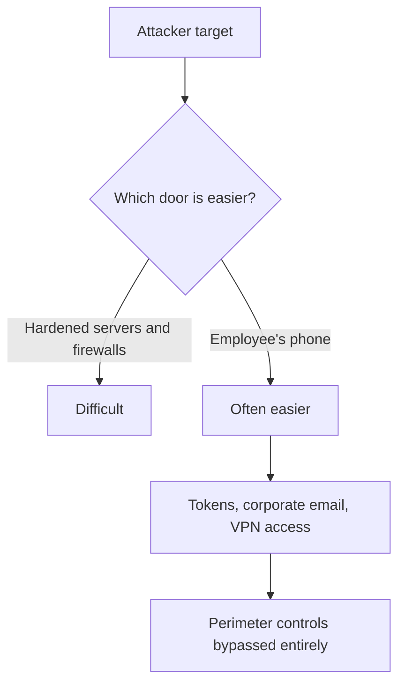
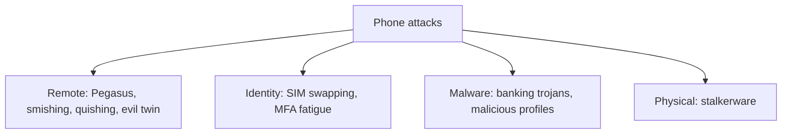
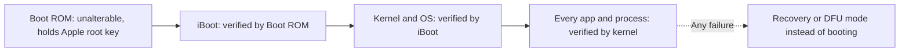
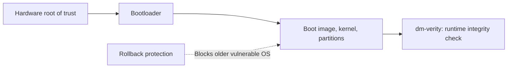

| Topic | Level | Reading Time | Prerequisites |
|---|---|---|---|
| Mobile Threats and Platform Security | Beginner | ~20 min | None |

> **The goal of this section:**  
> You'll understand why the mobile phone has become an easier door for attackers than hardened servers, what the most common attacks targeting phones are, what the real security difference between iOS and Android is, and how each system protects itself from the very first moment it powers on (boot security).

## Learning Objectives

By the end of this section, you will be able to:

- List the four things mobile security protects and explain why a phone is often the easiest door into an organization.
- Describe the main attacks that target phones: **Pegasus**, **SIM swapping**, **MFA fatigue**, **smishing and quishing**, **evil twin Wi-Fi**, **stalkerware**, **banking trojans**, and malicious iOS profiles.
- Compare **iOS** and **Android** across source model, hardware, updates, app sources, review, market share, and attacker interest.
- Walk through **Apple's secure boot chain** and name the other Apple protection layers.
- Explain **Android Verified Boot**, the four bootloader colour states, and Android's other protections and main weakness.

## Table of Contents

- [Learning Objectives](#learning-objectives)
- [Why Mobile Security Matters](#why-mobile-security-matters)
  - [What Mobile Security Protects](#what-mobile-security-protects)
  - [Why the Phone Is the Easier Door](#why-the-phone-is-the-easier-door)
- [Attacks That Target Phones](#attacks-that-target-phones)
  - [Pegasus Spyware](#pegasus-spyware)
  - [SIM Swapping](#sim-swapping)
  - [MFA Fatigue](#mfa-fatigue)
  - [Smishing and Quishing](#smishing-and-quishing)
  - [Evil Twin Wi-Fi](#evil-twin-wi-fi)
  - [Stalkerware](#stalkerware)
  - [Banking Trojans on Android](#banking-trojans-on-android)
  - [Malicious Profiles on iOS](#malicious-profiles-on-ios)
- [iOS Versus Android: The Big Picture](#ios-versus-android-the-big-picture)
- [Apple's Secure Boot Chain](#apples-secure-boot-chain)
  - [The Four Steps](#the-four-steps)
  - [Other Apple Protection Layers](#other-apple-protection-layers)
  - [The checkm8 Lesson](#the-checkm8-lesson)
- [Android Boot Security](#android-boot-security)
  - [Verified Boot](#verified-boot)
  - [The Four Bootloader States](#the-four-bootloader-states)
  - [Other Android Protections and the Fragmentation Weakness](#other-android-protections-and-the-fragmentation-weakness)
- [Career Path Connections](#career-path-connections)
- [Key Terms Glossary](#key-terms-glossary)
- [Summary](#summary)

## Why Mobile Security Matters

### What Mobile Security Protects

**Mobile security** protects four things: **the device itself, the data on it, the apps, and the network connection**.

### Why the Phone Is the Easier Door

The phone is an employee's **most personal and most trusted device**:

- It holds email, chats, photos, contacts, and documents.
- It has the MFA apps and receives SMS codes, which means it **unlocks all the other accounts**.
- It's used for the VPN and the password manager.
- It's **always on, always with the person, and always connected** (cellular, Wi-Fi, Bluetooth, NFC).
- It has a **camera, microphone, and GPS**, which turns it into a surveillance tool if it's compromised.

For an attacker, hardened servers and firewalls are difficult. **The employee's phone is often the easier door.** Compromising a single phone can give the attacker tokens, corporate email, and VPN access, **bypassing all the perimeter controls**. That's why some organizations give high-value employees (executives, admins, journalists, diplomats) dedicated, closely monitored devices.

> [!IMPORTANT]
> The phone is not just another endpoint. Because it holds the MFA app and receives SMS codes, compromising it can unlock every other account the person owns. This is why mobile security belongs in the same conversation as identity security, not only device security.

## Attacks That Target Phones

### Pegasus Spyware

**Pegasus** (from NSO Group) is commercial spyware sold to governments. It used **zero-click exploits**, meaning the victim **doesn't do anything at all**. Example: the exploit called **FORCEDENTRY** (2021) abused a flaw in how iMessage processed images.

Once installed, it can read messages, record calls, and turn on the microphone and camera. It was found on the phones of journalists, activists, and officials, which is why Apple created **Lockdown Mode**.

### SIM Swapping

The attacker convinces the mobile carrier (or bribes an employee) to move the victim's phone number to a SIM the attacker controls. After that, **all SMS codes go to the attacker**, who then resets passwords and drains the accounts.

**Defense:** don't use SMS for MFA if you can avoid it; use an authenticator app or a security key, and set a **carrier PIN**.

### MFA Fatigue

The attacker has the password and fires MFA push requests **many times in a row** until the worn-out user taps **Approve**. The 2022 Uber breach used this technique.

**Defense:** number matching, limiting the number of prompts, and user training.

### Smishing and Quishing

- **Smishing:** phishing via SMS.
- **Quishing:** phishing via QR codes ("scan to pay," fake parking meter stickers, QR codes in emails).

### Evil Twin Wi-Fi

A fake hotspot with a name similar to the airport's or café's Wi-Fi, set up to capture traffic or credentials.

### Stalkerware

Spyware installed by someone with **physical access** to the phone (a jealous partner, for example) to track location and messages.

### Banking Trojans on Android

Many of them abuse the **Accessibility Service** permission to read the screen, tap buttons, and intercept one-time passwords.

### Malicious Profiles on iOS

The attacker convinces the user to install a **configuration profile** or an app signed with an enterprise certificate from **outside the App Store**.

| Attack | Core Technique | Primary Defense |
|---|---|---|
| Pegasus | Zero-click exploit | Keep updated, Lockdown Mode for high-risk users |
| SIM swapping | Transfer number to attacker's SIM | No SMS MFA, carrier PIN |
| MFA fatigue | Repeated push prompts | Number matching, limit prompts, training |
| Smishing / quishing | Phishing via SMS or QR | Awareness, avoid unknown links and codes |
| Evil twin Wi-Fi | Fake hotspot | VPN on untrusted Wi-Fi, no auto-join |
| Stalkerware | Physical-access install | Device lock, regular app review |
| Banking trojans | Abuse Accessibility Service | Official stores only, review permissions |
| Malicious iOS profiles | Config profile or enterprise cert | Never install profiles from unknown sources |

> [!NOTE]
> MFA fatigue connects directly to the Impossible Travel investigation in the Log Analysis and Digital Forensics category, where repeated MFA prompts followed by a single approval are one of the signals checked in the authentication details.

## iOS Versus Android: The Big Picture

**Android** is open source (AOSP), highly customizable, used by many companies (Samsung, Xiaomi, Google, Oppo...), and has a market share of about **70-80%** worldwide. **iOS** is closed, built by Apple for Apple devices only, and Apple controls the hardware, the OS, and the App Store.

| | iOS | Android |
|---|---|---|
| **Source** | Closed | Open (AOSP) + manufacturer layers |
| **Hardware** | Apple only | Many companies |
| **Updates** | Apple pushes them to all supported devices at once, for 5-7+ years | Depend on the manufacturer and the carrier; fragmentation; some devices are never updated at all |
| **App sources** | App Store by default (sideloading only in some regions) | Google Play + easy sideloading and alternative stores |
| **App review** | Strict | Automated + Google Play Protect |
| **Market share** | Smaller | About 80% worldwide |
| **Attacker interest** | Lower volume, but high-value targets | Higher malware volume |

**The key point:** a larger user share, combined with more fragmentation and an open system, makes Android **the biggest target for common malware**, while iOS's closed model makes mass compromise harder. **But no system is "completely immune"**: targeted attacks (like Pegasus) hit both.

> [!WARNING]
> Do not read this comparison as "iOS is safe, Android is not." Higher malware volume on Android and higher-value targeted attacks on iOS are different risk profiles, not a winner and a loser. Both require patching, careful app choices, and awareness.

## Apple's Secure Boot Chain

### The Four Steps

**The boot** is the process from pressing the power button until the OS is running. Apple verifies **every step** with a digital signature. If any step fails verification, **the device refuses to continue**.

| # | Step | What Happens |
|---|---|---|
| 1 | **Boot ROM** | The first code to run, burned into the chip's read-only memory at manufacture. **It can't be modified.** It contains Apple's Root CA public key |
| 2 | **Boot ROM verifies the next stage** | The Low-Level Bootloader (iBoot), by checking its signature against Apple's key |
| 3 | **iBoot verifies the kernel and the OS** | And on newer devices, kernel extensions and firmware as well |
| 4 | **The kernel verifies the signatures of every app and system process** | This is code signing |

Each link verifies the one after it. This is a **chain of trust** that starts from hardware that can't be modified. If anything has been modified, the device enters **Recovery or DFU mode** instead of booting.

### Other Apple Protection Layers

| Layer | Role |
|---|---|
| **Secure Enclave** | A separate, isolated processor that handles Face ID/Touch ID data and encryption keys. **Even the main OS can't read them** |
| **Code signing** | Only code approved by Apple or signed by a developer can run |
| **App sandbox** | Each app runs in an isolated container, with no access to other apps' data |
| **Hardware-based encryption** | Data is tied to the device's passcode and keys. Without the passcode, the data is unreadable |
| **Memory protections** | Pointer authentication, kernel integrity protection |
| **Lockdown Mode** (optional) | A maximum-protection mode that reduces the attack surface: it blocks most message attachments, some web technologies, and wired connections while the device is locked |

### The checkm8 Lesson

In 2019, a vulnerability called **checkm8** was found in the Boot ROM of many iPhones (A5 to A11 chips). Since the Boot ROM is **read-only silicon**, Apple **can't fix it**. This shows why this layer is so important and so hard to fix.

> [!IMPORTANT]
> The chain of trust is only as strong as its first link. A flaw in the one component that cannot be updated (the Boot ROM) cannot be patched, only worked around. This is the hardware-level version of the lesson from the Defense in Depth Model: a single unpatchable weak point matters far more than many patchable ones.

## Android Boot Security

### Verified Boot

Android uses **Verified Boot (AVB)**:

| # | Step | What Happens |
|---|---|---|
| 1 | **Hardware root of trust** | In the chip; verifies the bootloader |
| 2 | **Bootloader** | Verifies the boot image, the kernel, and the other partitions (using signatures) |
| 3 | **dm-verity** | Checks the integrity of the system partition block by block **at runtime**; modified data causes errors |
| 4 | **Rollback protection** | Prevents installing an older OS version that has vulnerabilities |

### The Four Bootloader States

The bootloader displays a state at boot time:

| Colour | Meaning |
|---|---|
| **Green** | Bootloader locked, fully verified with the manufacturer's keys |
| **Yellow** | Locked, but verified with the user's own key (shows a warning) |
| **Orange** | Bootloader **unlocked**, no verification (shows a warning). This is what happens when the phone is **rooted** or runs a custom ROM |
| **Red** | Verification failed; the system is corrupted or modified |

### Other Android Protections and the Fragmentation Weakness

**Other Android protections:** the app sandbox (each app has its own Linux user ID), SELinux in enforcing mode, the **hardware-backed Keystore** and the **Trusted Execution Environment (TEE) / StrongBox secure element**, file-based encryption, **Google Play Protect** (scans apps), runtime permissions, and the **Play Integrity API** (apps can confirm the device is genuine and unmodified).

**The weakness: fragmentation.** Security updates depend on the manufacturer, so many phones stay **months or years behind** on patches. On top of that, the user can unlock the bootloader and install anything.

> [!TIP]
> A clean interview comparison: Apple controls the whole chain (hardware, OS, store), so patches reach everyone together. Android shares control across Google and many manufacturers, so protection is strong on paper but uneven in practice, depending on which phone and which vendor.

## Career Path Connections

| Career Path | How This Topic Applies |
|---|---|
| SOC Analyst | Recognizes mobile-origin signals such as MFA fatigue patterns, SIM-swap indicators, and unmanaged-device sign-ins |
| Penetration Tester | Assesses mobile attack surface, including app permissions, malicious profiles, and rogue network scenarios in authorized scope |
| GRC | Mobile security policy must address both iOS and Android differences, patch responsibility, and acceptable device states |
| Cloud Security | Mobile devices are a primary identity endpoint into cloud apps, so device state feeds conditional access decisions |

## Key Terms Glossary

| Term | Definition |
|---|---|
| Zero-Click Exploit | An attack that compromises a device without any user interaction |
| SIM Swapping | Moving a victim's phone number to an attacker-controlled SIM to intercept SMS codes |
| MFA Fatigue | Repeatedly triggering MFA prompts until a tired user approves one |
| Smishing | Phishing delivered by SMS |
| Quishing | Phishing delivered through QR codes |
| Evil Twin | A fake Wi-Fi hotspot imitating a legitimate one to capture traffic or credentials |
| Stalkerware | Spyware installed by someone with physical access to track a victim |
| Boot ROM | The first, unalterable code that runs on an Apple device, holding Apple's root key |
| Chain of Trust | A boot process where each stage cryptographically verifies the next |
| Secure Enclave | An isolated Apple processor handling biometric data and encryption keys |
| Verified Boot (AVB) | Android's boot-time and runtime verification of the OS |
| dm-verity | An Android feature checking system partition integrity block by block while running |
| Rollback Protection | A control preventing installation of an older, vulnerable OS version |
| Fragmentation | Uneven patch availability across many Android manufacturers and carriers |

## Summary

- **Mobile security protects four things:** the device, the data, the apps, and the network connection.
- **The phone is often the easiest door:** it carries MFA, tokens, and VPN access, and bypasses the perimeter controls.
- **Phone attacks span several types:** zero-click (Pegasus), identity (SIM swapping and MFA fatigue), phishing (smishing and quishing), network (evil twin), malware (banking trojans and malicious profiles), and physical (stalkerware).
- **iOS and Android trade different risks:** Android has higher malware volume because of its reach and fragmentation, while iOS faces targeted, high-value attacks.
- **Apple's boot chain starts in unalterable hardware:** Boot ROM, then iBoot, then the kernel, then code signing for every app.
- **checkm8 shows why the first link matters:** a flaw in read-only silicon can't be patched.
- **Android's Verified Boot adds runtime checks (dm-verity) and rollback protection:** and the four bootloader states (Green, Yellow, Orange, Red) describe the level of trust.
- **Android's main weakness is fragmentation, not the design itself.**

