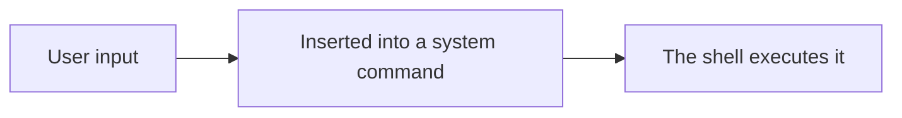
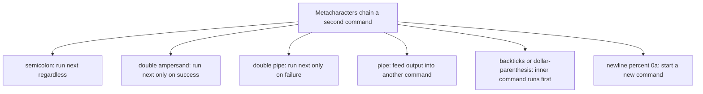
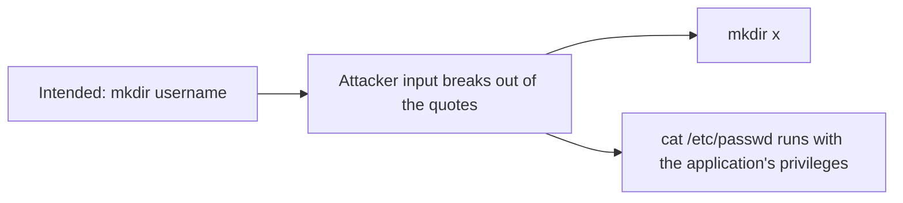
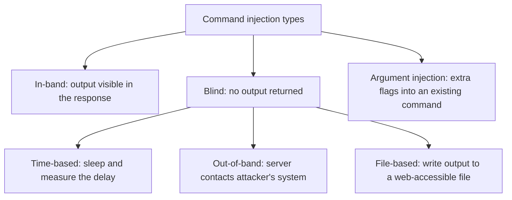
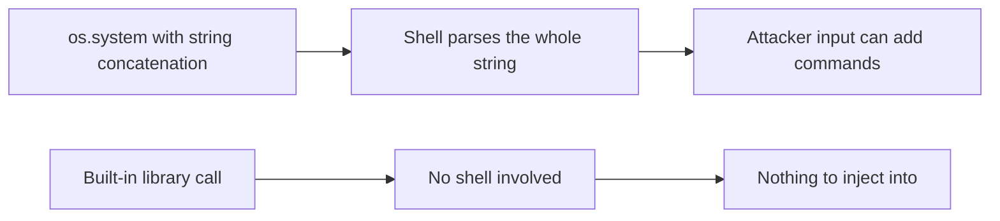
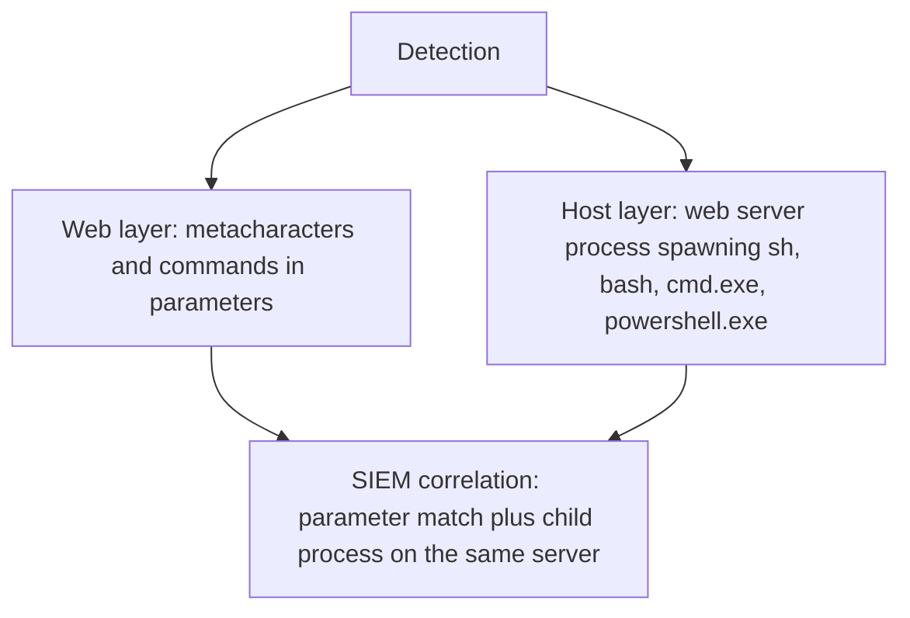

| Topic | Level | Reading Time | Prerequisites |
|---|---|---|---|
| OS Command Injection | Intermediate | ~20 min | Input Attacks Fundamentals |

> **The goal of this section:**  
> You'll understand how an ordinary text field can turn into a shell on the server, which shell metacharacters let the attacker attach a second command to the developer's command, how to tell the types apart (in-band, blind, and argument injection), how to write the code safely, and what the SOC should look for.


## Learning Objectives

By the end of this section, you will be able to:

- Define **OS command injection** and explain the three-step path from user input to shell execution.
- List the **shell metacharacters** and what each one does.
- Walk through the **mailbox application** example and explain why the attacker needs metacharacters.
- Differentiate between **in-band**, **blind** (time-based, out-of-band, file-based), and **argument injection**.
- Contrast vulnerable code that launches a shell with safer alternatives: built-in libraries, argument lists with `shell=False`, and allowlist validation.
- List prevention measures and the SOC detection signals, including a web server process spawning a shell.

## Table of Contents

- [Learning Objectives](#learning-objectives)
- [What Is OS Command Injection](#what-is-os-command-injection)
  - [Definition](#definition)
  - [The Three-Step Path](#the-three-step-path)
  - [Impact](#impact)
  - [Why Applications Use System Commands](#why-applications-use-system-commands)
- [How the Attack Works: Shell Metacharacters](#how-the-attack-works-shell-metacharacters)
- [Example: The Mailbox Application](#example-the-mailbox-application)
- [Types of Command Injection](#types-of-command-injection)
  - [In-Band (Classic)](#in-band-classic)
  - [Blind (No Output Returned)](#blind-no-output-returned)
  - [Argument Injection](#argument-injection)
- [Vulnerable Code Versus a Built-In Library](#vulnerable-code-versus-a-built-in-library)
- [If System Calls Are the Only Option](#if-system-calls-are-the-only-option)
- [Preventing and Detecting Command Injection](#preventing-and-detecting-command-injection)
  - [Prevention](#prevention)
  - [SOC Detection](#soc-detection)
- [Career Path Connections](#career-path-connections)
- [Key Terms Glossary](#key-terms-glossary)
- [Summary](#summary)

## What Is OS Command Injection

### Definition

**OS command injection** is a vulnerability that lets an attacker **run arbitrary operating system commands on the server** through a vulnerable application. It happens when **user input is passed to a shell command without validation or sanitization.**

### The Three-Step Path



### Impact

Reading sensitive files, creating users, installing malware or backdoors, pivoting inside the internal network, and full control of the server. **The commands run with the permissions of the web application's account.**

### Why Applications Use System Commands

Pinging a host, converting files, creating folders, sending mail, generating PDFs, or calling admin utilities. **The use itself isn't wrong; the mistake is building the command from untrusted input.**

> [!NOTE]
> The impact line is why the least-privilege advice in Input Attacks Fundamentals matters so much here: the injected command runs with exactly the privileges of the web application account, so a low-privilege service account turns a full server compromise into a much smaller incident.

## How the Attack Works: Shell Metacharacters

**Shell metacharacters** let the attacker **attach a second command** to the command the developer intended.

| Character | Effect |
|---|---|
| `;` | Runs the next command **regardless of the result of the first** |
| `&&` | Runs the next command **only if the first one succeeded** |
| `\|\|` | Runs the next command **only if the first one failed** |
| `\|` | Passes one command's output to another command (pipe) |
| `` ` ` `` or `$( )` | **Command substitution**: the inner command runs first |
| newline (`%0a`) | Starts a new command on the next line |



## Example: The Mailbox Application

**The scenario:** a mailbox application creates **a folder named after the user** and stores the attachments in it. It runs a command like:

```text
mkdir "username"
```

If the username **isn't sanitized**, the attacker can choose a username that **breaks out of the quotes** and adds a command of their own.

| Item | Value |
|---|---|
| **Attacker's username** | `x"; cat /etc/passwd; "` |
| **Command that actually runs** | `mkdir "x"; cat /etc/passwd; ""` |

The second command (`cat /etc/passwd`) **runs with the application's permissions.**



> [!IMPORTANT]
> Teaching note: simply naming the user `cat /etc/passwd` would only create a folder with that name. The attacker must use shell metacharacters to escape the intended command. The vulnerability is not "the text contains a command", it is "the text changes the structure of the command".

## Types of Command Injection

### In-Band (Classic)

**The command's output appears directly in the application's response.** This is **the easiest to exploit and to detect.**

### Blind (No Output Returned)

The attacker **can't see the output** and has to infer success indirectly:

| Sub-type | How It Works |
|---|---|
| **Time-based** | Inject a delay such as `; sleep 10`. **A slow response confirms execution** |
| **Out-of-band** | Make the server **contact a system the attacker controls**, for example a DNS lookup or an HTTP request that carries data |
| **File-based** | Write the output to **a file reachable from the web**, then request that file |

### Argument Injection

The attacker **can't add new commands**, but can **inject extra options or flags** into an existing command, for example a flag that makes the tool write to an arbitrary file.



> [!NOTE]
> Out-of-band blind injection leaves a DNS or HTTP request from the server to an unfamiliar destination. That is the same kind of unexpected outbound connection that gave away Log4Shell exploitation, and it is why outbound traffic and DNS logs, covered in Network and Authentication Logs, are useful for detecting this class of attack.

## Vulnerable Code Versus a Built-In Library

| Vulnerable: a shell is launched | Safer: a built-in language library |
|---|---|
| `import os` | `from datetime import datetime` |
| `time = os.popen("date").read()` | `now = datetime.now()` |
| `os.system("mkdir " + username)` | `print(now)` |

**The first:** Python launches a **system shell**, the shell runs the string, and the output comes back to the program. Getting the date **isn't dangerous**, but **the pattern is**: the second line **builds a command from input the attacker controls.**

**The second:** **there is no shell** and no system call runs, so there is nothing for the attacker to inject into. This is **the safer implementation.** Most common tasks (dates, files, compression, DNS, HTTP) **have a ready-made library.**



## If System Calls Are the Only Option

| Technique | Example |
|---|---|
| **Pass arguments as a list, with no shell** | The username is passed as a single argument and isn't interpreted as shell syntax, so semicolons and pipes **lose their special meaning** |
| **Strict allowlist validation** | Accept only the expected characters and length. **Reject everything else instead of trying to clean it** |

```python
import subprocess

subprocess.run(["mkdir", username], shell=False, check=True)
```

An example of an allowlist for a username:

```text
^[a-zA-Z0-9_]{3,20}$
```

> [!WARNING]
> Filtering and sanitization help, but escaping alone should never be the only defence. Escaping rules differ between shells and operating systems, and a single missed character reopens the hole. Argument lists with `shell=False` remove the problem at its source instead of cleaning up after it.

## Preventing and Detecting Command Injection

### Prevention

| Measure | Detail |
|---|---|
| **Avoid direct system calls** | Especially ones built from user input |
| **Use built-in libraries and APIs** | Instead of operating system commands |
| **If you must call the OS** | Argument arrays with `shell=False`, strict allowlist validation, **and never rely on escaping alone** |
| **Minimal privileges** | A **non-root** service account and restricted file permissions |
| **SELinux** | So that a successful injection **finds little it can reach** |

### SOC Detection

| Signal | What to Look For |
|---|---|
| **Request parameters** | `;` `\|` `&&`, backticks, `$(`, and `%0a`, or commands such as `cat`, `whoami`, `wget`, `curl`, and `nc` |
| **Process behavior** | **Alert when a web-server process launches a shell**: `sh`, `bash`, `cmd.exe`, or `powershell.exe` |



> [!IMPORTANT]
> The second detection signal is the stronger one. A metacharacter in a parameter shows an attempt, but a web server process spawning a shell shows that a command actually ran. This is the same child-process evidence used in the Log4Shell detection, and in both cases correlating web logs with endpoint telemetry separates an attempt from a success.

## Career Path Connections

| Career Path | How This Topic Applies |
|---|---|
| SOC Analyst | Hunts for metacharacters in parameters and, more importantly, web server processes spawning shells |
| Penetration Tester | Tests every parameter that could reach a system call, including blind variants confirmed through delays or outbound requests |
| GRC | Secure coding standards should require libraries over shell calls and allowlist validation |
| Cloud Security | Serverless functions and containers that call out to the OS are exposed to the same flaw, with the function role as the privilege boundary |

## Key Terms Glossary

| Term | Definition |
|---|---|
| OS Command Injection | A vulnerability letting an attacker run arbitrary operating system commands through an application |
| Shell Metacharacter | A character with special meaning to the shell, such as `;` or `\|`, used to chain commands |
| Command Substitution | Running an inner command first and using its output, written with backticks or `$( )` |
| In-Band Injection | Injection where command output appears in the application's response |
| Blind Injection | Injection where no output is returned and success is inferred indirectly |
| Argument Injection | Injecting extra options or flags into an existing command |
| `shell=False` | A subprocess setting that passes arguments directly without a shell interpreting them |
| SELinux | A Linux security module limiting what a compromised process can access |

## Summary

- **Command injection happens when user input reaches a shell:** and the commands run with the application account's permissions.
- **Metacharacters chain a second command:** `;`, `&&`, `||`, `|`, command substitution, and newline.
- **The attacker must change the structure of the command:** not just type a command name into a text field.
- **Three families exist:** in-band, blind (time-based, out-of-band, and file-based), and argument injection.
- **The safest fix is no shell at all:** built-in libraries remove the problem at its root.
- **If the OS call is unavoidable, use argument lists with `shell=False` plus an allowlist:** escaping alone is not enough.
- **Least privilege and SELinux limit the damage of a successful injection.**
- **SOC detection pairs web signals with host signals:** metacharacters in the parameters, and a web server process launching a shell.

