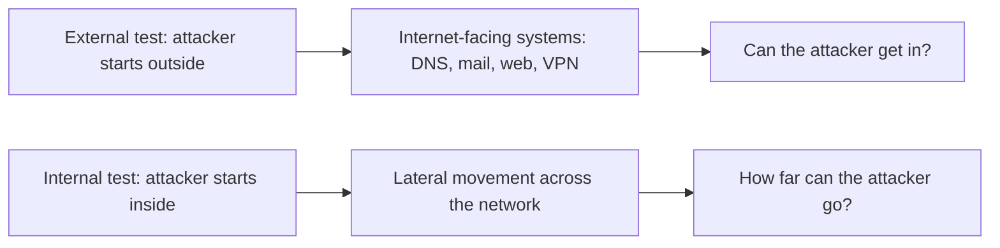
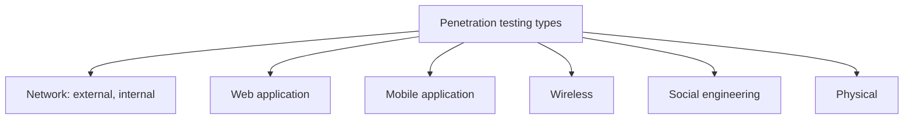
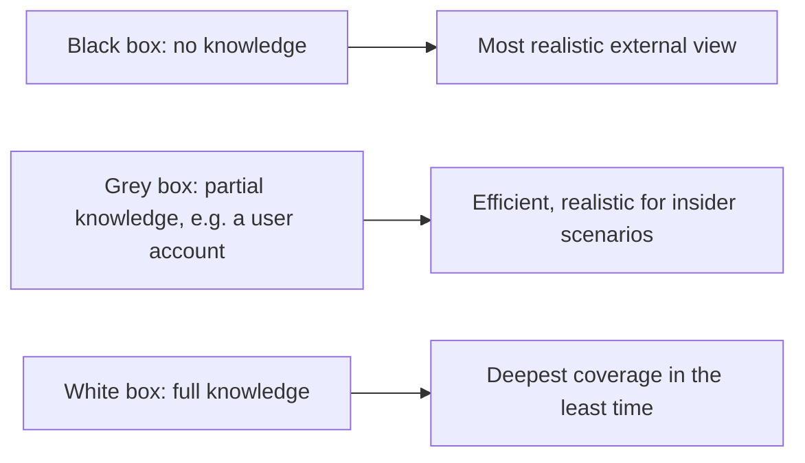
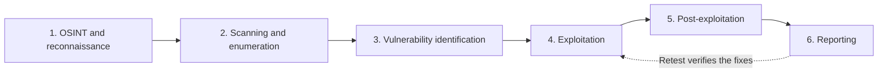
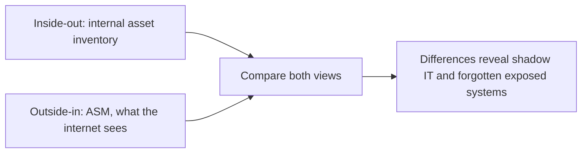
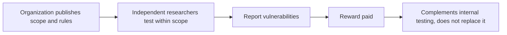

| Topic | Level | Reading Time | Prerequisites |
|---|---|---|---|
| Pentest Types, Phases, and Attack Surface Management | Beginner | ~20 min | Penetration Testing, Red Teaming, and Purple Teaming |

> **The goal of this section:**  
> You'll learn the different types of penetration testing (network, web, mobile, wireless, human, and physical), the three knowledge levels (black, grey, and white box), the six phases of any pentest from OSINT to the report, how Attack Surface Management sees the organization from the attacker's point of view, and where bug bounties fit in a security program.

## Learning Objectives

By the end of this section, you will be able to:

- Differentiate between **external** and **internal** network penetration tests.
- List the main types of penetration testing: web application, mobile, wireless, social engineering, and physical.
- Compare **black box**, **grey box**, and **white box** testing.
- Describe the six phases of a penetration test, in order, and what each delivers.
- Define **Attack Surface Management (ASM)** and contrast the outside-in view with the inside-out asset inventory.
- List practical ways to **reduce the attack surface**.
- Explain how **bug bounty programs** work and where they fit in a security program.

## Table of Contents

- [Learning Objectives](#learning-objectives)
- [Types of Penetration Testing: Network](#types-of-penetration-testing-network)
  - [External Network Test](#external-network-test)
  - [Internal Network Test](#internal-network-test)
- [Types of Penetration Testing: Application and Human](#types-of-penetration-testing-application-and-human)
- [Testing Knowledge Levels](#testing-knowledge-levels)
- [Penetration Testing Phases](#penetration-testing-phases)
  - [The Six Phases](#the-six-phases)
  - [Reporting Is the Real Deliverable](#reporting-is-the-real-deliverable)
- [Attack Surface Management (ASM)](#attack-surface-management-asm)
  - [Definition](#definition)
  - [Typical Assets](#typical-assets)
- [ASM: The Attacker's View](#asm-the-attackers-view)
  - [Outside-In Versus Inside-Out](#outside-in-versus-inside-out)
  - [Ways to Reduce the Attack Surface](#ways-to-reduce-the-attack-surface)
- [Bug Bounty Programs](#bug-bounty-programs)
- [Career Path Connections](#career-path-connections)
- [Key Terms Glossary](#key-terms-glossary)
- [Summary](#summary)

## Types of Penetration Testing: Network

### External Network Test

It is treated as a **black box**: no prior knowledge, **exactly like a real attacker**.

- It targets systems **reachable from the internet**: DNS, mail, web servers, and VPNs.
- It relies heavily on **OSINT (Open-Source Intelligence)** and scanning.
- It may include **phishing** as another way in.

### Internal Network Test

It simulates an attacker who **already has internal access**, such as a **malicious insider** or someone who **bought initial access on the dark web**.

- **The goal:** what can the attacker do after the initial foothold, and how far will they move laterally?
- **Focus areas:** firewalls, routers, the VPN, and publicly reachable servers (the **DMZ**).

| Aspect | External | Internal |
|---|---|---|
| Starting point | From outside, with no access | From inside, after an initial foothold |
| Knowledge | Black box | Internal access already in place |
| Question | Where can the attacker get in? | Once inside, how far can they reach? |
| Focus | DNS, mail, web, and VPN | Lateral movement, firewalls, routers, and the DMZ |

> [!NOTE]
> The internal test is the practical check of the segmentation covered in VLANs, Protocols, and Secure Topology Design. If VLANs, firewall rules between zones, and a properly isolated DMZ are working, an internal tester should find lateral movement hard. If not, this is where it shows up.

## Types of Penetration Testing: Application and Human

| Type | Focus |
|---|---|
| **Web application** | Web applications and databases: SQL injection, Cross-Site Scripting (XSS), authentication bypass, file upload flaws, session hijacking. The **OWASP Top 10** is the standard reference list |
| **Mobile application** | iOS and Android apps: authentication flaws, insecure storage, and reverse engineering |
| **Wireless** | Wi-Fi security: weak encryption, rogue access points, and WPA cracking |
| **Social engineering** | Targets **human weaknesses**, using phishing emails and USB drop attacks |
| **Physical** | Tests physical controls: access control systems, badge cloning, and tailgating inside buildings |

> [!NOTE]
> Each of these types maps to a topic covered elsewhere in this series: web application testing to the Input Attacks and Injection category, mobile testing to Mobile Security and Device Management, and the phishing side of social engineering to the Mobile Threats and Platform Security file.

## Testing Knowledge Levels

| Level | What the Tester Knows | Why Use It |
|---|---|---|
| **Black box** | **Nothing** | The most realistic view from outside |
| **Grey box** | **Partial knowledge**, such as a regular user account | **Efficient and realistic** for insider-threat scenarios |
| **White box** | **Full knowledge** (source code, architecture, credentials) | **The deepest coverage in the least time** |

> [!TIP]
> There is a trade-off hidden in this table: the less the tester knows, the more realistic the view but the more time is spent just discovering things. White box spends that time testing instead. Choose the level based on what question the client actually needs answered.

## Penetration Testing Phases

### The Six Phases

| # | Phase | What Happens |
|---|---|---|
| 1 | **OSINT and reconnaissance** | Gather public information (domains, employees, technologies, leaked credentials) |
| 2 | **Scanning and enumeration** | Identify live hosts, open ports, services and their versions, and extract details such as usernames and shares |
| 3 | **Vulnerability identification** | Match the discovered services against known weaknesses and misconfigurations |
| 4 | **Exploitation** | Use the weaknesses to gain access |
| 5 | **Post-exploitation** | Privilege escalation, lateral movement, persistence, **and measuring the real business impact** (what data can be reached?) |
| 6 | **Reporting** | Executive summary, technical findings with evidence, risk assessment, and remediation steps |

### Reporting Is the Real Deliverable

**The report is the actual deliverable** the client pays for. A **retest** afterwards verifies that the fixes worked.

> [!IMPORTANT]
> A technically brilliant pentest with a weak report is a failed engagement, because the client cannot act on findings they cannot understand. The executive summary lets leadership decide, and the technical findings with evidence let engineers fix.

> [!NOTE]
> Phase 2 is the offensive twin of the Nmap-style discovery that defenders try to detect, and phase 1 (OSINT) is why leaked credentials found by dark web monitoring, covered in Asset Awareness and Traffic Flow, matter so much: attackers start from the same public data.

## Attack Surface Management (ASM)

### Definition

**Attack Surface Management** is **the continuous process of discovering, monitoring, and securing every asset exposed to attackers.** It answers the question: **what does my organization expose to the internet that attackers can see and target?**

The **attack surface** is **the total number of entry points** an attacker could use.

### Typical Assets

| Category | Examples |
|---|---|
| Names and addresses | Domains, subdomains, public IP addresses |
| Infrastructure | Cloud resources, open ports |
| Certificates | Expired or misconfigured certificates |
| Hidden systems | Forgotten systems (**shadow IT**) |

## ASM: The Attacker's View

### Outside-In Versus Inside-Out

| View | What It Is |
|---|---|
| **ASM: outside-in** | Looks at the organization **from the attacker's side**, and sees **what the internet sees** |
| **Asset inventory: inside-out** | **The internal list** of what the organization owns |

**The two complement each other.**

> [!IMPORTANT]
> The most valuable output of ASM is the difference between the two lists. A system visible from the internet but absent from the inventory is shadow IT by definition, and it is exactly the kind of system that goes unscanned and unpatched, as described in Vulnerability Assessment and Risk Scoring.

### Ways to Reduce the Attack Surface

| Action | Effect |
|---|---|
| **Close unused ports** | Reduces the entry points |
| **Decommission old systems** | Removes systems that no longer get updates |
| **Enforce MFA** | Makes stolen credentials harder to use |
| **Patch exposed services quickly** | Closes vulnerabilities on what the attacker can reach |

## Bug Bounty Programs

| Aspect | Detail |
|---|---|
| **How it works** | Organizations invite independent researchers to report vulnerabilities **in exchange for rewards** |
| **Platforms and scope** | Run through platforms such as **HackerOne** and **Bugcrowd**, with a **clearly published scope and rules** |
| **Role in a security program** | **Complements, not replaces,** internal testing: it brings **continuous, diverse testing at scale** |

> [!WARNING]
> A bug bounty only authorizes testing inside the published scope and rules. Researchers who test outside the scope, or on a program that does not exist, lose the legal protection the program provides. The same rule from the previous file applies: authorization defines what is legal.

## Career Path Connections

| Career Path | How This Topic Applies |
|---|---|
| SOC Analyst | Recognizes the reconnaissance and scanning phases in logs, and uses ASM findings to know what is exposed |
| Penetration Tester | Core workflow: choose test type and knowledge level, then follow the six phases to a clear report |
| GRC | Chooses test types and frequency to satisfy compliance, and tracks remediation from the report |
| Cloud Security | ASM is especially important for cloud, where new internet-facing resources can appear in minutes |

## Key Terms Glossary

| Term | Definition |
|---|---|
| External Test | A penetration test from outside the network, targeting internet-facing systems |
| Internal Test | A penetration test assuming the attacker already has internal access |
| OSINT | Open-Source Intelligence, information collected from public sources |
| Black Box | Testing with no prior knowledge of the target |
| Grey Box | Testing with partial knowledge, such as a normal user account |
| White Box | Testing with full knowledge, including source code and credentials |
| Enumeration | Extracting details such as usernames and shares from discovered services |
| Post-Exploitation | Activity after gaining access: privilege escalation, lateral movement, persistence, impact measurement |
| Retest | A later test verifying that reported issues were actually fixed |
| Attack Surface | The total number of entry points an attacker could use |
| ASM | Attack Surface Management, continuous discovery and monitoring of exposed assets |
| Bug Bounty | A program rewarding independent researchers for reporting vulnerabilities within a stated scope |

## Summary

- **External tests start outside, internal tests start inside:** the first asks where the attacker gets in, the second asks how far they reach after getting in.
- **Five more test types exist:** web, mobile, wireless, social engineering, and physical.
- **Knowledge level trades realism for efficiency:** black box is the most realistic, white box goes deepest in the least time, and grey box sits between them.
- **A pentest follows six phases:** OSINT, scanning, vulnerability identification, exploitation, post-exploitation, and reporting.
- **The report is the deliverable:** an executive summary, technical findings with evidence, a risk assessment, and remediation steps, with a retest that verifies them.
- **ASM sees the organization the way an attacker does:** it complements the internal inventory, and the gap between them is what exposes shadow IT.
- **Reducing the attack surface is concrete:** close ports, remove old systems, enable MFA, and fix exposed services quickly.
- **Bug bounties complement internal testing at scale, inside a published scope.**

