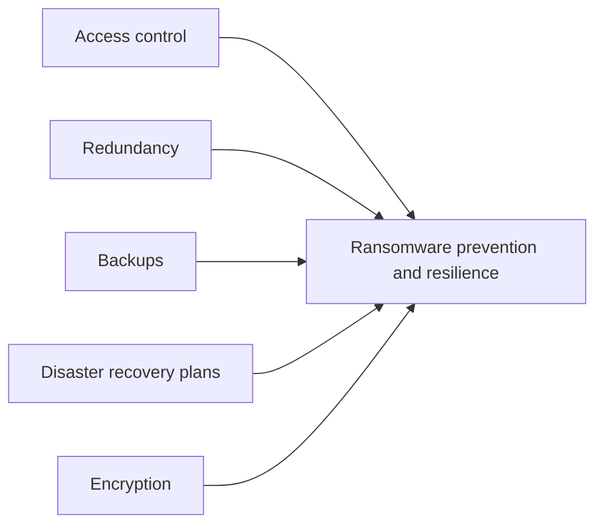
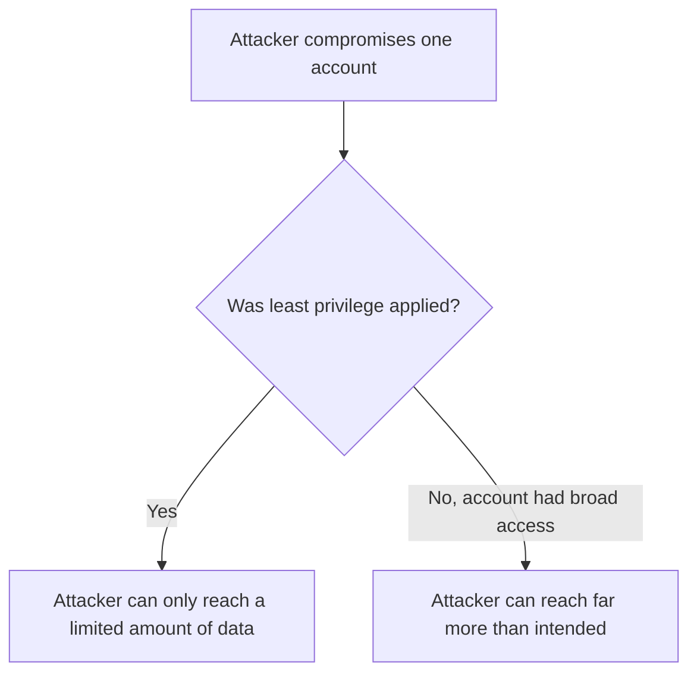
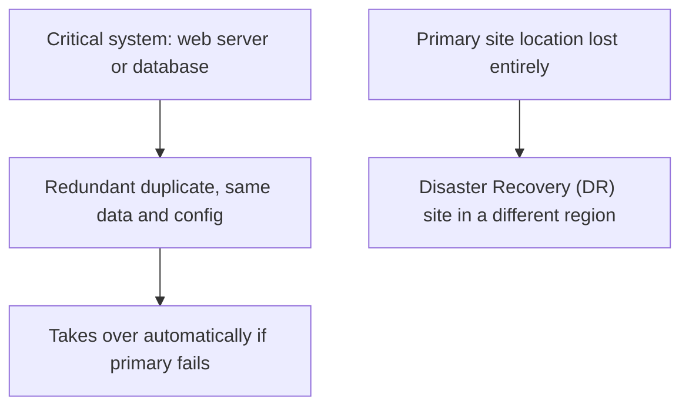
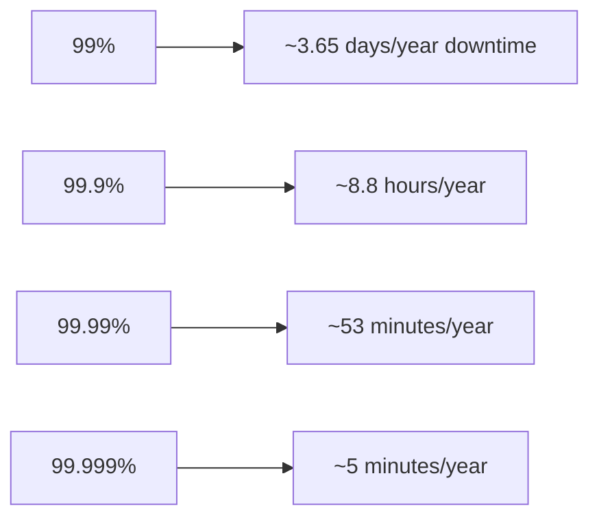
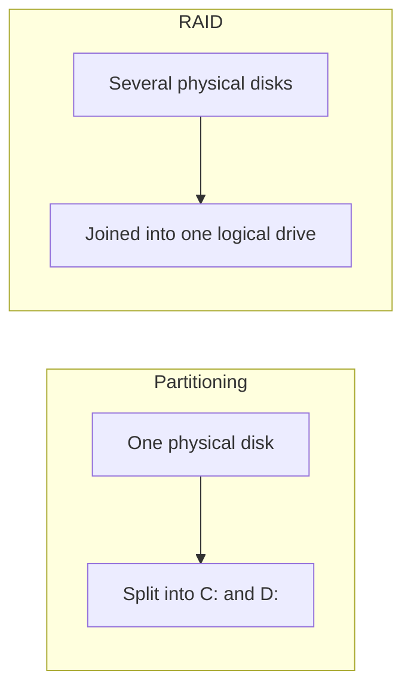
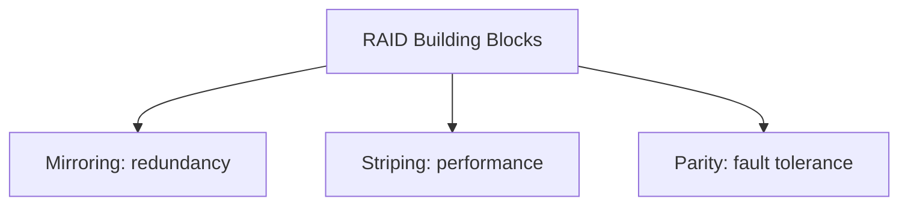
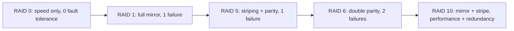
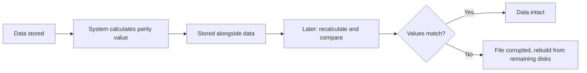
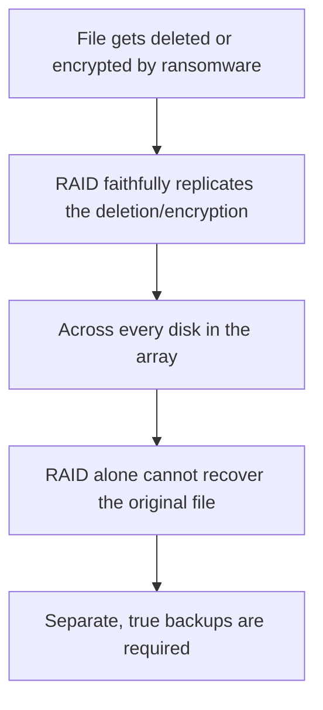

| Topic | Level | Reading Time | Prerequisites |
|---|---|---|---|
| Redundancy, High Availability, and RAID | Intermediate | ~20 min | Ransomware and the LockBit Case Study |

> **Goal of this section:**
> You'll learn the five core measures for preventing and recovering from a ransomware attack, understand the difference between redundancy and disaster recovery, learn what "the nines" mean in measuring availability, and understand RAID in detail: its components, its levels, and why it is never a substitute for backup.

## Learning Objectives

By the end of this section, you will be able to:

- List the five core **preventive and recovery measures** against ransomware and data loss.
- Explain **least privilege**, **need-to-know**, and **separation of duties** as applied specifically to limiting ransomware damage.
- Explain **defense in depth**, **network segmentation**, and the **multiple-vendor** strategy, including its cost trade-off.
- Differentiate between **system redundancy** and a **disaster recovery (DR) site**, and explain why geographic distribution matters.
- Read an **availability table ("the nines")** and explain why even minutes of downtime matter for certain industries.
- Define **RAID** and its three building blocks: mirroring, striping, and parity.
- Compare the common **RAID levels** (0, 1, 5, 6, 10) by minimum disks, fault tolerance, and typical use.
- Explain, with a concrete reason, why **RAID is not a backup**.

## Table of Contents

- [Learning Objectives](#learning-objectives)
- [Overview of Preventive Measures](#overview-of-preventive-measures)
- [Access Control and Least Privilege](#access-control-and-least-privilege)
  - [Why Access Control Matters So Much](#why-access-control-matters-so-much)
  - [Four Core Practices](#four-core-practices)
- [Defense in Depth, Segmentation, and Multiple Vendors](#defense-in-depth-segmentation-and-multiple-vendors)
  - [Defense in Depth](#defense-in-depth)
  - [Network Segmentation](#network-segmentation)
  - [Multiple Vendors](#multiple-vendors)
- [Redundancy and Disaster Recovery](#redundancy-and-disaster-recovery)
  - [System Redundancy](#system-redundancy)
  - [Disaster Recovery (DR) Site](#disaster-recovery-dr-site)
  - [Geographic Distribution](#geographic-distribution)
- [High Availability: The Nines](#high-availability-the-nines)
  - [The Availability Table](#the-availability-table)
  - [Why This Matters](#why-this-matters)
- [RAID: What Is It](#raid-what-is-it)
  - [Core Definition](#core-definition)
  - [RAID Versus Partitioning](#raid-versus-partitioning)
  - [Who Manages RAID, and Why a SOC Analyst Should Care](#who-manages-raid-and-why-a-soc-analyst-should-care)
  - [Three Building Blocks](#three-building-blocks)
- [RAID Levels](#raid-levels)
- [Read/Write Performance, Parity, and Fault Tolerance](#readwrite-performance-parity-and-fault-tolerance)
  - [Read and Write, and How Striping Helps](#read-and-write-and-how-striping-helps)
  - [Parity Check](#parity-check)
  - [RAID 6's Double Parity](#raid-6s-double-parity)
  - [RAID 10's Trade-Off](#raid-10s-trade-off)
  - [Why RAID Is Not a Backup](#why-raid-is-not-a-backup)
- [Career Path Connections](#career-path-connections)
- [Key Terms Glossary](#key-terms-glossary)
- [Summary](#summary)

## Overview of Preventive Measures

The core measures for preventing and recovering from ransomware and data loss:

| # | Measure | Core Idea |
|---|---|---|
| 1 | **Access control** | Restricting who can reach the data |
| 2 | **Redundancy** | Duplicating systems so that one failure doesn't stop the business |
| 3 | **Backups** | Keeping copies to restore from |
| 4 | **Disaster recovery plans** | Knowing exactly what to do when a disaster strikes |
| 5 | **Encryption** | Making stolen data unreadable |

> [!TIP]
> In interviews, if asked "how do you prevent ransomware?", start with this five-point list. This file covers the first two in depth (access control and redundancy, including RAID); backups and encryption are covered in full in the Backup Strategies and Data Recovery file.

## Access Control and Least Privilege

### Why Access Control Matters So Much

**Access control** is one of the most important security mitigations. When implemented well, it **significantly reduces data loss and unauthorized access**.

### Four Core Practices

| Practice | What It Means |
|---|---|
| **Least privilege** | Everyone gets the minimum access their job requires, and no more |
| **Need-to-know** | Access to a specific data set is granted only to the people who actually use it |
| **Separation of duties** | No one person alone can complete a critical action |
| **Regular reviews** | Removing access when someone changes roles or leaves the company |

> [!IMPORTANT]
> Least privilege limits the damage of a compromised account, which is why it is one of the best defenses against ransomware specifically. A stolen credential with narrow access simply cannot reach, encrypt, or exfiltrate as much data.

> [!NOTE]
> This connects directly to the full treatment of least privilege, need-to-know, and separation of duties in the Access Control Models file from the Zero Trust and Access Management category. Here, the same principles are applied specifically as a ransomware mitigation.

## Defense in Depth, Segmentation, and Multiple Vendors

### Defense in Depth

Using **multiple layers of protection**, so that if one fails, another layer catches the attack.

> [!NOTE]
> The full model, with its five core layers (Perimeter, Network, Host, Application, Data), is covered in depth in the Defense in Depth Model file from the Defense in Depth and Evasion Techniques category.

### Network Segmentation

Dividing the network into **zones**, so that malware **can't spread freely** from one zone to another.

### Multiple Vendors

Using controls from **different companies**. If one product misses an attack or has a hidden vulnerability, another product may stop it.

Example: an email security product from one company may let a malicious email through, while another product stops it. Large organizations may run **firewalls or backup systems from two different companies** for this very reason.

**The trade-off: cost.** This approach is common in organizations that can afford it, such as banks and large enterprises.

> [!TIP]
> This is the practical, real-world extension of defense in depth's "independent layers" principle: using different vendors makes the layers genuinely independent, since two products from the same vendor often share the same blind spots.

## Redundancy and Disaster Recovery

### System Redundancy

Keeping a **duplicate** of a critical system (for example, a web server or SQL database) with the same data and configuration, **ready to take over** if the primary one fails.

### Disaster Recovery (DR) Site

A second site the business can operate from if the main site is **completely lost**.

### Geographic Distribution

**Don't keep all your copies in one city.** If a disaster hits Cairo, **every copy in Cairo is lost**. Keep copies in **different regions**, as Maersk did.

> [!NOTE]
> This is the same lesson drawn from the Maersk/NotPetya case study covered in Data Loss Fundamentals and DLP Operations: the only surviving data copy existed purely by geographic accident. Deliberate geographic distribution turns that accident into a designed-in guarantee.

## High Availability: The Nines

### The Availability Table

| Availability | Downtime per Year |
|---|---|
| 99% | About 3.65 days |
| 99.9% | About 8.8 hours |
| 99.99% | About 53 minutes |
| 99.999% ("five nines") | About 5 minutes |

### Why This Matters

For a stock exchange, a bank, or a call center, **even three minutes of downtime can cost millions**, so they invest heavily in redundancy.

> [!IMPORTANT]
> Each additional "nine" represents an exponentially harder (and more expensive) engineering target. Moving from 99.9% to 99.99% is not a small improvement; it typically requires fundamentally different architecture, not just better maintenance.

## RAID: What Is It

### Core Definition

**RAID** stands for **Redundant Array of Independent Disks**.

It's a storage technology that combines multiple **physical disks** into **a single logical disk**, which the operating system sees as **a single drive**.

### RAID Versus Partitioning

**RAID is the opposite of partitioning**: partitioning splits a single disk into multiple drives (`C:`, `D:`), while **RAID combines multiple disks into one**.

### Who Manages RAID, and Why a SOC Analyst Should Care

RAID is usually managed by **the storage team**, but **the SOC analyst needs to understand it**, because it shows up in logs and in interviews.

### Three Building Blocks

| Block | What It Does | Purpose |
|---|---|---|
| **Mirroring** | The same data is written to more than one disk | Redundancy |
| **Striping** | The data is split into chunks distributed across the disks | Performance (faster reads and writes) |
| **Parity** | Extra calculated information that lets the system detect corruption and rebuild lost data | Fault tolerance |

## RAID Levels

| Level | Method | Min Disks | Failures Survived | Main Benefit | Typical Use |
|---|---|---|---|---|---|
| **RAID 0** | Striping only | 2 | 0 | Maximum speed | Temporary or non-critical data that needs speed |
| **RAID 1** | Mirroring | 2 | 1 | A complete copy of the data | Small critical systems |
| **RAID 5** | Striping + parity | 3 | 1 | A balance of speed, capacity, and safety | Very common in company servers |
| **RAID 6** | Striping + double parity | 4 | 2 | Higher fault tolerance | Data with zero tolerance for loss |
| **RAID 10** | Mirror + stripe | 4 | 1 per mirrored pair | Speed and redundancy together | Databases, heavy workloads |

**The number after the word RAID tells you which implementation is being used.**

> [!WARNING]
> RAID 0 has zero fault tolerance despite being part of the "RAID" family. It is pure performance striping with no redundancy at all: losing any single disk in a RAID 0 array loses the entire array's data.

## Read/Write Performance, Parity, and Fault Tolerance

### Read and Write, and How Striping Helps

**Read** means retrieving data from the disk. **Write** means saving new data to it. Striping improves both, because **multiple disks work at the same time**.

### Parity Check

The system calculates **a value from the stored data** and stores it. Later, it recalculates the value and compares the two. If the values **don't match**, the file **has been corrupted**.

With parity, RAID can **detect a damaged file, discard the bad copy, and rebuild it correctly from the remaining disks**.

### RAID 6's Double Parity

**RAID 6 uses double parity**, so it checks **twice**. It's designed for data with **absolutely no tolerance for errors**, like verifying **a person's ID card and passport together**.

### RAID 10's Trade-Off

**RAID 10 combines mirroring and striping** for performance and redundancy together, but it **needs more disks, which makes it more expensive**.

### Why RAID Is Not a Backup

> [!IMPORTANT]
> Important interview point: RAID is NOT a backup. RAID protects against a disk failure. It does not protect against deletion, ransomware, or a fire: if a file is deleted or encrypted, RAID faithfully copies the deletion or encryption to every disk. You still need real backups.

> [!TIP]
> A clean way to phrase this distinction: RAID protects against hardware failure, backups protect against data loss events. They solve two completely different problems, and a resilient organization needs both. For the full treatment of actual backup strategy, see the Backup Strategies and Data Recovery file.

## Career Path Connections

| Career Path | How This Topic Applies |
|---|---|
| SOC Analyst | Must recognize RAID references in storage logs and understand which failures RAID does and does not protect against |
| Penetration Tester | Understanding redundancy and multi-vendor defenses helps assess realistic detection gaps during authorized engagements |
| GRC | Disaster recovery planning and high-availability targets are standard business continuity audit requirements |
| Cloud Security | Cloud providers implement redundancy, multi-region distribution, and RAID-equivalent storage resilience natively |

## Key Terms Glossary

| Term | Definition |
|---|---|
| Least Privilege | Granting only the minimum access required to perform a job |
| Need-to-Know | Restricting access to a data set to only those who actually use it |
| Separation of Duties | Ensuring no single person can complete a critical action alone |
| Defense in Depth | Using multiple layers of protection so one failure does not expose everything |
| Network Segmentation | Dividing a network into zones to limit malware spread |
| Multiple Vendors | Using security controls from different vendors to avoid shared blind spots |
| System Redundancy | Keeping a duplicate of a critical system ready to take over on failure |
| Disaster Recovery (DR) Site | A second location from which business can operate if the main site is lost |
| High Availability | A system's ability to remain operational, measured in "nines" of uptime percentage |
| RAID | Redundant Array of Independent Disks, combining multiple physical disks into one logical disk |
| Mirroring | Writing the same data to more than one disk for redundancy |
| Striping | Splitting data across multiple disks for performance |
| Parity | Calculated extra information enabling corruption detection and data rebuilding |

## Summary

- **Five measures form the core of ransomware prevention and resilience:** access control, redundancy, backups, disaster recovery plans, and encryption.
- **Least privilege limits the blast radius of a compromised account:** Part of why it's one of the best defenses against ransomware specifically.
- **Multiple vendors create genuinely independent defense layers:** At extra cost, common in large organizations.
- **Redundancy and DR solve different scopes of failure:** A single failed system versus the loss of an entire site, and geographic distribution is essential for both.
- **Each additional "nine" of availability is exponentially harder to achieve:** And even minutes of downtime can cost millions for critical systems.
- **RAID has three building blocks:** mirroring for redundancy, striping for performance, and parity for fault tolerance.
- **RAID levels trade off disks, fault tolerance, and use case:** From RAID 0 (speed only) to RAID 10 (speed and redundancy at a higher cost).
- **RAID is definitively not a backup:** It protects you only from hardware failure, not from deletion, ransomware, or fire.

