> **Goal of this section:**
>  You'll learn how to design a secure network for a small business from scratch — you'll know where to place each security device, how to separate the different networks, and how to protect sensitive data from attackers, whether they're outside or inside the network.
---

# Secure Network Design for Small Business (50 Employees)

## Table of Contents

- [Introduction — Why Do We Need Network Security?](#introduction)
- [Understanding the Network Requirements](#network-requirements)
- [Security Devices — The Required Security Devices](#security-devices)
- [Network Segmentation — Dividing the Network](#network-segmentation)
- [Full Network Topology Diagram](#topology-diagram)
- [Zone-by-Zone Deep Dive](#zone-deep-dive)
   - [Internet Edge Zone](#internet-edge)
   - [DMZ — Demilitarized Zone](#dmz-zone)
   - [Internal Employee Network](#internal-network)
   - [Server Zone](#server-zone)
   - [Guest WiFi Zone](#guest-wifi)
   - [Remote Workers](#remote-workers)
- [Security Devices Placement Summary](#placement-summary)
- [Traffic Flow Analysis](#traffic-flow)
- [Summary](#summary)

---

## Introduction

Imagine the network is like a house — it needs doors, windows, and security cameras. Not everyone should be able to enter every room, and some rooms hold valuable things (like the safe) that need more protection.

Our company has **50 employees** and needs to provide:

| Need | What It Means in Practice |
|---|---|
| **Public Services** | Websites or APIs that people on the internet access |
| **Internal Network** | The employees' internal network — not for anyone else |
| **Servers** | Hold sensitive data that needs the highest level of protection |
| **Remote Workers** | Employees who work from home and need to reach the network |
| **Guest WiFi** | Visitors or customers who need internet but not our internal network |

---

## Network-requirements

Before we start designing, we need to understand the **Threats** we're fighting:

```
From outside (External Threats):
  - Hackers on the internet trying to break into the Servers
  - DDoS Attacks on the Public Services
  - Man-in-the-Middle against the Remote Workers

From inside (Internal Threats):
  - An employee trying to access data they're not entitled to
  - A guest on the Guest WiFi trying to get into the internal network
  - Malware spreading inside the network
```

> [!IMPORTANT]
> The **"Zero Trust"** principle says: don't trust anyone automatically — even if they're inside the network. Every device and every user must be verified before accessing any resource.

---

## Security-devices

These are the devices we'll use in the design:

### 🔥 Firewall
The firewall — it inspects all incoming and outgoing traffic and decides whether to let it through or not, based on **Rules** you define.

```
Firewall Rule Example:
  ALLOW  TCP  from ANY         to DMZ:80,443   (HTTP/HTTPS for the public)
  ALLOW  TCP  from Internal    to Servers:3306 (MySQL for employees only)
  DENY   ALL  from Guest_WiFi  to Internal     (Guests can't access internal)
  DENY   ALL  from ANY         to Servers      (default: block everything)
```

### 🛡️ IDS / IPS (Intrusion Detection/Prevention System)
- **IDS** = detects the attack and sends an alert
- **IPS** = detects the attack and stops it automatically

> [!NOTE]
> An IDS is like a camera — it records and reports. An IPS is like a guard — it acts immediately. In a small business, the IPS is usually built into the modern firewall (Next-Gen Firewall).

### 🌐 Router
Routes traffic between different networks and between the network and the internet.

### 🔀 Switch
Connects devices to each other within the same network. A **Managed Switch** lets you create **VLANs** to divide the network logically.

### 📡 Wireless Access Point (WAP)
Provides WiFi — we need to separate the Employee WiFi from the Guest WiFi.

### 🔐 VPN Gateway
Lets Remote Workers connect to the internal network securely and with encryption.

### ⚖️ Load Balancer *(optional for Public Services)*
If we have more than one server for the Public Services, the Load Balancer distributes the traffic across them.

---

## Network-segmentation

The most important principle in Network Security is **Segmentation** — dividing the network into separate zones. If a hacker gets into one zone, they can't easily move to the rest of the network.

```
The zones we'll create:
  ┌─────────────────────────────────────┐
  │         INTERNET (Untrusted)        │
  └─────────────────────────────────────┘
              ↕ (Firewall 1)
  ┌─────────────────────────────────────┐
  │     DMZ — Demilitarized Zone        │
  │   (Web Server, Mail Server, etc.)   │
  └─────────────────────────────────────┘
              ↕ (Firewall 2)
  ┌──────────────┬──────────────────────┐
  │ Internal LAN │    Server Zone       │
  │  (Employees) │  (Database, Files)   │
  └──────────────┴──────────────────────┘
  ┌──────────────┬──────────────────────┐
  │  Guest WiFi  │   VPN (Remote)       │
  └──────────────┴──────────────────────┘
```

> [!WARNING]
> **Don't put the Servers in the same segment as the employees!** If malware reaches an employee's machine, it will reach the Servers right away. Segmentation prevents Lateral Movement.

---

## Topology-diagram

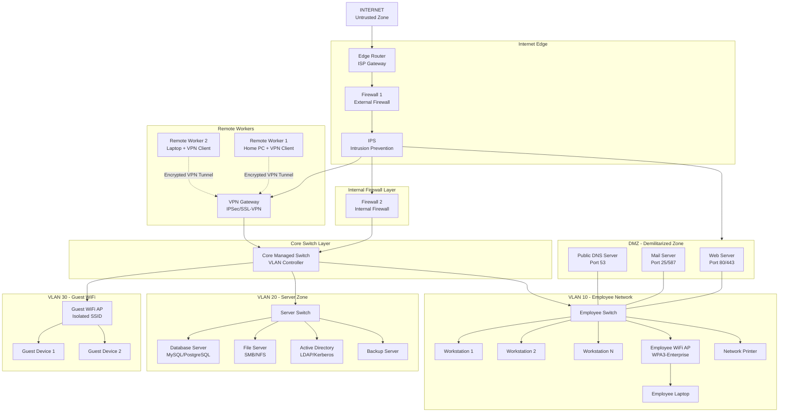

> [!NOTE]
> The dashed lines in the diagram represent the **Encrypted VPN Tunnels** — Remote Workers connect over the internet, but the connection is fully encrypted.

---

## Zone-deep-dive

### Internet-edge

This is the first line of defense — the only entry point from the internet.

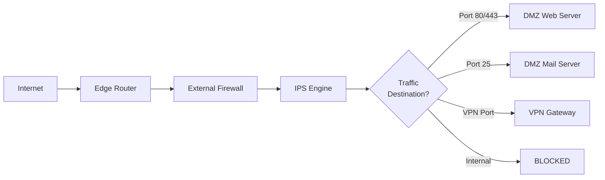

**The Edge Router** does:
- **NAT** (Network Address Translation) — hides the internal IP addresses
- **Basic ACLs** — blocks obviously malicious traffic
- **BGP/OSPF** routing with the ISP

**The External Firewall** does:
- Opens only the required ports (80, 443, 25, VPN Port)
- Blocks everything else
- **Stateful Inspection** — tracks the state of every connection

**The IPS** does:
- Detects attack signatures
- Stops DDoS, SQL Injection, and others
- Records every event in the logs

---

### Dmz-zone

The DMZ is a "neutral" zone — not quite the internet and not quite the internal network. The Public Services are placed here.

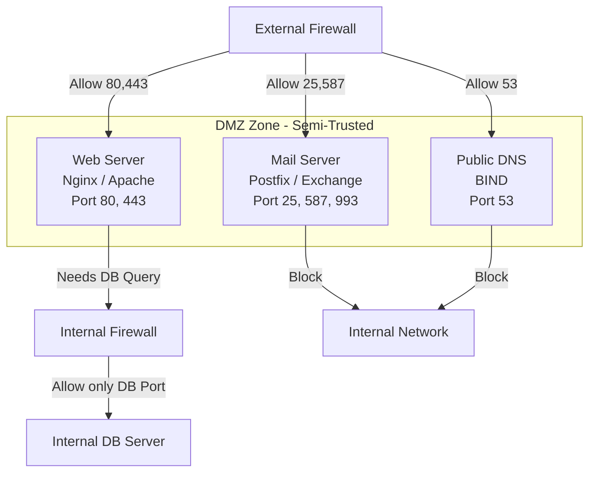

> [!IMPORTANT]
> **The DMZ rule:** Servers in the DMZ are allowed to talk to the internet, and they're allowed to request data from the internal servers (such as the database), but **only through a very specific firewall rule**. DMZ servers shouldn't be able to start a new connection to the internal network without permission.

**Why is the DMZ important?**

If a hacker breaches the Web Server in the DMZ, they won't be able to move into the internal network, because there's **a second firewall** (Firewall 2) blocking them.

---

### Internal-network

The employee network is on **VLAN 10** — isolated from the Guest WiFi and from the Servers.

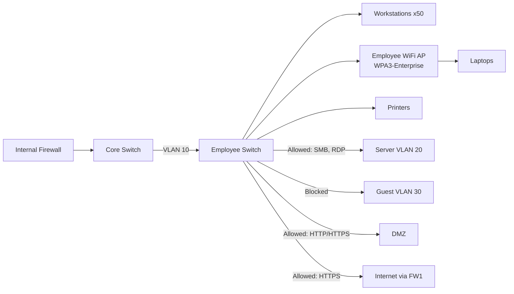

**Important settings for the Employee Network:**

| Setting | Value | Reason |
|---|---|---|
| **DHCP Range** | 192.168.10.10 – 192.168.10.200 | Automatic IP assignment |
| **Gateway** | 192.168.10.1 | The Core Switch |
| **DNS** | Internal AD DNS | Forwards to the Public DNS if needed |
| **WiFi Auth** | WPA3-Enterprise (802.1X) | Authentication through AD |
| **Network Access Control** | Enabled | Makes sure the device is healthy before it's allowed in |

> [!TIP]
> Use **802.1X Authentication** on the Employee WiFi — this means each employee authenticates with their own username and password from Active Directory, not with a shared password. If an employee leaves, you disable their account and they immediately can't connect.

---

### Server-zone

The most sensitive point in the network — it holds the most important data.

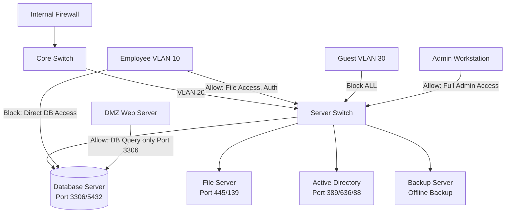

**Why are the Servers in a separate VLAN?**

- **Least Privilege**: everything is blocked by default except what's explicitly allowed
- **Breach Containment**: if an employee's machine is compromised, the attacker won't reach the DB directly
- **Monitoring**: it's easy to monitor all traffic going into and out of the Servers

> [!WARNING]
> **No regular employee should be able to reach the Database Server directly.** The DB only accepts queries from the Application Server (or the Web Server in the DMZ). Even developers must use a Bastion Host or Jump Server for administrative access.

---

### Guest-wifi

Guests and customers need internet — but not our internal network.

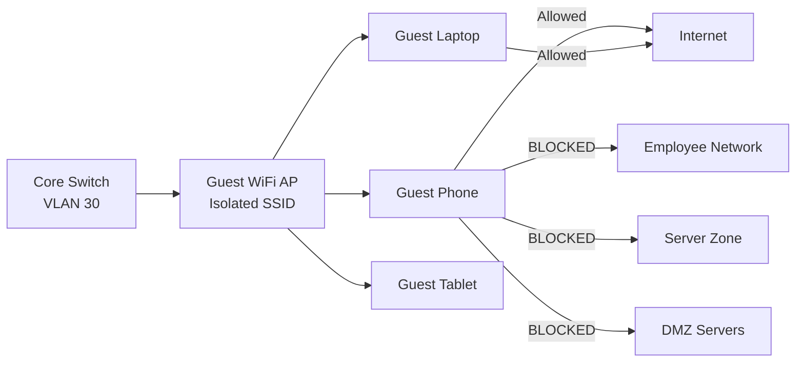

**Guest WiFi settings:**

```
SSID Name:    "CompanyName-Guest"
Security:     WPA2/WPA3-Personal (password changes every week)
VLAN:         VLAN 30 (fully isolated)
DHCP Range:   192.168.30.10 – 192.168.30.100
Gateway:      192.168.30.1
Firewall:     Allow ONLY port 80, 443 to Internet
              Block EVERYTHING to Internal Networks
Client Isolation: ON  ← Important! Prevents guests from seeing each other
```

> [!TIP]
> Enable **Client Isolation** on the Guest WiFi — this prevents any guest device from talking to another guest device on the same WiFi. If someone tries to launch an attack from the network, they won't be able to reach the other devices.

---

### Remote-workers

Employees who work from home need to reach the internal network securely.

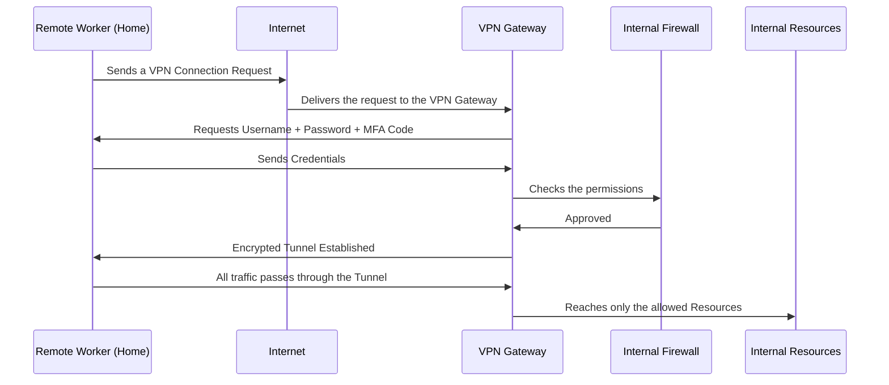

**VPN settings:**

| Setting | Preferred Option |
|---|---|
| **Protocol** | IPSec/IKEv2 or WireGuard |
| **Authentication** | Username + Password + **MFA** (Multi-Factor Authentication) |
| **Split Tunneling** | Disabled — all traffic goes through the VPN |
| **Access Level** | Based on the employee's role — not every Remote Worker can reach everything |
| **Session Timeout** | 8 hours — if the employee leaves the device, the session ends |

> [!IMPORTANT]
> You must enable **MFA (Multi-Factor Authentication)** on the VPN. If a hacker steals an employee's password, they won't be able to get in without the second factor (the phone or a token). This is the most important security measure for Remote Access.

---

## Placement-summary

| Device | Location in the Network | Function |
|---|---|---|
| **Edge Router** | Between the ISP and the Firewall | Traffic routing + NAT |
| **External Firewall (FW1)** | Directly after the Router | The first line of defense against the internet |
| **IPS** | After FW1, before the DMZ and internal network | Detecting and preventing attacks |
| **DMZ Switch** | Inside the DMZ | Connecting the Public Servers |
| **Internal Firewall (FW2)** | Between the DMZ and the internal network | Isolating the internal network from the DMZ |
| **Core Managed Switch** | The heart of the internal network | Distributing the VLANs |
| **Employee Switch** | Inside VLAN 10 | Connecting employee devices |
| **Server Switch** | Inside VLAN 20 | Connecting the Servers |
| **Employee WiFi AP** | In work areas | WiFi for employees (WPA3-Enterprise) |
| **Guest WiFi AP** | In reception/meeting rooms | WiFi for visitors (isolated) |
| **VPN Gateway** | Behind FW1, before FW2 | Receiving Remote Worker connections |

---

## Traffic-flow

### Scenario 1: A Customer Opens the Website from the Internet

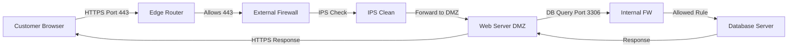

### Scenario 2: An Employee Opens a File from the File Server

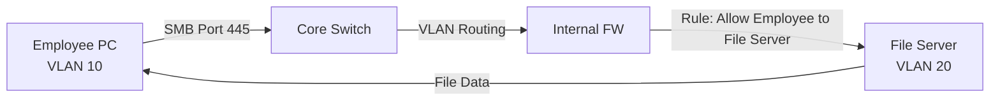

### Scenario 3: A Guest Tries to Get into the Internal Network

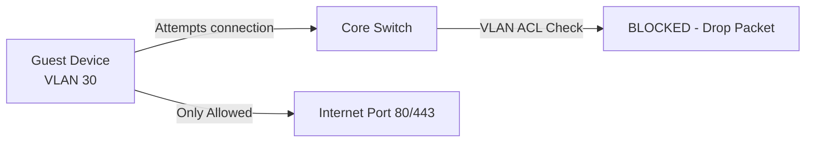

### Scenario 4: A Remote Worker Connects to the VPN

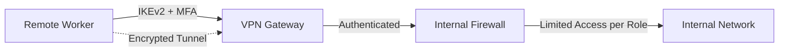

---

## 9. IP Addressing Scheme

A table to define the IP ranges for each zone:

| Zone | Network | Range | Devices |
|---|---|---|---|
| **DMZ** | 10.0.1.0/24 | 10.0.1.1 – 10.0.1.50 | Public Servers |
| **Employee LAN (VLAN 10)** | 192.168.10.0/24 | 192.168.10.10 – 192.168.10.200 | 50 Workstations + WiFi |
| **Server Zone (VLAN 20)** | 192.168.20.0/24 | 192.168.20.10 – 192.168.20.50 | Servers |
| **Guest WiFi (VLAN 30)** | 192.168.30.0/24 | 192.168.30.10 – 192.168.30.100 | Guest Devices |
| **VPN Pool** | 10.8.0.0/24 | 10.8.0.10 – 10.8.0.50 | Remote Workers |

> [!NOTE]
> The DMZ gets a completely different range (10.0.1.x) so we can easily tell it apart from the internal networks (192.168.x.x) in the firewall rules and logs.

---

## Summary

### Design Summary

In this design, we built a secure network for a 50-employee company using the core principles of Network Security:

**The principles used:**
- **Defense in Depth** — multiple layers of protection (FW1 → IPS → FW2 → VLANs)
- **Network Segmentation** — every zone is isolated and has its own permissions
- **Least Privilege** — everything is blocked by default except what's explicitly allowed
- **Zero Trust** — even internal employees always have their identity verified

**The zones we created:**

| Zone | Protection | Inside | External Access |
|---|---|---|---|
| **DMZ** | Between FW1 and FW2 | Web, Mail, DNS Servers | Connected to the internet |
| **Employee Network (VLAN 10)** | FW2 + VLAN ACL | 50 employees + Laptops | Limited access to the Servers |
| **Server Zone (VLAN 20)** | FW2 + Strict Rules | DBs, Files, AD | No internet access |
| **Guest WiFi (VLAN 30)** | Client Isolation + VLAN | Guests only | Internet only |
| **Remote Workers** | VPN + MFA | Authenticated Users | Limited access based on role |

**The key devices and their locations:**
- **FW1**: between the internet and the DMZ/VPN
- **IPS**: protects all incoming traffic
- **FW2**: separates the DMZ from the Internal Network
- **Core Managed Switch**: controls the internal VLANs
- **VPN Gateway**: receives Remote Workers securely, with encryption

> [!IMPORTANT]
> This design isn't the end of the road — security is a continuous process. You need to review the firewall rules regularly, update the IPS signatures, and monitor the logs daily to detect any unusual activity.
