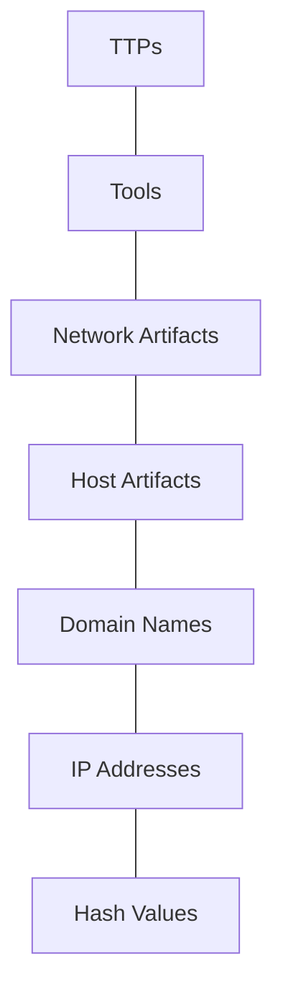
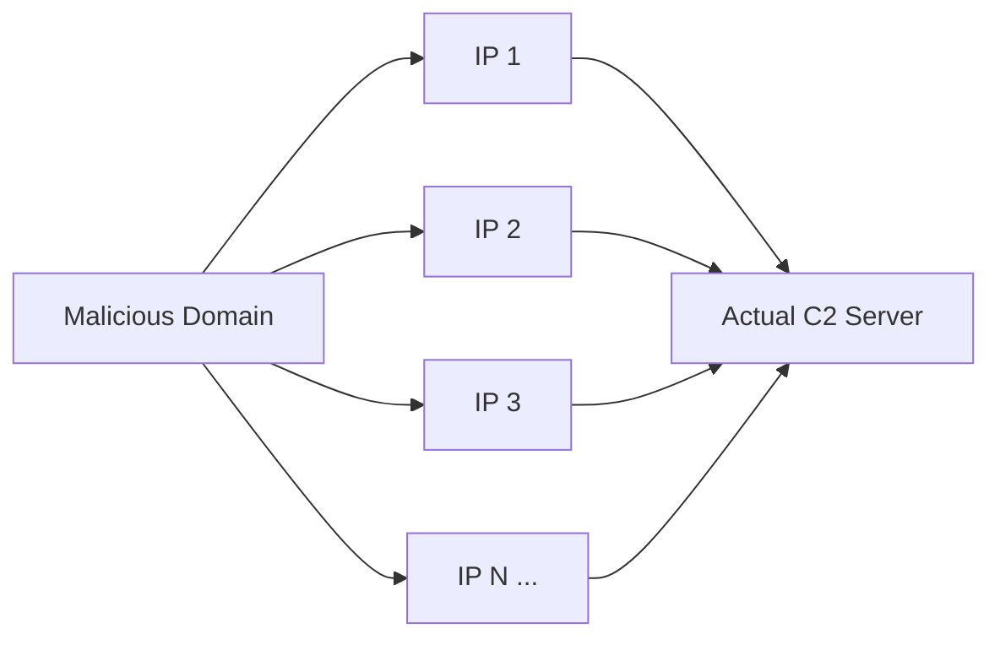
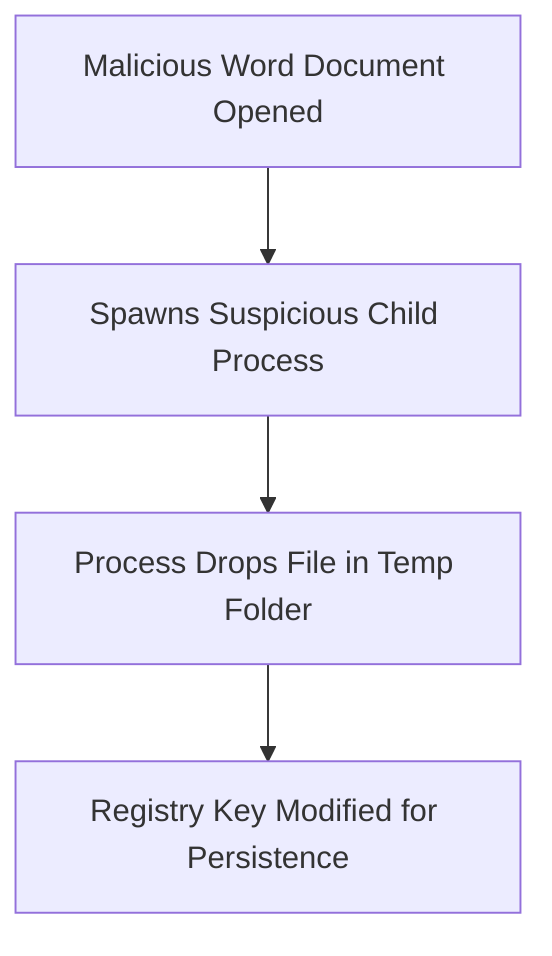
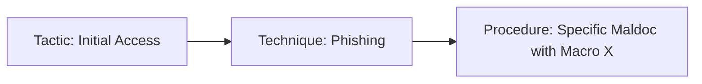

> **Goal of this section:**
> You'll understand what the **Pyramid of Pain** is, how each type of indicator (from a simple Hash all the way up to complex TTPs) affects the attacker differently when you detect it, and how, as a SOC Analyst, you can use this pyramid to decide where to focus your detection effort so you cause the attacker the most pain.

## Table of Contents

- [What is the Pyramid of Pain?](#what-is-the-pyramid-of-pain)
- [Level 1: Hash Values](#level-1-hash-values)
- [Level 2: IP Addresses](#level-2-ip-addresses)
- [Level 3: Domain Names](#level-3-domain-names)
- [Level 4: Host Artifacts](#level-4-host-artifacts)
- [Level 5: Network Artifacts](#level-5-network-artifacts)
- [Level 6: Tools](#level-6-tools)
- [Level 7: TTPs (Tactics, Techniques & Procedures)](#level-7-ttps-tactics-techniques--procedures)
- [Summary Comparison Table](#summary-comparison-table)
- [Summary](#summary)

---

## What is the Pyramid of Pain?

The **Pyramid of Pain** is a model created by **David Bianco** that shows the relationship between the types of **Indicators of Compromise (IOCs)** you can detect as a Defender and how much "pain" you'll cause the attacker if you manage to detect and block that indicator.

The core idea: not all IOCs have the same value. If you detect an IP Address, the attacker will change it in seconds. But if you detect their **TTPs** (the way they operate), they'll be forced to rebuild their whole attack approach — and that costs them real time, money, and effort.



> [!IMPORTANT]
> The higher you go up the pyramid, the harder detection becomes for you as a Defender, but at the same time, the more painful it is for the attacker. The strategic goal of any mature SOC is not to stop at the base (Hashes and IPs) alone; it has to climb higher.

The pyramid is traditionally colored as follows, from the base to the top:

| Color | Level | Pain Level for the Attacker |
|---|---|---|
| Green | Hash Values | Trivial |
| Green | IP Addresses | Easy |
| Teal | Domain Names | Simple |
| Yellow | Host Artifacts | Annoying |
| Yellow | Network Artifacts | Annoying |
| Orange | Tools | Challenging |
| Red | TTPs | Tough! |

> [!TIP]
> When you're doing Threat Hunting or writing a new Detection Rule, always ask yourself: "What am I detecting right now? Is it just a Hash, or am I detecting the attacker's real behavior?" The higher you go up the pyramid, the more resistant your detection becomes to changes on the other side.

---

## Level 1: Hash Values

### What Is a Hash Value?

A Hash Value is a fixed-length number generated by running a specific file through a specific Hashing algorithm, and it's used to "fingerprint" that file uniquely (Unique Identifier). The most well-known algorithms:

| Algorithm | Year | Bit Length | Hex Digits | Security Status |
|---|---|---|---|---|
| MD5 | 1992 | 128-bit | 32 | Insecure, vulnerable to Collision Attacks (RFC 6151) |
| SHA-1 | 1995 | 160-bit | 40 | Deprecated by NIST in 2011, prohibited for use in Digital Signatures at the end of 2013 |
| SHA-2 (SHA-256) | 2001 | 256-bit | 64 | Currently recommended (NIST/NSA) |

> [!NOTE]
> A "Collision" means finding two completely different files that have the same Hash Value. If that happens, the algorithm is no longer reliable, because you can't be sure the file really is the same one.

### Why Are Hashes at the Bottom of the Pyramid?

From a **SOC Analyst's** perspective, the Hash is the easiest IOC to use — you can look up the Hash on tools like **VirusTotal** or **Metadefender Cloud - OPSWAT** and immediately know whether the file is known to be Malicious.

The problem is that any tiny change to the file — even a single character added at the end — changes the Hash completely. This means the attacker can "escape" detection with minimal effort.

```powershell
# Before the change
PS C:\Users\THM\Downloads> Get-FileHash .\OpenVPN_2.5.1_I601_amd64.msi -Algorithm MD5
Algorithm Hash                             Path
_________ ____                             ____
MD5       D1A008E3A606F24590A02B853E955CF7  ...OpenVPN_2.5.1_I601_amd64.msi

# The attacker appends a very simple line to the file
PS C:\Users\THM\Downloads> echo "AppendTheHash" >> .\OpenVPN_2.5.1_I601_amd64.msi

# After the change - the Hash has changed completely
PS C:\Users\THM\Downloads> Get-FileHash .\OpenVPN_2.5.1_I601_amd64.msi -Algorithm MD5
Algorithm Hash                             Path
_________ ____                             ____
MD5       9D52B46F5DE41B73418F8E0DACEC5E9F  ...OpenVPN_2.5.1_I601_amd64.msi
```

> [!WARNING]
> Don't rely on File Hashes alone as your main IOC in Threat Hunting. With so many variants of the same Malware Family, relying on the Hash alone will always keep you one step behind the attacker, because they can change it in a second.

### Useful Sources for Hash Lookup

- **VirusTotal** — also gives you the Filename next to the Hash, often showing names like `m_croetian.wnry` as an example of a Ransomware file.
- **Metadefender Cloud - OPSWAT**
- **The DFIR Report** and **Trellix Threat Research Blogs** — real reports that list the sample Hashes at the end.

---

## Level 2: IP Addresses

An IP Address is the address that identifies any device on the network — from an ordinary Desktop all the way to CCTV cameras. In the context of the Pyramid of Pain, we look at the IP as an indicator that can point us to attacker activity (for example, a Server hosting C2).

### Why Is It Still Easy for the Attacker to Change?

The common defensive tactic is **Blocking/Dropping** the IP at the Firewall or the Perimeter. But that isn't a final solution, because any experienced attacker can get a new IP and carry on with their work easily.

> [!IMPORTANT]
> Professional attackers use a technique called **Fast Flux**. This is a DNS technique used by Botnets to hide Phishing, Web Proxying, or Malware Delivery activity behind Compromised Hosts acting as Proxies. The idea is that a single domain is mapped to a large number of constantly changing IPs, which makes tracking and blocking the C2 Server very difficult.



> [!WARNING]
> Never interact directly with any IP Address you see in a Malware Analysis or Threat Intel report (such as any.run reports) — don't open it in a browser, don't Ping it or Connect to it. It's an indicator for analysis and Blocking purposes only, not for experimenting.

### Detection Tip

From a SOC perspective, you can use Sandboxing platforms like **any.run** to see the Network Connections a sample makes during Detonation (the moment the sample is run in an isolated environment):

| Tab | What It Shows You |
|---|---|
| HTTP Requests | Resources requested from a Web Server (Dropper, Callback) |
| Connections | Any connections that were made (C2 Traffic, FTP Upload/Download) |
| DNS Requests | The Domains that were queried — Malware often makes a DNS Request first to confirm it's connected to the internet and that it isn't inside a Sandbox |

---

## Level 3: Domain Names

The move from green to Teal reflects that a Domain Name is a bit harder for the attacker to change compared to an IP, because they need to buy the domain, register it, and modify DNS Records — steps that take time and money.

> [!NOTE]
> A Domain Name consists of a Domain + a Top-Level Domain (like `evilcorp.com`), or it may also include a Sub-domain (like `tryhackme.evilcorp.com`). You'll find the details of DNS itself in a separate note about DNS.

Unfortunately, though, many DNS providers have weak standards and offer APIs that make it easier for the attacker to change the domain faster than you'd expect.

### Punycode Attack

This is one of the most dangerous methods used in Domain Spoofing. The idea is:

> [!IMPORTANT]
> **Punycode** is a way of converting words written in non-ASCII characters (such as Unicode characters) into an encodable ASCII format. The attacker exploits this to register a domain that looks identical to a real domain, using Unicode characters that visually resemble Latin letters.

Example: the attacker registers `adıdas.de` (with the Turkish "ı" instead of the regular "i"), which actually translates to:

```
http://xn--addas-o4a.de/
```

To the average user, the site looks exactly like the real `adidas.de`, but in reality it's a completely different domain.

> [!TIP]
> Modern browsers (Chrome, Edge, Safari, IE) have become good at translating these encoded characters and showing you the full Punycode in the address bar instead of the misleading form — but that isn't a sufficient guarantee; real detection comes from Proxy Logs or Web Server Logs.

### URL Shorteners as a Hiding Tool

Attackers also use link-shortening services to hide the malicious domain:

```
bit.ly | goo.gl | ow.ly | s.id | smarturl.it | tiny.pl | tinyurl.com | x.co
```

> [!TIP]
> You can reveal the real link behind most of these Shorteners by adding a `+` sign at the end of the shortened link before opening it — this shows you the Preview page instead of redirecting you directly.

---

## Level 4: Host Artifacts

We've entered the **Yellow Zone**. Here the attacker starts to feel real annoyance, because if your detection is strong at this level, they'll be forced to go back and modify their tools and methods — and that's real time and effort, not just changing an IP or a Domain.

Host Artifacts are any traces the attacker leaves on the infected machine itself:

- **Registry values** that were modified or added
- **Suspicious process execution** (for example, Word suddenly launching PowerShell)
- **Dropped files** created by the Malicious Application
- Anything exclusive to this specific threat



> [!IMPORTANT]
> A classic example: a Word document opens and suddenly launches `powershell.exe` or `cmd.exe` as a Child Process. This is a well-known pattern in most Maldoc Attacks, and it's an excellent detection you can build at the EDR level by monitoring Parent-Child Process Relationships.

**Related MITRE ATT&CK mapping:**

| Technique | ID |
|---|---|
| Phishing (Maldoc Delivery) | T1566 |
| Command and Scripting Interpreter (PowerShell) | T1059.001 |
| Boot or Logon Autostart Execution (Registry Run Keys) | T1547.001 |

---

## Level 5: Network Artifacts

Still in the Yellow Zone, but here we're looking at traces at the **Traffic** level rather than on the Host. If you can detect and respond to the threat at this level, the attacker will need more time to go back and modify their tactics or tools — which gives you a wider window for Detection and Response.

Examples of Network Artifacts:

- A **User-Agent String** that's strange or unfamiliar in your environment
- **C2** (Command and Control) information
- Repeated **URI Patterns** in HTTP POST requests

> [!NOTE]
> The User-Agent is defined in **RFC 2616** as a Request-Header Field that carries information about the program sending the request. Malware authors sometimes use a fixed, distinctive User-Agent in every sample of their tool — and that's a weakness you can exploit as a Defender.

### How Do You Detect Network Artifacts?

By analyzing **PCAP** files with tools like **Wireshark** or **TShark**, or through **IDS Alerts** from tools like **Snort**.

```bash
# Extract the Host and the User-Agent from every HTTP Request inside a PCAP file
tshark -Y http.request -T fields -e http.host -e http.user_agent -r analysis_file.pcap
```

This command gives you a simple table of every Host that was requested along with the User-Agent used — very useful if you want to match this sample to a known Trojan like **Emotet** based on its distinctive User-Agent String.

> [!TIP]
> If you find a strange User-Agent repeating across several Hosts in your environment, that's a strong signal you can build a **Detection Rule** on (in Snort/Suricata, for example) to block or alert on any traffic with the same pattern.

**Related MITRE ATT&CK mapping:**

| Technique | ID |
|---|---|
| Application Layer Protocol (Web Protocols / C2) | T1071.001 |
| Non-Standard Port | T1571 |

---

## Level 6: Tools

We've reached the **Orange Zone**. This is where things become a real challenge for the attacker. If you detect the tool itself (not just the result of using it), the attacker won't just need to change some settings — they'll need to build a new tool from scratch or look for an alternative, which can cost them money, training, and a lot of time.

"Tools" here include:

- **Maldocs** (Malicious Macro Documents) for use in Spearphishing
- **Backdoors** for setting up C2
- Custom **.EXE / .DLL** files
- **Payloads**
- **Password Crackers**

> [!IMPORTANT]
> Example: a Trojan drops a file named `Stealer.exe` into the Temp folder and then runs it. If you can detect this tool by its Signature — not just its Hash — then any modified version of it will be detected too.

### Your Weapons Against the Attacker at This Level

| Tool/Source | Use |
|---|---|
| **YARA Rules** | Writing rules that match patterns inside the code itself, not just the Hash |
| **Antivirus Signatures** | Detecting the tool based on its behavior or structure |
| **MalwareBazaar** and **Malshare** | Sources of Malware samples and intelligence feeds for Threat Hunting |
| **SOC Prime Threat Detection Marketplace** | Ready-made Detection rules covering the latest actively exploited CVEs |
| **SSDeep (Fuzzy Hashing)** | Can match two files with small differences based on Hash similarity, not an exact match |

> [!TIP]
> **Fuzzy Hashing** (like SSDeep) is the solution to the problem of the traditional Hash changing with any small modification. It performs Similarity Analysis, so if the attacker modifies a small portion of the tool, you can still link it to the original sample.

**Related MITRE ATT&CK mapping:**

| Technique | ID |
|---|---|
| Obfuscated Files or Information | T1027 |
| Ingress Tool Transfer | T1105 |

---

## Level 7: TTPs (Tactics, Techniques & Procedures)

We've reached the top of the pyramid — the **Red Zone**. This is the maximum pain you can cause the attacker.

**TTPs** = **Tactics, Techniques & Procedures**, and this is exactly the philosophy the entire **MITRE ATT&CK Matrix** is built on. Here we're not detecting a tool, an IP, or a Hash; we're detecting the attacker's **approach** itself — how they think and how they move from one phase to the next, from Initial Access all the way to Exfiltration.



> [!IMPORTANT]
> The difference between a Tactic, a Technique, and a Procedure:
> - **Tactic** = the goal (why are they doing this?) — such as Initial Access or Persistence
> - **Technique** = the general method (how do they reach the goal?) — such as Phishing
> - **Procedure** = the precise details of how a specific attacker applies the Technique

### Practical Example: Pass-the-Hash Detection

If you can detect a **Pass-the-Hash** attack through **Windows Event Log Monitoring**, you can reach the infected Host very quickly and prevent **Lateral Movement** inside your network — and that isn't just blocking a tool or an IP; it's cutting off the entire approach the attacker relies on.

> [!WARNING]
> When you detect a real TTP and respond to it quickly, the attacker is left with only two options:
> 1. Go back to do more research and training and rebuild their whole attack approach (very costly).
> 2. Abandon this target completely and look for another, easier victim.
>
> The second option is usually cheaper for them — and that's exactly the outcome we want as Defenders.

**Related MITRE ATT&CK mapping:**

| Technique | ID |
|---|---|
| Pass the Hash | T1550.002 |
| Lateral Movement (Tactic) | TA0008 |
| Valid Accounts | T1078 |

---

## Summary Comparison Table

| Level | Indicator Type | Color | Difficulty for the Attacker to Change | Typical Detection Tool |
|---|---|---|---|---|
| 1 | Hash Values | Green | Trivial | VirusTotal, Metadefender |
| 2 | IP Addresses | Green | Easy | Firewall Logs, any.run |
| 3 | Domain Names | Teal | Simple | Proxy/Web Server Logs |
| 4 | Host Artifacts | Yellow | Annoying | EDR, Sysmon |
| 5 | Network Artifacts | Yellow | Annoying | Wireshark, TShark, Snort |
| 6 | Tools | Orange | Challenging | YARA, SSDeep, AV Signatures |
| 7 | TTPs | Red | Tough! | MITRE ATT&CK Mapping, SIEM Correlation Rules |

---

## Summary

- The **Pyramid of Pain** shows that not all IOCs are equal in value — the higher you go up the pyramid, the more pain you cause the attacker when you detect and block the indicator.
- **Hashes** and **IP Addresses** (the base) are very easy for the attacker to change — modifying a single byte changes the Hash completely, and changing an IP can happen in seconds, especially with techniques like **Fast Flux**.
- **Domain Names** are a bit harder because of the cost of buying and registering them, but they can still be changed, and they can also be disguised using **Punycode Attacks** or **URL Shorteners**.
- **Host Artifacts** and **Network Artifacts** (the Yellow Zone) represent a real turning point — detecting them forces the attacker to go back and modify how they operate, not just some simple infrastructure.
- When **Tools** (the Orange Zone) are detected, the attacker needs to build or find an entirely new alternative tool — a real investment of time and money.
- **TTPs** (the Red Zone) are the top of the pyramid, and detecting them causes the maximum pain — because you're detecting the attacker's **approach**, not just a tool or an address, which makes them prefer to leave you alone and look for another target.
- As a **SOC Analyst**, the right strategy is not to settle for detection at the level of Hashes and IPs alone; you need to invest in **Behavioral Detection** and **MITRE ATT&CK Mapping** to reach the highest possible level of the pyramid.

