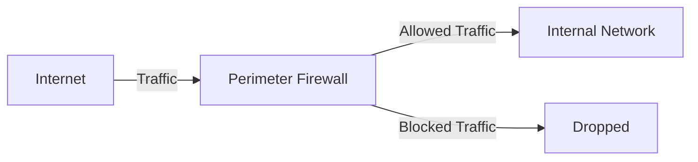
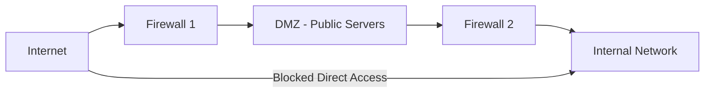
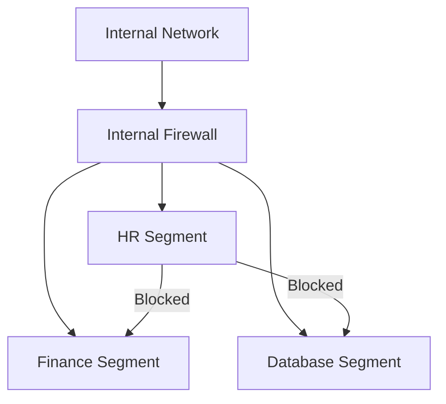
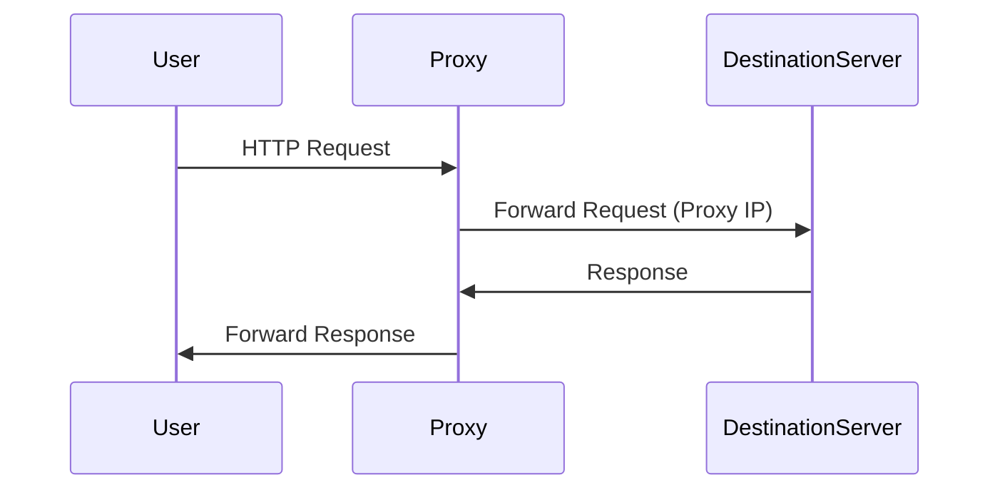
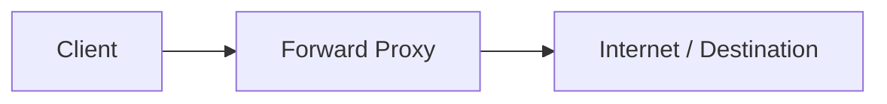
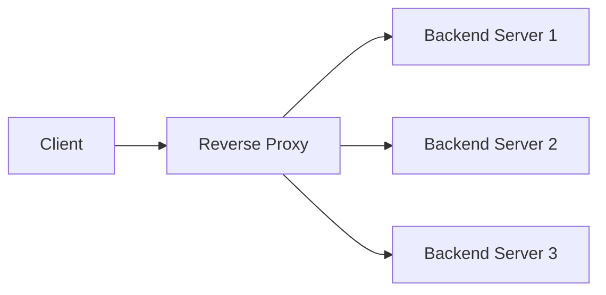
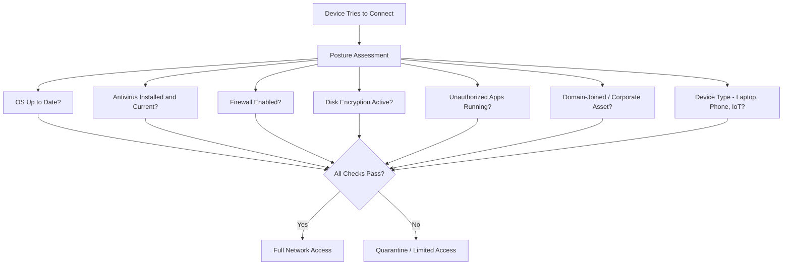
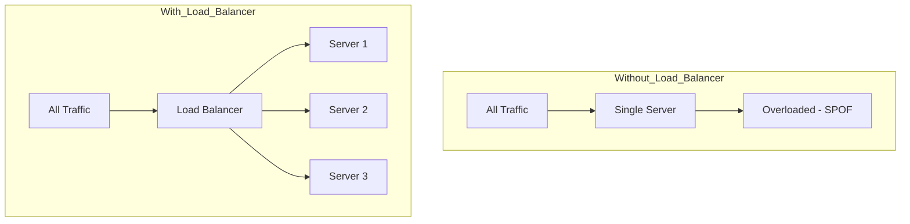
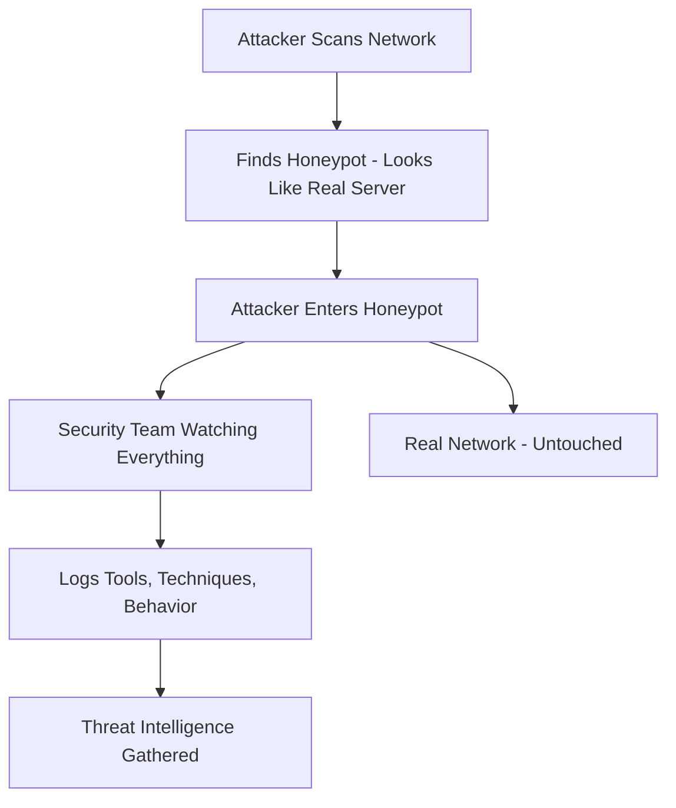
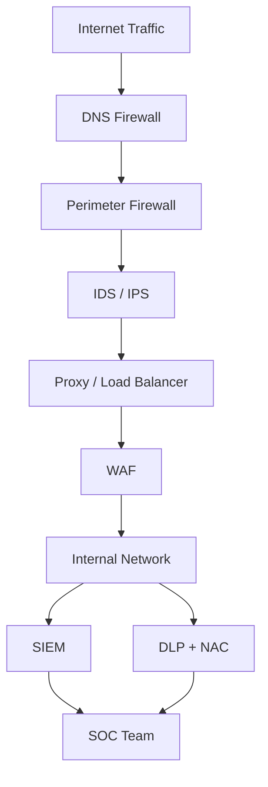

> **Goal of this section:**
> You'll get to know the most important devices that protect the network, and how each device works and handles traffic in its own way. You'll understand the role of the Firewall, the Honeypot, and others, and by the end you'll be able to look at any network architecture and know what each layer protects.


## Table of Contents

- [Why Network Security Devices Exist](#why-network-security-devices-exist)
- [Firewalls: The Core Guardian](#firewalls-the-core-guardian)
   - [Firewall Locations](#firewall-locations)
   - [Firewall Benefits vs Shortcomings](#firewall-benefits-vs-shortcomings)
- [Proxy Server](#proxy-server)
   - [Why Organizations Use Proxies](#why-organizations-use-proxies)
   - [Types of Proxies](#types-of-proxies)
- [Proxy vs Firewall vs WAF](#proxy-vs-firewall-vs-waf)
- [Network Access Control (NAC)](#network-access-control-nac)
- [Load Balancer](#load-balancer)
- [Honeypot](#honeypot)
- [How They All Fit Together](#how-they-all-fit-together)
- [Summary](#summary)

---

## Why Network Security Devices Exist

Pay attention to this analogy; it's very important because it explains the core problem in security:

Imagine you own a shop. You have to display your merchandise so people can buy it, which means there has to be accessibility. But if you leave everything exposed without protection, people will steal. It makes no sense to close the shop completely so nobody steals, because then nobody will buy either.

It's exactly the same idea on the network. If you have a **Game Server** or a **Web Application**:
- It must be **publicly accessible** so users can reach it
- At the same time, attackers may try to break into it

**The Golden Rule in Security:**

> [!IMPORTANT]
> Security is about finding the right balance between **trust** and **restriction**. If you trust no one, the system will be secure but unusable. If you trust everyone, the system will get compromised.

These devices are exactly what strike that balance: they let legitimate users in and block attackers.

The most common **Network Security Devices**:

| Device | Role |
|--------|-------|
| **Firewall** | Monitors and controls incoming and outgoing traffic based on rules |
| **IDS** (Intrusion Detection System) | Detects attacks and suspicious activity |
| **IPS** (Intrusion Prevention System) | Like an IDS, but blocks the attack automatically |
| **WAF** (Web Application Firewall) | Specifically protects websites and web apps |
| **VPN Gateway** | Lets users connect over an encrypted connection from the internet |
| **Proxy** | An intermediary between the user and the internet |

---

## Firewalls: The Core Guardian

The **Firewall** is the most important device in network security. At its core, it's a **routing device** that inspects network traffic and applies a **predefined rule set** to it to decide whether to allow or block that traffic.

```
[Incoming Packet] --> [Firewall] --> [Check Rules] --> Allow / Deny
```

### Firewall Locations

It's not just in one place: the Firewall can be placed at different points in the network, and each location serves a different purpose.

#### Main Firewall (Perimeter Firewall) — Internet to Internal Network

This is the classic placement everyone knows. The Firewall sits between the Internet and the Internal Network.

**Its job:**
- Block attackers coming from the internet
- Allow internal users to reach the internet
- Control all inbound and outbound traffic



---

#### DMZ Firewall — Internet to Public Servers

When you have **Public Servers** such as a web server, mail server, or game server, you don't put them directly inside the Internal Network. Instead, you put them in a zone called the **DMZ (Demilitarized Zone)**.

**Why the DMZ?**

> [!IMPORTANT]
> If the public server gets hacked, the attacker won't be able to reach the Internal Network. The DMZ provides **isolation**: it separates the public servers from the internal network.



---

#### Internal Segmentation Firewall — Inside the Network

Large companies place Firewalls **inside** the Internal Network itself to separate the different departments.

**Its job:**
- HR can't reach the Finance servers
- Users can't reach the database directly
- If an attacker gets into the network, they can't move around freely; this is called **Limiting Lateral Movement**



> [!TIP]
> The concept of **Lateral Movement** is very important in the SOC. When an attacker gets into one machine and tries to spread across the network, that's called lateral movement. Internal Firewalls reduce their ability to do that.

---

#### Firewall Placement Summary

| Location | Goal |
|----------|-------|
| Internet to LAN | Protect the Internal Network from the internet |
| Internet to DMZ | Protect the Public Servers |
| DMZ to LAN | Protect the Internal Network from compromised servers |
| Inside LAN | Network segmentation between departments |
| User to Server | Protect critical servers from internal users |

---

### Firewall Benefits vs Shortcomings

| Benefits | Shortcomings |
|----------|--------------|
| Blocks unauthorized access | Doesn't understand application-layer attacks (such as SQL Injection) without a WAF |
| Monitors and logs traffic | Can't see encrypted traffic inside HTTPS without SSL inspection |
| Enforces security policies centrally | Misconfigured rules can block legitimate traffic |
| Protects the network perimeter | If the attacker is already inside the network, the perimeter firewall doesn't help |
| Provides network segmentation | Single point of failure if there's no High Availability |

> [!WARNING]
> The Firewall isn't a silver bullet. Many attacks get past the Firewall because they come in over open ports (such as port 80/443). That's why you need other layers such as an IPS and a WAF.

---

## Proxy Server

Some security professionals classify the **Proxy** as a type of firewall, and it's also called an **Application Gateway**.

The Proxy is an **intermediary server** that sits between the client (you) and the destination server. Instead of connecting directly, your request goes to the Proxy first, and it forwards it to the destination server on your behalf.



### Why Organizations Use Proxies

| Function | Explanation |
|--------|-------|
| **Anonymity** | The destination server sees the Proxy's IP, not the user's IP |
| **Access Control** | Companies block certain sites for employees |
| **Caching** | Keeps copies of frequently requested content to speed up access |
| **Filtering and Monitoring** | Inspects outgoing and incoming traffic |
| **SOC Visibility** | Gives you visibility into the URLs employees visit |

> [!NOTE]
> The SOC team uses Proxy logs to detect whether an employee is accessing suspicious domains or whether malware is communicating with C2 servers.

---

### Types of Proxies

#### Forward Proxy

It sits **in front of the client**. The client sends its requests through it.

**Uses:**
- Anonymity
- Filtering (blocking sites)
- Bypassing restrictions



This is what people usually mean when they say "proxy" in general.

---

#### Reverse Proxy

It sits **in front of the server**. Clients don't know which specific backend server they'll reach.

**Uses:**
- Load Balancing
- SSL Termination
- Caching
- DDoS Protection



> [!TIP]
> The most common reverse proxies in practice are **Nginx** and **HAProxy**. If you see them in any infrastructure, you now understand why they're there.

---

#### Elite / High-Anonymity Proxy

It hides your IP and doesn't reveal that it's a proxy at all. The destination server doesn't know you're using a proxy.

---

## Proxy vs Firewall vs WAF

The difference between them is very important and comes up a lot:

| Feature | Firewall | Proxy | WAF |
|---------|----------|-------|-----|
| **Works at** | Network / Transport Layer (L3/L4) | Application Layer (L7) | Application Layer (L7) — HTTP/S only |
| **Sees** | IPs, Ports, Protocols | URLs, Content, Users | HTTP Requests, Payloads |
| **Protects against** | Unauthorized connections | Malicious web content, data leakage | SQL Injection, XSS, CSRF |
| **Direction** | Inbound and Outbound | Mainly Outbound (Forward) | Inbound |
| **Example** | pfSense, Cisco ASA | Squid Proxy, Nginx | Cloudflare WAF, ModSecurity |

> [!IMPORTANT]
> The three don't replace each other; each one protects a different layer. In real-world deployments, you'll find all three working together.

---

## Network Access Control (NAC)

**NAC** is a security solution that controls **who** and which **devices** are allowed to connect to the network, and **what** they're allowed to reach after connecting.

### The Problem NAC Solves

In traditional networks, if you knew the Wi-Fi password or plugged a cable into the switch, you were in. No further questions.

NAC changes this radically. It doesn't just ask **"Who are you?"**; it also asks **"What state is your device in?"**

> [!IMPORTANT]
> A correct username isn't enough if the laptop isn't updated or is infected with malware. NAC performs a **Posture Assessment**: it evaluates the device's health before letting it in.

### What NAC Checks (Posture Assessment)



| Check | Goal |
|-------|-------|
| OS Patch Level | Is the device updated against known vulnerabilities? |
| Antivirus Signatures | Is the AV running and up to date? |
| Host Firewall | Is the firewall on the device itself enabled? |
| Disk Encryption | Is the data protected if the device is stolen? |
| Unauthorized Apps | Is any prohibited software running? |
| Domain-Joined | Is this device a managed asset or an unknown one? |
| Device Type | A printer or IoT device may get different access |

> [!TIP]
> NAC is very important in scenarios such as **BYOD (Bring Your Own Device)**, when employees bring their personal devices to work. NAC ensures that the personal device won't put the network at risk.

---

## Load Balancer

The **Load Balancer** sits in front of multiple servers and distributes incoming traffic across them so that none of them carries more than it can handle.

### The Problem It Solves



**SPOF = Single Point of Failure**: if the single server goes down, the whole service goes down. With a Load Balancer, if one server goes down, the others keep working.

### Load Balancer Functions

| Function | Explanation |
|--------|-------|
| **Traffic Distribution** | Distributes requests across the servers |
| **High Availability** | If one server goes down, another takes over |
| **Scalability** | You can add servers during high load |
| **SSL Termination** | Performs HTTPS decryption here instead of on every server |
| **Health Checks** | Monitors the servers and sends traffic only to the healthy ones |
| **DDoS Mitigation** | Spreads the attack traffic instead of letting it all hit one server |

> [!NOTE]
> The Load Balancer isn't just an availability tool; it's also a **security tool**. It hides the number of backend servers and their architecture from the attacker.

---

## Honeypot

The **Honeypot** is one of the smartest and most elegant tools in cybersecurity. Instead of blocking the attacker, **you invite them in**, into a fake environment where they can't do any real damage, while you watch everything they do.

### The Core Idea

> [!IMPORTANT]
> **The Core Logic:** If no legitimate user is supposed to touch this system, anyone who touches it is a **threat by definition**.



### Why Does a Honeypot Matter?

| Benefit | Explanation |
|--------|-------|
| **Early Detection** | Any access to the honeypot = an immediate alert |
| **Threat Intelligence** | You learn which tools and techniques the attacker uses |
| **Deception** | Wastes the attacker's time and resources |
| **Low False Positives** | Anything that happens in it is 100% suspicious |
| **Research** | You learn about new attack methods |

> [!TIP]
> In the SOC, if you see an alert from the honeypot, take it completely seriously. There's no legitimate reason for anyone to communicate with it. It's not a false positive.

---

## How They All Fit Together

No single device protects everything. Each layer catches what the one before it missed:



| Layer | Device | Protects Against |
|-------|--------|---------|
| 1 | **DNS Firewall** | Connections to bad domains before they start |
| 2 | **Firewall** | Unauthorized network connections |
| 3 | **IDS/IPS** | Attack patterns on allowed ports |
| 4 | **Proxy / Load Balancer** | Hides the backend and distributes the load |
| 5 | **WAF** | SQL Injection, XSS, and web attacks |
| 6 | **SIEM** | Sees everything and correlates events from all devices |
| 7 | **DLP + NAC** | Protects from the inside: data and devices |

> [!IMPORTANT]
> This concept is called **Defense in Depth**: multiple layers of defense, so if one fails, the next one is still there. It's the foundation of any solid security architecture.

---

## Summary

- **Security is always about balance**: not zero access and not full access; the right balance is in between

- **The Firewall** is the network's primary gatekeeper, and it's placed in more than one location (Perimeter, DMZ, Internal), each with its own purpose

- **The DMZ** is a buffer zone where you put the Public Servers so that if they get hacked, the attacker can't reach the Internal Network

- **The Proxy** is an intermediary: it hides identity, performs caching and filtering, and gives the SOC visibility into web traffic

- **Forward Proxy** in front of the client | **Reverse Proxy** in front of the server

- **NAC** doesn't just ask "Who are you?"; it asks "Is your device fit to connect?" through the Posture Assessment

- **The Load Balancer** prevents a Single Point of Failure, distributes traffic, and hides the backend architecture

- **The Honeypot**: anyone who touches it is an attacker by definition. It gives you intelligence without any real damage being done

- **Defense in Depth** is the strategy that ties them all together: multiple layers of defense, each protecting against something different
