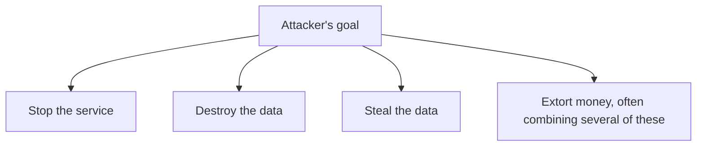
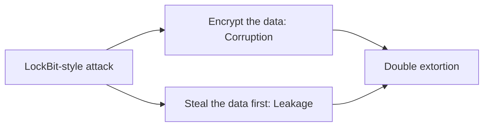
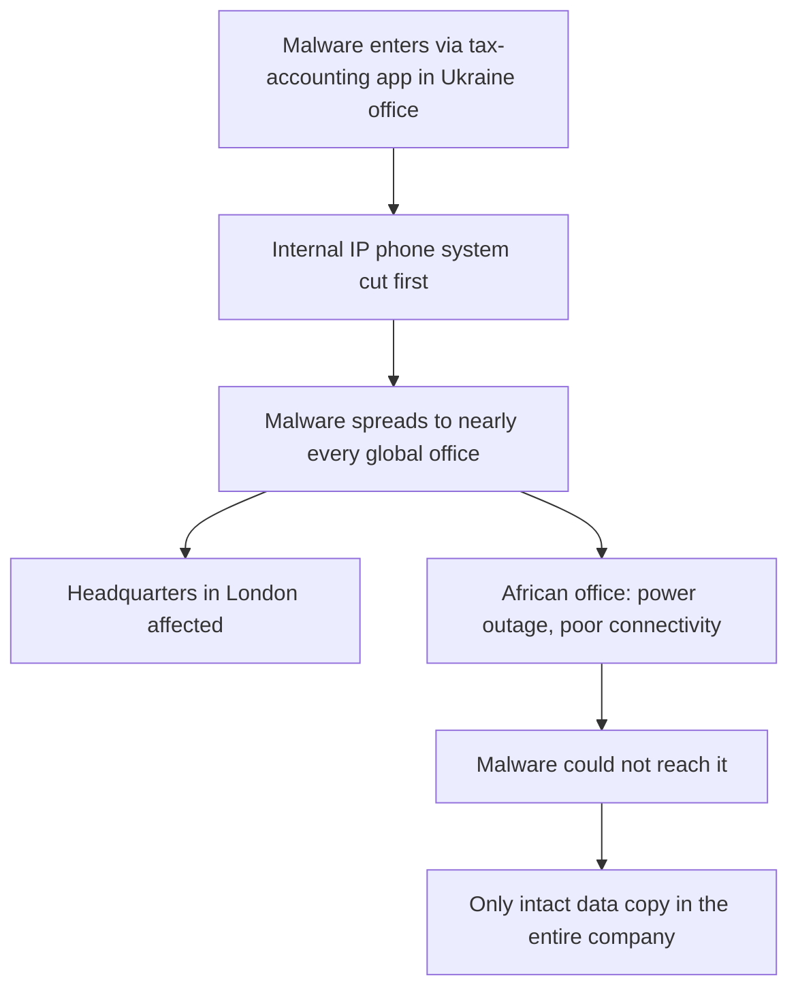
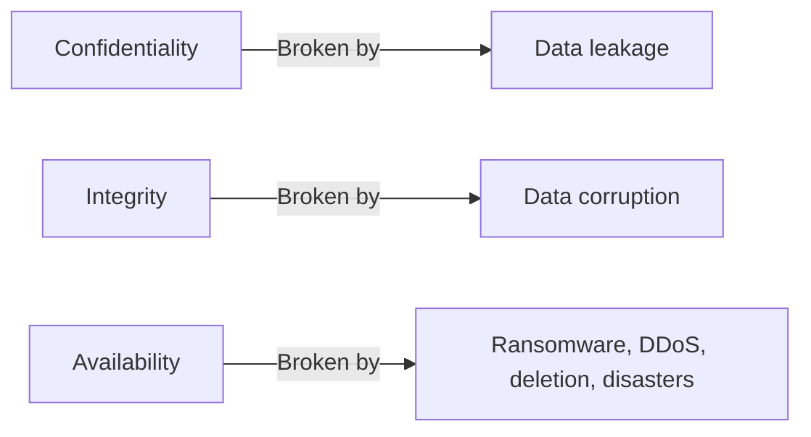
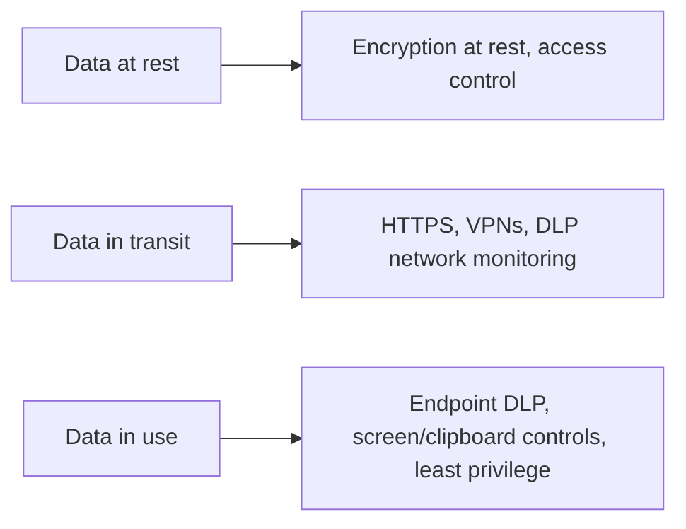
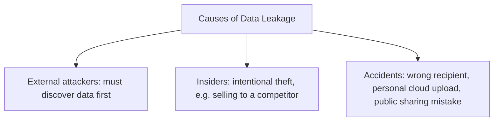
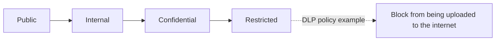
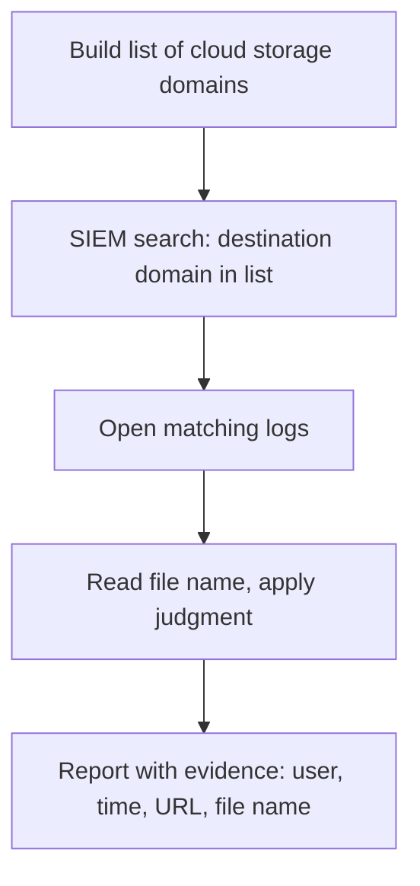

| Topic | Level | Reading Time | Prerequisites |
|---|---|---|---|
| Data Loss Fundamentals and DLP Operations | Beginner | ~20 min | None |

> **Goal of this section:**  
> You'll understand what "data loss" means in all its forms and how each form strikes a different property of the CIA triad, and you'll see the SOC analyst's daily role in monitoring and detecting data leakage, with practical examples from inside the SIEM.

## Learning Objectives

By the end of this section, you will be able to:

- Explain what **data loss** means and differentiate between **corruption**, **leakage**, and **accidental/environmental loss**.
- Map each type of data loss to the **CIA triad** property it breaks.
- Describe the **three states of data** and the protection appropriate for each.
- List the common causes of data leakage, from external attackers to insiders to accidents.
- Explain the role of **data classification** in making DLP policies possible.
- Describe a practical SIEM workflow for detecting unauthorized cloud uploads and email leakage, while avoiding false positives.

## Table of Contents

- [Learning Objectives](#learning-objectives)
- [What Is Data Loss](#what-is-data-loss)
  - [Three Main Ways Data Is Lost](#three-main-ways-data-is-lost)
  - [The Attacker's Goal Decides the Outcome](#the-attackers-goal-decides-the-outcome)
- [Corruption Versus Leakage Versus Service Disruption](#corruption-versus-leakage-versus-service-disruption)
  - [Comparing the Three](#comparing-the-three)
  - [Attacks Often Combine These](#attacks-often-combine-these)
- [Case Study: A Data Destruction Attack (Maersk)](#case-study-a-data-destruction-attack-maersk)
  - [What Happened](#what-happened)
  - [The Single Surviving Office](#the-single-surviving-office)
  - [Lessons](#lessons)
- [Mapping Data Loss to the CIA Triad](#mapping-data-loss-to-the-cia-triad)
- [The Three States of Data](#the-three-states-of-data)
- [Causes of Data Leakage](#causes-of-data-leakage)
  - [External Attackers](#external-attackers)
  - [Insiders](#insiders)
  - [Accidental Leaks](#accidental-leaks)
- [Data Classification](#data-classification)
  - [Why Classification Comes First](#why-classification-comes-first)
  - [Classification Levels](#classification-levels)
- [The SOC Analyst's Role in Stopping Leakage](#the-soc-analysts-role-in-stopping-leakage)
- [Practical Task: Finding Cloud Uploads in the SIEM](#practical-task-finding-cloud-uploads-in-the-siem)
- [Avoiding False Positives](#avoiding-false-positives)
- [Finding Leakage Through Email](#finding-leakage-through-email)
- [Go Beyond the Alerts](#go-beyond-the-alerts)
- [Career Path Connections](#career-path-connections)
- [Key Terms Glossary](#key-terms-glossary)
- [Summary](#summary)

## What Is Data Loss

### Three Main Ways Data Is Lost

**Data loss** means the organization **can no longer access, trust, or control its data**. This happens in three main ways:

| # | Type | What Happens |
|---|---|---|
| 1 | **Data corruption** | The data was changed, encrypted, or deleted, so it became inaccurate, inconsistent, or unusable |
| 2 | **Data leakage** | The data was exposed to people who aren't authorized to see it |
| 3 | **Accidental/environmental loss** | Someone deleted something by mistake, or a fire/flood/power outage destroyed the systems |

### The Attacker's Goal Decides the Outcome

**The attacker's goal is what decides which scenario happens**. Some attackers want to stop the service, some want to destroy the data, some want to steal it, and some want money through a combination of these.

## Corruption Versus Leakage Versus Service Disruption

### Comparing the Three

| | Service Disruption | Data Corruption | Data Leakage |
|---|---|---|---|
| What happens | Systems become unavailable | Data is encrypted, modified, or deleted | Data is copied or exposed to outsiders |
| Attack example | DDoS | Ransomware, wiper malware | Data theft, an insider upload |
| Did the attacker touch the data itself? | No | Yes, they have to reach it | Yes, they have to find it and copy it |
| CIA property affected | Availability | Integrity and Availability | Confidentiality |
| Difficulty for the attacker | Low | Medium | High: requires extra time, stealth, and effort |

### Attacks Often Combine These

Some attacks **combine more than one type**. Ransomware groups such as **LockBit** encrypt (corruption) **and also leak** (leakage) the data.

> [!NOTE]
> This double-layer attack pattern (corruption + leakage together) is covered in full detail, including the LockBit business model, in the Ransomware and the LockBit Case Study file in the Ransomware and Backup Resilience category.

## Case Study: A Data Destruction Attack (Maersk)

### What Happened

**Maersk** is one of the largest shipping companies in the world, headquartered in London. Around the time of the Russia-Ukraine conflict, attackers targeted Ukraine's infrastructure through a **tax-accounting application** that every company operating in Ukraine was **required to install**. Maersk had an office in Ukraine, so the malware got in through that application. This attack became known as **NotPetya**.

The malware's goal was **destruction, not money**. It **wiped the data on every system it reached**.

Maersk's Ukrainian office was connected to its branches around the world, so the malware **spread to nearly every office**, including headquarters.

**Before it spread**, the attackers **cut off the company's internal IP phone system**. Employees **couldn't warn each other quickly**.

### The Single Surviving Office

**Only one office survived**: an office in **Africa** that had a power outage and poor connectivity, so the malware **couldn't reach it**. That office held **the only intact copy** of the data needed to rebuild the entire company.

### Lessons

- **Keep backup copies in several different geographic regions.**
- **Keep backups isolated from the network.**
- **Provide a backup means of communication during the incident.**

> [!IMPORTANT]
> The fact that the only surviving copy of Maersk's data existed by pure accident, an office that happened to have a power outage, is the strongest possible argument for deliberate geographic backup distribution. Luck is not a disaster recovery strategy.

## Mapping Data Loss to the CIA Triad

The **CIA triad** is the core model of information security:

| Property | Meaning | Broken By |
|---|---|---|
| **Confidentiality** | Only authorized people can see the data | Data leakage |
| **Integrity** | The data is accurate and unaltered | Data corruption |
| **Availability** | The data and systems are available when needed | Ransomware, DDoS, deletion, disasters |

> [!IMPORTANT]
> Whenever you see an alert, ask: which of the three CIA properties is being attacked? That single question tells you how serious the alert is and what to do next. This is the same triage mindset covered in the Asset Awareness file from Network Security Foundations, applied specifically to data loss events.

## The Three States of Data

Data must be protected **in each of its three states**:

| State | Where It Lives | Protection |
|---|---|---|
| **Data at rest** | Stored on disks, servers, databases, laptops, USB drives, or backups | Encryption at rest and access control |
| **Data in transit** | Moving across the network, such as email, file uploads, and transfers | HTTPS, VPNs, DLP network monitoring |
| **Data in use** | Open in an application or being edited by a user | Endpoint DLP, screen and clipboard controls, least privilege |

> [!NOTE]
> DLP tools are designed to watch all three states together, not just one. A policy that only covers data at rest, for example, would miss an employee copying sensitive data from an open application (data in use) straight into a personal email (data in transit).

## Causes of Data Leakage

Not every leak comes from an external hacker.

### External Attackers

External attackers break in, find the valuable data, and copy it out. **Before the theft, they have to discover where the valuable data even is**, and that can take a long time, even in large companies.

### Insiders

Insiders can steal **intentionally**, for example by selling a secret to a competitor. Trade secrets (such as a drug formula) are worth huge sums, and some of them are stored on **isolated systems with no internet connection** for exactly this reason. When the system is offline, **the only way to steal from it is to physically remove the hard disk**, and that usually requires an insider.

### Accidental Leaks

These happen when employees upload sensitive files to personal cloud storage, send an email to the wrong person, or accidentally share a document publicly.

## Data Classification

### Why Classification Comes First

**DLP can't protect something it can't recognize**. Organizations first label data according to its sensitivity.

### Classification Levels

| Level | Meaning | Example |
|---|---|---|
| **Public** | Safe to share with anyone | Marketing brochures |
| **Internal** | For employees only | Internal phone directory |
| **Confidential** | Harmful if leaked | Salaries, contracts, customer lists |
| **Restricted** | Severely harmful if leaked | Source code, trade secrets, payment data, health records |

DLP policies are written around these levels, for example: **block any file labeled Restricted from being uploaded to the internet**.

## The SOC Analyst's Role in Stopping Leakage

As a **SOC analyst**, you usually **aren't the one building the DLP policies**. You **read the alerts and investigate**. Your DLP tool is connected to the **SIEM**, so DLP alerts show up there.

To do this job, you need to understand:

- **What the alert means**.
- **What the tool was looking for**.
- **Where to look next**.

> [!WARNING]
> If you do not understand the concept of data loss prevention, you cannot investigate its alerts. Tier 1 analysts often struggle here specifically because they try to memorize alert responses without understanding the underlying concepts this file covers.

## Practical Task: Finding Cloud Uploads in the SIEM

**The scenario:** your manager tells you, "Show me who's uploading company data to cloud storage sites."

**The steps:**

- Make a list of file-sharing and cloud storage service domains (such as MediaFire, MEGA, and the like). You can use your own knowledge or ask an AI tool to suggest more.
- In the SIEM, search for logs where the destination domain equals any domain on the list.
- Open the matching logs. Each log shows you the domain and the URL, and often the name of the file being uploaded.
- Read the file name and use your judgment (a file named `Salaries_2026.xlsx` is suspicious).
- Present the finding to your team lead with evidence: the user, the time, the URL, the file name.

## Avoiding False Positives

Not every upload is a violation. Before you report, ask yourself:

- Is this file **business data**, or **something personal** (such as the person's own ID photo)?
- Is the person **allowed to use this service for work**?
- Is there a **pattern** (many uploads, large sizes, unusual times)?

> [!WARNING]
> If you report a harmless personal upload as a data leak, you lose credibility (a false positive). Read the logs as carefully as you can and collect as much evidence as possible before you escalate.

## Finding Leakage Through Email

Employees can also send sensitive files as **email attachments** to external addresses.

- Search the email security logs in the SIEM for messages sent to external domains that contain attachments.
- Search attachment names and content using sensitive keywords such as **salaries**, **plan**, **contract**, **confidential**, or a customer's name.
- If you don't know which words to use, ask an AI tool for words commonly found in sensitive documents.
- The result will show you which employees are sending which files outside.

> [!TIP]
> Notice that this is the same underlying skill as the cloud-upload task: search, filter, and read logs carefully. The channel changes (cloud storage versus email), but the investigative method is identical.

## Go Beyond the Alerts

Most analysts only close the alerts that reach them. You can stand out through **proactive threat hunting**.

Once you've finished your alerts, create **your own cases**. For example, ask "Who in the company is uploading to file-sharing sites?", find the evidence, and report it.

Managers notice initiative, and that speeds up promotion.

> [!NOTE]
> A real-world example from this lecture: a manager's own promotion was delayed because he uploaded confidential data to an external service. He did not mean harm, but it violated company policy. Awareness of policy protects you as well, not just the people you investigate.

## Career Path Connections

| Career Path | How This Topic Applies |
|---|---|
| SOC Analyst | This entire file describes core daily responsibilities: triaging DLP alerts, searching SIEM logs, and avoiding false positives |
| Penetration Tester | Understanding classification and detection logic helps design realistic data-theft scenarios for authorized engagements |
| GRC | Data classification levels and the CIA mapping are the foundation for compliance reporting and risk assessments |
| Cloud Security | Cloud storage monitoring is a direct extension of the cloud-upload detection task covered here |

## Key Terms Glossary

| Term | Definition |
|---|---|
| Data Loss | A state where an organization can no longer access, trust, or control its data |
| Data Corruption | Data that has been changed, encrypted, or deleted, breaking Integrity |
| Data Leakage | Data exposed to unauthorized people, breaking Confidentiality |
| CIA Triad | The core model of information security: Confidentiality, Integrity, Availability |
| Data at Rest | Data stored on disks, servers, databases, or backups |
| Data in Transit | Data moving across a network |
| Data in Use | Data open in an application or being actively edited |
| Data Classification | Labeling data by sensitivity level to determine appropriate protection |
| False Positive | A legitimate activity mistakenly reported as a security violation |
| Threat Hunting | Proactively searching for security issues beyond the alerts that arrive automatically |

## Summary

- **Data loss takes three forms:** corruption, leakage, and accidental/environmental loss, and the attacker's goal decides which one happens.
- **Each type breaks a different CIA property:** corruption ≈ Integrity, leakage ≈ Confidentiality, service disruption ≈ Availability.
- **Maersk/NotPetya shows destruction without ransom intent:** and the importance of geographically distributing backups and isolating them from the network.
- **Data needs protection in three states:** at rest, in transit, and in use, and each state has different means of protection.
- **Leakage comes from three sources:** external attackers, insiders, and accidents, not just external hackers.
- **Classification enables DLP:** the tool can't protect something that hasn't been identified as sensitive in the first place.
- **The SOC analyst's job is investigation, not policy-building:** understanding the alert, what the tool is looking for, and where to look next.
- **Practical SIEM searches follow a repeatable pattern:** a list of domains or keywords, a search, a check for false positives, and presenting the evidence.
- **Proactive threat hunting distinguishes strong analysts:** without waiting for alerts to come to you.

