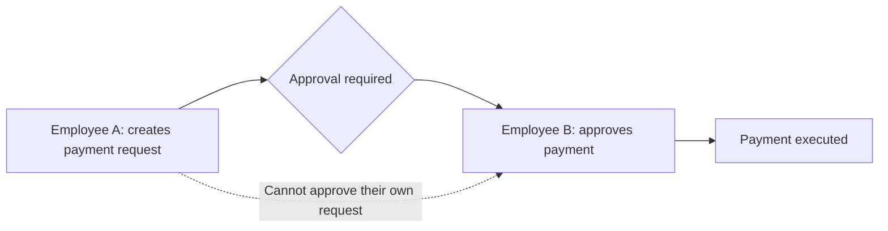
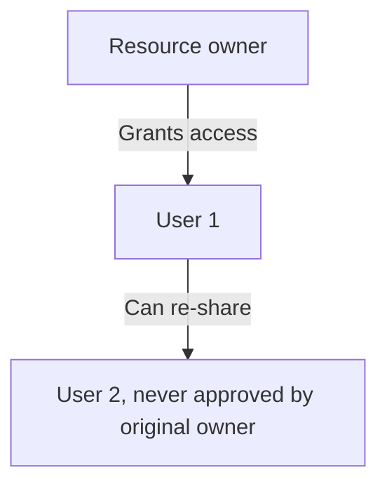
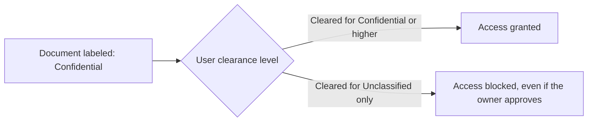
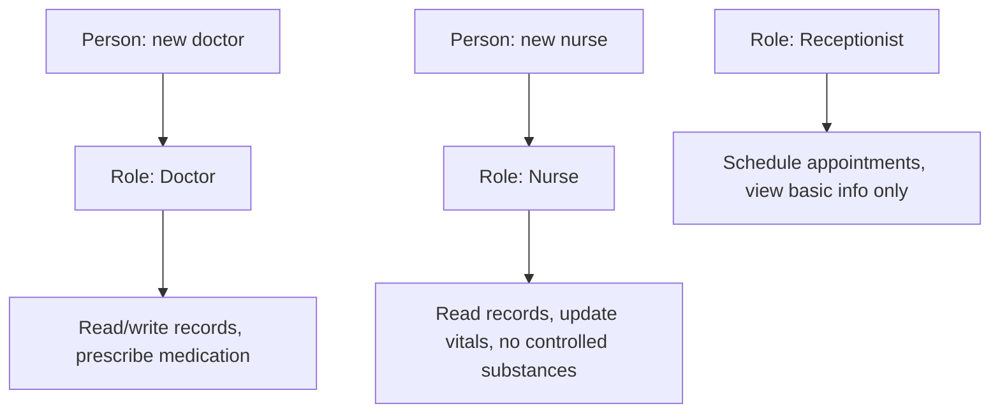
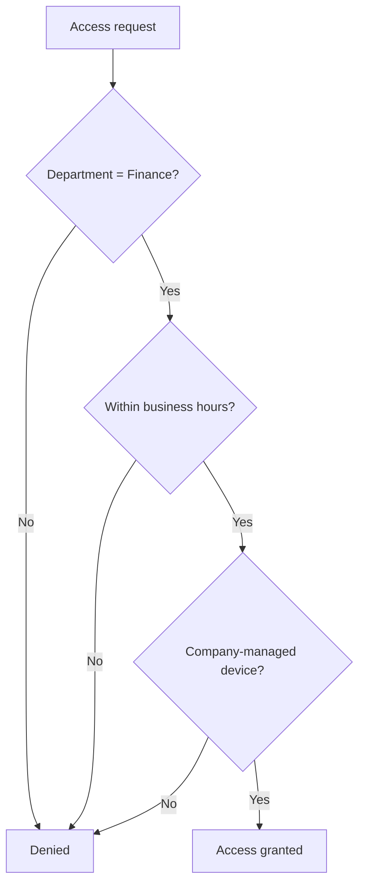
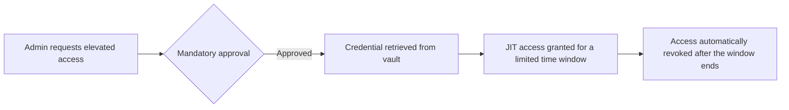

| Topic | Level | Reading Time | Prerequisites |
|---|---|---|---|
| Access Control Models | Intermediate | ~20 min | Identity and Access Management (IAM) |

> **Goal of this section:**
> You'll understand how organizations decide, in practice, exactly who can touch what. You'll compare the different access control models (DAC, MAC, RBAC, ABAC), and you'll see how even simple access can become a risk if no one monitors it.

## Learning Objectives

By the end of this section, you will be able to:

- Explain the principle of **least privilege** and describe a real scenario where least privilege alone is not enough.
- Explain **separation of duties** and why it protects against both accidents and malicious intent.
- Differentiate between **DAC (Discretionary)** and **MAC (Mandatory)** access control, with concrete examples of each.
- Describe **RBAC (Role-Based Access Control)** and explain why it reduces administrative overhead.
- Differentiate between **ABAC (Attribute-Based)** and **Rule-Based Access Control**, and give a concrete example rule.
- Explain what **Privileged Access Management (PAM)** protects, including credential vaulting and **Just-In-Time (JIT)** access.

## Table of Contents

- [Learning Objectives](#learning-objectives)
- [Least Privilege and Separation of Duties](#least-privilege-and-separation-of-duties)
  - [The Principle of Least Privilege](#the-principle-of-least-privilege)
  - [When Least Privilege Is Not Enough](#when-least-privilege-is-not-enough)
  - [Separation of Duties](#separation-of-duties)
  - [Why This Matters for Credentials](#why-this-matters-for-credentials)
- [Discretionary and Mandatory Access Control](#discretionary-and-mandatory-access-control)
  - [DAC: Discretionary Access Control](#dac-discretionary-access-control)
  - [MAC: Mandatory Access Control](#mac-mandatory-access-control)
  - [DAC Versus MAC Compared](#dac-versus-mac-compared)
- [Role-Based Access Control (RBAC)](#role-based-access-control-rbac)
  - [The Core Idea](#the-core-idea)
  - [A Hospital Example](#a-hospital-example)
  - [The Main Benefit](#the-main-benefit)
- [ABAC and Privileged Access Management](#abac-and-privileged-access-management)
  - [Attribute-Based Access Control (ABAC)](#attribute-based-access-control-abac)
  - [Rule-Based Access Control](#rule-based-access-control)
  - [Privileged Access Management (PAM)](#privileged-access-management-pam)
- [Choosing the Right Model](#choosing-the-right-model)
- [Career Path Connections](#career-path-connections)
- [Key Terms Glossary](#key-terms-glossary)
- [Summary](#summary)

## Least Privilege and Separation of Duties

### The Principle of Least Privilege

**The principle of least privilege** is simple: **give each person the minimum access needed to do their job, and no more than that**.

This is the core principle that every other access control model we'll explain in this file builds on.

### When Least Privilege Is Not Enough

In some cases, **even minimal access remains risky** enough to need extra protection. Example: a single, highly trusted employee approves large financial transactions alone.

The problem here isn't that the employee has more access than necessary; the problem is that they're **the only person** able to carry out a sensitive action from start to finish.

### Separation of Duties

**Separation of duties** solves this problem: a sensitive task **is divided among more than one person**, so no one can complete it alone, whether by mistake or with bad intent.

A concrete example: in the Finance department, the person who **creates** a payment request must **not be the same person** who **approves** it. This prevents a single employee from creating and approving a fraudulent payment on their own.

### Why This Matters for Credentials

If all the critical duties sit with one highly skilled person, **a single compromised account** becomes **a catastrophic single point of failure**.

> [!IMPORTANT]
> Least privilege limits what one compromised account can do. Separation of duties limits what one trusted person, even acting alone with legitimate access, can do. They solve two related but different problems, and a mature access control strategy needs both.

## Discretionary and Mandatory Access Control

### DAC: Discretionary Access Control

In **DAC**, **the resource owner themselves** decides who can access it, like file permissions on a personal computer.

It's flexible and easy to understand, but access can **spread in an uncontrolled way**: once you give someone control, they can pass it on to people you never approved.

Examples of DAC:

- Traditional file systems (**Windows NTFS**, **Linux permissions**).
- **Google Drive** sharing, where anyone with the link can become an editor.

### MAC: Mandatory Access Control

In **MAC**, **the system itself** enforces the access rules based on **fixed security classifications** that users can't override. This is common in military and government systems.

In practice: documents are labeled by classification (**Top Secret, Secret, Confidential, Unclassified**), and users carry a **clearance label**. The system compares the two labels **automatically** and blocks access if the clearance isn't sufficient, **even if** the document's owner wants to share it.

### DAC Versus MAC Compared

| Aspect | DAC | MAC |
|---|---|---|
| Who decides access | The resource owner | The system, based on fixed classifications |
| Flexibility | High | Low, by design |
| Risk | Access can spread beyond original intent | Very controlled, but rigid |
| Typical environment | Personal computers, general file sharing, Google Drive | Military, government, highly classified systems |
| Can the owner override the system? | Yes | No |

> [!NOTE]
> DAC's flexibility is exactly its weakness: once you grant someone control, they can pass it along to people you never approved. MAC removes that flexibility entirely, trading convenience for guaranteed enforcement.

## Role-Based Access Control (RBAC)

### The Core Idea

Instead of managing each person's permissions individually, one by one, **RBAC** ties permissions to **roles**, and then places people into those roles.

### A Hospital Example

| Role | Permissions |
|---|---|
| Doctor | Reads and writes patient records, and prescribes medication |
| Nurse | Reads records and updates vitals, but **can't prescribe controlled substances** |
| Receptionist | Schedules appointments and views basic information, but **can't view the medical history** |

### The Main Benefit

The main advantage: **administrative work drops significantly**. When a new doctor joins, they're simply assigned the "Doctor" role, instead of configuring dozens of individual permissions for them one by one.

> [!TIP]
> RBAC scales well when roles are stable and well-defined, like in a hospital. It struggles when access decisions depend on context that changes moment to moment, which is exactly the gap ABAC fills next.

## ABAC and Privileged Access Management

### Attribute-Based Access Control (ABAC)

**ABAC** decides access from **several attributes combined at the moment of the request**: the department, the time of day, the device being used, and the sensitivity of the data, instead of a single fixed role.

An example rule: **allow access only if the department is Finance, the request happens during business hours, and the device is company-managed**.

### Rule-Based Access Control

It applies **predefined rules** to every request regardless of role, based on conditions such as the time, the IP address, or the device type. This is exactly **the mechanism behind Conditional Access policies in Azure**.

| Aspect | RBAC | ABAC | Rule-Based |
|---|---|---|---|
| Decision basis | Fixed role | Multiple attributes at request time | Predefined conditions, regardless of role |
| Flexibility | Low, roles are static | High, context-aware | Medium, condition-driven |
| Example | Doctor role sees medical records | Finance + business hours + managed device | Block access from unfamiliar IP addresses |

### Privileged Access Management (PAM)

**PAM** secures accounts with elevated privileges (such as system administrators) through **credential vaulting**, **mandatory approval** before any elevated privilege is used, and **Just-In-Time (JIT) access** (elevated privileges are active only for the time needed and are automatically revoked afterward).

> [!IMPORTANT]
> PAM is not a replacement for RBAC or ABAC; it is an additional layer specifically for the highest-risk accounts. Even a well-designed RBAC system needs PAM if administrator accounts stay permanently elevated instead of only activating when actually needed.

For full details on PAM tools (session isolation, credential vaulting, password rotation, break-glass accounts), see the dedicated file: **Privileged Access Management (PAM)**.

## Choosing the Right Model

| Model | Best Fit When |
|---|---|
| DAC | Resource owners are trusted to manage their own sharing decisions, and flexibility matters more than strict control |
| MAC | Access must follow fixed, non-negotiable classifications, such as government or military data |
| RBAC | Job functions are stable and well-defined, and administrative simplicity is the priority |
| ABAC | Access decisions depend on dynamic context: time, device, location, or data sensitivity |
| PAM | Specifically for accounts with elevated privileges, regardless of which base model is used |

> [!TIP]
> These models are not mutually exclusive. A real organization commonly runs RBAC for general access, layers ABAC-style conditional rules on top for sensitive systems, and adds PAM specifically for administrator accounts.

## Career Path Connections

| Career Path | How This Topic Applies |
|---|---|
| SOC Analyst | Investigates access anomalies against expected role permissions and flags separation-of-duties violations |
| Penetration Tester | Tests whether DAC-based sharing has spread access beyond intended boundaries, or whether PAM controls can be bypassed |
| GRC | Verifies that access control models match regulatory requirements, especially separation of duties in financial systems |
| Cloud Security | Implements ABAC and Rule-Based Access Control through cloud-native policy engines and Conditional Access |

## Key Terms Glossary

| Term | Definition |
|---|---|
| Least Privilege | Granting only the minimum access required to perform a job |
| Separation of Duties | Dividing a sensitive task between multiple people so no one person can complete it alone |
| DAC | Discretionary Access Control, where the resource owner decides who can access it |
| MAC | Mandatory Access Control, where the system enforces fixed security classifications |
| Clearance Label | A classification assigned to a user in a MAC system, compared against a resource's classification |
| RBAC | Role-Based Access Control, where permissions are assigned to roles rather than individuals |
| ABAC | Attribute-Based Access Control, where access decisions use multiple contextual attributes |
| Rule-Based Access Control | Applying predefined conditions to every access request regardless of role |
| PAM | Privileged Access Management, securing elevated-access accounts |
| Credential Vault | A secure central store for privileged credentials |
| Just-In-Time (JIT) Access | Elevated permissions active only for the time needed, then automatically revoked |

## Summary

- **Least privilege limits routine exposure:** give each person only the minimum, no more.
- **Separation of duties limits concentrated power:** a sensitive task is divided among more than one person so no one can abuse it alone.
- **DAC is flexible but leaky:** the owner decides, but control can spread to people who weren't approved.
- **MAC is rigid but guaranteed:** the system enforces the rules, and even the owner can't override them.
- **RBAC reduces administrative overhead:** permissions are tied to the role, not the person, so access management becomes much simpler.
- **ABAC handles dynamic context:** the decision is made from several factors at the moment of the request, not a fixed role.
- **PAM protects the highest-risk accounts specifically:** a credential vault, mandatory approval, and JIT access reduce the window of exposure.
- **The models complement each other:** a real organization usually uses a mix of RBAC, ABAC, and PAM together, not just one model.

