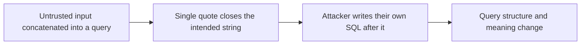
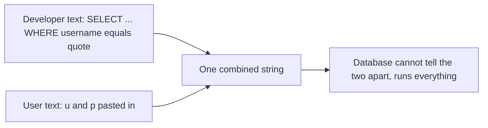
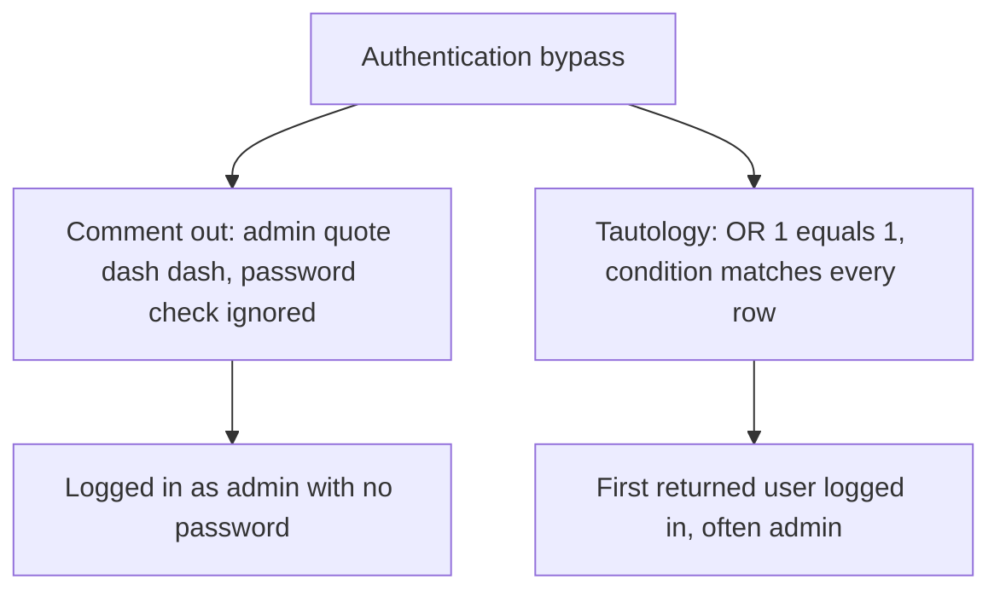
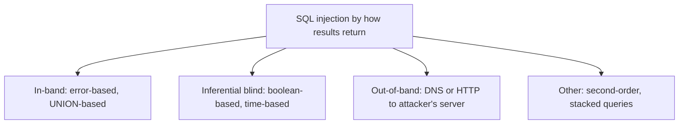
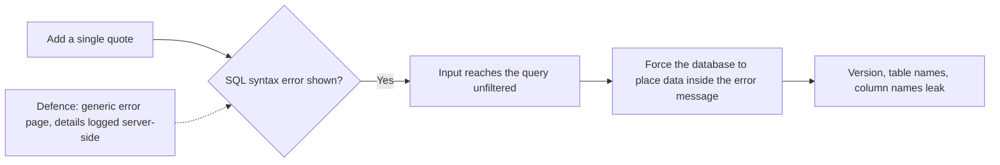
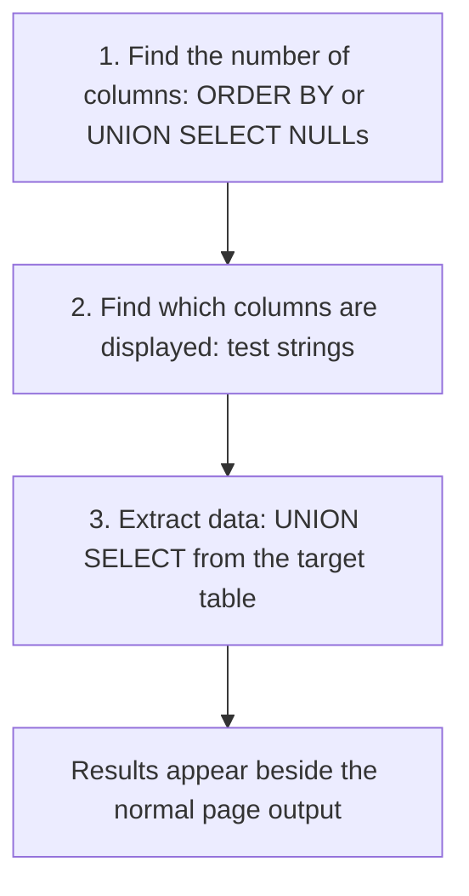

| Topic | Level | Reading Time | Prerequisites |
|---|---|---|---|
| SQL Injection Basics and In-Band Attacks | Intermediate | ~20 min | Input Attacks Fundamentals |

> **The goal of this section:**  
> You'll understand how a single quote (') is enough to change the meaning of an entire query, how to read a normal query and one built unsafely, the types of SQL injection by how the result comes back, and how in-band attacks (error-based and UNION-based) leak data directly in the application's response.


## Learning Objectives

By the end of this section, you will be able to:

- Define **SQL injection (SQLi)** and explain why the single quote is the key to the classic attack.
- Read a normal **login query** and the vulnerable code that builds it by concatenation.
- Explain two basic **authentication bypass** attacks: commenting out the password check and the tautology.
- Classify SQLi by **how the attacker gets results back**: in-band, inferential (blind), out-of-band, and other.
- Describe **error-based** SQLi, what it leaks, and the defence.
- Describe the three steps of **UNION-based** SQLi: count columns, find displayed columns, extract data.

## Table of Contents

- [Learning Objectives](#learning-objectives)
- [What Is SQL Injection](#what-is-sql-injection)
  - [Definition](#definition)
  - [The Role of the Single Quote](#the-role-of-the-single-quote)
  - [Where It Can Be Found](#where-it-can-be-found)
- [Understanding the Query](#understanding-the-query)
  - [A Normal Login Query](#a-normal-login-query)
  - [How the Vulnerable Code Builds It](#how-the-vulnerable-code-builds-it)
- [Basic Attacks: Authentication Bypass](#basic-attacks-authentication-bypass)
  - [Comment Out the Password Check](#comment-out-the-password-check)
  - [Tautology: Always True](#tautology-always-true)
  - [Comment Syntax Varies](#comment-syntax-varies)
- [Types of SQL Injection: Overview](#types-of-sql-injection-overview)
- [Error-Based SQL Injection](#error-based-sql-injection)
  - [How It Works](#how-it-works)
  - [What Leaks](#what-leaks)
  - [Defence](#defence)
- [UNION-Based SQL Injection](#union-based-sql-injection)
  - [The Idea](#the-idea)
  - [The Three Steps](#the-three-steps)
- [Career Path Connections](#career-path-connections)
- [Key Terms Glossary](#key-terms-glossary)
- [Summary](#summary)

## What Is SQL Injection

### Definition

**SQL injection (SQLi)** is a vulnerability where the attacker **injects malicious SQL code** into the application's database query, which lets them **manipulate the database.**

The application **builds queries by concatenating untrusted input**, and the attacker's input **changes the structure and meaning of the query.**

### The Role of the Single Quote

**The key to the classic attack is the ability to enter a single quote (`'`).** It **closes the string the developer intended** and lets the attacker **write their own SQL after it.**

### Where It Can Be Found

SQLi can be found in **URL parameters, POST bodies, cookies, and HTTP headers.** **Any value that reaches a query is a candidate.**

An example from the lecture:

```text
http://www.example.com/login.php?passwd=' or userID='admin';--
```



> [!NOTE]
> This is the database version of the mix-data-with-instructions root cause from Input Attacks Fundamentals. The input was meant to be a value to compare against, but the quote lets it become part of the query's grammar.

## Understanding the Query

### A Normal Login Query

```sql
SELECT * FROM users
WHERE username = 'admin'
AND password = '1234';
```

| Part | Meaning |
|---|---|
| `SELECT` | Retrieves data from the database |
| `*` | All columns |
| `users` | The table name |
| `WHERE ... AND ...` | A filter: return **only the row** whose username is admin and whose password is 1234 |

### How the Vulnerable Code Builds It

```python
query = ("SELECT * FROM users "
         "WHERE username='" + u +
         "' AND password='" + p + "'")
```

The username (`u`) and password (`p`) **that the user typed are concatenated directly into the SQL text.** **The database can't tell which part the developer wrote and which part the user wrote.** It simply **executes the whole string.**



## Basic Attacks: Authentication Bypass

### Comment Out the Password Check

| Field | Value |
|---|---|
| Username | `admin'--` |
| Password | `anything` |

```sql
SELECT * FROM users
WHERE username='admin'--'
AND password='x';
```

The quote **closes the username string.** The `--` **starts a comment**, so **the password check is ignored.** The attacker **logs in as admin without a password.**

### Tautology: Always True

| Field | Value |
|---|---|
| Password | `' OR '1'='1` |

```sql
SELECT * FROM users
WHERE username='admin'
AND password='' OR '1'='1';
```

The condition `'1'='1'` **is always true**, so the condition **matches every row.** The application usually **logs in the first user returned**, which is **often the admin.**



### Comment Syntax Varies

> [!WARNING]
> Comment syntax varies by database: `--` (needs a trailing space in MySQL), `#` (MySQL), and `/* */` (most databases). A payload that works against one database can fail against another, which is why attackers first fingerprint the database and why detection rules should cover all the comment styles, not just `--`.

## Types of SQL Injection: Overview

SQLi is classified by **how the attacker gets the results back.**

| Category | Type | How Data Comes Back |
|---|---|---|
| **In-band** | Error-based | Database error messages leak the data |
| **In-band** | UNION-based | The results are appended to the page's normal output |
| **Inferential (blind)** | Boolean-based | The page's behaviour changes (true versus false) |
| **Inferential (blind)** | Time-based | A delayed response reveals true or false |
| **Out-of-band** | DNS / HTTP | The data is sent to a server the attacker controls |
| **Other** | Second-order | The payload is stored first and triggers later |
| **Other** | Stacked queries | Several statements run together |



> [!TIP]
> The classification is a ladder of difficulty for the attacker. In-band is easiest because the answer shows up on the page. Each step down (blind, then out-of-band) is for situations where the application reveals less, so the attacker works harder and the techniques get slower. This file covers the in-band pair; the next file covers the rest.

## Error-Based SQL Injection

### How It Works

The attacker **deliberately causes database errors** and reads **sensitive information from the detailed error message** the application displays.

| Step | Action |
|---|---|
| 1 | Add a single quote (`'`). If the page shows an error such as `"You have an error in your SQL syntax"`, then **the input reaches the query unfiltered** |
| 2 | Force the database **to put data inside the error**. An example for Microsoft SQL Server: |

```sql
' AND 1=CONVERT(int, (SELECT @@version))--
```

The database **tries to convert a text value (the version string) to an integer, fails, and prints that text inside the error message.**

### What Leaks

**The database type and version, and the table and column names.** It is **fast and effective** for the attacker.

### Defence

**Never show raw database errors to users.** Return **a generic error page** and log the details **on the server.**



> [!IMPORTANT]
> Error-based injection only works because the application is helpful to the attacker. Showing a raw database error to a user is an information leak by itself, even without a vulnerability. Generic error pages with detailed server-side logging remove the attacker's easiest feedback channel.

## UNION-Based SQL Injection

### The Idea

The **`UNION`** operator **combines the results of two `SELECT` statements**, so the stolen data **appears in the page's normal output.** **Both queries must return the same number of columns with compatible data types.**

### The Three Steps

| # | Step | Example |
|---|---|---|
| 1 | **Find the number of columns**: increase `ORDER BY` until an error occurs, or add `NULL`s to the `UNION` | `' ORDER BY 4--` (an error means 3 columns), `' UNION SELECT NULL,NULL,NULL--` |
| 2 | **Find which columns are displayed**: put test strings in each column and see which one appears on the page | `' UNION SELECT 'a','b','c'--` |
| 3 | **Extract the data**: the page shows usernames and password hashes next to the normal results. `information_schema` reveals the table and column names | `' UNION SELECT username, password, NULL FROM users--` |



> [!NOTE]
> The stolen password hashes in step 3 are exactly the material discussed in Password Hashing, Salting, and Peppering and Password Cracking Techniques. A strong, salted, slow hash does not stop the injection, but it decides whether the leaked hashes are usable afterward. That is why the next file lists hashing passwords as one of the supporting defences.

> [!NOTE]
> A basic example of this attack as it appears in a web server log, including the `sqlmap` user agent, is shown in Core Log Types and Web Server Logs.

## Career Path Connections

| Career Path | How This Topic Applies |
|---|---|
| SOC Analyst | Recognizes encoded quotes, UNION SELECT, and ORDER BY probing in web, WAF, and application logs |
| Penetration Tester | Probes parameters with a quote, reads error messages, then enumerates columns and tables to demonstrate impact |
| GRC | SQL injection prevention is a baseline requirement in secure development standards and PCI DSS-style audits |
| Cloud Security | Managed databases and cloud-hosted apps are equally exposed, and the database account's permissions limit the blast radius |

## Key Terms Glossary

| Term | Definition |
|---|---|
| SQL Injection (SQLi) | Injecting malicious SQL into an application's database query to manipulate the database |
| Concatenation | Building a query by joining strings, mixing developer text with user input |
| Tautology | A condition that is always true, such as `'1'='1'` |
| Comment Injection | Using `--`, `#`, or `/* */` to make the database ignore the rest of a query |
| In-Band SQLi | SQLi where results come back through the same channel as the request |
| Error-Based SQLi | In-band SQLi that reads data from verbose database error messages |
| UNION-Based SQLi | In-band SQLi that appends stolen data to the normal results with the `UNION` operator |
| `information_schema` | A standard database schema describing table and column names |

## Summary

- **SQLi injects SQL into a query built by concatenation:** its key is the single quote that closes the string.
- **The database cannot tell developer text from user text:** it executes the whole string.
- **Two basic bypasses exist:** commenting out the password check, and a tautology such as `OR '1'='1'`.
- **Comment syntax differs by database:** `--`, `#`, and `/* */`.
- **SQLi is classified by how results return:** in-band, blind, out-of-band, and other types (second-order and stacked).
- **Error-based SQLi reads data from verbose error messages:** and the defence is a generic error page with logging on the server.
- **UNION-based SQLi follows three steps:** the number of columns, the displayed columns, and extracting the data.

