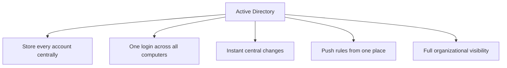
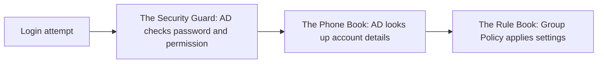
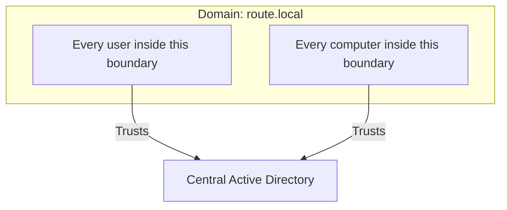
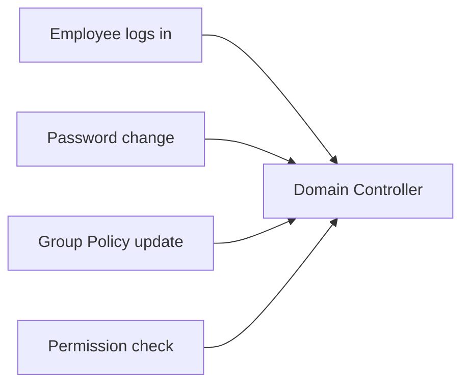
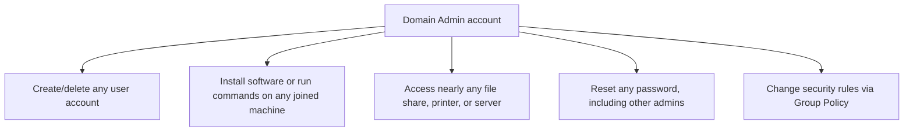
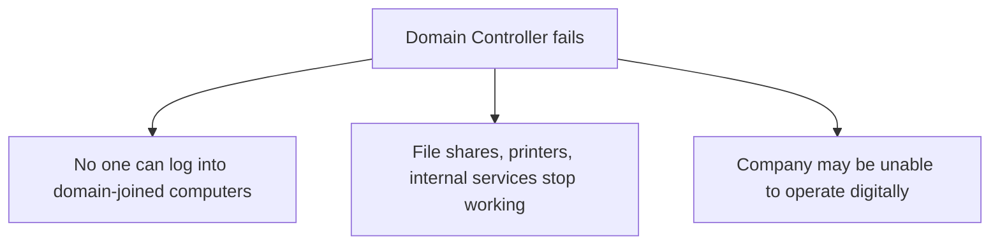
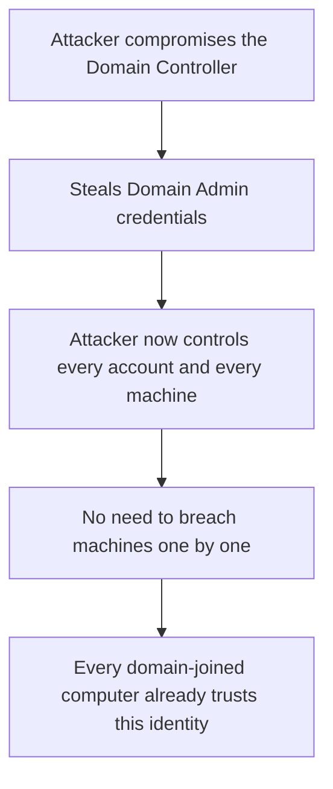

| Topic | Level | Reading Time | Prerequisites |
|---|---|---|---|
| Active Directory Core Concepts | Intermediate | ~20 min | Local Identity and the Scaling Problem |

> **Goal of this section:**
>  You will understand exactly what Active Directory is, the difference between a Domain, a Domain Controller, and a Domain Admin, and why compromising just one server can mean compromising the entire company.

## Learning Objectives

By the end of this section, you will be able to:

- Explain why organizations need **Active Directory (AD)**, and how it solves the four scaling problems from local identity management.
- Describe AD using the three-part model: the phone book, the security guard, and the rule book.
- Define a **Domain** and explain how joining one changes a computer's trust relationship.
- Define a **Domain Controller (DC)** and explain why it is the single most sensitive machine in the network.
- Define a **Domain Admin** account and list the scope of control it holds.
- Explain why the Domain Controller is a **single point of failure**, and how organizations mitigate that risk with redundancy and a disaster recovery site.
- Explain, step by step, why compromising a Domain Controller can mean compromising an entire organization.

## Table of Contents

- [Learning Objectives](#learning-objectives)
- [Why We Need Active Directory](#why-we-need-active-directory)
  - [Five Things Active Directory Provides](#five-things-active-directory-provides)
- [What Is Active Directory](#what-is-active-directory)
  - [The Three-Part Model](#the-three-part-model)
  - [The Key Shift](#the-key-shift)
- [What Is a Domain](#what-is-a-domain)
  - [The Organization's Territory](#the-organizations-territory)
  - [Joining a Domain](#joining-a-domain)
- [What Is a Domain Controller (DC)](#what-is-a-domain-controller-dc)
  - [Concept Versus Machine](#concept-versus-machine)
  - [Why Every Request Goes Through It](#why-every-request-goes-through-it)
- [What Is a Domain Admin](#what-is-a-domain-admin)
  - [The Scope of Control](#the-scope-of-control)
  - [The Master Key, Scaled Up](#the-master-key-scaled-up)
- [Why the Domain Controller Is a Single Point of Failure](#why-the-domain-controller-is-a-single-point-of-failure)
  - [If the DC Goes Down](#if-the-dc-goes-down)
  - [The Fix: Redundancy](#the-fix-redundancy)
  - [Disaster Recovery (DR) Site](#disaster-recovery-dr-site)
- [What If an Attacker Reaches the Domain Controller](#what-if-an-attacker-reaches-the-domain-controller)
  - [The Attack Path](#the-attack-path)
  - [Game Over](#game-over)
- [Career Path Connections](#career-path-connections)
- [Key Terms Glossary](#key-terms-glossary)
- [Summary](#summary)

## Why We Need Active Directory

Remember the four problems from the previous file: no single login, no central control, no consistent rules, no visibility? **Active Directory (AD)** is the direct solution to them.

### Five Things Active Directory Provides

| # | Capability | What It Solves |
|---|---|---|
| 1 | Store every account in one place | Instead of managing separate accounts on every machine |
| 2 | One login, everywhere | Any employee can sign in to any machine in the company with the same account |
| 3 | Instant, central changes | Create, disable, or delete an account once, and it applies instantly everywhere |
| 4 | Push rules from one place | Password requirements, the wallpaper, blocked applications: all configured centrally |
| 5 | Full organizational visibility | Track every device, user, and printer in one organized structure |

**Active Directory (AD)** is **Microsoft's** answer from **2000**, and it is used in **almost every medium or large company** to manage Windows machines and their accounts.

## What Is Active Directory

### The Three-Part Model

The easiest way to understand AD is to see it as three connected concepts:

| Model | What It Represents |
|---|---|
| **The Phone Book** | It stores every user account, computer, printer, and group, with details such as the name, department, password hash, and which machine the account belongs to |
| **The Security Guard** | Every login on any machine in the company asks AD: is the password correct, and is this account allowed to sign in here? |
| **The Rule Book** | It pushes settings and restrictions automatically to every machine and user; this is what's called **Group Policy** |

### The Key Shift

The key shift here: **accounts no longer belong to a single machine**; they now belong to **the entire organization**, and every machine simply **trusts Active Directory** to say who is who.

> [!IMPORTANT]
> Active Directory (AD) is a centralized database and management system for a company's users, computers, and resources. This single sentence is the definition worth memorizing; everything else in this file explains how that definition is implemented.

## What Is a Domain

### The Organization's Territory

A **Domain** is **the territory managed by Active Directory**. It is the name for the complete organized group of users and machines that all **trust the same Active Directory**.

It replaces the concept of the **workgroup** from the previous file, but instead of being just a loose label, **joining a domain** means the machine **now actually trusts the central system** for login and rules.

A domain has a name, usually shaped like a website address, for example: `company.corp`.

### Joining a Domain

Joining a domain says: **from now on, you won't just check your small local list of accounts; you'll also trust whatever Active Directory says**.

> [!NOTE]
> Every user and computer inside this boundary trusts one central Active Directory. This is the practical meaning of "joining a domain": a shift from local self-management to central trust.

## What Is a Domain Controller (DC)

### Concept Versus Machine

This difference is very important to remember:

| Term | What It Is |
|---|---|
| Active Directory | **The concept**: the phone book, the rules, the design |
| Domain Controller (DC) | **The actual server** (physical or virtual) that this system actually lives and runs on |

The **Domain Controller** is the server that runs Active Directory. It is **the machine** that holds the real database of every user, password, machine, and rule.

### Why Every Request Goes Through It

When any employee needs to sign in or have a permission checked, that request **goes to the Domain Controller**. Every machine connected to the domain **talks to a DC constantly**: every login, every password change, every Group Policy update, all of it passes through it.

This is what makes the Domain Controller **the most important and most dangerous machine in the entire company network**.

## What Is a Domain Admin

### The Scope of Control

A **Domain Admin** is a special account with **full administrative control over the entire domain**: not over just one machine, but over **every machine, every user account, and the Domain Controller itself**.

A Domain Admin can:

- Create or delete any user account in the company.
- Install software or run commands on any machine joined to the domain.
- Access almost any file share, printer, or server in the environment.
- Reset any password, **even those of other administrators**.
- Change the security rules for the entire organization through **Group Policy**.

### The Master Key, Scaled Up

It's the same idea as Administrator versus Standard User that we explained in the previous file, but **scaled up to control every machine and account in the company at once**, and it is **the most valuable account, and the one that most needs protection,** in any organization.

> [!WARNING]
> A Domain Admin account is not "an administrator with a bigger scope" in a casual sense. It is the single most valuable target in the entire organization. Losing control of one Domain Admin credential is functionally equivalent to losing control of every computer, every account, and every file share in the company.

## Why the Domain Controller Is a Single Point of Failure

### If the DC Goes Down

Since the Domain Controller holds **every account, every password check, and every rule**, if it goes down, breaks, or is destroyed, the consequences are **serious**:

- No one can sign in to any machine joined to the domain (if this is the only DC and there is no cached login).
- File shares, printers, and internal services tied to AD may stop working.
- The company may become **completely unable to operate digitally** until the system is restored.

### The Fix: Redundancy

Companies run **two or more Domain Controllers**, often in **different physical locations**, automatically synchronized with each other (a process called **replication**).

### Disaster Recovery (DR) Site

**A separate physical location**, sometimes in a different city or country, holding backup copies of critical systems, including AD, ready to take over if the main site is destroyed by a fire, a flood, ransomware, or any catastrophic event.

| Risk | Mitigation |
|---|---|
| Only one DC, and it went down | Run more than one DC with automatic replication |
| The entire main site was destroyed | A Disaster Recovery (DR) site in a geographically separate location |

> [!TIP]
> Redundancy answers "what if one server fails?" A DR site answers a bigger question: "what if the entire building or region is unavailable?" Mature organizations plan for both, not just the first.

## What If an Attacker Reaches the Domain Controller

### The Attack Path

- The Domain Controller holds **every account and every password-related secret** in the company.
- A Domain Admin account can **control everything, everywhere**.
- If an attacker compromises the DC and steals **Domain Admin credentials**, they become **the most powerful user in the entire company**, with the same god-mode privileges across every machine and account.
- The attacker **no longer needs to compromise machines one by one**; they already control the system that **all of these machines fully trust**.

### Game Over

The common description in cybersecurity for this moment: **"Game Over"**. One server was compromised, and the entire organization was compromised.

> [!IMPORTANT]
> This single fact, that compromising one server can compromise an entire organization, is exactly why Domain Controllers and Domain Admin accounts receive the highest level of protection in any serious security program. This is not an exaggeration; it is a direct structural consequence of how trust is centralized in Active Directory.

## Career Path Connections

| Career Path | How This Topic Applies |
|---|---|
| SOC Analyst | Treats any alert touching the Domain Controller or a Domain Admin account as Tier 0, the highest priority, connecting directly to asset criticality tiering |
| Penetration Tester | Domain Admin compromise is often the explicit end goal of an internal penetration test or red team engagement |
| GRC | Domain Controller redundancy and DR planning are standard requirements in business continuity and disaster recovery audits |
| Cloud Security | Cloud identity providers (such as Microsoft Entra ID) replace the physical DC model but face the same "one identity system, total trust" risk |

## Key Terms Glossary

| Term | Definition |
|---|---|
| Active Directory (AD) | A centralized database and management system for a company's users, computers, and resources |
| Domain | The organized group of users and computers that all trust the same Active Directory |
| Domain Controller (DC) | The physical or virtual server that runs Active Directory and holds its database |
| Domain Admin | A user account with full administrative control over the entire domain |
| Group Policy | The rule-book feature of Active Directory that pushes settings automatically to computers and users |
| Replication | The automatic synchronization of data between multiple Domain Controllers |
| Disaster Recovery (DR) Site | A separate physical location with backup copies of critical systems, ready to take over after a catastrophic event |
| Single Point of Failure | A component whose failure disrupts the entire system depending on it |

## Summary

- **Active Directory solves the local identity scaling problem:** one account, one place, one set of rules, and full visibility across the entire organization.
- **AD works as three connected ideas:** phone book (storage), security guard (verification), rule book (enforcing rules through Group Policy).
- **A Domain is the trust boundary:** every user and machine inside it trusts the same central Active Directory.
- **The Domain Controller is the concept made physical:** it is the server AD actually runs on, and every login or permission request passes through it.
- **Domain Admin is the master key, scaled to the whole company:** full control over every machine and account, not just one machine.
- **The DC is a single point of failure by design:** the fix is redundancy through multiple DCs, plus a DR site in case of a bigger disaster.
- **Compromising the DC means compromising everything:** because every machine in the domain trusts it completely, nothing stands between them after that.

