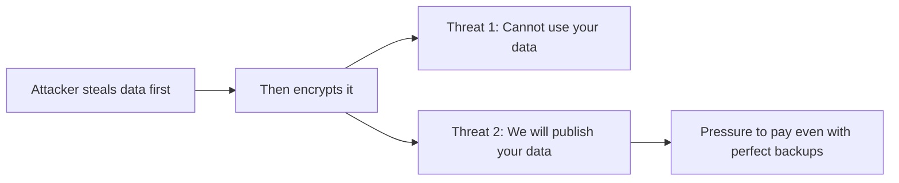
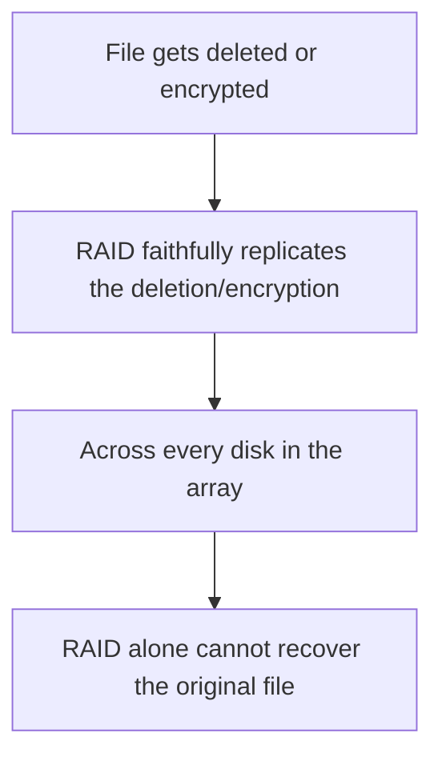
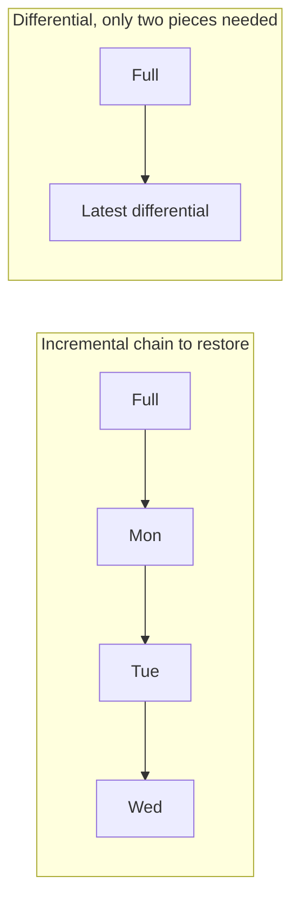
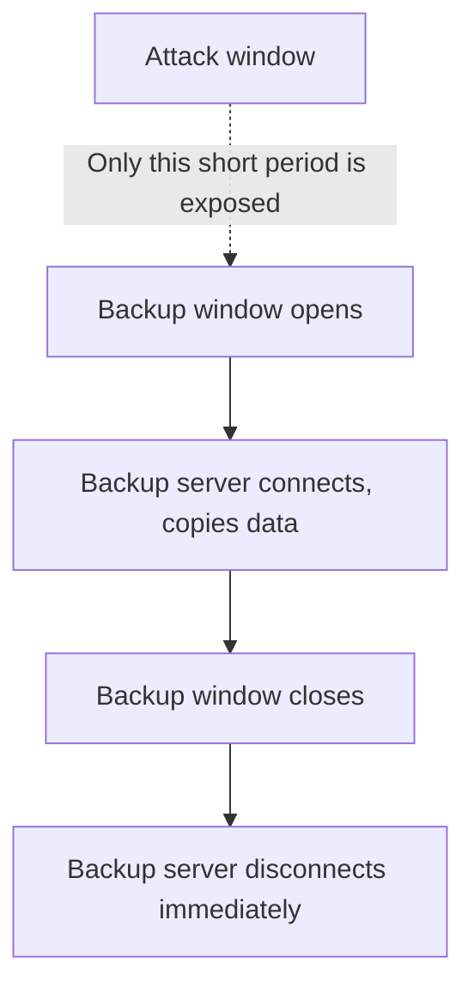
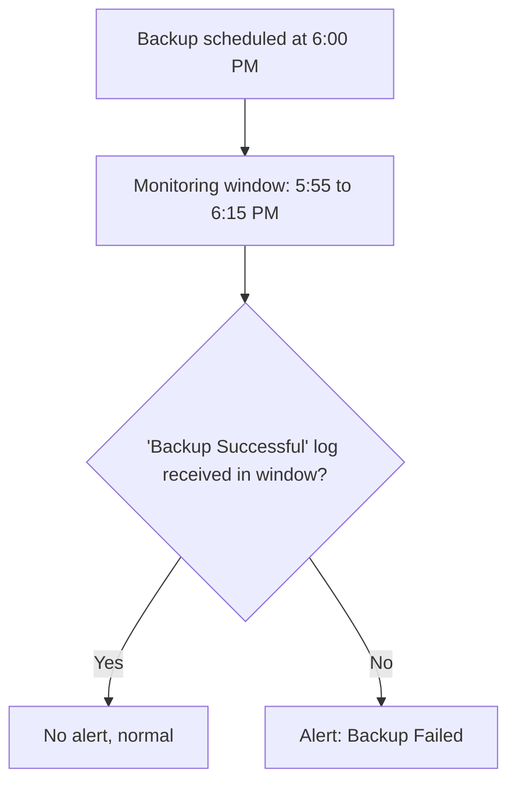

| Topic | Level | Reading Time | Prerequisites |
|---|---|---|---|
| Interview Questions Review: Ransomware and Backup Resilience | Intermediate | ~15 min | Ransomware and the LockBit Case Study, Redundancy High Availability and RAID, Backup Strategies and Data Recovery |

> **Goal of this section:**
> A quick question-and-answer review of the most important points you might be asked about in an interview on ransomware, RAID, and backups, as a practical summary of the concepts explained in detail in this category's files.

## Learning Objectives

By the end of this section, you will be able to:

- Answer, in your own words, the most common interview questions about ransomware business models and backup resilience.
- Explain the reasoning behind each answer, not just recite it, so you can adapt to follow-up questions.
- Identify which file in this category to revisit for deeper detail on any question you found difficult.

## Table of Contents

- [Learning Objectives](#learning-objectives)
- [Question 1: What Is Ransomware-as-a-Service](#question-1-what-is-ransomware-as-a-service)
- [Question 2: Why Is Double Extortion So Dangerous](#question-2-why-is-double-extortion-so-dangerous)
- [Question 3: RAID 5 Versus RAID 6, and Why RAID Is Not a Backup](#question-3-raid-5-versus-raid-6-and-why-raid-is-not-a-backup)
- [Question 4: Comparing Full, Incremental, and Differential Backups](#question-4-comparing-full-incremental-and-differential-backups)
- [Question 5: Why Backups Must Be Isolated, and the Dilemma](#question-5-why-backups-must-be-isolated-and-the-dilemma)
- [Question 6: How Would You Know If Last Night's Backup Failed](#question-6-how-would-you-know-if-last-nights-backup-failed)
- [Quick Reference Table](#quick-reference-table)
- [Career Path Connections](#career-path-connections)
- [Summary](#summary)

## Question 1: What Is Ransomware-as-a-Service

**Question: What is Ransomware-as-a-Service (RaaS)? Give an example.**

**Model answer:**

**RaaS** is a **criminal business model** in which developers write the ransomware and lease it to **affiliates**, who are the ones who actually carry out the attacks. The ransom is split between them.

- The developers are usually **skilled at writing code**.
- The affiliates are usually **skilled at breaching networks**.

**Example: LockBit.**

> [!TIP]
> If asked to connect this to familiar terms, point out that "as a service" is the same idea as SaaS or IaaS in the cloud world: you receive a ready-made product instead of building it yourself. RaaS applies that exact business model to crime.

For full details, see the **Ransomware and the LockBit Case Study** file.

## Question 2: Why Is Double Extortion So Dangerous

**Question: Why is double extortion so dangerous?**

**Model answer:**

- **Single extortion**: The attacker only encrypts. If the victim has good backups, they can restore and refuse to pay.
- **Double extortion**: The attacker **steals the data first, then encrypts it**. Now there are **two separate threats**: you can't use your data, and they will publish it.

Even a victim with **excellent backups** may pay to prevent a public leak. The leak can also put them in **legal trouble**, because exposing customer data can mean fines from regulators (such as under GDPR).

> [!IMPORTANT]
> This single fact, that good backups alone no longer guarantee a ransomware victim can refuse payment, is why modern ransomware defense combines backup resilience with data-exfiltration detection, not either one alone.

For full details, see the **Ransomware and the LockBit Case Study** file.

## Question 3: RAID 5 Versus RAID 6, and Why RAID Is Not a Backup

**Question: What is the difference between RAID 5 and RAID 6? And why is RAID not a backup?**

**Model answer:**

| Aspect | RAID 5 | RAID 6 |
|---|---|---|
| Method | Striping + single parity | Striping + double parity |
| Minimum disks | 3 | 4 |
| Disk failures survived | 1 | 2 |
| Typical use | Very common in company servers | Data with zero tolerance for failure |

**Why RAID is not a backup:**

RAID protects you from **a physical disk failure**, not from **deletion, ransomware, or fire**. If a file is deleted or encrypted, RAID **faithfully replicates that deletion or encryption across all the disks**. You need real, separate backups.

> [!TIP]
> A clean way to phrase this in an interview: "RAID protects against hardware failure; backups protect against data loss events. They solve two completely different problems, and you need both."

For full details, see the **Redundancy, High Availability, and RAID** file.

## Question 4: Comparing Full, Incremental, and Differential Backups

**Question: Compare full, incremental, and differential backups.**

**Model answer:**

| Aspect | Full | Incremental | Differential |
|---|---|---|---|
| Backup speed | Slowest | Fastest | Medium |
| Storage | Largest | Smallest | Medium |
| Restore speed | Fastest | Slowest | Medium |
| Restore needs | A single copy | Full + all the incrementals in order | Full + only the latest differential |

- **Full**: A complete copy of everything.
- **Incremental**: Only what changed since **the last backup of any type**.
- **Differential**: Everything that changed since **the last full backup**, so it grows day by day.

> [!WARNING]
> The classic follow-up question: "what happens if Tuesday's incremental backup is corrupted?" The answer is that the entire incremental chain breaks from that point forward, meaning you cannot restore Wednesday either. This single weakness is why many organizations prefer differential backups despite the extra storage cost.

For full details, see the **Backup Strategies and Data Recovery** file.

## Question 5: Why Backups Must Be Isolated, and the Dilemma

**Question: Why must backups be isolated? And what is the dilemma?**

**Model answer:**

Ransomware spreads across the network and looks for backups **to encrypt or delete them first**. If the backup server is on the same compromised network, **it is lost along with it**.

**The dilemma:** The backup server **has to connect to the network** to copy the data, but that permanent connection **cancels out its value** as an independent layer of protection.

**The solution:** Connect it **only during the scheduled backup window**, then disconnect it **immediately**.

> [!WARNING]
> A skilled attacker can wait inside a network specifically for the backup connection to open, then infect the backup files during that window. Monitoring the network carefully during the connection window is just as important as the disconnect-after rule itself.

For full details, see the **Backup Strategies and Data Recovery** file.

## Question 6: How Would You Know If Last Night's Backup Failed

**Question: How would you know if last night's backup failed?**

**Model answer (a practical scenario):**

The scenario: The backup runs every day at 6:00 PM. The backup team doesn't work 24/7, but the SOC does. The backup system sends a log such as "Backup Successful".

**The steps:**

- Send only the necessary logs to the SIEM (not everything; the backup system can produce millions of logs per hour).
- Create a rule based on **the absence of a log**: if no "Backup Successful" log arrives between 5:55 and 6:15 PM, raise an alert called "Backup Failed".
- Have the window start a little early and end a little late to account for any small timing differences.

> [!TIP]
> This kind of rule, "an expected event did NOT happen", is a distinct and very useful SOC detection pattern, different from the usual "a bad event DID happen" alert logic. It is worth naming explicitly in an interview as a technique you understand.

For full details, see the **Backup Strategies and Data Recovery** file.

## Quick Reference Table

| # | Question | One-Line Answer |
|---|---|---|
| 1 | What is RaaS? | A criminal business model: developers lease ransomware to affiliates, profits split; example: LockBit |
| 2 | Why is double extortion dangerous? | Two independent threats (data unusable + public leak) defeat even good backups |
| 3 | RAID 5 vs RAID 6, and RAID vs backup | RAID 6 survives two disk failures vs one; RAID protects against hardware failure only, not deletion or ransomware |
| 4 | Full vs incremental vs differential | Trade-off between backup speed, storage, and restore speed/complexity |
| 5 | Why isolate backups? | Ransomware targets backups on the same network; the fix is connect-only-during-window, then disconnect |
| 6 | Detecting a failed backup | Alert on the absence of an expected "Backup Successful" log within a defined time window |

## Career Path Connections

| Career Path | How This Topic Applies |
|---|---|
| SOC Analyst | These exact questions reflect real incident response and monitoring scenarios for ransomware and backup health |
| Penetration Tester | Understanding RaaS and extortion models informs realistic ransomware simulation during authorized red team engagements |
| GRC | Backup isolation and verification policies are standard, auditable business continuity requirements |
| Cloud Security | Cloud-native backup and redundancy services implement the same 3-2-1 and isolation principles |

## Summary

- **RaaS is a criminal business model, mirroring SaaS/IaaS:** developers write, affiliates deploy, profits split.
- **Double extortion defeats "just restore from backup":** two independent threats pressure the victim even when they have excellent backups.
- **RAID and backups solve different problems entirely:** RAID is for hardware failure, backups are for the loss of the data itself.
- **Each backup type trades speed, storage, and restore complexity differently:** incremental is faster to take and slower to restore, while differential is roughly the opposite.
- **Backup isolation requires a deliberate connect-disconnect cycle:** a permanent connection cancels out the value of isolation.
- **"Expected event did not happen" is a distinct, valuable detection pattern:** very useful for monitoring any scheduled process, not just backups.

